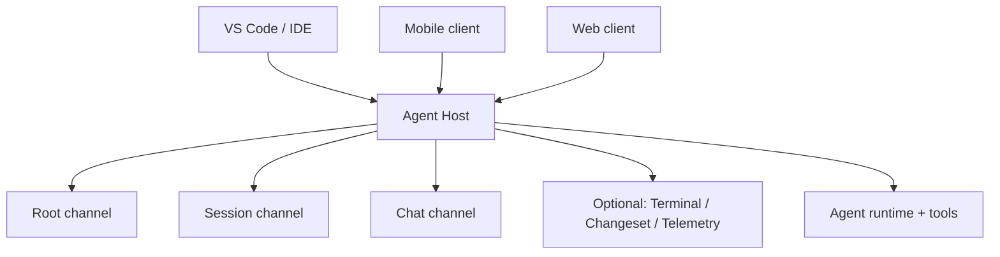

فرض کن یک ایجنت کدنویسی را روی لپ‌تاپ راه انداخته‌ای. وسط کار از خانه بیرون می‌روی و می‌خواهی با گوشی ببینی چه تغییری داده، یک درخواست دسترسی را تأیید کنی و بعد پشت سیستم دیگری ادامه بدهی. اگر تمام وضعیت ایجنت فقط داخل حافظهٔ یک پنجرهٔ IDE باشد، این تجربه به‌سادگی کار نمی‌کند.

مسئله فقط ذخیره‌کردن تاریخچهٔ چت نیست. باید وضعیت اجرای ابزارها، پیام‌ها، تغییرات فایل‌ها، تأییدهای کاربر و چند کلاینت هم‌زمان را با هم هماهنگ کنیم. این دقیقاً مسئله‌ای است که **Agent Host Protocol (AHP)** می‌خواهد برایش یک قرارداد مشترک تعریف کند.

GitHub در [۱۷ نوامبر ۲۰۲۶](https://github.blog/engineering/engineering-principles/building-the-agent-host-protocol-for-sessions-that-continue-across-devices/) دربارهٔ طراحی و استفاده از این پروتکل در VS Code و تجربه‌های Copilot نوشت. مشخصات و پیاده‌سازی‌های آن هم در [مخزن متن‌باز Microsoft](https://github.com/microsoft/agent-host-protocol) قرار دارند. این نوشته دربارهٔ معماری است، نه معرفی یک مدل زبانی تازه.

## مشکل اصلی: نشست با پنجرهٔ برنامه یکی نیست

در یک طراحی ساده، UI هم درخواست را می‌فرستد، هم خروجی را نگه می‌دارد و هم فرض می‌کند تا پایان کار باز می‌ماند. اما وقتی ایجنت چند دقیقه یا چند ساعت کار می‌کند، این فرض‌ها می‌شکنند:

- کاربر پنجره را می‌بندد یا اتصالش قطع می‌شود.
- گوشی و IDE هم‌زمان به یک نشست وصل می‌شوند.
- یک کلاینت تأیید ابزار را می‌فرستد و دیگری هنوز وضعیت قدیمی را نشان می‌دهد.
- خروجی ترمینال یا Diff بزرگ‌تر از آن است که در هر رویداد دوباره ارسال شود.

AHP بین **Client** (مثل IDE یا اپ موبایل)، **Host** (سرویسی که نشست را نگه می‌دارد) و خود **Agent Runtime** مرز می‌گذارد. کلاینت لازم نیست جزئیات داخلی هر ایجنت را بشناسد؛ با نمای مشترکی از نشست حرف می‌زند.

## معماری AHP در یک نگاه



طبق [راهنمای رسمی AHP](https://microsoft.github.io/agent-host-protocol/guide/what-is-ahp)، واحد اصلی تعامل یک **Channel** است: منبعی با شناسهٔ URI که کلاینت می‌تواند در آن مشترک شود. کانال‌های Root، Session و Chat هستهٔ پروتکل‌اند؛ قابلیت‌هایی مثل Terminal، Changeset یا Telemetry از طریق کانال‌های دیگر ارائه می‌شوند.

این تفکیک مهم است: فهرست نشست‌ها لازم نیست با هر تغییر کوچک در خروجی ترمینال دوباره بارگیری شود. کلاینت فقط به بخش‌هایی مشترک می‌شود که واقعاً نیاز دارد.

## Snapshot، Action و Reducer چه نقشی دارند؟

به‌جای اینکه هر کلاینت یک کپی مستقل و غیرقابل‌اعتماد از وضعیت بسازد، Host مرجع نهایی وضعیت است. کلاینت ابتدا Snapshot می‌گیرد و سپس Actionهای مرتب‌شده را دریافت می‌کند. Reducer با اعمال هر Action روی وضعیت قبلی، وضعیت بعدی را می‌سازد.

این مثال **شبه‌کد آموزشی** است، نه API واقعی SDK:

```ts
type State = { messages: string[]; status: "idle" | "running" };
type Action =
  | { type: "message-added"; text: string }
  | { type: "status-changed"; status: State["status"] };

function reduce(state: State, action: Action): State {
  switch (action.type) {
    case "message-added":
      return { ...state, messages: [...state.messages, action.text] };
    case "status-changed":
      return { ...state, status: action.status };
  }
}
```

نکتهٔ اصلی کد، خالص بودن Reducer است: با ورودی یکسان، خروجی یکسان می‌دهد. در نتیجه کلاینت‌های مختلف می‌توانند جریان Actionهای یکسان را اعمال کنند و به یک نمای سازگار برسند. البته این ویژگی به‌تنهایی تضمین نمی‌کند که ابزار خارجی دوبار اجرا نشود؛ اجرای Side Effect به قرارداد و منطق Host وابسته است.

## وقتی اینترنت قطع می‌شود چه اتفاقی می‌افتد؟

فرض کن کاربر در گوشی پیامی می‌فرستد، اما قبل از دریافت تأیید، اتصال قطع می‌شود. یک UI خوش‌بینانه ممکن است پیام را فوراً نشان بدهد. اگر بعد از اتصال مجدد همان درخواست را بدون هماهنگی دوباره اجرا کنیم، احتمال تکرار عملیات وجود دارد.

AHP برای این وضعیت از **Write-ahead و Reconciliation** استفاده می‌کند: کلاینت Actionهای خودش را موقتاً ثبت می‌کند، Host ترتیب معتبر را تعیین می‌کند و کلاینت با پاسخ مرجع همگام می‌شود. این با صرفاً «Reconnect کردن WebSocket» فرق دارد؛ مسئلهٔ اصلی، سازگارکردن وضعیت است.

برای طراحی محصول خودمان، سه سناریو را جداگانه تست می‌کنیم:

1. اتصال قبل از رسیدن درخواست به Host قطع شود.
2. درخواست به Host برسد، اما پاسخ تأیید گم شود.
3. دو کلاینت هم‌زمان وضعیت یک نشست را تغییر بدهند.

در هر سه حالت باید مشخص باشد کدام تغییر پذیرفته شده، کدام هنوز در انتظار است و چه چیزی نیاز به تأیید مجدد دارد. **Exactly-once execution** را صرفاً از وجود AHP نتیجه نگیریم؛ عملیات حساس به Idempotency و کنترل مستقل نیاز دارند.

## چرا AHP با MCP یکی نیست؟

این سه نام زیاد کنار هم دیده می‌شوند، اما یک مسئله را حل نمی‌کنند:

| پروتکل | سؤال اصلی |
| --- | --- |
| **AHP** | کلاینت‌های مختلف چطور وضعیت یک نشست ایجنت را مشترک و هماهنگ ببینند؟ |
| **MCP** | ایجنت یا برنامه چطور به ابزارها و منابع بیرونی متصل شود؟ |
| **ACP** | یک کلاینت چطور با یک ایجنت تعامل کند؟ |

این مقایسه ساده‌سازی عمدی است. [مستندات معماری AHP](https://github.com/microsoft/agent-host-protocol/blob/main/docs/guide/doctrine.md) توضیح می‌دهد که AHP لایهٔ رو‌به‌کلاینت برای همگام‌سازی است و قرار نیست جای پروتکل‌های ارتباط با ایجنت در لایهٔ پایین‌تر را بگیرد.

مثلاً یک Host می‌تواند از MCP برای دسترسی ایجنت به GitHub یا دیتابیس استفاده کند، ولی از AHP برای نمایش وضعیت همان کار در گوشی و IDE کمک بگیرد. این دو نقش مکمل دارند.

## چند تصمیم معماری که ارزش دقت دارند

### ۱. مرجع وضعیت را روشن کنیم

اگر کلاینت و سرور هر دو بتوانند بدون قرارداد وضعیت نهایی را تعیین کنند، اختلاف دیر یا زود پیش می‌آید. در AHP، Host مرجع معتبر است. کلاینت می‌تواند خوش‌بینانه نمایش بدهد، اما باید امکان اصلاح وضعیت خودش را داشته باشد.

### ۲. داده‌های بزرگ را از رویدادها جدا کنیم

فرستادن کل خروجی ترمینال یا تصویر در هر Action هم پهنای باند را هدر می‌دهد و هم بازیابی را سخت می‌کند. AHP برای محتوای بزرگ به ارجاع و دریافت جداگانه تکیه دارد. این الگو در سیستم‌های غیرایجنتی هم مفید است: رویداد سبک، محتوای حجیم در ذخیره‌سازی مناسب.

### ۳. مجوز دیدن با مجوز اجراکردن فرق دارد

داشتن دسترسی خواندن یک نشست نباید خودکار به معنی اجازهٔ اجرای دستور Shell یا تأیید یک ابزار حساس باشد. این **توصیهٔ طراحی امنیتی** است، نه ادعای اینکه AHP تمام سیاست‌های مجوزدهی محصول را آماده پیاده کرده. Host باید هویت، مجوز هر Action، انقضای نشست و Audit Log را خودش جدی بگیرد.

### ۴. سازگاری نسخه‌ها را آزمایش کنیم

پروتکل و SDKها نسخه‌بندی دارند. در [انتشار مشخصات 1.1.0 در نوامبر ۲۰۲۶](https://github.com/microsoft/agent-host-protocol/releases) قابلیت‌هایی مثل متادیتای بیشتر و انواع آزمایشی Flow Control اضافه شدند. بنابراین هنگام ساخت کلاینت نباید فرض کنیم هر Host از تمام قابلیت‌های اختیاری پشتیبانی می‌کند؛ Capability و نسخهٔ مذاکره‌شده را بررسی کنیم.

## اگر بخواهیم خودمان نمونه بسازیم

من برای یک Proof of Concept کوچک، به‌جای ساخت یک ایجنت کامل، ابتدا فقط همگام‌سازی را امتحان می‌کنم:

1. یک Host ساده با یک نشست و یک Chat راه بیندازیم.
2. دو کلاینت به همان نشست وصل کنیم.
3. پیام و تغییر وضعیت را به شکل Action ردوبدل کنیم.
4. اتصال یکی را قطع کنیم و بعد از برگشت، Snapshot و رویدادهای جدید را تطبیق بدهیم.
5. سناریوی ارسال تکراری، تأیید ابزار و دسترسی غیرمجاز را تست کنیم.

برای پیاده‌سازی واقعی بهتر است از [SDKها و نمونه‌های رسمی مخزن](https://github.com/microsoft/agent-host-protocol) شروع کنیم، نه اینکه از روی شبه‌کد بالا یک پروتکل ناسازگار بسازیم. این آزمایش کمک می‌کند قبل از انتخاب زیرساخت، بفهمیم مسئلهٔ ما واقعاً چندکلاینتی است یا فقط به یک API سادهٔ ذخیرهٔ گفتگو نیاز داریم.

## آیا الان باید به AHP مهاجرت کنیم؟

اگر یک ابزار شخصی داریم که فقط در یک پنجره اجرا می‌شود، احتمالاً نه. اضافه‌کردن Host مستقل، مدیریت نشست و همگام‌سازی هزینهٔ عملیاتی دارد.

اما اگر محصولمان چند کلاینت، ایجنت‌های طولانی‌مدت، اجرای محلی و ابری یا تأیید عملیات از دستگاه دیگر دارد، AHP ارزش بررسی جدی دارد. مهم‌ترین ایده‌اش برای من این است که **طول عمر نشست را از طول عمر رابط کاربری جدا کنیم**. حتی اگر از خود پروتکل استفاده نکنیم، همین مرزبندی می‌تواند طراحی سیستم را بهتر کند.

---

## منابع و مطالعهٔ بیشتر

- [GitHub Engineering — Building the Agent Host Protocol for sessions that continue across devices (17 Nov 2026)](https://github.blog/engineering/engineering-principles/building-the-agent-host-protocol-for-sessions-that-continue-across-devices/)
- [Agent Host Protocol — راهنمای رسمی مفاهیم](https://microsoft.github.io/agent-host-protocol/guide/what-is-ahp)
- [مخزن متن‌باز microsoft/agent-host-protocol](https://github.com/microsoft/agent-host-protocol)
- [مشخصات رسمی و کانال‌ها](https://microsoft.github.io/agent-host-protocol/specification/overview.html)
- [انتشارها و تغییرات نسخه‌ها](https://github.com/microsoft/agent-host-protocol/releases)

**یادداشت منابع:** انتخاب موضوع بر اساس گزارش تازهٔ GitHub Engineering و فعالیت مخزن رسمی انجام شده؛ رتبهٔ مشخصی در Google Trends برای این موضوع مستقلاً تأیید نشده است.
