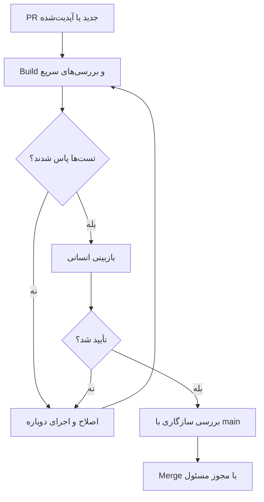
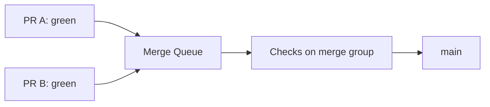

فرض کن صبح لپ‌تاپ رو باز می‌کنی و می‌بینی پنج تا Pull Request منتظر بررسی‌ان. تا همین چند وقت پیش، نوشتن هرکدوم از این تغییرها شاید نصف روز وقت می‌گرفت. حالا یک ایجنت می‌تونه بخش زیادی از کار رو انجام بده، تست اولیه بنویسه و PR رو تحویل بده.

خبر خوب اینه که ساختن تغییر راحت‌تر شده. خبر نه‌چندان خوب؟ **بررسی کردن، تست گرفتن و با خیال راحت Merge کردن لزوماً راحت‌تر نشده.**

اگر تیم ما در روز دو برابر PR تولید کنه ولی CI همچنان کند و نامطمئن باشه، فقط صف انتظار رو بزرگ‌تر کردیم. برای همین می‌خوام این بار به‌جای اینکه دربارهٔ بهتر پرامپت نوشتن حرف بزنیم، سراغ بخش کمتر جذاب اما مهم ماجرا بریم: **چطور یک مسیر قابل‌اعتماد از PR تا Merge بسازیم؟**

## چرا الان باید دربارهٔ این موضوع حرف بزنیم؟

گزارش [Octoverse 2026 گیت‌هاب](https://github.blog/news-insights/octoverse/octoverse-commits-pushes-reach-new-highs-in-2026-as-developers-build-with-agents/) در ۲۸ اکتبر منتشر شد. طبق این گزارش، در سپتامبر ۲۰۲۶ بیش از ۴۰ درصد Pull Requestهای شناسایی‌شده در گیت‌هاب با پیش‌نویس اولیهٔ یک ایجنت شروع شده‌اند؛ این سهم در مارس ۱۷ درصد بوده.

این عدد یک نکتهٔ مهم داره: **منظور همهٔ کدهای نوشته‌شده با هوش مصنوعی نیست.** گیت‌هاب فقط مشارکت ایجنت‌هایی رو می‌شمره که می‌تونه تشخیص بده. ضمن اینکه «ایجنت پیش‌نویس اولیه رو ساخته» با «ایجنت بدون نظارت انسانی تغییر رو تأیید کرده» یکی نیست.

همین گزارش برای بازهٔ یک‌سالهٔ منتهی به ۳۰ سپتامبر ۲۰۲۶، حدود ۴۵٫۴ میلیارد اجرای job در GitHub Actions و ۱٫۳ میلیارد Pull Request ادغام‌شده رو ثبت کرده. این‌ها آمار کل پلتفرمن، نه نرخ رشد یک تیم مشخص؛ ولی نشون می‌دن چرا زیرساخت بررسی تغییرات اهمیت بیشتری پیدا کرده.

در [فهرست ترندهای GitHub در ۳۰ اکتبر](https://ageshio.dev/) هم ابزارهای مرتبط با توسعهٔ ایجنتی، از جمله `obra/superpowers` و `JetBrains/thinkrail`، دیده می‌شن. این فهرست یک سیگنال توجه جامعه‌ست، نه اثبات اینکه هر تیمی باید همین ابزارها رو نصب کنه. برای Google Trends هم در این مقاله عدد یا رتبه‌ای ادعا نمی‌کنم؛ دادهٔ قابل‌استناد مستقلی برای آن تأیید نکرده‌ام.

## مشکل واقعی: سرعت تولید کد با سرعت اطمینان پیدا کردن فرق داره

یک مثال بزنیم. فرض کن در سرویس پرداخت، ایجنتی منطق محاسبهٔ کارمزد رو تغییر داده. کد تمیزه، TypeScript خطا نمی‌ده و تست واحد هم پاس شده. اما در یک حالت مرزی، کارمزد دوبار محاسبه می‌شه.

CI قرار نیست تضمین کنه هیچ باگی وجود نداره. کارش اینه که قبل از رسیدن تغییر به شاخهٔ اصلی، یک‌سری **شواهد قابل تکرار** دربارهٔ کیفیت و سازگاری تغییر تولید کنه.

من این مسیر رو به چند سؤال تقسیم می‌کنم:

1. آیا پروژه با همین تغییر نصب و Build می‌شه؟
2. آیا قراردادهای موجود و تست‌های حساس هنوز برقرارن؟
3. آیا تغییر با آخرین وضعیت `main` سازگاره؟
4. آیا کد غیرقابل‌اعتماد می‌تونه به Secret یا دسترسی نوشتن برسه؟
5. اگر همه‌چیز سبز شد، چه کسی مسئول تأیید نهایی است؟

وقتی این سؤال‌ها روشن باشن، تعداد زیاد PR کمتر ترسناک می‌شه.

## یک مسیر ساده از PR تا Merge



این دیاگرام یک الگوی پیشنهادی‌ه. برای پروژهٔ کوچک شاید دو مرحلهٔ اول کافی باشن؛ برای یک سامانهٔ مالی، تست یکپارچگی و کنترل‌های امنیتی هم بهش اضافه می‌شن.

نکته‌ای که دوست دارم روش تأکید کنم اینه: **سبز بودن CI به‌معنی تأیید طراحی، امنیت یا منطق کسب‌وکار نیست.** یک تست فقط چیزی رو بررسی می‌کنه که براش نوشته‌ایم.

## اول یک Quality Gate کوچک و قابل‌اعتماد بسازیم

به‌عنوان مثال، یک پروژهٔ Astro رو در نظر بگیریم که با npm ساخته می‌شه. برای چنین پروژه‌ای، این Workflow نقطهٔ شروع قابل‌فهمیه:

```yaml
name: PR quality gate

on:
  pull_request:

permissions:
  contents: read

concurrency:
  group: pr-quality-${{ github.event.pull_request.number }}
  cancel-in-progress: true

jobs:
  build:
    runs-on: ubuntu-latest
    timeout-minutes: 15
    steps:
      - uses: actions/checkout@v4
      - uses: actions/setup-node@v4
        with:
          node-version: '24'
          cache: npm
      - run: npm ci
      - run: npm run build
```

این نمونه برای فهم ساختار نوشته شده، نه کپی کردن بدون بررسی در هر ریپوزیتوری. نسخهٔ Node باید با پروژه هماهنگ باشه و در محیط حساس بهتره اکشن‌ها رو به SHA کامل و بازبینی‌شده Pin کنیم، نه فقط یک تگ نسخه. اگر پروژه اسکریپت‌های lint، typecheck و test داره، اون‌ها هم باید به گیت کیفیت اضافه بشن.

چند تصمیم اینجا مهمه:

- `permissions: contents: read` دسترسی پیش‌فرض توکن این Workflow رو محدود می‌کنه.
- `npm ci` از Lockfile استفاده می‌کنه و برای نصب قابل‌تکرار در CI مناسب‌تر از نصب آزادانهٔ وابستگی‌هاست.
- `timeout-minutes` نمی‌ذاره یک job معیوب برای مدت نامحدود منابع بگیره.
- `concurrency` باعث می‌شه وقتی برای همان PR اجرای جدیدی شروع شد، اجرای قدیمی لغو بشه.

البته Concurrency رو باید با دقت طراحی کنیم. اگر چند Workflow متفاوت یک group مشترک داشته باشن، ممکنه ناخواسته اجرای همدیگه رو لغو کنن. همین‌طور نباید بدون فکر روی Deploy یا بررسی‌های Merge Queue همان سیاست لغو PR رو اعمال کنیم.

## چرا هر بار همهٔ تست‌ها رو اجرا نکنیم؟

وسوسهٔ طبیعی اینه که برای هر تغییر، همهٔ تست‌های پروژه رو اجرا کنیم. از نظر پوشش ظاهراً عالیه، اما وقتی مجموعهٔ تست‌ها بزرگ می‌شه، هزینه و زمان انتظار بالا می‌ره.

من معمولاً بررسی‌ها رو در دو لایه می‌بینم:

| لایه | چه چیزهایی؟ | هدف |
| --- | --- | --- |
| سریع و همیشگی | نصب، lint، typecheck، تست‌های واحد مهم، Build | بازخورد زودهنگام برای هر PR |
| عمیق و هدفمند | تست یکپارچگی، قرارداد API، E2E، اسکن‌های سنگین | بررسی ریسک‌هایی که تست سریع پوشش نمی‌ده |

این تقسیم‌بندی به این معنی نیست که تست عمیق رو حذف کنیم. باید مشخص کنیم **کدوم بررسی‌ها برای Merge اجباری‌اند** و کدوم‌ها می‌تونن در مرحلهٔ جدا یا بر اساس ریسک اجرا بشن.

یک تلهٔ مهم در GitHub Actions هم وجود داره: اگر Workflowای که Status Check اجباری تولید می‌کنه به‌خاطر فیلتر مسیر (`paths`) اصلاً اجرا نشه، Check ممکنه در حالت Pending بمونه و Merge رو مسدود کنه. پس برای چک‌های اجباری، بهتره خود Workflow همیشه اجرا بشه و تصمیم‌های شرطی رو در سطح Job با طراحی درست انجام بدیم؛ یا ساختار چک‌های اجباری رو طوری بچینیم که نتیجهٔ نهایی همیشه گزارش بشه.

این مورد در [مستندات Required Status Checks](https://docs.github.com/en/enterprise-cloud@latest/pull-requests/how-tos/merge-and-close-pull-requests/troubleshooting-required-status-checks) توضیح داده شده.

## یک مسئلهٔ کمتر دیده‌شده: PRها به‌تنهایی سبزن، کنار هم نه

فرض کن دو PR داریم. یکی امضای یک تابع رو عوض می‌کنه، دیگری هنوز از امضای قدیمی استفاده می‌کنه. هر دو موقع اجرا روی وضعیت قبلی `main` سبز می‌شن. اما بعد از Merge اولی، دومی ممکنه Build رو خراب کنه.

اینجا **Merge Queue** می‌تونه مفید باشه؛ مخصوصاً وقتی تعداد Mergeها زیاده. گیت‌هاب تغییرات صف رو روی وضعیت به‌روز شاخهٔ مقصد بررسی می‌کنه تا ناسازگاری‌هایی که در تست مستقل PR دیده نشده، قبل از ادغام مشخص بشن.



اما فعال کردن Merge Queue به‌تنهایی کافی نیست. اگر Required Checks با GitHub Actions اجرا می‌شن، Workflow مربوط باید رویداد `merge_group` رو هم پشتیبانی کنه:

```yaml
on:
  pull_request:
  merge_group:
    types: [checks_requested]
```

در غیر این صورت ممکنه Check لازم برای Merge Group اصلاً گزارش نشه و صف متوقف بمونه. این بخش رو حتماً با [راهنمای رسمی Merge Queue](https://docs.github.com/en/repositories/configuring-branches-and-merges-in-your-repository/configuring-pull-request-merges/managing-a-merge-queue) تطبیق بده.

Merge Queue برای هر پروژه‌ای ضروری نیست. اگر هفته‌ای دو PR داریم، شاید اضافه کردنش فقط پیچیدگی باشه. وقتی چند تیم هم‌زمان روی یک شاخهٔ شلوغ کار می‌کنن، ارزشش بیشتر می‌شه.

## ایجنت کدنویسی را با دسترسی CI اشتباه نگیریم

ایجنت می‌تونه یک PR پیشنهاد بده؛ اما این به معنی قابل‌اعتماد بودن کدی که پیشنهاد داده نیست. حتی اگر نویسندهٔ PR یک همکار شناخته‌شده باشه، وابستگی جدید یا اسکریپت نصب می‌تونه خطر ایجاد کنه.

یک تفاوت امنیتی مهم در GitHub Actions بین `pull_request` و `pull_request_target` وجود داره. اولی برای اجرای تست روی تغییرات PR معمولاً انتخاب مناسب‌تریه. دومی در زمینهٔ شاخهٔ مقصد اجرا می‌شه و ممکنه به دسترسی‌ها و Secretهای قدرتمندتری دسترسی داشته باشه.

**ترکیب خطرناک** اینه که با `pull_request_target`، کد PR غیرقابل‌اعتماد رو Checkout کنیم و بعد با Secretهای ریپوزیتوری اجراش کنیم. چنین الگویی می‌تونه راهی برای افشای Secret یا اجرای فرمان با دسترسی بالا باز کنه.

برای شروع این اصول رو رعایت کنیم:

- برای تست PR از رویداد `pull_request` و کمترین دسترسی لازم استفاده کنیم.
- Secretهای Deploy رو وارد Job بررسی کد غیرقابل‌اعتماد نکنیم.
- وابستگی‌ها، اسکریپت‌های نصب و اکشن‌های ثالث رو هم بخشی از سطح حمله حساب کنیم.
- Cache رو محل نگهداری رمز یا توکن نکنیم؛ دادهٔ بازیابی‌شده از Cache هم باید با احتیاط مصرف بشه.
- Deploy رو از Quality Gate جدا کنیم و برای محیط عملیاتی مجوزهای مستقل داشته باشیم.

جزئیات این خطرها در [راهنمای امنیتی pull_request_target](https://docs.github.com/en/actions/reference/security/securely-using-pull_request_target) و [مستندات امنیت Cache](https://docs.github.com/en/actions/concepts/workflows-and-actions/dependency-caching) آمده.

## اگر CI کند شد، دقیقاً چی رو اندازه بگیریم؟

صرفاً اینکه بگیم «پایپ‌لاین کنده» کمک زیادی نمی‌کنه. بهتره چند معیار مشخص داشته باشیم:

1. **زمان تا اولین نتیجهٔ مفید:** از Push تا اولین شکست قابل‌اقدام چند دقیقه طول می‌کشه؟
2. **زمان کل بررسی اجباری:** PR بعد از آخرین Commit چقدر منتظر Required Checks می‌مونه؟
3. **نرخ Flaky Test:** چند بار تست بدون تغییر کد یک‌بار سبز و بار دیگر قرمز می‌شه؟
4. **نرخ اجرای مجدد:** چند درصد Runها به‌خاطر خطای زیرساخت یا تست ناپایدار تکرار می‌شن؟
5. **هزینهٔ محاسباتی:** مجموع زمان Jobها و مصرف Runnerها برای هر تغییر چقدره؟

برای مثال، اگر Job نصب وابستگی ۶ دقیقه و تست واحد ۳۰ ثانیه طول می‌کشه، شاید بهینه‌سازی نصب مهم‌تر از موازی‌سازی تست‌ها باشه. اگر بیشتر زمان صرف انتظار در صف Runner می‌شه، مسئله با سریع‌تر کردن یک تست حل نمی‌شه.

**میانگین به‌تنهایی کافی نیست.** صدک ۹۵ زمان انتظار هم می‌تونه نشان بده بدترین تجربه‌های معمول تیم چقدر طول می‌کشن. این عدد رو کنار تعداد نمونه‌ها و تغییرات حجم کار بخونیم.

## Cache و اجرای موازی، همیشه جواب نیستن

Cache کردن وابستگی‌ها می‌تونه زمان نصب رو کم کنه، اما کلید نامناسب ممکنه باعث بازیابی دادهٔ قدیمی یا نامرتبط بشه. مهم‌تر اینکه Cache یک مرز امنیتی نیست. دادهٔ داخلش رو مثل ورودی قابل‌اعتمادِ قطعی فرض نکنیم.

اجرای موازی هم محدودیت داره. اگر چهار Job هم‌زمان اجرا کنیم، ممکنه زمان انتظار کاربر کم بشه، ولی مصرف کل Runnerها بیشتر بشه. پس باید **Latency و Cost رو با هم** بسنجیم.

برای پروژه‌های کوچک، به‌جای ساختن یک سیستم پیچیدهٔ تقسیم تست، اول از Lockfile، Cache استاندارد وابستگی‌ها و حذف کارهای تکراری شروع کنیم.

## یک پیشنهاد عملی برای ریپوزیتوری Astro

در یک سایت محتوایی مبتنی بر Astro، مسیر منطقی می‌تونه خیلی ساده باشه: هر PR یک Build داشته باشه، ساختار MDX و Frontmatter با Schema پروژه بررسی بشه و فقط بعد از تأیید انسانی تغییر وارد `main` بشه.

برای چنین سایتی لازم نیست از روز اول Kubernetes، Runner اختصاصی یا ده‌ها Job موازی داشته باشیم. بهتره اول مطمئن بشیم که یک Frontmatter نامعتبر، لینک شکستهٔ مهم یا خطای Build قبل از انتشار شناسایی می‌شه.

اگر بعدها حجم مشارکت بالا رفت، می‌تونیم سراغ بررسی‌های مرحله‌ای، گزارش مدت اجرای Jobها و در صورت نیاز Merge Queue بریم. **هدف معماری خوب، اضافه کردن ابزار بیشتر نیست؛ کم کردن ریسک با کمترین پیچیدگی لازمه.**

## از فردا چه تغییری بدیم؟

من برای شروع، این ترتیب رو انتخاب می‌کنم:

1. یک PR اخیر رو باز کنیم و ببینیم کدوم بررسی‌ها واقعاً جلوی خطای مهم رو می‌گیرن.
2. Required Checks رو مشخص کنیم و مطمئن بشیم هیچ‌کدوم ناخواسته Skip نمی‌شن.
3. سطح دسترسی Workflowهای PR و Deploy رو جدا بررسی کنیم.
4. زمان انتظار CI رو برای چند روز ثبت کنیم و بزرگ‌ترین گلوگاه رو پیدا کنیم.
5. فقط اگر شواهد نشون داد نیاز داریم، سراغ موازی‌سازی گسترده یا Merge Queue بریم.

این روزها تولید کد از همیشه راحت‌تر شده. اما **اعتماد به تغییر** هنوز چیزی نیست که با یک دکمه تولید بشه. ایجنت می‌تونه سرعت نوشتن رو بالا ببره؛ ما باید مسیر بررسی رو طوری طراحی کنیم که این سرعت به کیفیت ضربه نزنه.

---

## منابع و مطالعهٔ بیشتر

- [GitHub Octoverse 2026 — گزارش رسمی، ۲۸ اکتبر ۲۰۲۶](https://github.blog/news-insights/octoverse/octoverse-commits-pushes-reach-new-highs-in-2026-as-developers-build-with-agents/)
- [GitHub Docs — Control workflow concurrency](https://docs.github.com/en/actions/how-tos/write-workflows/choose-when-workflows-run/control-workflow-concurrency)
- [GitHub Docs — Required status checks](https://docs.github.com/en/repositories/configuring-branches-and-merges-in-your-repository/managing-rulesets/available-rules-for-rulesets)
- [GitHub Docs — Managing a merge queue](https://docs.github.com/en/repositories/configuring-branches-and-merges-in-your-repository/configuring-pull-request-merges/managing-a-merge-queue)
- [GitHub Docs — Securely using pull_request_target](https://docs.github.com/en/actions/reference/security/securely-using-pull_request_target)
- [GitHub Docs — Dependency caching and security](https://docs.github.com/en/actions/concepts/workflows-and-actions/dependency-caching)
- [GitHub Trending snapshot — ۳۰ اکتبر ۲۰۲۶](https://ageshio.dev/)
