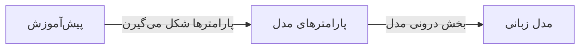
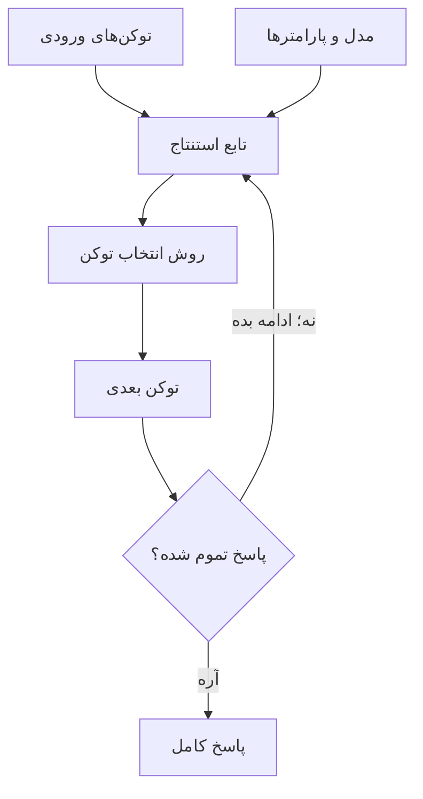
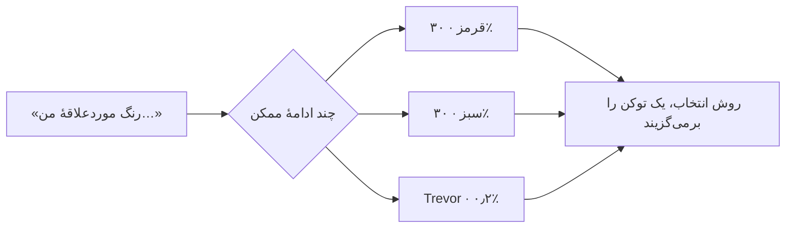
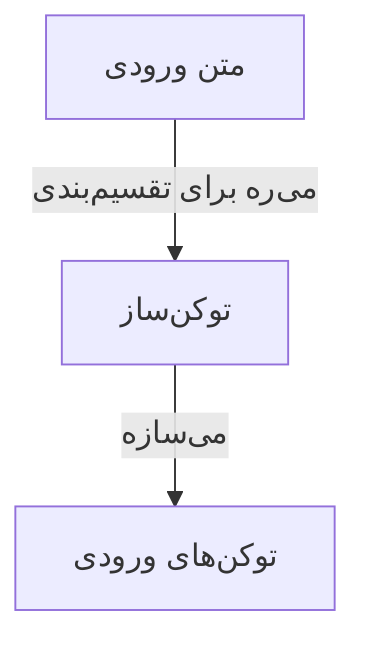
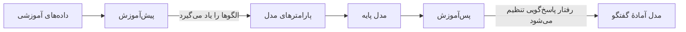
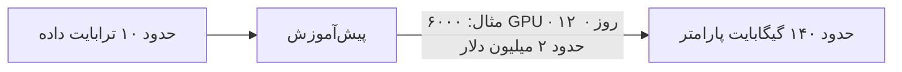
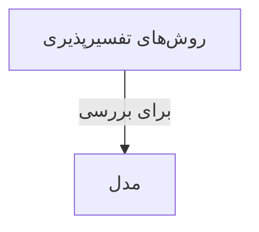

مدل‌های زبانی رو همه‌جا می‌بینیم: از چت‌بات‌ها گرفته تا ابزارهای برنامه‌نویسی. اگه بخوام خیلی ساده بگم، LLM برنامه‌ایه که با دیدن متن‌های زیاد، یاد می‌گیره کلمه‌ها و مفهوم‌ها معمولاً چطور کنار هم میان. بعد از همین الگوها استفاده می‌کنه تا جواب بسازه.

من اینجا می‌خوام تصویر کلی رو توضیح بدم؛ نه اینکه وارد فرمول‌های پیچیده بشم. با چند نمودار ساده، مسیر رو از آموزش مدل تا ساخت جواب مرور می‌کنیم.

## مدل زبانی بزرگ یعنی چی؟

مدل با متن‌های زیادی آموزش می‌بینه و نتیجهٔ این آموزش در تعداد زیادی عدد جا می‌گیره. به این عددها «پارامتر» یا «وزن مدل» می‌گن.

برای اینکه راحت‌تر تصورش کنیم، پارامترها رو مثل تنظیمات درونی مدل در نظر بگیریم. مدل متن‌ها رو مثل فایل یا پایگاه داده ذخیره نمی‌کنه تا بعداً جمله‌ها رو عیناً از توش پیدا کنه. پارامترها بیشتر کمک می‌کنن مدل الگوها و ارتباط‌ها رو یاد بگیره.

خلاصهٔ نمودار اینه: پیش‌آموزش پارامترها رو می‌سازه و این پارامترها رفتار مدل رو شکل می‌دن. این‌ها «مغز» به معنای واقعی کلمه نیستن؛ فقط یک تشبیه برای درک راحت‌تر موضوعه.

مدل بزرگ‌تر ممکنه توان بیشتری داشته باشه، اما معمولاً اجرای اون حافظه و قدرت پردازشی بیشتری می‌خواد. پس بزرگ‌تر بودن همیشه یعنی «بهتر برای همه‌چیز» نیست؛ باید دید برای چه کاری، با چه سرعت و هزینه‌ای لازم داریم.

## مدل چطور جواب می‌سازه؟

وقتی از یک مدل آماده سؤال می‌پرسیم، متن ورودی و پارامترهای مدل به بخشی می‌رسن که جواب رو تولید می‌کنه. این مرحله رو «استنتاج» می‌گن؛ یعنی استفاده از مدل آموزش‌دیده برای جواب دادن به یک ورودی تازه.

به زبان ساده، مدل هر بار ادامهٔ ممکن رو بررسی می‌کنه و یک توکن به جواب اضافه می‌کنه. همین چرخه تکرار می‌شه تا پاسخ کامل بشه. استفاده از مدل آماده معمولاً خیلی کم‌هزینه‌تر از آموزش‌دادن اون از صفره.

### مدل از بین چند جواب احتمالی انتخاب می‌کنه

فرض کن ورودی این باشه: «رنگ موردعلاقهٔ من…». مدل می‌تونه برای ادامه‌های مختلف احتمال‌های متفاوتی در نظر بگیره. این نمودار فقط چند گزینه رو نشون می‌ده؛ همهٔ گزینه‌های ممکن توش نیستن:

اون گزینهٔ عجیبِ آخر همون‌جاست که یادمون بمونه مدل فقط یک جواب از پیش آماده رو برنمی‌داره؛ بین چند ادامهٔ ممکن انتخاب می‌کنه. روش انتخاب می‌تونه روی جواب اثر بذاره و بعضی تنظیمات، مثل «دما»، میزان تنوع جواب‌ها رو تغییر می‌دن. این احتمال‌ها هم مثال ساده‌ان، نه عددهای ثابت برای همهٔ مدل‌ها.

## توکن چیه؟

مدل متن رو قبل از پردازش به بخش‌های کوچک‌تری به نام «توکن» تبدیل می‌کنه. توکن ممکنه یک کلمهٔ کامل باشه، اما می‌تونه فقط بخشی از یک کلمه یا یک نشانه مثل نقطه هم باشه. این تقسیم‌بندی برای هر مدل فرق می‌کنه.

یعنی متن اول تکه‌تکه می‌شه و بعد این تکه‌ها به شکل عددی به مدل می‌رسن. برای همین تعداد توکن‌ها با تعداد کلمه‌ها یکی نیست. تعدادشون روی مقدار متنی که مدل در هر نوبت می‌تونه بخونه اثر داره و در بعضی سرویس‌ها، هزینه هم با همین تعداد حساب می‌شه.

## مدل چطور آموزش می‌بینه؟

آموزش یک مدل بزرگ معمولاً دو بخش کلی داره:

1. **پیش‌آموزش:** مدل با داده‌های زیاد تمرین می‌کنه تا الگوهای زبان رو یاد بگیره.
2. **پس‌آموزش:** مدل با دستورها و نمونه‌های پاسخ تنظیم می‌شه تا بهتر به درخواست‌ها جواب بده.

پیش‌آموزش به مدل کمک می‌کنه الگوهای زبان رو یاد بگیره؛ پس‌آموزش کمک می‌کنه شکل جواب‌دادنش بهتر بشه. جزئیات واقعی در مدل‌های مختلف فرق می‌کنه، اما همین تصویر برای فهمیدن کلیت کافیه.

برای اینکه بزرگی کار دستمون بیاد، یک نمودار دیگه از مقیاس آموزش می‌بینیم. عددها فقط یک مثال تقریبی از متن اصلی‌ان؛ نسخهٔ ثابت یا برآورد امروزی برای ساخت هر مدل نیستن:

هزینه و زمان واقعی به اندازهٔ مدل، نوع سخت‌افزار و روش آموزش بستگی داره. پس بهتره این عددها رو فقط برای تصور مقیاس کار ببینیم، نه به‌عنوان قانون.

## می‌شه فهمید مدل چطور به جواب رسیده؟

پژوهشگرها سعی می‌کنن بخش‌هایی از کار مدل رو بررسی کنن. به این حوزه معمولاً «تفسیرپذیری» می‌گن:

این نمودار فقط می‌گه از روش‌های تفسیرپذیری برای بررسی مدل استفاده می‌کنیم؛ معنیش این نیست که همهٔ تصمیم‌های مدل رو کامل می‌فهمیم.

پژوهش‌ها گاهی سرنخ‌های جالبی پیدا می‌کنن؛ مثلاً اینکه بعضی مفهوم‌ها در زبان‌های مختلف به هم ربط دارن. اما هنوز نمی‌تونیم برای تک‌تک جواب‌ها دقیق بگیم داخل مدل چه اتفاقی افتاده. حتی توضیحی که خود مدل دربارهٔ دلیل جوابش می‌ده هم همیشه شرح دقیق روند درونی‌اش نیست.

## خلاصهٔ حرفم

LLM با پارامترهایی کار می‌کنه که در زمان آموزش شکل گرفتن. وقتی متنی بهش می‌دیم، اون متن به توکن تبدیل می‌شه و مدل با توجه به ورودی، قدم‌به‌قدم ادامهٔ متن رو می‌سازه.

برای استفاده از مدل لازم نیست همهٔ ریاضی پشتش رو بلد باشیم. همین که بدونیم چطور آموزش می‌بینه و جواب می‌سازه، کمک می‌کنه راحت‌تر بفهمیم چه کاری ازش برمیاد و کجا باید جوابش رو دوباره بررسی کنیم.

**منبع:** [What Is An LLM? — AI Hero](https://www.aihero.dev/what-is-an-llm)
