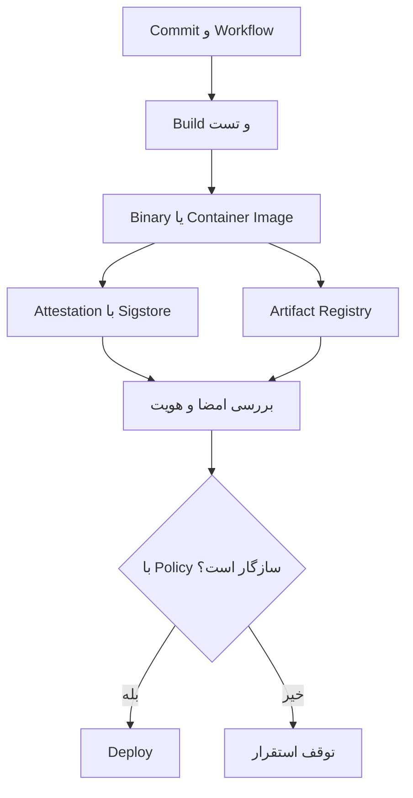

فرض کن یک سرویس پرداخت رو Build کردیم، تست‌ها سبز شدن و فایل اجرایی آماده‌ست. چند ساعت بعد همون فایل روی سرور نصب می‌شه. سؤال ساده‌ای دارم: **از کجا مطمئنیم چیزی که نصب شده واقعاً خروجی همون Workflow و همون Commit بوده؟**

جواب «چون فایل توی GitHub Actions ساخته شده» کافی نیست. ممکنه فایل در مسیر انتقال عوض شده باشه، کسی یک نسخهٔ قدیمی رو دوباره منتشر کرده باشه یا حتی به‌اشتباه خروجی یک Branch دیگه به محیط عملیاتی رسیده باشه.

اینجاست که **Artifact Attestations** به کار میاد: همراه خروجی Build، مدرکی قابل‌اعتبارسنجی تولید می‌کنیم که هویت سازنده، منشأ Build و هش خروجی رو به هم وصل می‌کنه. این قابلیت در GitHub Actions بر پایهٔ Sigstore و قالب‌های in-toto و SLSA ساخته شده. اما نکتهٔ مهم اینه که **امضاشدن یک فایل به معنی امن‌بودن کد داخلش نیست**.

## مشکل دقیقاً کجاست؟

یک Pipeline معمولی ممکنه این مراحل رو داشته باشه:

1. دریافت سورس از GitHub
2. نصب وابستگی‌ها و اجرای تست
3. ساخت Binary یا Image
4. آپلود Artifact
5. دانلود و استقرار روی سرور

بین مرحلهٔ سوم و پنجم یک مرز اعتماد داریم. هش فایل به‌تنهایی نشون می‌ده فایل عوض شده یا نه، ولی نمی‌گه **چه کسی و با چه Workflowی** اون هش رو تولید کرده. از طرف دیگه، اسم فایل مثل `payment-api-latest.tar.gz` هیچ تضمینی دربارهٔ محتواش نمی‌ده.

Attestation برای این شکاف طراحی شده: به‌جای اعتماد به اسم فایل یا توضیح شفاهی Pipeline، یک ادعای امضاشده دربارهٔ خروجی داریم.

## Attestation با امضای معمولی چه فرقی داره؟

در یک امضای دیجیتال ساده، می‌تونیم ثابت کنیم دارندهٔ یک کلید مشخص داده‌ای رو امضا کرده. اما در سیستم Build، سؤال فقط «چه کسی؟» نیست؛ «کدوم مخزن، Commit، Workflow و رویداد؟» هم مهمه.

GitHub از هویت کوتاه‌عمر مبتنی بر OIDC و گواهی Sigstore استفاده می‌کنه تا اطلاعات منشأ Build به امضا متصل بشه. طبق [مستندات GitHub](https://docs.github.com/en/actions/concepts/security/artifact-attestations)، این داده‌ها می‌تونن مخزن، Commit SHA، محیط و Workflow رو مشخص کنن.

سه اصطلاح رو جدا نگه داریم:

| اصطلاح | جواب چه سؤالی رو می‌ده؟ |
| --- | --- |
| Digest یا SHA-256 | آیا محتوای فایل با چیزی که انتظار داریم یکسانه؟ |
| Provenance | این خروجی در چه فرایند و با چه هویتی ساخته شده؟ |
| SBOM | چه مؤلفه‌ها و وابستگی‌هایی در محصول گزارش شده‌اند؟ |

SBOM جای Provenance رو نمی‌گیره. همین‌طور Provenance هم اسکن آسیب‌پذیری یا بررسی مجوز وابستگی‌ها نیست.

## جریان اعتماد از Build تا Deploy



این دیاگرام یک پیشنهاد معماریه، نه اینکه GitHub به‌صورت خودکار جلوی هر Deploy رو بگیره. **تا وقتی مرحلهٔ Verify و Policy Gate رو اضافه نکنیم، ساخت Attestation به‌تنهایی جلوی استقرار خروجی نامعتبر رو نمی‌گیره.**

## یک نمونهٔ واقعی با GitHub Actions

فرض کنیم یک برنامهٔ Go داریم که فایل `dist/payment-api` رو می‌سازه. نسخهٔ Action و ورودی‌های زیر مطابق [راهنمای رسمی actions/attest](https://github.com/actions/attest) هستند.

```yaml
name: build-release
on:
  push:
    tags:
      - "v*"

permissions:
  contents: read

jobs:
  release:
    runs-on: ubuntu-latest
    permissions:
      contents: read
      id-token: write
      attestations: write
    steps:
      - uses: actions/checkout@v4

      - uses: actions/setup-go@v5
        with:
          go-version-file: go.mod

      - name: Build
        run: |
          mkdir -p dist
          go build -trimpath -o dist/payment-api ./cmd/server

      - name: Attest provenance
        uses: actions/attest@v4
        with:
          subject-path: dist/payment-api

      - uses: actions/upload-artifact@v4
        with:
          name: payment-api
          path: dist/payment-api
```

این مثال عمداً کوتاهه. برای محیط حساس بهتره Actionها رو به Commit SHA مشخص Pin کنیم، نسخهٔ Go و وابستگی‌ها رو کنترل کنیم و مجوزهای Token رو محدود نگه داریم. اجرای Workflow روی Tag هم به‌تنهایی به معنی مجازبودن Release نیست؛ محافظت از Tagها و قواعد تأیید انتشار باید جداگانه تنظیم بشن.

**چرا `id-token: write` لازم داریم؟** برای گرفتن توکن OIDC که در فرایند صدور گواهی امضای کوتاه‌عمر استفاده می‌شه. `attestations: write` هم اجازهٔ ثبت Attestation رو می‌ده. این‌ها مجوزهای Job هستند؛ لازم نیست به همهٔ Jobهای مخزن داده بشن.

در برخی سناریوهای مرتبط با ثبت متادیتای Artifact، مجوز `artifact-metadata: write` هم مطرح می‌شه. جزئیات اون رو باید با [مستندات فعلی GitHub](https://docs.github.com/en/actions/how-tos/secure-your-work/use-artifact-attestations) و نوع Registry بررسی کنیم.

## بخش مهم‌تر: Verify در مقصد

اگر فقط Attestation بسازیم و هیچ‌وقت بررسیش نکنیم، عملاً یک مدرک تولید کردیم که کسی ازش استفاده نمی‌کنه.

برای فایل دانلودشده می‌شه از GitHub CLI استفاده کرد:

```bash
gh attestation verify ./payment-api \
  --repo YOUR_ORG/YOUR_REPO
```

برای محدودترکردن هویت مورداعتماد، می‌تونیم Workflow امضاکننده رو هم مشخص کنیم؛ گزینه‌های دقیق رو در [راهنمای gh attestation verify](https://cli.github.com/manual/gh_attestation_verify) ببین.

در یک سرویس واقعی من به «امضا معتبر بود» اکتفا نمی‌کنم. Policy استقرار باید دست‌کم این موارد رو بررسی کنه:

- مخزن تولیدکننده دقیقاً همون مخزن مجاز باشه.
- Workflow امضاکننده از مسیر موردانتظار اجرا شده باشه.
- Commit یا Release با نسخهٔ تأییدشدهٔ استقرار تطابق داشته باشه.
- Digest خروجی با فایل یا Image دریافتی برابر باشه.
- نتیجهٔ اعتبارسنجی ثبت بشه و شکست اون Deploy رو متوقف کنه.

نکتهٔ ظریف: اعتبارسنجی امضا لزوماً به معنی تأیید همهٔ این شرط‌های سازمانی نیست. بعضی شرط‌ها به استخراج و ارزیابی محتوای Provenance یا اتصال به سیستم Release Management نیاز دارن.

## وقتی اینترنت یا GitHub در دسترس نیست

برای زیرساختی که ممکنه از اینترنت بین‌الملل جدا بشه، این قسمت مهمه. GitHub CLI می‌تونه Attestation رو با Bundle محلی هم بررسی کنه. [مستندات GitHub](https://docs.github.com/en/actions/how-tos/secure-your-work/use-artifact-attestations) از Verify آفلاین پشتیبانی می‌کنن.

اما آفلاین‌بودن فقط یک سوییچ نیست. باید **پیش از قطع ارتباط**، فایل خروجی، Bundle مربوط، Policy و داده‌های لازم برای اعتماد به هویت رو به محیط مقصد منتقل کنیم. روش نگهداری و اعتبارسنجی گواهی و وضعیت اعتماد باید از قبل آزمایش شده باشه.

```bash
gh attestation verify ./payment-api \
  --repo YOUR_ORG/YOUR_REPO \
  --bundle ./payment-api-attestation.json
```

این دستور یک الگوی آموزشی برای استفاده از Bundle دانلودشده‌ست؛ نام فایل Bundle رو باید با خروجی واقعی فرایند دریافت تنظیم کنیم. یک محدودیت مهم هم وجود داره: در حالت Bundle محلی، بررسی نام مخزن به اطلاعات ثبت‌شده در گواهی متکیه و نمی‌تونه تغییر مالکیت یا نام مخزن در GitHub رو به‌صورت زنده تشخیص بده.

برای محیط‌های بانکی بهتره از قبل مشخص کنیم در زمان قطعی چه چیزی مجاز به استقرار است: فقط نسخه‌های از پیش تأییدشده؟ آخرین Release معتبر؟ یا توقف کامل انتشار؟ این یک تصمیم امنیتی و عملیاتی مشترکه.

## Artifact Attestations و SLSA

[SLSA](https://slsa.dev/) چارچوبی برای سنجش بلوغ امنیت زنجیرهٔ تأمین نرم‌افزاره. طبق توضیح GitHub، Artifact Attestations به‌تنهایی می‌تونه بخشی از الزامات **SLSA Build Level 2** رو پوشش بده؛ استفاده از Reusable Workflow با شرایط مشخص می‌تونه مسیر رسیدن به **Build Level 3** رو هموار کنه.

ولی نباید صرفاً با اضافه‌کردن یک Step ادعا کنیم کل سیستم «SLSA 3» شده. سطح انطباق به طراحی Build، ایزولاسیون، کنترل ورودی‌ها و شواهد اجرای واقعی وابسته‌ست.

برای چندین تیم، Reusable Workflow یک مزیت عملی هم داره: به‌جای اینکه هر تیم فرایند Build و امضای خودش رو از صفر بسازه، یک مسیر استاندارد و قابل‌ممیزی داریم. البته تغییر خود اون Workflow مشترک هم باید تحت کنترل و بازبینی باشه.

## چه چیزی رو امضا کنیم؟

همه‌چیز ارزش Attestation نداره. توصیهٔ GitHub اینه که روی خروجی‌هایی تمرکز کنیم که واقعاً قراره مصرف یا اجرا بشن: Binary، Package، Container Image یا Manifest مرتبط با Release.

امضاکردن تک‌تک فایل‌های سورس یا هر Build موقت تستی معمولاً ارزش عملی کمی داره. اگر Pipeline روزانه هزاران اجرای آزمایشی داره، اول مرز «خروجی قابل‌انتشار» رو مشخص کنیم.

برای Container Image بهتره به Digest غیرقابل‌تغییر ارجاع بدیم، نه صرفاً Tagی مثل `latest`. Tag ممکنه به Image دیگری اشاره کنه؛ Digest هویت محتوای مشخصی رو نگه می‌داره.

## تهدیدهایی که همچنان باقی می‌مونن

Attestation راه‌حل همهٔ حمله‌های زنجیرهٔ تأمین نیست:

| تهدید | آیا Attestation به‌تنهایی حلش می‌کنه؟ |
| --- | --- |
| جابه‌جایی فایل بعد از Build | با Verify و Policy درست، قابل‌شناساییه |
| وابستگی آلوده در زمان Build | نه؛ به کنترل وابستگی و اسکن نیاز داریم |
| Workflow مخرب اما مجاز | نه؛ باید Workflow و دسترسی‌ها رو محافظت کنیم |
| کد آسیب‌پذیر در Commit معتبر | نه؛ تست و تحلیل امنیتی لازمه |
| استقرار نسخهٔ معتبر ولی قدیمی | نه؛ باید سیاست نسخه و جلوگیری از Rollback ناخواسته داشته باشیم |
| دست‌کاری خروجی بدون اجرای Verify | نه؛ اصلاً کنترلی اعمال نشده |

این تفاوت برای طراحی امنیت مهمه. ما داریم **منشأ و تمامیت خروجی** رو بررسی می‌کنیم، نه درست‌بودن تمام رفتارهای برنامه رو.

## پیشنهاد پیاده‌سازی مرحله‌ای

برای شروع لازم نیست تمام معماری انتشار رو عوض کنیم.

**مرحلهٔ اول — شناخت خروجی:** مشخص کنیم کدوم Binaryها، Imageها و Packageها به Production می‌رن و الان چه کسی مسئول تأییدشونه.

**مرحلهٔ دوم — تولید Provenance:** فقط برای Releaseهای واقعی Attestation بسازیم. هم‌زمان هش خروجی و Commit رو در گزارش انتشار ثبت کنیم.

**مرحلهٔ سوم — Verify در محیط آزمایشی:** عمداً یک فایل تغییرکرده، یک Artifact از مخزن دیگه و یک نسخهٔ قدیمی رو امتحان کنیم. باید ببینیم Policy کجا رد می‌کنه و کجا هنوز خلأ داره.

**مرحلهٔ چهارم — کنترل اجباری استقرار:** Deploy رو به Verify موفق و تأیید نسخه وابسته کنیم؛ خطای سرویس اعتبارسنجی نباید بی‌سروصدا به «اجازهٔ استقرار» تبدیل بشه.

**مرحلهٔ پنجم — مانور قطعی ارتباط:** اگر زیرساخت مقصد به GitHub دسترسی نداره، Bundle و فایل‌ها رو آفلاین اعتبارسنجی کنیم و نتیجه رو در گزارش Release نگه داریم.

برای سنجش نتیجه، سه معیار ساده خوبن: درصد Releaseهایی که Provenance معتبر دارن، درصد Deployهایی که واقعاً Verify می‌شن و تعداد دفعاتی که Policy جلوی Artifact نامعتبر رو گرفته.

## جمع‌بندی

Artifact Attestations یک جواب فنی به سؤال مهمی می‌ده: «این فایل دقیقاً از کجا اومده و چطور ساخته شده؟» ولی ارزش اصلیش وقتی معلوم می‌شه که در **سمت مصرف‌کننده** هم بررسی انجام بدیم.

اگر بخوام فقط یک اصل رو نگه دارم، اینه: **به خروجی Build به خاطر محل نگهداریش اعتماد نکنیم؛ منشأ، هویت سازنده و محتوای همون خروجی رو در زمان استقرار بررسی کنیم.**

### منابع و مطالعهٔ بیشتر

- [GitHub Docs — Artifact Attestations](https://docs.github.com/en/actions/concepts/security/artifact-attestations)
- [GitHub Docs — Using Artifact Attestations](https://docs.github.com/en/actions/how-tos/secure-your-work/use-artifact-attestations)
- [actions/attest — README و نمونهٔ Workflow](https://github.com/actions/attest)
- [GitHub CLI — gh attestation verify](https://cli.github.com/manual/gh_attestation_verify)
- [SLSA Framework — Specification](https://slsa.dev/spec/)
- [Sigstore — Documentation](https://docs.sigstore.dev/)
