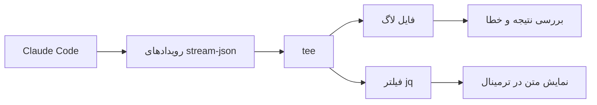

فرض کن یک ایجنت کدنویسی رو گذاشتی روی چند تا تسک کار کنه. ده دقیقه گذشته، ترمینال هنوز چیزی نشون نمی‌ده و نمی‌دونی داره تست اجرا می‌کنه، منتظر دسترسی مونده یا اصلاً جایی گیر کرده. اولین وسوسه اینه که اجرا رو قطع کنیم و دوباره از اول شروع کنیم؛ در حالی که شاید ایجنت درست وسط کار باشه.

این مشکل مخصوص مدل زبانی نیست؛ مشکل **دیدن وضعیت اجرای یک فرایند طولانی**ه. برای حلش لازم نیست یک داشبورد کامل بسازیم. می‌تونیم خروجی ساختاریافتهٔ Claude Code رو بگیریم، قسمت‌های مهمش رو همون لحظه نمایش بدیم و نتیجهٔ نهایی رو جداگانه بررسی کنیم.

اگر هنوز با Ralph آشنا نیستی، اول مقالهٔ [رالف چیست و چطور کار می‌کند؟](../ralph-ai-coding-loop-fa/) رو بخون. اینجا فرض می‌کنیم یک تسک و یک دستور اجرای ایجنت داریم و می‌خوایم بفهمیم وسط اجرا چه خبره.

## چرا با اجرای معمولی چیزی نمی‌بینیم؟

وقتی Claude Code رو در حالت غیرتعاملی با `claude -p` اجرا می‌کنیم، معمولاً خروجی متنی نهایی رو بعد از تمام شدن کار تحویل می‌گیریم. این برای یک سؤال کوتاه خوبه؛ برای ایجنتی که فایل تغییر می‌ده و تست اجرا می‌کنه، نه چندان.

مثلاً این دستور رو در نظر بگیر:

```bash
claude -p "تست‌های ماژول تیکت را بررسی کن و خطاهای مشخص را گزارش بده."
```

ممکنه تا پایان اجرا خروجی قابل‌استفاده‌ای نبینیم. از طرف دیگه، صرفاً اضافه کردن چند `echo` به اسکریپت Ralph هم کمکی نمی‌کنه؛ چون نمی‌دونیم داخل خود اجرای ایجنت چه اتفاقی افتاده.

## راه‌حل: به‌جای متن نهایی، رویدادها را بخوانیم

Claude Code برای اجرای برنامه‌نویسی‌شده، قالب `stream-json` داره. در این حالت، به‌جای یک پاسخ متنی، دنباله‌ای از رویدادهای JSON در خط‌های جداگانه می‌گیریم؛ به این شیوه معمولاً **JSON Lines** یا **NDJSON** می‌گن.

برای دیدن قطعه‌های متن در لحظه، سه گزینه رو کنار هم می‌ذاریم:

```bash
claude -p "وضعیت تست‌های این پروژه را بررسی کن." \
  --output-format stream-json \
  --verbose \
  --include-partial-messages
```

این خروجی برای خواندن مستقیم آدم‌ها مناسب نیست. ممکنه رویداد شروع نشست، پیام ابزارها، قطعه‌های متن و نتیجهٔ پایانی رو ببینی. نکته اینه که هر رویداد کاربرد خودش رو داره؛ قرار نیست همه رو به کاربر نشون بدیم.

## با jq فقط متن قابل‌خواندن را نمایش بدهیم

ابزار `jq` برای پردازش JSON در ترمیناله. با یک فیلتر کوچک می‌تونیم فقط تکه‌های متن تولیدشده رو نمایش بدیم:

```bash
claude -p "وضعیت تست‌های این پروژه را بررسی کن." \
  --output-format stream-json \
  --verbose \
  --include-partial-messages \
  | jq --unbuffered -rj '
      select(.type == "stream_event" and .event.delta.type? == "text_delta")
      | .event.delta.text // empty
    '
```

اینجا `select` رویدادهای مربوط به تغییر متن رو جدا می‌کنه، `-r` متن رو بدون علامت نقل‌قول چاپ می‌کنه و `-j` نمی‌ذاره بعد از هر قطعه یک خط تازهٔ اضافی ساخته بشه. گزینهٔ `--unbuffered` هم کمک می‌کنه خروجی `jq` برای نمایش در لحظه معطل بافر نشه.

یک ظرافت مهم: **این فیلتر فقط متن پاسخ رو نمایش می‌ده، نه همهٔ فعالیت‌های ایجنت رو.** ممکنه ایجنت در حال استفاده از ابزار یا اجرای تست باشه و برای مدتی هیچ `text_delta`ای تولید نکنه. پس ساکت شدن ترمینال به‌تنهایی نشونهٔ گیر کردن نیست.

همچنین اگر هم رویدادهای متن نهایی و هم قطعه‌های `text_delta` رو چاپ کنیم، احتمال داره بخشی از متن دوبار دیده بشه. برای همین در این مثال فقط یک نوع رویداد رو انتخاب کردیم.

## هم‌زمان نمایش بدهیم و لاگ را نگه داریم

حالا فرض کن بعد از تمام شدن اجرا می‌خوایم بفهمیم آیا واقعاً تسک تمام شده یا نه. اگر خروجی رو فقط به `jq` بدیم، رویداد نهایی و اطلاعات خطا ممکنه از دیدمون حذف بشن.

اینجا `tee` به کار میاد: جریان JSON رو هم در یک فایل ذخیره می‌کنه، هم برای نمایش به `jq` می‌فرسته.



در عمل می‌شه این‌طوری امتحانش کرد:

```bash
set -o pipefail

claude -p "فقط وضعیت تست‌های پروژه را گزارش بده." \
  --output-format stream-json \
  --verbose \
  --include-partial-messages \
  | tee ./agent-run.jsonl \
  | jq --unbuffered -rj '
      select(.type == "stream_event" and .event.delta.type? == "text_delta")
      | .event.delta.text // empty
    '
```

`pipefail` مهمه. بدون اون ممکنه اجرای Claude با خطا تمام بشه، ولی چون `jq` موفق بوده، کل pipeline موفق به نظر برسه. فایل `agent-run.jsonl` هم خروجی کامل‌تری برای عیب‌یابی نگه می‌داره؛ البته **ممکنه شامل اطلاعات حساس، مسیر فایل‌ها یا خروجی ابزارها باشه**. چنین فایلی رو داخل Git کامیت نکن و بی‌دلیل برای دیگران نفرست.

## یک حلقهٔ کوچک Ralph با خروجی قابل‌مشاهده

بیایم این ایده رو به یک حلقهٔ محدود وصل کنیم. فرض کن یک فایل `ralph-prompt.md` داری که به ایجنت می‌گه نیازمندی‌ها و وضعیت پروژه رو بخونه، فقط یک تسک رو جلو ببره و نتیجه رو ثبت کنه.

نمونهٔ زیر برای Bash نوشته شده؛ `claude` و `jq` باید از قبل نصب و تنظیم شده باشن. از یک ریپوزیتوری آزمایشی، بدون دادهٔ واقعی مشتری، شروع کن.

```bash
#!/usr/bin/env bash
set -Eeuo pipefail

max=3
log=$(mktemp)
trap 'rm -f "$log"' EXIT

for ((i=1; i<=max; i++)); do
  : > "$log"
  printf '\n--- اجرای %s از %s ---\n' "$i" "$max"

  if ! claude -p "$(cat ./ralph-prompt.md)" \
    --output-format stream-json \
    --verbose \
    --include-partial-messages \
    --max-turns 12 \
    | tee "$log" \
    | jq --unbuffered -rj '
        select(.type == "stream_event" and .event.delta.type? == "text_delta")
        | .event.delta.text // empty
      '; then
    echo "اجرای ایجنت یا پردازش خروجی خطا داشت." >&2
    exit 1
  fi

  printf '\n'

  is_error=$(jq -r '
    select(.type == "result") | .is_error // false
  ' "$log" | tail -n 1)

  result=$(jq -r '
    select(.type == "result") | .result // empty
  ' "$log" | tail -n 1)

  if [[ -z "$is_error" || "$is_error" == "true" ]]; then
    echo "نتیجهٔ نهایی معتبر یا موفق نبود." >&2
    exit 1
  fi

  if [[ "$result" == *"<promise>COMPLETE</promise>"* ]]; then
    echo "ایجنت اعلام پایان کرد؛ حالا نوبت بازبینی است."
    exit 0
  fi
done

echo "سقف اجرا رسید؛ کار هنوز نیاز به بررسی دارد."
exit 2
```

در این نسخه چند تصمیم عمدی گرفتیم: تعداد تکرارها فقط سه‌تاست، برای هر اجرا یک نشست تازه ساخته می‌شه، لاگ موقت بعد از خروج پاک می‌شه و اگر فرمان یا فیلتر خطا بده، حلقه ادامه پیدا نمی‌کنه. کد خروج `2` هم یعنی سقف اجرا رسیده، نه اینکه الزاماً همهٔ کارها شکست خورده باشن.

**یک نکتهٔ مهم دربارهٔ این نمونه:** برای سادگی، فقط قطعه‌های متنی نمایش داده می‌شن و پیام‌های ابزارها روی صفحه نمیان. اگر می‌خوای اجرای تست‌ها، تغییر فایل‌ها یا وضعیت هر ابزار رو هم زنده ببینی، باید رویدادهای مربوط به ابزار رو جداگانه پردازش کنی. ساختار رویدادها ممکنه با نسخهٔ CLI تغییر کنه؛ قبل از استفادهٔ جدی، خروجی نسخهٔ نصب‌شدهٔ خودت رو بررسی کن.

## آیا دیدن کلمهٔ COMPLETE یعنی کار تمام شده؟

نه. عبارت `<promise>COMPLETE</promise>` صرفاً **اعلام خود ایجنت**ه. ممکنه اشتباه کنه، تستی رو جا انداخته باشه یا یک شرط پذیرش رو درست نفهمیده باشه.

برای مثال، اگر ایجنت فیلتر تیکت‌ها رو پیاده‌سازی کرده، هنوز باید ببینیم مقدار نامعتبر `status` رد می‌شه، صفحه‌بندی خراب نشده و تست‌ها واقعاً اجرا شدن. من بعد از هر اجرای مهم حداقل `git diff`، نتیجهٔ تست‌ها و فایل پیشرفت رو بررسی می‌کنم.

برای اجرای کاملاً بی‌نظارت، **اعلام پایان مدل رو با معیار مستقل پایان اشتباه نگیر**. بهتره اسکریپت یا CI جداگانه، تست و Type Check رو اجرا کنه و فقط وقتی اون‌ها موفق بودن، خروجی رو آمادهٔ Pull Request بدونه.

## چند اشتباه که بهتره از اول جلوشون رو بگیریم

| اشتباه | راه بهتر |
| --- | --- |
| چاپ کل JSON در ترمینال | جدا کردن رویدادهای موردنیاز با `jq` |
| تکیه بر متن خروجی برای تشخیص موفقیت | بررسی کد خروج، رویداد `result` و تست مستقل |
| ادامهٔ بی‌نهایت حلقه | سقف تعداد اجرا و محدودیت هزینه و زمان |
| ذخیرهٔ لاگ در ریپوزیتوری | فایل موقت، حذف بعد از کار و محدود کردن دسترسی |
| دادن مجوز نامحدود به ایجنت | محیط ایزوله و دسترسی حداقلی |
| فرض اینکه سکوت یعنی توقف | بررسی وضعیت فرایند و رویدادهای ابزار |

در پروژه‌ای که به اطلاعات بانکی، کلیدهای دسترسی یا دیتابیس عملیاتی وصله، این نکته‌ها فقط توصیهٔ تمیزی کد نیستن. لاگ کامل ایجنت ممکنه اطلاعاتی رو نگه داره که اصلاً نباید از محیط امن خارج بشن. دسترسی به Production و عملیات حساس رو هم پشت تأیید انسانی نگه دار.

## از کجا شروع کنیم؟

اگر بخوام برای اولین بار این روش رو امتحان کنم، اصلاً سراغ حلقهٔ سه‌مرحله‌ای نمی‌رم. اول یک بار `claude -p` رو با `stream-json` و `jq` اجرا می‌کنم، بعد مطمئن می‌شم خروجی و خطا رو درست می‌فهمم. تازه بعدش `tee`، ثبت نتیجه و حلقهٔ محدود رو اضافه می‌کنم.

برای من فایدهٔ اصلی این کار این نیست که ترمینال شلوغ‌تر بشه؛ اینه که **اجرای ایجنت قابل‌مشاهده و قابل‌عیب‌یابی بشه**. وقتی می‌دونیم کجا کار می‌کنه، کجا خطا داده و چه چیزی واقعاً تست شده، خیلی راحت‌تر می‌تونیم تصمیم بگیریم اجازهٔ ادامه بدیم یا مداخله کنیم.

---

**منبع اصلی:** [Here's How To Stream Claude Code With AFK Ralph — AI Hero](https://www.aihero.dev/heres-how-to-stream-claude-code-with-afk-ralph)

**مطالعهٔ تکمیلی:**
- [Run Claude Code programmatically — Claude Code Docs](https://code.claude.com/docs/en/headless)
- [Claude Code CLI reference](https://code.claude.com/docs/en/cli-reference)
- [jq Manual](https://jqlang.org/manual/)
