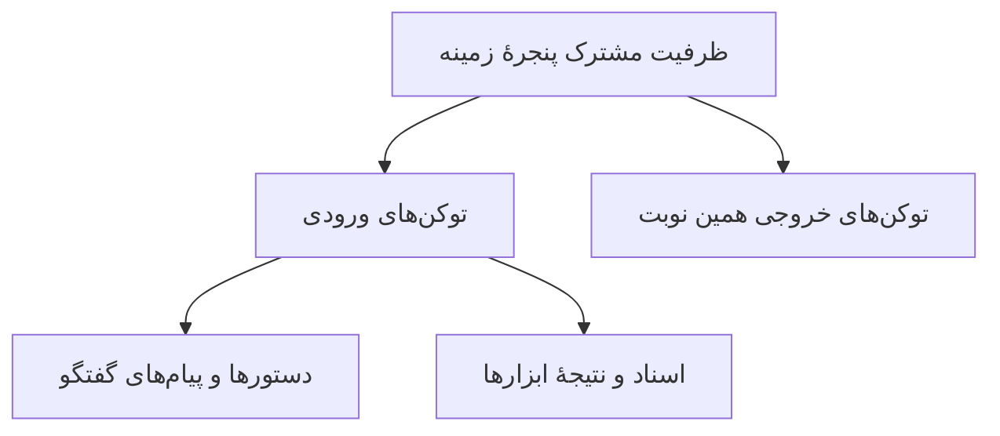
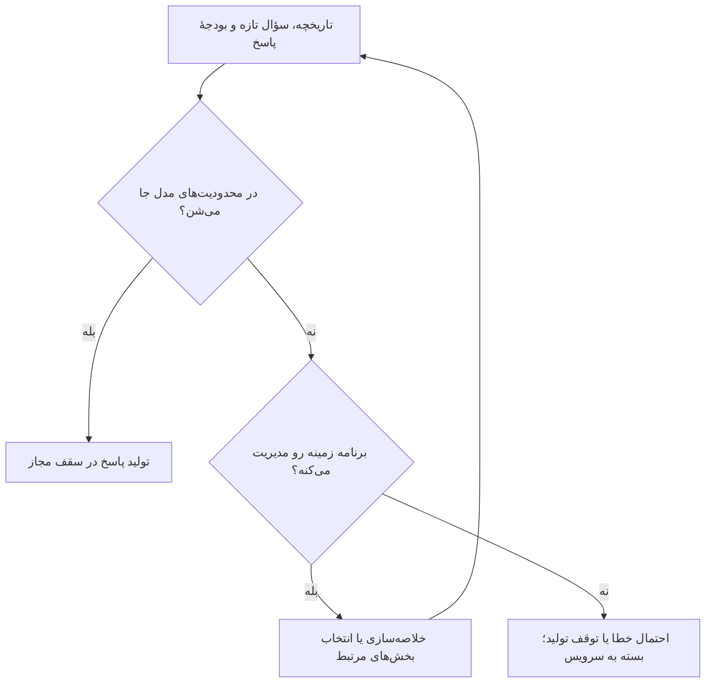

فرض کن چند صفحه راهنمای یک اپلیکیشن رو به چت‌بات می‌دی، بعد می‌پرسی: «برای تغییر شماره موبایل باید چی کار کنم؟» جواب می‌ده، ولی شرط مهمی رو که وسط راهنما نوشته بودی جا می‌اندازه. ممکنه فکر کنیم مدل حرف قبلی‌مون رو فراموش کرده؛ اما همیشه ماجرا به این سادگی نیست.

برای فهمیدنش، اول باید با **پنجرهٔ زمینه** یا Context Window آشنا بشیم: ظرفیت محدودی که مدل برای اطلاعات همین نوبت و پاسخ خودش در اختیار داره.

## پنجرهٔ زمینه، جای اطلاعات همین درخواسته

من برای تصورش از یک میز کار کمک می‌گیرم. کتابخونه می‌تونه خیلی بزرگ باشه، ولی روی میز فقط بخشی از کتاب‌ها جا می‌شن. داده‌هایی که مدل موقع آموزش دیده با اطلاعاتی که الان جلوشه یکی نیستن؛ این تشبیه هم به معنی داشتن حافظهٔ انسانی نیست.

دستورهای سیستم، پیام‌های ارسال‌شده، متن اسناد و نتیجهٔ ابزارها می‌تونن بخشی از ورودی باشن. پاسخ تازه هم جا می‌خواد. ظرفیت با **توکن** سنجیده می‌شه، نه تعداد کلمه یا صفحه.

این نمودار، تقسیم ظرفیت رو به‌صورت ساده نشون می‌ده؛ اندازهٔ کادرها متناسب با تعداد توکن‌ها نیست:



در مدل‌های استدلالی، توکن‌های مربوط به پردازش استدلال هم ممکنه از بودجهٔ خروجی و زمینه مصرف کنن؛ جزئیات شمارششون رو باید در مستندات همون مدل دید.

## چرا برای جواب هم باید جا بذاریم؟

یک مثال کاملاً فرضی: ظرفیت مدل رو ۱۰ هزار توکن در نظر بگیریم.

| بخش | تعداد توکن فرضی |
| --- | ---: |
| دستورها، گفتگو و اسناد ورودی | ۸۰۰۰ |
| فضای باقی‌مونده برای خروجی | حداکثر ۲۰۰۰ |

این عددها مشخصات هیچ مدل واقعی‌ای نیستن. مدل ممکنه سقف جداگانه‌ای هم برای خروجی داشته باشه، پس همهٔ فضای باقی‌مونده الزاماً قابل‌استفاده نیست.

## وقتی گفتگو طولانی می‌شه، چه اتفاقی می‌افته؟

اگر تاریخچه رو کامل دوباره بفرستیم، پیام‌ها و جواب‌های قبلی هم وارد حساب می‌شن. با ادامهٔ گفتگو، ورودی بزرگ‌تر می‌شه.



مدیریت زمینه کار برنامه یا سرویسه؛ نباید فرض کنیم خود مدل همیشه خودکار انجامش می‌ده. خلاصه‌سازی هم بی‌هزینه نیست: ممکنه جزئیاتی از متن اصلی حذف بشن.

## جا شدن متن، یعنی استفادهٔ درست از همهٔ جزئیات؟

نه لزوماً. پژوهش «Lost in the Middle» در سال ۲۰۲۳ نشون داد در بعضی آزمون‌های بازیابی اطلاعات، مدل‌های بررسی‌شده با اطلاعات وسط متن ضعیف‌تر از ابتدا یا انتهای اون کار می‌کردن.

این نتیجه قانون ثابت همهٔ مدل‌های امروز نیست. بااین‌حال، یک هشدار کاربردی داره: ظرفیت بزرگ‌تر به‌تنهایی تضمین دقت نیست. دربارهٔ همون راهنمای اپلیکیشن، حتی اگر کل متن جا شده باشه، هنوز باید چک کنیم مدل شرط تغییر شماره رو درست پیدا کرده یا نه.

## من چطور ورودی رو آماده می‌کنم؟

برای مثال راهنما، این شکل درخواست رو امتحان می‌کنم:

```text
از بخش «تغییر شماره موبایل» در راهنمای زیر استفاده کن.
مراحل و شرط‌های انجام کار رو جدا بنویس.
کنار هر شرط، جملهٔ پشتیبانش رو از متن نقل کن.
اگر جواب در متن نیست، بگو مشخص نیست.
```

بعد نقل‌قول‌ها رو با اصل راهنما تطبیق می‌دم. این دستور تضمین درستی نیست؛ فقط بررسی جواب رو راحت‌تر می‌کنه. اگر بخش‌های دیگه هم به سؤال مربوط باشن، اون‌ها رو هم اضافه می‌کنم، نه اینکه صرفاً برای کوتاه‌شدن متن حذفشون کنم.

برای من نکتهٔ اصلی همینه: به‌جای پرکردن پنجره، اطلاعات لازم رو با سؤال روشن کنار هم بذاریم و نتیجه رو با متن واقعی بسنجیم.

---

**برای بررسی بیشتر:**

- [راهنمای پنجرهٔ زمینه در مستندات Claude](https://platform.claude.com/docs/en/build-with-claude/context-windows)
- [پژوهش Lost in the Middle، نسخهٔ بازبینی‌شدهٔ ۲۰ نوامبر ۲۰۲۳](https://arxiv.org/abs/2307.03172v3)

**منبع اصلی:** [What Is The Context Window? — AI Hero](https://www.aihero.dev/what-is-the-context-window)
