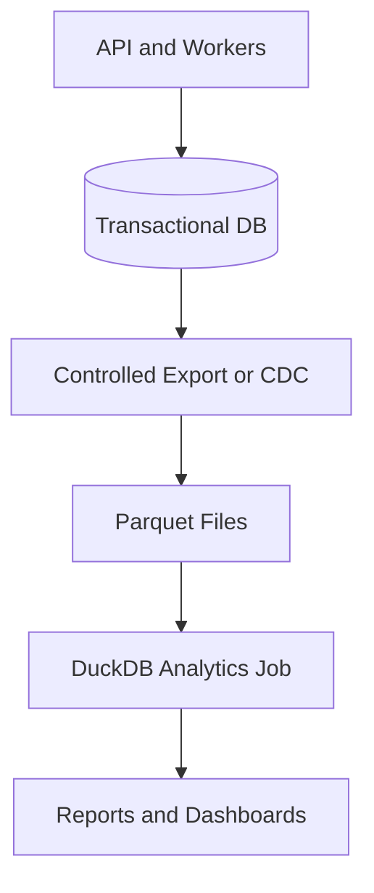
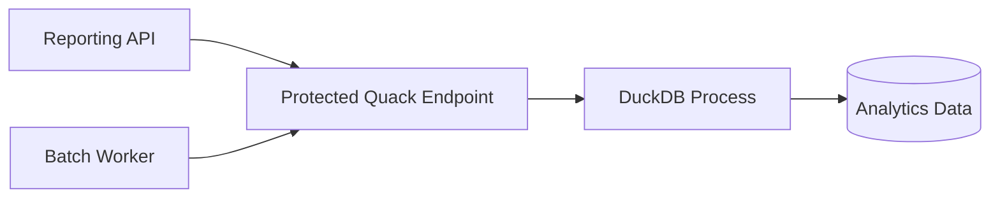

فرض کن یک سرویس داری که هر چند دقیقه از چند منبع، قیمت ارز یا وضعیت تراکنش‌ها رو می‌گیره. در طول روز همه‌چیز خوب پیش می‌ره، اما وقتی می‌خوای گزارش بگیری، تازه دردسر شروع می‌شه: «برای هر منبع، اختلاف قیمت در هر ساعت چقدر بوده؟»، «کدوم منبع دادهٔ ناقص بیشتری داشته؟»، «تغییرات امروز با هفتهٔ قبل چه فرقی کرده؟»

اولین واکنش شاید این باشه که چند کوئری سنگین روی دیتابیس اصلی بنویسیم. ولی دیتابیسی که باید تراکنش‌های کاربران رو سریع و مطمئن ثبت کنه، لزوماً بهترین جا برای اسکن‌کردن میلیون‌ها ردیف گزارش نیست.

اینجا من معمولاً دو سؤال رو از هم جدا می‌کنم: **داده رو کجا ثبت کنیم؟** و **داده رو کجا تحلیل کنیم؟** جواب این دو سؤال همیشه یک دیتابیس نیست.

[DuckDB](https://duckdb.org/) برای بخش دوم ساخته شده؛ یک موتور تحلیلی SQL که می‌تونه داخل فرایند برنامه اجرا بشه. حالا نسخهٔ **2.0.0** که در **۲۱ اکتبر ۲۰۲۶** منتشر شده، قابلیت‌های تازه‌ای مثل پروتکل شبکه‌ای Quack، خواندن غیرهم‌زمان فایل‌ها، نوع `VARIANT` و Trigger رو جدی‌تر وارد بازی کرده.

این مقاله دربارهٔ حفظ‌کردن فهرست قابلیت‌ها نیست. می‌خوام ببینیم این تغییرها چه تصمیم‌های معماری تازه‌ای جلوی ما می‌ذارن و کجا بهتره هنوز سراغشون نریم.

## DuckDB چه فرقی با دیتابیس معمول سرویس ما داره؟

وقتی دربارهٔ دیتابیس حرف می‌زنیم، خیلی وقت‌ها دو نوع کار رو قاطی می‌کنیم:

- **OLTP** یا پردازش تراکنش‌های عملیاتی: ثبت پرداخت، تغییر موجودی، ایجاد سفارش و خواندن یا به‌روزرسانی چند ردیف مشخص.
- **OLAP** یا پردازش تحلیلی: جمع‌زدن حجم زیادی از داده، گروه‌بندی، مقایسهٔ بازه‌های زمانی و ساخت گزارش.

این مرزبندی مطلق نیست. مثلاً PostgreSQL هم کوئری تحلیلی اجرا می‌کنه و DuckDB هم جدول و تراکنش داره. اما اولویت طراحی‌شون یکسان نیست.

DuckDB یک موتور **ستونی** برای اجرای تحلیلیه. یعنی برای کوئری‌ای که فقط چند ستون از تعداد زیادی ردیف رو لازم داره، می‌تونه از مدل ذخیره‌سازی و اجرای مناسب این نوع پردازش استفاده کنه. ضمن اینکه لازم نیست حتماً یک سرور مستقل راه بندازی؛ می‌تونی موتور رو داخل برنامهٔ Python یا فرایند دیگری اجرا کنی.

پس جملهٔ «DuckDB جای PostgreSQL رو می‌گیره» از همون اول سؤال رو اشتباه مطرح می‌کنه. سؤال بهتر اینه: **کدوم قسمت بار کاری رو باید از دیتابیس عملیاتی جدا کنیم؟**

## چرا انتشار نسخهٔ 2.0 مهمه؟

تیم DuckDB در [اطلاعیهٔ ۲۱ اکتبر](https://duckdb.org/2026/10/21/announcing-duckdb-200.html) نسخهٔ 2.0 رو یک انتشار LTS معرفی کرده که دست‌کم تا اکتبر ۲۰۲۷ پشتیبانی می‌شه. این نسخه فقط یک تغییر شماره نیست.

چند تغییرش مستقیماً روی معماری اثر می‌ذارن:

| تغییر | چه مسئله‌ای رو هدف گرفته؟ | چه چیزی رو نباید نتیجه بگیریم؟ |
| --- | --- | --- |
| Quack و `CONNECT` | دسترسی شبکه‌ای به یک فرایند DuckDB | اینکه هر استقرار DuckDB باید سرور بشه |
| Async I/O | هم‌پوشانی بهتر خواندن داده و پردازش، به‌خصوص روی فضای ذخیره‌سازی شبکه‌ای | اینکه همهٔ کوئری‌ها همیشه سریع‌تر می‌شن |
| `VARIANT` | تحلیل داده‌های نیمه‌ساخت‌یافته با شکل‌های متفاوت | اینکه قرارداد داده و کیفیت ورودی دیگه مهم نیست |
| Trigger | واکنش SQL به تغییر داده و بعضی سناریوهای نگهداری خروجی مشتق‌شده | اینکه یک سیستم کامل Materialized View آماده داریم |
| Parser جدید | گسترش‌پذیری گرامر SQL و پیام خطای دقیق‌تر | اینکه همهٔ کوئری‌های قدیمی بدون تست کار می‌کنن |

این‌ها از جنس قابلیت‌هاییه که ممکنه طراحی یک سرویس رو عوض کنه؛ نه صرفاً ظاهر یک دستور SQL رو.

## یک سناریوی واقعی: تحلیل داده بدون فشار به سرویس اصلی

فرض کنیم یک سیستم داریم که رویدادهای مالی رو ثبت می‌کنه و تیم محصول گزارش‌های ساعتی می‌خواد. من برای شروع، معماری رو این‌طوری جدا می‌کنم:



اینجا چند تصمیم عمدی گرفته شده:

اول، ثبت تراکنش و منطق حساس کسب‌وکار همچنان در دیتابیس عملیاتی می‌مونه. دوم، داده از یک مسیر مشخص و قابل‌پایش به محیط تحلیل می‌ره. سوم، گزارش‌ها مجبور نیستن هر بار جدول‌های اصلی رو زیر بار اسکن ببرن.

این فقط **یک الگوی ممکنه**. اگر حجم داده کمه و کوئری‌ها سبک‌اند، شاید اصلاً نیازی به این جداسازی نباشه. از طرف دیگه، اگر گزارش باید کاملاً لحظه‌ای باشه، خروجی دسته‌ای Parquet ممکنه تأخیر قابل‌قبولی نداشته باشه. باید SLA تازگی داده رو قبل از انتخاب معماری تعیین کنیم.

### یک کوئری ساده روی Parquet

فرض کنیم فایل‌های خروجی ستون‌های `source`، `observed_at`، `currency` و `price` دارن. بدون اینکه اول همهٔ داده رو داخل جدول جداگانه وارد کنیم، می‌تونیم از روی فایل‌ها بخونیم:

```sql
SELECT
  source,
  date_trunc('hour', observed_at) AS hour,
  count(*) AS sample_count,
  min(price) AS min_price,
  max(price) AS max_price,
  max(price) - min(price) AS price_range
FROM read_parquet('data/prices/*.parquet')
WHERE currency = 'USD'
GROUP BY source, date_trunc('hour', observed_at)
ORDER BY hour DESC, source;
```

این یک مثال فرضیه و به نام ستون‌های واقعی دادهٔ شما وابسته است. نکتهٔ معماریش مهم‌تر از خود SQLه: می‌تونیم یک مجموعه فایل رو مثل منبع قابل‌پرس‌وجو ببینیم.

در Python هم شروع کار پیچیده نیست:

```python
import duckdb

con = duckdb.connect()
rows = con.execute("""
    SELECT source, count(*) AS samples
    FROM read_parquet('data/prices/*.parquet')
    GROUP BY source
    ORDER BY samples DESC
""").fetchall()

for source, samples in rows:
    print(source, samples)
```

این نمونه به فایل‌های محلی دسترسی داره. برای S3 یا HTTP، تنظیمات دسترسی و افزونه‌های مربوط هم وارد ماجرا می‌شن؛ بهتره اعتبارنامه‌ها رو در کد یا فایل مقاله هاردکد نکنیم.

## تغییر اول: Quack، یعنی DuckDB دیگر فقط داخل یک فرایند نیست

یکی از ویژگی‌های قدیمی DuckDB این بود که معمولاً درون برنامه اجرا می‌شد. این مدل ساده و سریع بود، ولی وقتی چند برنامهٔ جدا می‌خواستن به یک دیتابیس مشترک دسترسی داشته باشن، محدودیت‌های عملی خودش رو داشت.

در نسخهٔ 1.5.3 پروتکل **Quack** معرفی شد و در 2.0 بهبودهای پایداری و کارایی گرفت. حالا می‌شه یک فرایند DuckDB رو به‌عنوان سرویس نگه داشت و از فرایند دیگری بهش وصل شد.

مثال سادهٔ مستندات رسمی:

**در فرایند سرور:**

```sql
CALL quack_serve(token = 'demo-token');

CREATE TABLE events (
  event_date DATE,
  event_name VARCHAR
);

INSERT INTO events
VALUES (DATE '2026-10-29', 'daily-report');
```

**در فرایند کلاینت:**

```sql
ATTACH 'quack:localhost'
  AS analytics (TOKEN 'demo-token');

CONNECT analytics;

SELECT * FROM events;
```

این کد برای نمایش ایده‌ست، نه کانفیگ Production. توکن ثابت و قابل‌حدس فقط برای مثال استفاده شده.

با Quack می‌شه معماری رو به شکل زیر هم در نظر گرفت:



اما اینجا باید یک سوءتفاهم رو برطرف کنیم: **داشتن پروتکل شبکه‌ای به‌معنی تبدیل خودکار DuckDB به جایگزین همهٔ دیتابیس‌های تراکنشی نیست.** ظرفیت هم‌زمانی، مدیریت اتصال، امنیت، پشتیبان‌گیری و مدل دسترسی همچنان باید با بار واقعی آزمایش بشن.

طبق [راهنمای Quack](https://duckdb.org/docs/2.0/quack/overview)، سرور به‌صورت پیش‌فرض فقط روی `localhost` گوش می‌ده. برای محیط عملیاتی، پیشنهاد پروژه اینه که سرویس پشت یک reverse proxy با TLS قرار بگیره. باز کردن مستقیم سرویس روی همهٔ اینترفیس‌ها گزینهٔ مناسبی برای شروع Production نیست.

اگر یک API عمومی می‌سازیم، من ترجیح می‌دم کاربران مستقیم به موتور SQL وصل نشن. یک لایهٔ سرویس با احراز هویت، محدودیت درخواست، کنترل کوئری و سطح دسترسی مشخص، مرز امن‌تری ایجاد می‌کنه.

## تغییر دوم: Async I/O برای فایل‌های بزرگ و Object Storage

در تحلیل داده، CPU همیشه گلوگاه نیست. گاهی موتور منتظره تا تکه‌های بعدی فایل از دیسک یا شبکه برسن.

DuckDB 2.0 برای خواندن Parquet، CSV و فایل‌های ذخیره‌سازی خودش **I/O غیرهم‌زمان** معرفی کرده. ایده اینه که خواندن داده و پردازش کوئری مستقل‌تر پیش برن و چند درخواست I/O هم‌زمان در جریان باشه.

این قابلیت به‌خصوص وقتی داده روی Object Storage مثل S3 قرار داره جذابه؛ چون تأخیر شبکه می‌تونه از هزینهٔ پردازش محلی بیشتر باشه.

اما از عددهای بنچمارک نباید نتیجهٔ قطعی گرفت. نتیجهٔ واقعی به اندازهٔ فایل، تعداد ستون‌های موردنیاز، فشرده‌سازی، شبکه، cache و الگوی کوئری بستگی داره.

برای ارزیابی منصفانه، همین چند مورد رو با نسخهٔ قبلی و 2.0 مقایسه می‌کنم:

1. مدت اجرای چند کوئری نماینده، نه فقط یک `SELECT count(*)`.
2. مصرف حافظه و CPU در اجرای هم‌زمان.
3. تعداد و حجم درخواست‌های شبکه‌ای به Storage.
4. رفتار در خطا، کندی شبکه و فایل ناقص.
5. هزینهٔ انتقال داده و تعداد درخواست‌های Object Storage.

اگر فقط زمان یک کوئری آزمایشی بهتر شده ولی هزینهٔ شبکه یا مصرف حافظه به‌شدت بالا رفته، هنوز نمی‌شه گفت معماری جدید بهتره.

## تغییر سوم: VARIANT برای داده‌هایی که همیشه یک شکل ندارن

دادهٔ ورودی از چند API معمولاً کاملاً یکدست نیست. یک منبع فیلد `rate` می‌ده، یکی `price`، یکی هم اطلاعات اضافی مثل نام بازار و زمان ثبت داره.

در این شرایط وسوسه می‌شیم همه‌چیز رو به‌صورت JSON خام ذخیره کنیم. DuckDB از نسخهٔ 1.5 نوع `VARIANT` رو معرفی کرده بود و در 2.0 پشتیبانی از اون رو در ذخیره‌سازی و اجرای ستونی کامل‌تر کرده.

مثال رسمی با دو شکل متفاوت داده:

```sql
CREATE TABLE incoming_events (payload VARIANT);

INSERT INTO incoming_events
VALUES
  ('{"source":"A","price":100}'::JSON::VARIANT),
  ('{"source":"B","rate":102,"market":"cash"}'::JSON::VARIANT);

SELECT
  variant_type(payload),
  variant_keys(payload)
FROM incoming_events;
```

اینجا لازم نیست تمام ردیف‌ها دقیقاً کلیدهای یکسان داشته باشن. با این حال، `VARIANT` به‌معنی بی‌نیازی از اعتبارسنجی نیست. اگر قرار باشه قیمت‌ها رو مقایسه کنیم، باید واحد پول، مقیاس عدد، timezone، معنی قیمت خرید یا فروش و کیفیت دادهٔ هر منبع مشخص باشه.

من معمولاً **raw data** رو از **canonical data** جدا نگه می‌دارم: نسخهٔ خام برای بررسی و بازپردازش، نسخهٔ استانداردشده برای گزارش و تصمیم‌گیری. قابلیت جدید DuckDB این مرز رو حذف نمی‌کنه؛ فقط پردازش دادهٔ خام رو راحت‌تر می‌کنه.

## تغییر چهارم: Triggerها؛ کاربردی، ولی با احتیاط

DuckDB 2.0 از `CREATE TRIGGER` پشتیبانی می‌کنه. یعنی می‌تونیم در پاسخ به تغییر جدول، عملیات دیگری رو هم با SQL انجام بدیم. مثلاً در یک محیط تحلیلی، بعد از تغییر دادهٔ ورودی یک جدول آماری رو به‌روزرسانی کنیم.

این قابلیت برای بعضی الگوهای نگهداری دادهٔ مشتق‌شده جالبه، اما نباید با یک سیستم کامل Materialized View اشتباه گرفته بشه. خود تیم DuckDB هم Trigger رو قدمی در اون مسیر توصیف کرده، نه پایان کار.

ضمن اینکه همهٔ ترکیب‌های Trigger هنوز پشتیبانی نمی‌شن؛ برای مثال، مستندات انتشار دربارهٔ محدودیت بعضی حالت‌های `BEFORE` و `UPDATE` در سطح ردیف هشدار داده.

برای من سؤال اصلی اینه: «منطق محاسبه باید در دیتابیس بمونه یا در pipeline داده؟» اگر تیم به replay، نسخه‌بندی قواعد و مشاهده‌پذیری دقیق نیاز داره، گاهی یک pipeline صریح از Trigger پنهان قابل‌نگهداری‌تره.

## تغییر پنجم: Agent Mode؛ خروجی SQL برای ابزارهای خودکار

یک قابلیت کمتر مرتبط با معماری ذخیره‌سازی، اما جالب برای ابزارهای توسعه، **Agent Mode** در CLIه. وقتی DuckDB از طریق عامل کدنویسی استفاده می‌شه، خروجی می‌تونه به‌شکل فشرده‌تر و ماشین‌خوان‌تر ارائه بشه؛ خطاها JSON باشند و محدود شدن نتیجه واضح اعلام بشه.

در آزمایش منتشرشدهٔ خود تیم روی TPC-H، حجم خروجی‌ای که مدل باید بخونه ۵۹ درصد کمتر شده. این عدد مربوط به آزمایش همون تیمه، نه تضمین کاهش ۵۹ درصدی هزینهٔ توکن در همهٔ پروژه‌ها.

برای آزمایش دستی می‌شه CLI رو با گزینهٔ `-agent` اجرا کرد.

ولی این قابلیت به‌هیچ‌وجه جای کنترل دسترسی SQL رو نمی‌گیره. اگر یک agent اجازهٔ اجرای کوئری روی دادهٔ حساس داره، همچنان باید محدودهٔ دسترسی، read-only بودن در صورت امکان، محدودیت زمان اجرا و ثبت رخدادها مشخص باشه.

## بزرگ‌ترین ریسک مهاجرت: فرمت فایل‌ها

اینجا مهم‌ترین نکتهٔ عملیاتی نسخهٔ 2.0 قرار داره.

**فایل دیتابیس تازه‌ای که با فرمت پیش‌فرض DuckDB 2.0 ساخته بشه، توسط نسخه‌های قبل از 2.0 قابل‌خواندن نیست.** در مقابل، DuckDB 2.0 می‌تونه فایل‌های قدیمی رو بخونه و طبق توضیح رسمی، فایل‌های موجود رو با فرمت قدیمی نگه داره تا نسخه‌های قدیمی همچنان قادر به خواندنشون باشن.

این تفاوت برای Rollback حیاتیه. فرض کن سرویس جدید با 2.0 یک دیتابیس تازه ساخته و بعد مجبور می‌شی نسخهٔ برنامه رو به 1.5 برگردونی. ممکنه نسخهٔ قبلی اصلاً نتونه اون فایل جدید رو باز کنه.

برای همین، من ارتقا رو صرفاً تعویض یک dependency نمی‌بینم.

### چک‌لیست مهاجرتی که واقعاً استفاده می‌کنم

- نسخهٔ فعلی، فرمت فایل‌ها، افزونه‌ها و کلاینت‌های متصل رو فهرست کن.
- قبل از هر تغییری از داده و تنظیمات نسخهٔ قبلی نسخهٔ پشتیبان قابل‌بازیابی بگیر.
- یک **Shadow Environment** با دادهٔ نماینده بساز و نسخهٔ 2.0 رو جدا از Production اجرا کن.
- خروجی کوئری‌های حساس رو با نسخهٔ قبلی مقایسه کن؛ فقط زمان اجرا کافی نیست.
- مسیر Rollback رو با یک فایل ساخته‌شده در نسخهٔ 2.0 عملاً آزمایش کن.
- parser و lambdaهای قدیمی رو بررسی کن؛ syntax تک‌فلشی `x -> x + 1` در 2.0 به‌صورت پیش‌فرض غیرفعاله و جایگزینش `lambda x: x + 1` است.
- اگر از افزونه‌های خارجی استفاده می‌کنی، سازگاری اون‌ها با نسخهٔ جدید رو جداگانه تأیید کن.
- اگر سیستم حیاتی داری، زمان‌بندی ارتقا رو با ریسک محصول هماهنگ کن، نه صرفاً تاریخ انتشار نسخه.

اگر از **Python** استفاده می‌کنی، یک نکتهٔ مهم دیگه هم هست: کلاینت DuckDB 2.0 به **Python 3.11 یا جدیدتر** نیاز داره. علاوه بر اون، رفتار بعضی عبارت‌های SQL عوض شده؛ مثلاً عملگر regex یعنی \`~\` حالا تطبیق جزئی انجام می‌ده و چند حالت تقسیم بر صفر و \`MERGE INTO\` هم رفتار متفاوتی دارن. پس علاوه بر تست عملکرد، **نتیجهٔ واقعی کوئری‌ها** رو با نسخهٔ قبلی مقایسه کن؛ این تغییرها ممکنه بدون خطای واضح روی خروجی اثر بذارن.\n\nتیم DuckDB خودش پیشنهاد کرده برای بارهای حیاتی، در صورت نیاز تا اولین Patch Release برنامه‌ریزی‌شده در نوامبر صبر کنیم. پشتیبانی 1.5 هم تا مارس ۲۰۲۷ تمدید شده؛ بنابراین برای همهٔ تیم‌ها عجله لازم نیست.

راهنمای کامل: [Migrating to DuckDB 2.0](https://duckdb.org/docs/2.0/operations_manual/migration).

## بالاخره DuckDB رو کجای معماری بذاریم؟

من برای تصمیم‌گیری، این جدول رو جلوی تیم می‌ذارم:

| سناریو | انتخابی که اول بررسی می‌کنم | دلیل |
| --- | --- | --- |
| ثبت تراکنش و تغییر موجودی | دیتابیس تراکنشی موجود | نیاز به مدل تراکنش، هم‌زمانی و کنترل‌های عملیاتی مشخص |
| گزارش‌های دسته‌ای از CSV و Parquet | DuckDB داخل Job | شروع ساده، SQL مستقیم روی فایل‌ها و جداسازی بار تحلیلی |
| تحلیل ad-hoc در ابزار داخلی | DuckDB Embedded | بدون نیاز اولیه به سرور مجزا |
| چند کلاینت برای یک موتور تحلیلی | Quack را در محیط آزمایشی ارزیابی می‌کنم | امکان اتصال شبکه‌ای، همراه با نیاز به کنترل امنیت و ظرفیت |
| دادهٔ بسیار بزرگ با کاربران متعدد و SLA سخت | مقایسهٔ DuckDB با راهکارهای تحلیلی دیگر | هزینه، هم‌زمانی، دسترس‌پذیری و عملیات تعیین‌کننده‌اند |

در عمل، انتخاب فقط بین دو محصول نیست؛ بین **الگوهای استقرار** هم هست. گاهی یک Job که روزی چند بار Parquet رو می‌خونه از یک سرویس تحلیلی همیشه‌روشن بهتره. گاهی هم تأخیر موردنیاز گزارش اجازهٔ پردازش دسته‌ای نمی‌ده.

قبل از تصمیم نهایی، این چهار سؤال رو جواب می‌دم: داده هر چند وقت تازه می‌شه؟ چند کاربر هم‌زمان گزارش می‌خوان؟ در زمان قطعی چه اتفاقی می‌افته؟ هزینهٔ نگهداری و انتقال داده چقدره؟

## یک آزمایش کوچک قبل از تصمیم بزرگ

اگر بخوام این هفته DuckDB 2.0 رو برای یک تیم امتحان کنم، از یک پروژهٔ یک‌روزه شروع می‌کنم:

1. یک خروجی واقعی اما بی‌اطلاعات حساس از سیستم می‌گیرم.
2. داده رو به Parquet تبدیل می‌کنم و سه کوئری مهم گزارش رو می‌نویسم.
3. زمان اجرا، حافظه و صحت نتیجه رو اندازه می‌گیرم.
4. همون آزمایش رو با نسخهٔ قبلی DuckDB یا راهکار فعلی تکرار می‌کنم.
5. فقط اگر نیاز به دسترسی مشترک وجود داشت، Quack رو در یک شبکهٔ آزمایشی بررسی می‌کنم.
6. در آخر، سناریوی خرابی و برگشت به نسخهٔ قبلی رو امتحان می‌کنم.

اگر خروجی این آزمایش نشون داد که پیچیدگی سیستم بیشتر شده ولی سود مشخصی نداریم، فعلاً مهاجرت نمی‌کنم. انتشار نسخهٔ جدید، به‌خودی‌خود دلیل کافی برای تغییر معماری نیست.

## جمع‌بندی

DuckDB 2.0 مرزهای موتور تحلیلی داخل برنامه رو گسترش داده. Quack امکان مدل سرویس‌دهنده رو فراهم می‌کنه، Async I/O خواندن داده‌های راه‌دور رو هدف گرفته و `VARIANT` و Triggerها دست ما رو برای کار با داده بازتر می‌کنن.

اما به‌نظرم مهم‌ترین تصمیم هنوز همون تصمیم قدیمیه: **بار تراکنشی رو از بار تحلیلی جدا کنیم یا نه، و این جداسازی رو چقدر پیچیده بسازیم؟**

اگر مسئله‌مون با یک Job ساده و چند فایل Parquet حل می‌شه، لازم نیست از روز اول یک پلتفرم دادهٔ کامل طراحی کنیم. اگر هم قرار شد DuckDB رو به‌عنوان سرویس مشترک استفاده کنیم، باید با همون دقتی به امنیت، بازیابی و پایداریش نگاه کنیم که به هر سرویس Production دیگه نگاه می‌کنیم.

---

## منابع و مطالعهٔ بیشتر

- [DuckDB 2.0.0 LTS — اطلاعیهٔ رسمی، ۲۱ اکتبر ۲۰۲۶](https://duckdb.org/2026/10/21/announcing-duckdb-200.html)
- [GitHub Release: DuckDB v2.0.0](https://github.com/duckdb/duckdb/releases/tag/v2.0.0)
- [راهنمای رسمی Quack Remote Protocol](https://duckdb.org/docs/2.0/quack/overview)
- [راهنمای مهاجرت به DuckDB 2.0](https://duckdb.org/docs/2.0/operations_manual/migration)
- [سازگاری فرمت ذخیره‌سازی](https://duckdb.org/docs/2.0/internals/storage)
- [پیش‌نمایش فنی DuckDB 2.0](https://duckdb.org/2026/08/17/duckdb-20-highlights.html)

*یادداشت: این مطلب بر اساس انتشار رسمی و فعالیت مخزن GitHub انتخاب شده است؛ رتبهٔ مشخص آن در Google Trends به‌صورت مستقل تأیید نشده. مثال‌های معماری و دادهٔ مالی آموزشی‌اند و جایگزین ارزیابی امنیتی و عملیاتی یک سیستم واقعی نیستند.*
