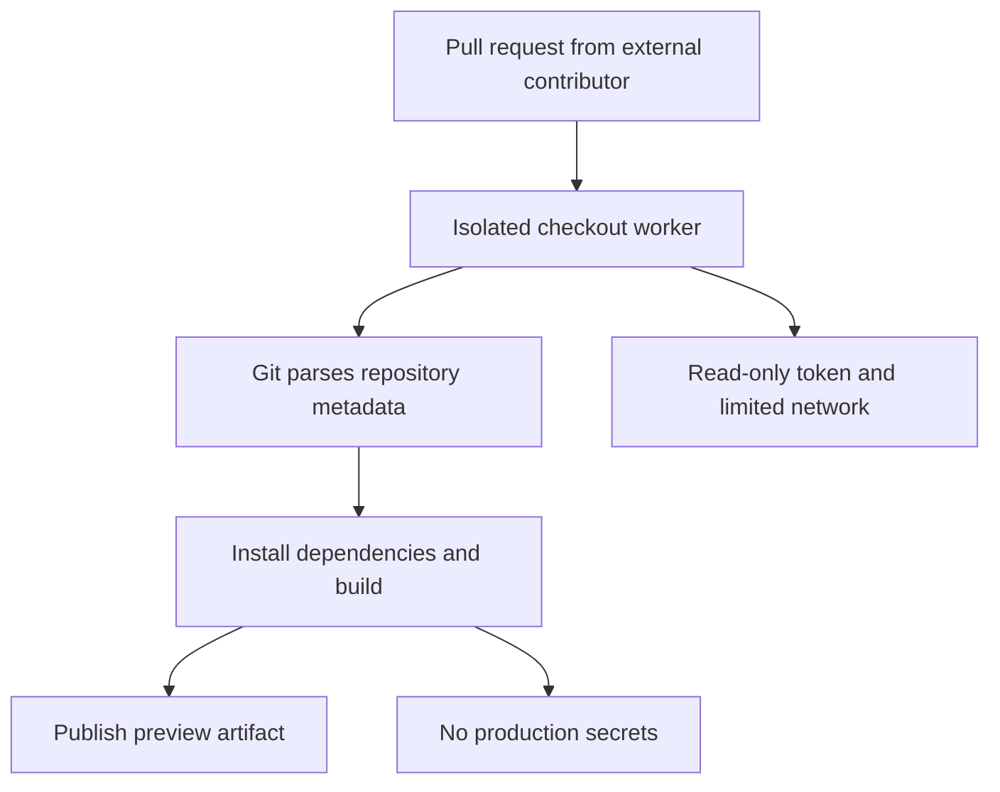

وقتی دربارهٔ امنیت CI صحبت می‌کنیم، معمولاً اولین چیزهایی که به ذهنمان می‌رسند Secretها، دسترسی توکن‌ها و وابستگی‌های پروژه‌اند. اما یک سؤال ساده‌تر هم هست: **ابزاری که کد را از مخزن می‌گیرد، خودش چقدر امن است؟**

۱۰ نوامبر ۲۰۲۶ پروژهٔ Git مجموعه‌ای از نسخه‌های اصلاحی را برای شش آسیب‌پذیری منتشر کرد. یکی از آن‌ها در شرایط مشخص می‌تواند هنگام Clone بازگشتی یک مخزن مخرب به اجرای کد برسد. بقیه به مسیر فایل‌ها، نام Referenceها، پردازش Merge، Patch باینری و Fast Import مربوط‌اند. این خبر فقط برای کسی نیست که روی لپ‌تاپش `git clone` می‌زند؛ سرویس‌هایی که مخزن کاربران را دریافت و پردازش می‌کنند هم باید آن را جدی بگیرند.

این مقاله قرار نیست صرفاً فهرست CVEها باشد. می‌خواهیم بفهمیم مرز اعتماد در یک Pipeline کجاست و چطور بدون پیچیده‌کردن بی‌دلیل زیرساخت، ریسک را پایین بیاوریم.

## دقیقاً چه اتفاقی افتاده؟

طبق [اطلاعیهٔ GitHub در ۱۰ نوامبر](https://github.blog/open-source/git/git-security-vulnerabilities-announced-7/)، اصلاحات در **Git 2.56.1** و نسخه‌های نگهداری **2.55.1، 2.54.1، 2.53.1، 2.52.1، 2.51.3 و 2.50.2** ارائه شده‌اند. این فهرست به معنی امن‌بودن خودکار همهٔ نسخه‌های قدیمی‌تر یا بسته‌های توزیع‌های لینوکسی نیست؛ بعضی توزیع‌ها اصلاح امنیتی را بدون تغییر شمارهٔ اصلی نسخه Backport می‌کنند. باید وضعیت بستهٔ همان توزیع را بررسی کنیم.

| شناسه | سطح درگیر | پیامد گزارش‌شده |
| --- | --- | --- |
| CVE-2026-111760 | Recursive Clone و Submodule | اجرای کد در شرایط مشخص با مخزن مخرب |
| CVE-2026-113408 | HEAD و Git Protocol v2 | نوشتن بیرون از مسیر Reference موردانتظار |
| CVE-2026-114467 | حذف امضا هنگام Merge | خرابی حافظهٔ Stack و احتمال ازکارافتادن پردازش |
| CVE-2026-114469 | Binary Patch | خواندن خارج از محدوده و Crash |
| CVE-2026-105437 | Merge خروجی‌های بزرگ | سرریز محاسبهٔ اندازه و خرابی Heap |
| CVE-2026-114466 | Fast Import | دسترسی ناخواسته به فایل‌های سیستم |

این جدول خلاصهٔ اطلاعیهٔ رسمی است، نه نتیجهٔ تست نفوذ مستقل. از آن نباید نتیجه گرفت که همهٔ مخزن‌ها یا همهٔ عملیات Git به یک اندازه آسیب‌پذیرند.

## چرا «فقط Clone کردن» همیشه بی‌خطر نیست؟

Git برای جلوگیری از نوشتن روی فایل‌های مدیریتی خودش، مسیرها را اعتبارسنجی می‌کند. در CVE-2026-111760 یک خطای تبدیل اندازهٔ عددی باعث می‌شد یک مسیر بسیار بلند در دو مرحله با دو برداشت متفاوت بررسی شود. مهاجم می‌توانست از این اختلاف برای دست‌کاری فایل `.git` مربوط به Submodule استفاده کند؛ بعد Git ممکن بود تنظیمات یا Hookهای کنترل‌شده توسط مهاجم را بخواند.

نکتهٔ مهم **Recursive Clone** است. وقتی می‌نویسیم:

```bash
git clone --recurse-submodules https://example.com/team/project.git
```

فقط یک مخزن را نمی‌گیریم؛ ممکن است مخزن‌های دیگری هم وارد فرایند شوند. این دستور به‌خودی‌خود مخرب نیست، ولی اگر منبع را نمی‌شناسیم، سطح اعتماد بزرگ‌تر می‌شود.

این مسئله با تصور رایج «Git موقع Clone هیچ Hookی اجرا نمی‌کند» فرق دارد. [مستندات امنیتی Git](https://git-scm.com/docs/git) توضیح می‌دهد که تنظیمات و Hookهای داخل یک دایرکتوری `.git` نامطمئن می‌توانند دستور اجرا کنند. آسیب‌پذیری اخیر راهی غیرمنتظره برای رسیدن به چنین وضعیتی ایجاد می‌کرد.

## پنج آسیب‌پذیری دیگر چه درسی دارند؟

### ۱. نام Reference هم ورودی نامطمئن است

در CVE-2026-113408 سرور مخرب می‌توانست هنگام Clone یک مخزن خالی، هدف HEAD را به‌شکلی تبلیغ کند که اجزای Path Traversal داشته باشد. اگر این نام بدون اعتبارسنجی ذخیره می‌شد، عملیات بعدی امکان نوشتن خارج از محدودهٔ موردنظر را داشت.

درس معماری‌اش این است: **داده‌ای که از پروتکل می‌آید، حتی اگر اسمش Branch یا HEAD باشد، هنوز ورودی خارجی است.**

### ۲. فرمت‌های ساختاریافته هم می‌توانند حافظه را خراب کنند

در CVE-2026-114467 پردازش پیام‌هایی با بیش از دو امضای GPG می‌توانست از آرایهٔ ثابت Stack عبور کند. این مسیر در Merge بعضی Tagهای دست‌کاری‌شده مطرح بود. این مورد را نباید با «شکستن رمزنگاری GPG» اشتباه گرفت؛ ایراد در مدیریت حافظه هنگام پردازش ساختار پیام بود.

### ۳. اندازهٔ فشرده با اندازهٔ واقعی یکی نیست

CVE-2026-114469 دربارهٔ Patchهای باینری است. محدودیت اندازه روی ورودی فشرده و کدگذاری‌شده اعمال می‌شد، درحالی‌که دادهٔ بازشده می‌توانست بزرگ‌تر باشد. نتیجه می‌توانست خواندن خارج از محدوده و Crash باشد.

برای سیستم‌هایی که فایل‌های فشرده، Archive یا Payloadهای کدگذاری‌شده می‌پذیرند، همین الگو آشناست: محدودیت باید روی **اندازهٔ واقعی پس از بازکردن** هم اعمال شود.

### ۴. جمع‌زدن اندازه‌ها هم نیاز به کنترل دارد

CVE-2026-105437 در محاسبهٔ حافظهٔ لازم برای Mergeهای بسیار بزرگ رخ می‌داد؛ ترکیب تعارض‌های زیاد و تنظیمات خاص Conflict Marker می‌توانست به سرریز عددی و نوشتن خارج از Buffer برسد. سرویس‌های میزبانی کد که Merge محتوای نامطمئن را به‌جای کاربر انجام می‌دهند، باید این مسیر را هم در مدل تهدیدشان ببینند.

### ۵. Import کردن، فقط خواندن داده نیست

در CVE-2026-114466 چند قابلیت `git fast-import` که از جریان ورودی فعال می‌شدند، می‌توانستند فایل‌های بیرون از مخزن را بخوانند یا بنویسند. اصلاح جدید این قابلیت‌ها را در جریان نامطمئن مسدود می‌کند، مگر اینکه اجراکننده آگاهانه `--allow-unsafe-features` را فعال کند.

برای داده‌ای که از بیرون سازمان می‌آید، این گزینه را به‌عنوان راه‌حل سازگاری پیش‌فرض فعال نکنیم.

## یک سناریوی واقعی: سرویس ساخت Preview برای Pull Request

فرض کنیم سرویسی داریم که برای هر PR یک محیط Preview می‌سازد. یک Worker مخزن را Clone می‌کند، وابستگی‌ها را نصب می‌کند و Build می‌گیرد. اگر PR از یک Fork ناشناس آمده باشد، ورودی ما فقط کد TypeScript نیست؛ Git Metadata، Submoduleها، Tagها و Patchها هم بخشی از ورودی‌اند.



در این سناریو، Patch کردن Git لازم است، اما کافی نیست. حتی با Git اصلاح‌شده، اجرای Scriptهای پروژه مثل `npm install` یا `npm run build` می‌تواند کد مشارکت‌کننده را اجرا کند. پس Checkout امن و اجرای Build نامطمئن را باید دو مسئلهٔ جدا در نظر بگیریم.

## برنامهٔ عملی برای تیم‌ها

### قدم اول: بفهمیم Git واقعاً کجا اجرا می‌شود

فقط لپ‌تاپ توسعه‌دهنده‌ها را نشماریم. این نقاط را هم بررسی کنیم:

- Runnerهای Self-hosted و Imageهای CI
- سرورهای Deploy و ابزارهای Release
- سرویس‌های Preview، Mirror، Import و Code Review
- Containerهای Build و ابزارهایی که Git را داخل خودشان Bundle کرده‌اند
- سیستم‌های توسعهٔ محلی و IDEهای دارای Git داخلی

روی هر محیط، نسخهٔ مؤثر را بررسی کنیم:

```bash
git --version
command -v git
```

این دو دستور برای Inventory شروع خوبی‌اند، ولی تأیید Patch بودن بستهٔ توزیع به بررسی Advisory همان Vendor نیاز دارد. شمارهٔ نسخه به‌تنهایی همیشه کافی نیست.

### قدم دوم: نسخهٔ اصلاحی را نصب و در Imageها ثبت کنیم

برای نصب‌های مستقیم از نسخه‌های اصلاح‌شدهٔ اعلام‌شده استفاده کنیم. برای Containerها، Image پایه را دوباره Build کنیم؛ به‌روزرسانی Git روی Host الزاماً Git داخل Container را عوض نمی‌کند. در CI هم نسخهٔ Runner و Git موجود در Image را مستقل بررسی کنیم.

یک گیت سادهٔ قابل‌استفاده در Pipeline:

```bash
set -eu
git --version
# در ادامه با ابزار مدیریت بسته یا SBOM،
# وجود اصلاح امنیتی در همین محیط را تأیید کنید.
```

عمداً شرط رشته‌ای مثل «اگر نسخه از 2.56.1 کمتر بود Fail کن» نمی‌گذاریم؛ چنین شرطی Backportهای امنیتی توزیع‌ها را به‌اشتباه رد می‌کند و بعضی نسخه‌های نامطمئن را هم ممکن است درست تشخیص ندهد.

### قدم سوم: اعتماد را در Checkout و Build جدا کنیم

در GitHub Actions می‌توانیم برای PRهای بیرونی حداقل Permission را تنظیم کنیم:

```yaml
name: PR checks
on:
  pull_request:

permissions:
  contents: read

jobs:
  test:
    runs-on: ubuntu-latest
    steps:
      - uses: actions/checkout@v4
        with:
          persist-credentials: false
          submodules: false
      - run: git --version
      - run: npm ci
      - run: npm test
```

این YAML **نمونهٔ آموزشی** است؛ نسخهٔ Action را باید مطابق سیاست سازمان به Commit SHA قابل‌اعتماد Pin کنیم و نسخهٔ Git موجود در Runner را هم تأیید کنیم. `submodules: false` فقط وقتی مناسب است که پروژه به Submodule نیاز نداشته باشد. `persist-credentials: false` نیز جلوی اجرای کد نامطمئن در مراحل بعدی را نمی‌گیرد.

اگر تست‌های PR خارجی به Secret نیاز ندارند، Secretهای Production را در اختیارشان نگذاریم. همچنین برای اجرای کد Fork ناشناس روی Runner دائمی Self-hosted بدون جداسازی قوی، ریسک ماندگاری و دسترسی به شبکه را در نظر بگیریم.

### قدم چهارم: مسیرهای غیرمعمول Git را هم Audit کنیم

ممکن است سرویس ما مستقیم `git clone` نزند، اما کتابخانه یا Job دیگری `git apply`، `git merge` یا `git fast-import` اجرا کند. بهتر است فراخوانی‌های Git در کد و Jobها را فهرست کنیم و مشخص کنیم کدامشان ورودی نامطمئن دارند.

برای هر مسیر سه سؤال داریم: ورودی را چه کسی کنترل می‌کند؟ پردازش در چه سطح دسترسی اجرا می‌شود؟ اگر پردازش Crash کند یا به فایل‌های بیرون دسترسی پیدا کند، چه چیزهایی در معرض خطرند؟

## چک‌لیست انتشار اصلاح امنیتی

| کنترل | معیار پذیرش |
| --- | --- |
| Inventory | همهٔ محل‌های اجرای Git و Gitهای Bundle‌شده مشخص شده‌اند |
| Patch | نسخه یا Backport اصلاحی توسط منبع معتبر تأیید شده |
| Isolation | Checkout و Build ورودی نامطمئن دسترسی حداقلی دارند |
| Secrets | PR خارجی به Credentialهای Production دسترسی ندارد |
| Submodules | فقط در Jobهای لازم فعال‌اند |
| Regression | Clone، Merge، Apply و Import موردنیاز محصول بعد از Update تست شده‌اند |
| Monitoring | خطاهای غیرعادی Git و Crashهای Worker قابل ردیابی‌اند |

## چه چیزی را نباید از این خبر نتیجه بگیریم؟

اول اینکه **هر Clone مساوی اجرای کد نیست**. بعضی ایرادها به Recursive Clone، بعضی به سرور مخرب، و بعضی به Merge یا Import با ورودی خاص وابسته‌اند. دوم اینکه صرفاً استفاده از GitHub Actions به معنی آسیب‌پذیری قطعی Workflow ما نیست؛ باید نسخهٔ Git، Runner و مسیر پردازش را بررسی کنیم. سوم اینکه محدودکردن Permission توکن‌ها جای Patch را نمی‌گیرد؛ این دو لایهٔ دفاعی مکمل‌اند.

در اطلاعیهٔ ۱۰ نوامبر، GitHub اعلام کرده اصلاحات را روی سرویس‌های Cloud خودش اعمال کرده و برای GitHub Enterprise Server نیز نسخه‌های اصلاحی **3.19.15، 3.20.11، 3.21.9 و 3.22.4** ارائه کرده است. این خبر به معنی اصلاح‌شدن خودکار Runnerهای Self-hosted یا Git داخل Imageهای خصوصی ما نیست.

## جمع‌بندی

Git ابزار پایه‌ای توسعه است و همین عادی‌بودنش باعث می‌شود کمتر به آن به‌عنوان یک پردازشگر ورودی نامطمئن نگاه کنیم. شش آسیب‌پذیری نوامبر یادآوری می‌کنند که حتی قبل از اجرای اولین تست، داده‌های مخزن می‌توانند وارد مسیرهای پیچیدهٔ Parser، Filesystem و Memory شوند.

من برای شروع سه کار را در اولویت می‌گذارم: **فهرست‌کردن تمام محل‌های اجرای Git، نصب اصلاح امنیتی، و جداکردن پردازش مخزن نامطمئن از Credentialها و زیرساخت حساس**. بعد از آن می‌شود با تست‌های Regression و پایش Workerها مطمئن شد این اصلاح امنیتی به اختلال عملیاتی تبدیل نشده است.

---

## منابع و مطالعهٔ بیشتر

- [GitHub Blog — Git security vulnerabilities announced (۱۰ نوامبر ۲۰۲۶)](https://github.blog/open-source/git/git-security-vulnerabilities-announced-7/) — منبع اصلی شش CVE، نسخه‌های اصلاحی و دامنهٔ اثر
- [Git documentation — Security](https://git-scm.com/docs/git) — نکات امنیتی دربارهٔ دایرکتوری `.git` و Hookها
- [Git documentation — Clone](https://git-scm.com/docs/git-clone) — گزینه‌های Clone و Recursive Submodule
- [GitHub Docs — Security hardening for GitHub Actions](https://docs.github.com/en/actions/security-for-github-actions/security-guides/security-hardening-for-github-actions) — حداقل‌سازی دسترسی و ایمن‌سازی Workflowها
- [GitHub Docs — Workflow syntax: permissions](https://docs.github.com/en/actions/reference/workflows-and-actions/workflow-syntax#permissions) — تنظیم مجوزهای Token در Workflow

*یادداشت: این مقاله وضعیت منتشرشده تا ۱۳ نوامبر ۲۰۲۶ را توضیح می‌دهد. برای تصمیم عملیاتی، Advisory توزیع یا Vendor و نسخهٔ نصب‌شدهٔ همان محیط را ملاک قرار دهید.*
