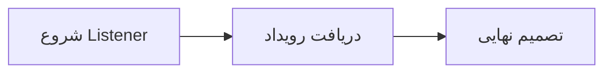
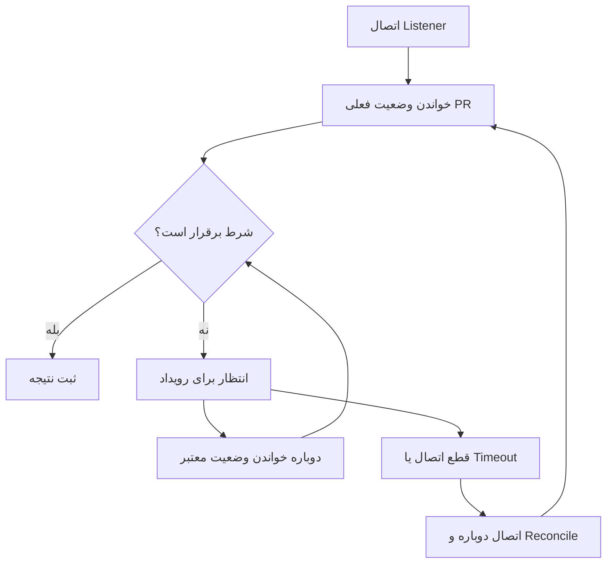

فرض کن یک اسکریپت نوشته‌ایم که بعد از ساختن Pull Request باید منتظر بماند تا تست‌ها تمام شوند یا یک نفر Review بدهد. راه معمول این است که هر چند ثانیه از GitHub بپرسیم: «خب، خبری شد؟»

این روش همان **Polling** است. برای یک اسکریپت کوچک شاید مسئله‌ای نباشد، اما وقتی چند ایجنت یا سرویس هم‌زمان ده‌ها PR را دنبال می‌کنند، درخواست‌های تکراری زیاد می‌شوند. تازه بین دو درخواست هم ممکن است اتفاقی بیفتد که دیر متوجهش شویم.

گیت‌هاب در [۱۷ نوامبر ۲۰۲۶](https://github.blog/changelog/) قابلیت **GitHub Event Streams** را در وضعیت Preview معرفی کرد و در [۱۸ نوامبر](https://github.blog/changelog/month/11-2026/) پشتیبانی از آن را با **GitHub CLI نسخهٔ 2.105.0** اعلام کرد. حالا می‌توانیم با `gh event listen` به‌جای پرس‌وجوی مداوم، منتظر رویداد بمانیم.

این مقاله دربارهٔ یک تغییر کوچک در ابزار خط فرمان است که پشتش یک تصمیم معماری مهم قرار دارد: **به‌جای اینکه وضعیت را مدام بخوانیم، تغییر وضعیت را دریافت کنیم؛ اما هیچ‌وقت دریافت رویداد را با داشتن وضعیت قطعی اشتباه نگیریم.**

## Polling چه مشکلی دارد؟

فرض کنیم هر ده ثانیه وضعیت یک PR را می‌خوانیم. در یک ساعت، ۳۶۰ درخواست خواهیم داشت؛ حتی اگر هیچ اتفاقی نیفتد. برای ۱۰۰ PR، این عدد به ۳۶ هزار درخواست در ساعت می‌رسد. این‌ها اعداد یک مثال محاسباتی‌اند، نه آمار مصرف واقعی GitHub.

فاصلهٔ Polling هم یک بده‌بستان است: فاصلهٔ کوتاه‌تر یعنی درخواست بیشتر؛ فاصلهٔ بلندتر یعنی تأخیر در واکنش.

البته Polling همیشه انتخاب بدی نیست. اگر هر چند ساعت یک بار گزارش می‌گیریم، یک درخواست ساده احتمالاً از نگهداری اتصال زنده راحت‌تر است. Event Streams بیشتر برای کاری مناسب است که **واقعاً منتظر یک تغییر مشخص** می‌ماند.

## قابلیت جدید دقیقاً چیست؟

دستور `gh event listen` به رویدادهای یک Pull Request در `github.com` گوش می‌دهد و هر رویداد را به شکل یک خط JSON از نوع CloudEvent روی stdout می‌نویسد. پیام‌های وضعیت اتصال به stderr می‌روند تا بتوانیم stdout را پردازش کنیم.

برای شروع باید GitHub CLI مناسب را نصب و احراز هویت کنیم:

```bash
gh --version
gh auth status
```

پشتیبانی موردبحث از نسخهٔ **2.105.0** شروع می‌شود. اگر نسخه قدیمی‌تر است، طبق روش نصب سیستم خودمان به‌روزرسانی‌اش می‌کنیم.

مثلاً برای انتظار تا ثبت Review روی یک PR:

```bash
gh event listen \
  --resource https://github.com/OWNER/REPO/pull/123 \
  --event com.github.pull_request.review.submitted.v1 \
  --timeout 30m
```

دستور در حالت پیش‌فرض بعد از **اولین رویداد** خارج می‌شود. با `--follow` می‌توانیم به گوش‌دادن ادامه بدهیم و با `--count` تعداد رویدادهای موردنیاز را تعیین کنیم. اگر مهلت `--timeout` قبل از رویداد تمام شود، کد خروج ۸ است؛ پس Timeout را نباید با «Review رد شد» اشتباه گرفت.

## چه رویدادهایی داریم؟

طبق [راهنمای رسمی GitHub CLI](https://cli.github.com/manual/gh_event_listen)، این رویدادها در دسترس‌اند:

| رویداد | کاربرد |
| --- | --- |
| `review.submitted.v1` | یک Review ثبت شده |
| `state.changed.v1` | PR بسته، باز، Merge یا Draft/Ready شده |
| `head.changed.v1` | HEAD شاخهٔ PR تغییر کرده |
| `merge_conflict.v1` | تضاد ادغام گزارش شده |
| `check_suite.status.changed.v1` | وضعیت یک Check Suite تغییر کرده؛ مثلاً اجرای CI تمام شده |

نام کامل رویدادها با پیشوند `com.github.pull_request.` ساخته می‌شود. این نام‌ها را دقیق وارد کنیم؛ اینجا نام دلخواه برای یک Webhook نیست.

برای نمونه، اگر فقط نتیجهٔ Check Suite را می‌خواهیم:

```bash
gh event listen \
  --resource https://github.com/OWNER/REPO/pull/123 \
  --event com.github.pull_request.check_suite.status.changed.v1 \
  --jq .data.conclusion \
  --timeout 20m
```

**نکته:** یک PR ممکن است چند Check Suite داشته باشد. دریافت `success` برای یکی از آن‌ها به معنی سبز شدن تمام CI نیست.

## یک اشتباه مهم: رویداد، خود وضعیت نیست

فرض کن ایجنت ما منتظر تأیید PR است. درست قبل از وصل‌شدن Listener، یک نفر PR را تأیید می‌کند. آیا رویداد تأیید را می‌گیریم؟ نه؛ **Event Streams رویدادهای قبلی را Replay نمی‌کند.**

از طرف دیگر، اگر اتصال قطع شود، CLI برای وصل‌شدن دوباره تلاش می‌کند؛ اما رویدادهایی که در فاصلهٔ قطعی رخ داده‌اند تحویل داده نمی‌شوند.

پس معماری قابل‌اعتماد نباید صرفاً این باشد:



به‌جایش این مدل را پیشنهاد می‌کنم:



به این الگو می‌توان گفت **Event-driven wake-up + state reconciliation**: رویداد به ما خبر می‌دهد که وقت بررسی دوباره است، ولی تصمیم را از روی وضعیت معتبر می‌گیریم.

برای جلوگیری از Race Condition بین اتصال و خواندن وضعیت، طبق مستندات باید ابتدا Listener وصل شود و **بعد از پیام اتصال** وضعیت PR را بخوانیم. اگر وضعیت قبل از اتصال خوانده شود، ممکن است تغییری در فاصلهٔ این دو مرحله از دست برود.

## یک نمونهٔ عملی: انتظار برای پایان بررسی‌های PR

اگر فقط می‌خواهیم تا تمام‌شدن Checkها صبر کنیم، هنوز هم دستور زیر ساده و کاربردی است:

```bash
gh pr checks 123 --watch --required \
  --repo OWNER/REPO
```

این دستور از حالت Watch استفاده می‌کند و طبق [مستندات رسمی](https://cli.github.com/manual/gh_pr_checks) Polling انجام می‌دهد. گزینهٔ `--required` فقط بررسی‌های اجباری را نشان می‌دهد.

برای معماری Event-driven می‌توانیم رویداد تکمیل Check Suite را دریافت کنیم، سپس با `gh pr checks` وضعیت واقعی را بخوانیم:

```bash
gh event listen \
  --resource https://github.com/OWNER/REPO/pull/123 \
  --event com.github.pull_request.check_suite.status.changed.v1 \
  --timeout 10m

gh pr checks 123 --required --repo OWNER/REPO
```

این **یک نمونهٔ آموزشی** است، نه یک Waiter کامل. اگر Timeout شود یا چند Suite در زمان‌های متفاوت تمام شوند، باید کد خروج را بررسی و دوباره وضعیت را Reconcile کنیم. همچنین قبل از اجرای Listener و بلافاصله پس از اتصال، یک Snapshot از وضعیت بگیریم؛ صرفاً اجرای دو دستور پشت‌سرهم شکاف رویدادی را کامل حل نمی‌کند.

برای سیستم Production بهتر است Listener یک پردازش ماندگار باشد و بررسی وضعیت در یک Worker مستقل انجام شود. هر Event فقط آن Worker را بیدار کند. نتیجهٔ نهایی را از روی یک Snapshot تازه تعیین کنیم.

## چرا این تغییر برای ایجنت‌های کدنویسی مهم است؟

ایجنت ممکن است کد بنویسد، PR بسازد و سپس منتظر سه اتفاق بماند: پایان CI، Review و تغییر شاخه. با Polling مداوم، بخش زیادی از عمر پردازش صرف سؤال تکراری می‌شود.

اما Event Streams به معنی اجازهٔ Merge خودکار نیست. ایجنت می‌تواند منتظر بماند، گزارش بدهد و بعد از تغییر وضعیت دوباره بررسی کند؛ **سیاست تأیید انسانی و مجوز Merge همچنان جداست.**

برای مثال، یک Orchestrator می‌تواند با رویداد `head.changed` بفهمد که Commit جدیدی Push شده و نتایج تست قبلی دیگر برای HEAD جدید کافی نیستند. این برداشت یک کاربرد معماری از رویداد است؛ نه تضمینی که GitHub خودش تمام تصمیم‌های اعتبارسنجی را برای ما می‌گیرد.

## Event Streams، Webhook یا Polling؟

| روش | مزیت | محدودیت |
| --- | --- | --- |
| Polling | ساده، بدون اتصال ماندگار | درخواست تکراری و تأخیر دوره‌ای |
| Webhook | مناسب سرویس‌های دائمی و رویدادهای متنوع | نیازمند Endpoint، اعتبارسنجی امضا، Retry و مدیریت تحویل |
| GitHub Event Streams | انتظار مستقیم از CLI، مناسب ابزار و ایجنت | Preview، محدود به PRهای github.com، بدون Replay |

Event Streams جای تمام Webhookها را نمی‌گیرد. اگر سرویسی داریم که رویدادهای چند مخزن را در بلندمدت پردازش می‌کند، Webhook با صف و ذخیره‌سازی پایدار همچنان می‌تواند انتخاب مناسب‌تری باشد.

## محدودیت‌هایی که باید قبل از استفاده بدانیم

- این قابلیت در زمان نگارش در وضعیت **Preview** است؛ برای فرآیند حیاتی، تغییرات و محدودیت‌های آن را پیگیری کنیم.
- فعلاً رویدادهای موردبحث فقط برای PRهای `github.com` ارائه شده‌اند، نه GitHub Enterprise Server یا GHE.com.
- Subscriptionها بعد از **۲۴ ساعت** منقضی می‌شوند و تعداد Subscription هم‌زمان هر حساب محدود است.
- قطعی اتصال می‌تواند باعث ازدست‌رفتن رویداد شود؛ Reconnect به معنی Replay نیست.
- یک رویداد تکمیل Check Suite، نتیجهٔ همهٔ Checkها را نمایندگی نمی‌کند.
- `data.api_url` در رویداد، آدرس منبع تغییرکرده را نشان می‌دهد؛ برای تصمیم حساس، دادهٔ تازه را از API بخوانیم و مجوزها را هم بررسی کنیم.

## چک‌لیست پیاده‌سازی

۱. نسخهٔ CLI و پشتیبانی از Event Streams را بررسی کنیم.

۲. رویدادهای دقیق موردنیاز را انتخاب کنیم، نه اینکه همه‌چیز را گوش بدهیم.

۳. Listener را وصل کنیم و بعد Snapshot اولیه را بخوانیم.

۴. بعد از هر رویداد، وضعیت فعلی PR یا Checkها را دوباره بگیریم.

۵. Timeout، قطع اتصال و اجرای تکراری Worker را مدیریت کنیم.

۶. تصمیم‌های حساس مثل Merge و Deploy را فقط با مجوز و بررسی مستقل انجام بدهیم.

۷. اگر قابلیت Preview برای محیط ما مناسب نیست، Polling با Backoff یا Webhook را نگه داریم.

## جمع‌بندی

جذابیت `gh event listen` در حذف چند خط `sleep` از اسکریپت نیست؛ در جدا کردن **«منتظر تغییر ماندن»** از **«درست بودن وضعیت»** است. رویداد کمک می‌کند سریع‌تر بیدار شویم، ولی منبع حقیقت همچنان وضعیت فعلی GitHub است.

برای یک اسکریپت کوتاه شاید `gh pr checks --watch` کافی باشد. برای ایجنت یا سرویس هماهنگ‌کننده‌ای که باید مدت زیادی منتظر Review و CI بماند، Event Streams ارزش آزمایش دارد؛ البته با Reconciliation، Timeout و مرز روشن اختیارات.

---

## منابع و مطالعهٔ بیشتر

- [GitHub Changelog — Wait for pull request events with GitHub CLI، ۱۸ نوامبر ۲۰۲۶](https://github.blog/changelog/month/11-2026/)
- [GitHub CLI — gh event listen](https://cli.github.com/manual/gh_event_listen)
- [GitHub CLI — gh pr checks](https://cli.github.com/manual/gh_pr_checks)
- [GitHub CLI — gh pr](https://cli.github.com/manual/gh_pr)
- [GitHub CLI — gh run watch](https://cli.github.com/manual/gh_run_watch)

*دربارهٔ ترندها:* این موضوع از انتشار رسمی و تازهٔ GitHub انتخاب شده؛ رتبه یا حجم جست‌وجوی Google Trends به‌طور مستقل تأیید نشده و در مقاله عددی برای آن ادعا نشده است.
