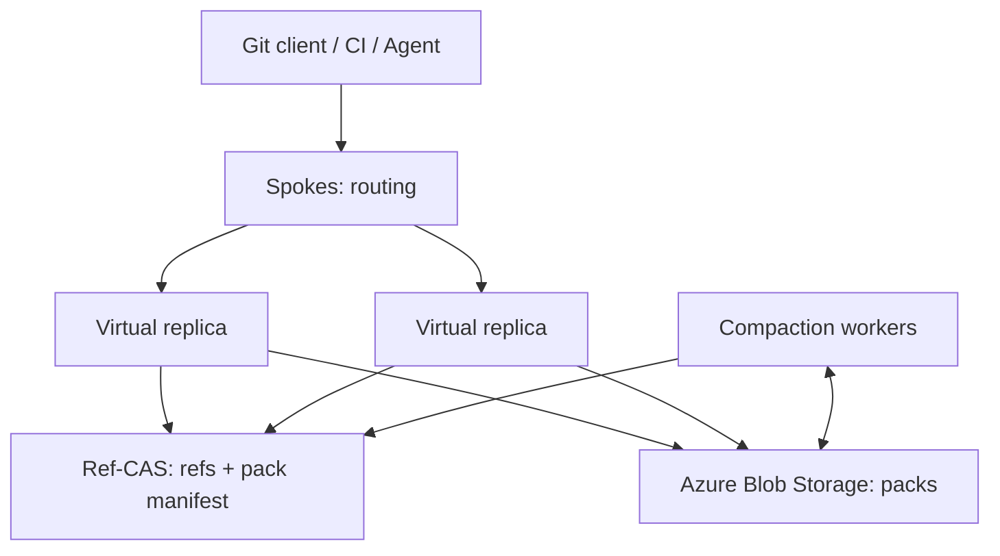

فرض کن یک مخزن Git داریم که پنج نفر روی اون کار می‌کنن. هر چند دقیقه یک‌بار Push می‌زنن و بقیه هم Fetch می‌کنن. حالا تعداد نویسنده‌ها رو به چند هزار ایجنت برسون؛ هرکدوم روی برنچ خودش کد تولید می‌کنه، تست اجرا می‌کنه و دوباره Push می‌زنه. مشکل فقط تعداد درخواست‌ها نیست: هر Push می‌تونه چندین Fetch از طرف CI، سرویس Deploy و ایجنت‌های دیگه ایجاد کنه.

گیت‌هاب در [گزارش مهندسی ۵ نوامبر ۲۰۲۶](https://github.blog/engineering/architecture-optimization/inside-githubs-new-git-storage-architecture/) معماری جدیدی به اسم **Rubicon** رو توضیح داده. نتیجهٔ تست داخلی گزارش‌شده چشمگیره: پشتیبانی از ۵۰۰۰ ایجنت هم‌زمان و ۷۲۰۰ Push در ثانیه روی یک مخزن. این عددها **بنچمارک داخلی گیت‌هاب** هستن، نه تضمین عملکرد برای همهٔ مخزن‌ها یا قابلیتی که همین امروز برای همه فعال شده باشه.

به نظرم بخش مهم‌تر گزارش، خود عددها نیست؛ تصمیم معماری پشت اون‌هاست: **داده‌ای رو که تغییر نمی‌کنه از بخش کوچکی که واقعاً به هماهنگی نیاز داره جدا کنیم.**

## چرا Push کردن به یک مخزن شلوغ سخت می‌شه؟

در Git، فایل‌ها و Commitها به‌صورت Object ذخیره می‌شن و شناسهٔ محتوایی دارن. وقتی یک Object نوشته شد، محتوای اون Object تغییر نمی‌کنه؛ تغییر جدید Object جدیدی می‌سازه. اما برنچی مثل `refs/heads/main` یک اشاره‌گر متغیره که باید به Commit درست اشاره کنه.

دو ایجنت می‌تونن Objectهای متفاوتی رو مستقل از هم آپلود کنن. ولی اگر هر دو بخوان یک Ref مشخص رو تغییر بدن، باید تکلیف ترتیب و تعارض روشن بشه. اگر همهٔ عملیات مخزن رو پشت یک قفل یا یک نویسندهٔ واحد بذاریم، با زیاد شدن Pushها خیلی زود به سقف می‌رسیم.

نکتهٔ ظریف اینه که **همهٔ Pushها با هم تعارض ندارن**. دو Push به دو برنچ متفاوت معمولاً می‌تونن مستقل پیش برن؛ دو Push به یک برنچ نیاز به کنترل هم‌زمانی دارن.

## Rubicon چه بخش‌هایی داره؟

گیت‌هاب سرویس مسیریابی موجود خودش، Spokes، رو نگه داشته و زیر اون سه مسئولیت رو از هم جدا کرده:

| بخش | مسئولیت | وضعیت داده |
| --- | --- | --- |
| Virtual Replica | پاسخ به Fetch و پردازش Push، ساخت ایندکس و کش محلی | محاسبات و کش قابل‌بازسازی |
| Azure Blob Storage | نگهداری Packها، ایندکس‌ها و داده‌های کمکی | ذخیره‌سازی پایدار Objectها |
| Ref-CAS | ثبت اتمیک تغییر Refها و فهرست Packهای مخزن | وضعیت مرجع و هماهنگی |
| Compaction Worker | ادغام Packها و آماده‌سازی نگهداری | پردازش پس‌زمینه و مستقل |

این جداسازی باعث می‌شه افزایش ظرفیت خواندن، نوشتن و نگهداری مخزن لزوماً به بزرگ‌تر کردن یک سرور واحد وابسته نباشه.



این دیاگرام برداشت ساده‌شده‌ای از معماری منتشرشده‌ست؛ جزئیات شبکه، Quorum و مدیریت کش رو کامل نشون نمی‌ده.

## مسیر یک Push؛ اول Object، بعد Ref

برای یک Push موفق، ترتیب عملیات اهمیت داره:

1. Virtual Replica دادهٔ ورودی رو دریافت و Pack رو پردازش می‌کنه.
2. Pack در Blob Storage ذخیره می‌شه تا Objectهای موردنیاز پایدار باشن.
3. یک تراکنش در Ref-CAS، هم فهرست Packها رو به‌روزرسانی می‌کنه و هم Refهای مربوط رو تغییر می‌ده.
4. بعداً Workerهای جداگانه Packهای کوچک رو ادغام می‌کنن.

چرا مرحلهٔ دوم باید قبل از سوم باشه؟ چون Ref نباید به Commitی اشاره کنه که Objectهاش هنوز پایدار نشده‌ان. این ترتیب یک اصل عمومی برای طراحی سیستم‌های توزیع‌شده‌ست: **اول دادهٔ وابسته رو Durable کن، بعد اشاره‌گر قابل‌مشاهده رو منتشر کن.**

البته از این ترتیب نباید نتیجه گرفت که هر سیستم دارای Object Storage خودبه‌خود تراکنش چندمرحله‌ای امن داره. مدیریت خطا، Retry، Objectهای بدون ارجاع و پاک‌سازی همچنان لازم‌اند.

## Ref-CAS دقیقاً چه مسئله‌ای رو حل می‌کنه؟

CAS مخفف Compare-and-Swap هست. ایده ساده‌ست: «فقط اگر مقدار قبلی هنوز همون چیزیه که انتظار دارم، مقدار جدید رو ثبت کن.»

فرض کنیم `main` الان به Commit A اشاره می‌کنه. دو نویسنده می‌خوان هم‌زمان اون رو به B و C تغییر بدن:

```text
Initial: main = A

Writer 1: CAS(main, expected=A, next=B) -> success
Writer 2: CAS(main, expected=A, next=C) -> conflict

Final: main = B
```

این شبه‌کده، نه API عمومی Ref-CAS. نویسندهٔ دوم باید وضعیت جدید رو بخونه و تصمیم بگیره دوباره تلاش کنه، Rebase کنه یا خطا رو به کاربر نشون بده. این رفتار به معنی Merge خودکار تغییرات نیست.

در طراحی گیت‌هاب، Ref-CAS یک سرویس Log تکرارشده‌ست. هر تراکنش فقط Refهای درگیر رو قفل می‌کنه، مقدار موردانتظار رو بررسی می‌کنه و پس از ثبت در اکثریت Replicaهای Log قابل‌مشاهده می‌شه. هر Commit یک **Log Sequence Number (LSN)** می‌گیره؛ نسخهٔ مخزن هم از آخرین LSN مشخص می‌شه.

این تفاوت بزرگی با یک قفل سراسری داره. اگر ایجنت‌ها روی برنچ‌های جدا کار کنن، بیشتر تغییرات Ref با هم رقابت نمی‌کنن. البته تراکنش‌هایی که چند Ref رو با هم تغییر می‌دن همچنان باید اتمیک باقی بمونن.

### چرا Refها رو مستقیم داخل Blob Storage نذاشتن؟

گیت‌هاب دو طراحی رو امتحان کرده:

- **یک Blob برای Log همهٔ Refها:** خواندن ساده بود، اما هر نوشتن شرطی باید منتظر نوشتن قبلی می‌موند. طبق گزارش، ظرفیت نوشتن در حد چندصد عملیات بر ثانیه متوقف می‌شد.
- **تقسیم Refها بین چند Blob:** نوشتن موازی‌تر شد، اما برای فهمیدن وضعیت جدید باید چند بخش بررسی می‌شد و خواندن به کندترین بخش وابسته می‌شد.

در سیستمی که Fetchها بسیار بیشتر از Pushها هستن، قربانی کردن سرعت خواندن برای افزایش سرعت نوشتن همیشه انتخاب خوبی نیست. Ref-CAS تلاش می‌کنه هر دو مسئله رو جدا حل کنه.

## خواندن چطور ارزون می‌مونه؟

Virtual Replica نسخهٔ Refهایی رو که در کش داره به Ref-CAS می‌فرسته. اگر نسخه هنوز معتبر باشه، لازم نیست فهرست کامل Refها دوباره ارسال بشه. اگر عقب مونده باشه، وضعیت تازه و اشاره‌گرهای Packهای موردنیاز رو می‌گیره و داده‌های لازم رو از Blob Storage داخل کش خودش می‌آره.

اینجا یک تفکیک مهم داریم: **کش محلی منبع حقیقت نیست.** از دست رفتن دیسک یک Virtual Replica نباید به معنی از دست رفتن مخزن باشه. این ویژگی جایگزینی Replica و افزایش ظرفیت رو ساده‌تر می‌کنه، اما همچنان به طراحی درست Invalidation، صحت داده و دسترس‌پذیری سرویس مرجع وابسته‌ست.

## مشکل دوم: هزاران Pack کوچک

هر Push می‌تونه یک Pack جدید اضافه کنه. اگر نرخ ورود Packها زیاد بشه و هیچ نگهداری‌ای انجام ندیم، تعداد Packها بالا می‌ره و Lookupها گرون‌تر می‌شن.

در Rubicon، Compaction روی همان ماشین‌هایی که به کاربران پاسخ می‌دن اجرا نمی‌شه. Workerهای جدا با Lease بخشی از کار رو می‌گیرن، Packها رو در Segmentهای مشخص جمع می‌کنن، اون‌ها رو به Packهای بزرگ‌تر تبدیل می‌کنن و قبل از انتشار بررسی می‌کنن Objectهای خروجی با ورودی برابر باشن.

بعد از آپلود Pack جدید، Manifest به‌روزرسانی می‌شه؛ حذف ورودی‌های قدیمی از Manifest در تراکنش بعدی انجام می‌شه و پاک‌سازی فیزیکی بعداً اتفاق می‌افته. این تفکیک جلوی قاطی شدن کار سنگین نگهداری با مسیر حساس Push و Fetch رو می‌گیره.

**Compaction با Garbage Collection یکی نیست.** Compaction شکل ذخیره‌سازی Objectهای موجود رو عوض می‌کنه؛ Garbage Collection سراغ Objectهایی می‌ره که دیگه قابل‌دسترسی نیستن. اشتباه گرفتن این دو می‌تونه به طراحی خطرناک حذف داده منجر بشه.

## چه درس‌هایی برای معماری سرویس‌های خودمون داره؟

قرار نیست هر تیمی Ref-CAS بسازه. بیشتر محصولات به چنین مقیاسی نمی‌رسن و اضافه کردن Consensus و Workerهای توزیع‌شده بدون نیاز واقعی، هزینه و پیچیدگی رو بالا می‌بره. اما چند الگو از این معماری قابل‌استفاده‌ست.

### ۱. واحد واقعی تعارض رو پیدا کن

اگر دو کاربر روی دو سند متفاوت کار می‌کنن، چرا باید یک قفل سراسری داشته باشیم؟ در یک سامانهٔ مالی هم می‌شه قفل یا کنترل نسخه رو به موجودیت مشخص محدود کرد؛ البته انتقال پول بین دو حساب به تراکنش و قواعد سازگاری دقیق‌تری نیاز داره.

### ۲. Payload بزرگ رو از Metadata متغیر جدا کن

مثلاً برای ذخیرهٔ گزارش‌های بزرگ، فایل رو اول در Object Storage بذار و بعد رکورد وضعیت و آدرس فایل رو در دیتابیس ثبت کن. اما حتماً برای آپلود نیمه‌کاره، رکورد ناموفق و پاک‌سازی فایل‌های بدون ارجاع برنامه داشته باش.

### ۳. کارهای نگهداری رو از مسیر پاسخ‌گویی جدا کن

فشرده‌سازی، ساخت ایندکس، حذف دادهٔ منقضی و تولید گزارش می‌تونن CPU و I/O مصرف کنن. وقتی این کارها با درخواست کاربر روی یک Worker رقابت می‌کنن، حتی با دیتابیس سریع هم Latency ناپایدار می‌شه.

### ۴. بنچمارک رو با شرایطش بخون

عدد ۷۲۰۰ Push در ثانیه بدون دانستن اندازهٔ Packها، توزیع برنچ‌ها، نرخ تعارض، ترکیب خواندن و نوشتن و شرایط شبکه، ظرفیت قابل‌انتقال به محصول ما نیست. در تست خودمون بهتره حداقل این معیارها رو اندازه بگیریم:

| معیار | چرا مهمه؟ |
| --- | --- |
| Push latency در p95 و p99 | تأخیرهای بدتر از میانگین رو نشون می‌ده |
| Conflict rate برای یک Ref | میزان رقابت واقعی نویسنده‌ها رو مشخص می‌کنه |
| Fetch latency در کش گرم و سرد | هزینهٔ بازسازی کش رو جدا می‌کنه |
| Pack count و Compaction lag | عقب افتادن نگهداری رو آشکار می‌کنه |
| Recovery time پس از حذف Replica | قابل‌بازسازی بودن کش رو امتحان می‌کنه |
| هزینهٔ ذخیره‌سازی و انتقال داده | تصویر کامل‌تری از مقیاس‌پذیری می‌ده |

## آیا این معماری همین حالا برای همه فعال شده؟

خیر. در زمان انتشار گزارش ۵ نوامبر ۲۰۲۶، گیت‌هاب گفته Rubicon در **Private Preview محدود** قرار داره و عرضهٔ گسترده‌تر رو برای اوایل سال بعد برنامه‌ریزی کرده. بنابراین بهتره نتایج تست داخلی رو با وضعیت عرضهٔ عمومی اشتباه نگیریم.

همچنین قابلیت‌هایی مثل کار بدون Clone کامل، API اتمیک چندفایلی، Replicaهای جهانی و Scale-to-Zero در بخش **برنامه‌های آینده** گزارش مطرح شده‌ان؛ نباید اون‌ها رو امکانات آمادهٔ محصول معرفی کرد.

## جمع‌بندی

چیزی که از معماری جدید گیت‌هاب برام جالبه، استفاده از یک فناوری عجیب نیست. Git از قبل Objectهای تغییرناپذیر و Refهای متغیر داشت. Rubicon این ویژگی رو جدی گرفته و سیستم رو دور همون مرز طراحی کرده: دادهٔ حجیم مستقل ذخیره بشه، هماهنگی فقط روی وضعیت کوچکی انجام بشه که واقعاً مشترکه، و نگهداری هم از مسیر درخواست جدا بمونه.

اگر قرار باشه فقط یک سؤال از این معماری برای پروژهٔ خودمون برداریم، اون سؤال اینه: **کدوم بخش سیستم واقعاً به هماهنگی نیاز داره و کدوم بخش رو بی‌دلیل پشت همون گلوگاه گذاشتیم؟**

---

## منابع و مطالعهٔ بیشتر

- [Inside GitHub's new Git storage architecture — GitHub Engineering، ۵ نوامبر ۲۰۲۶](https://github.blog/engineering/architecture-optimization/inside-githubs-new-git-storage-architecture/) — منبع اصلی معماری، اعداد تست و وضعیت عرضه.
- [The bridge to agent-scale Git infrastructure — GitHub Engineering، ۲۱ اکتبر ۲۰۲۶](https://github.blog/engineering/architecture-optimization/) — زمینهٔ مهاجرت و Replicaهای مجازی.
- [Git Internals: Git Objects — مستندات رسمی Git](https://git-scm.com/book/en/v2/Git-Internals-Git-Objects) — مفهوم Objectهای محتوایی.
- [Git Internals: Git References — مستندات رسمی Git](https://git-scm.com/book/en/v2/Git-Internals-Git-References) — مفهوم Ref و Branch.

*یادداشت روش‌شناسی: اعداد عملکردی و جزئیات Rubicon از گزارش خود گیت‌هاب نقل شدن؛ این مقاله بنچمارک مستقل انجام نداده. انتخاب موضوع با بررسی گزارش‌های مهندسی GitHub و محتوای مخزن انجام شده و رتبهٔ Google Trends به‌صورت مستقل تأیید نشده است.*
