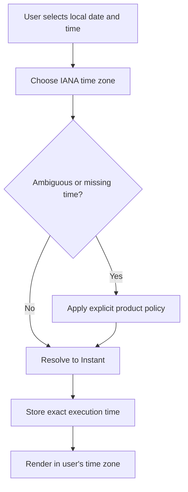

امروز، ۲۵ اکتبر ۲۰۲۶، توی برلین ساعت ۳ صبح دوباره به ۲ برگشت. یعنی ساعت ۲:۳۰ بامداد **دو بار** اتفاق افتاد: یک بار با اختلاف `UTC+02:00` و یک بار با `UTC+01:00`.

حالا فرض کن کاربر توی یک اپلیکیشن رزرو، ساعت ۲:۳۰ رو انتخاب کرده. دقیقاً کدوم ۲:۳۰ رو می‌خواسته؟ اگر فقط `2026-10-25 02:30` رو توی دیتابیس ذخیره کنیم، جواب این سؤال رو نمی‌دونیم.

این یک مثال ساختگی از محصوله، ولی تغییر ساعت واقعی بوده. اتفاقاً بهانهٔ خوبیه که دربارهٔ یکی از قدیمی‌ترین دردسرهای جاوااسکریپت حرف بزنیم: کار با تاریخ و زمان.

`Temporal` یک API جدید در خود جاوااسکریپته که تلاش می‌کنه به‌جای یک نوع دادهٔ همه‌کاره، برای هر مفهوم زمانی یک ابزار مشخص بده. در مارس ۲۰۲۶ به مرحلهٔ چهارم استانداردسازی TC39 رسید؛ اما **استاندارد شدن با پشتیبانی همهٔ مرورگرها یکی نیست**. آخر مقاله می‌گم کجا می‌شه ازش استفاده کرد و کجا هنوز باید احتیاط کنیم.

## مشکل Date دقیقاً چیه؟

خود `Date` برای ثبت یک لحظهٔ مشخص در زمان بد نیست. دردسر از جایی شروع می‌شه که ازش انتظار داریم هم‌زمان «تاریخ تقویمی»، «ساعت محلی»، «زمان یک منطقهٔ مشخص» و «لحظهٔ وقوع رویداد» رو مدل کنه.

مثلاً این کد رو ببین:

```js
const dueDate = new Date("2026-10-25");
console.log(dueDate.toISOString());
// 2026-10-25T00:00:00.000Z
```

رشتهٔ تاریخِ بدون ساعت در قالب استاندارد بالا، به نیمه‌شب UTC تفسیر می‌شه. وقتی همون لحظه رو در منطقه‌ای با اختلاف زمانی منفی نمایش بدیم، ممکنه کاربر **روز قبل** رو ببینه. برای چیزی مثل «تاریخ سررسید»، شاید اصلاً نباید از ابتدا یک لحظهٔ UTC ساخته باشیم.

`Date` چند محدودیت دیگه هم داره: متدهای تغییرش می‌تونن شیء رو درجا عوض کنن، ماه‌ها در سازندهٔ عددی از صفر شروع می‌شن، و متدهای محلی‌اش به منطقهٔ زمانی محیط اجرا وابسته‌اند. این‌ها لزوماً در هر پروژه باگ ایجاد نمی‌کنن؛ ولی وقتی چند کشور و چند سرویس درگیر باشن، احتمال اشتباه بیشتر می‌شه.

## قبل از کدنویسی، چهار مفهوم رو از هم جدا کنیم

مهم‌ترین قسمت یادگیری Temporal حفظ کردن اسم متدها نیست. باید بفهمیم **چه چیزی رو داریم ذخیره می‌کنیم**.

| چیزی که داریم | نوع مناسب در Temporal | مثال |
| --- | --- | --- |
| یک لحظهٔ دقیق در خط زمان | `Temporal.Instant` | زمان ثبت یک تراکنش |
| فقط تاریخ تقویمی، بدون ساعت | `Temporal.PlainDate` | تاریخ تولد یا سررسید |
| تاریخ و ساعت محلی، بدون منطقهٔ زمانی | `Temporal.PlainDateTime` | ساعت ۹ در یک برنامهٔ اولیه |
| زمان محلی همراه با منطقهٔ زمانی | `Temporal.ZonedDateTime` | جلسهٔ ساعت ۹ در برلین |
| یک بازه یا مدت | `Temporal.Duration` | دو ساعت و سی دقیقه |

برای مثال، «پرداخت در چه لحظه‌ای انجام شد؟» با «فاکتور مربوط به چه روزی است؟» یک سؤال نیست. اولی معمولاً به `Instant` نیاز داره و دومی ممکنه فقط `PlainDate` بخواد.

```js
const paidAt = Temporal.Instant.from("2026-10-25T01:30:00Z");
const invoiceDate = Temporal.PlainDate.from("2026-10-25");

console.log(paidAt.toString());      // 2026-10-25T01:30:00Z
console.log(invoiceDate.toString()); // 2026-10-25
```

دومی اصلاً Time Zone نداره. قرار نیست با جابه‌جایی کاربر بین تهران و برلین، تاریخ فاکتور خودبه‌خود عوض بشه.

## برگردیم به ساعت ۲:۳۰ که دو بار اتفاق افتاد

تغییر ساعت تابستانی یا `Daylight Saving Time` (به‌اختصار DST) باعث می‌شه بعضی ساعت‌های محلی وجود نداشته باشن و بعضی‌ها تکرار بشن.

در برلین، روز ۲۵ اکتبر ۲۰۲۶ ساعت از ۳ به ۲ برگشت. پس «۲:۳۰» به دو لحظهٔ متفاوت اشاره می‌کنه:

| زمان محلی برلین | معادل UTC |
| --- | --- |
| `2026-10-25 02:30 +02:00` | `2026-10-25 00:30Z` |
| `2026-10-25 02:30 +01:00` | `2026-10-25 01:30Z` |

این دقیقاً همون ابهامیه که Temporal اجازه می‌ده درباره‌اش تصمیم آگاهانه بگیریم:

```js
const input = {
  timeZone: "Europe/Berlin",
  year: 2026,
  month: 10,
  day: 25,
  hour: 2,
  minute: 30,
};

const earlier = Temporal.ZonedDateTime.from(input, {
  disambiguation: "earlier",
});

const later = Temporal.ZonedDateTime.from(input, {
  disambiguation: "later",
});

console.log(earlier.toString());
// 2026-10-25T02:30:00+02:00[Europe/Berlin]

console.log(later.toString());
// 2026-10-25T02:30:00+01:00[Europe/Berlin]
```

اگر اپلیکیشن اجازهٔ حدس زدن نداره، می‌تونیم به‌جای انتخاب خودکار یکی از این دو، ورودی مبهم رو رد کنیم:

```js
Temporal.ZonedDateTime.from(input, {
  disambiguation: "reject",
});
// RangeError
```

`reject` برای ساعت‌های محلیِ ناموجود در زمان جلو کشیدن ساعت هم خطا می‌ده. البته اینکه در محصول واقعی خطا نشون بدیم، انتخاب رو به کاربر بسپاریم یا سیاست پیش‌فرض داشته باشیم، یک **تصمیم محصولی**ه؛ نه چیزی که یک کتابخونه به‌تنهایی برامون حل کنه.

## یک روز همیشه ۲۴ ساعت نیست

این بخش برای زمان‌بندی کارها خیلی مهمه. فرض کن در برلین یک کار رو هر روز ساعت ۱۲ انجام می‌دیم. از ظهر ۲۴ اکتبر تا ظهر ۲۵ اکتبر ۲۰۲۶، به‌خاطر عقب رفتن ساعت، **۲۵ ساعت واقعی** گذشته.

```js
const start = Temporal.ZonedDateTime.from(
  "2026-10-24T12:00:00+02:00[Europe/Berlin]"
);

const nextCalendarDay = start.add({ days: 1 });
const after24Hours = start.add({ hours: 24 });

console.log(nextCalendarDay.toString());
// 2026-10-25T12:00:00+01:00[Europe/Berlin]

console.log(after24Hours.toString());
// 2026-10-25T11:00:00+01:00[Europe/Berlin]
```

هر دو نتیجه درسته، ولی برای دو سؤال متفاوت:

- «فردا همین ساعت محلی» یعنی اضافه کردن **یک روز تقویمی**.
- «دقیقاً ۲۴ ساعت بعد» یعنی اضافه کردن **۲۴ ساعت واقعی**.

اگر برای تمدید اشتراک، پایان یک روز کاری یا اجرای Job زمان‌بندی‌شده از این دو مفهوم به‌جای هم استفاده کنیم، ممکنه در روزهای تغییر ساعت نتیجهٔ اشتباهی بگیریم.

## آخر ماه هم یک دام جداگانه است

مشکل فقط Time Zone نیست. «یک ماه بعد» با «۳۰ روز بعد» فرق داره. فرض کن یک فاکتور ۳۱ ژانویه صادر شده:

```js
const issuedAt = Temporal.PlainDate.from("2026-01-31");

console.log(issuedAt.add({ months: 1 }).toString());
// 2026-02-28

console.log(issuedAt.add({ days: 30 }).toString());
// 2026-03-02
```

رفتار پیش‌فرض `add` برای روز نامعتبر در ماه مقصد، `constrain` است؛ یعنی به نزدیک‌ترین روز معتبر محدود می‌شه. اگر نمی‌خوایم چنین اصلاحی بی‌صدا انجام بشه، می‌تونیم `overflow: "reject"` رو انتخاب کنیم.

برای پرداخت اقساطی، دورهٔ صورتحساب یا تمدید اشتراک، حتی «اضافه کردن یک ماه» هم همیشه سیاست تجاری کامل نیست. مثلاً باید مشخص کنیم اگر قرارداد روز ۳۱ بسته شده، در ماه‌های کوتاه چه اتفاقی بیفته و آیا در ماه بعد دوباره باید به روز ۳۱ برگردیم یا نه. Temporal عملیات تقویمی رو روشن‌تر می‌کنه؛ **قانون کسب‌وکار رو باید خودمون تعریف کنیم**.

## یک الگوی ساده برای API و دیتابیس

اگر بخوام از این مفاهیم در یک سیستم واقعی استفاده کنم، قرارداد داده رو این‌طوری مشخص می‌کنم:

**زمان وقوع رویداد:** یک timestamp با offset مشخص یا UTC، مثل `2026-10-25T01:30:00Z`. موقع دریافتش به `Instant` تبدیل می‌کنیم.

**تاریخ تقویمی:** یک رشتهٔ `YYYY-MM-DD`، مثلاً `2026-10-25`، بدون اینکه به زور به نیمه‌شب UTC تبدیلش کنیم.

**زمان‌بندی محلیِ آینده:** تاریخ، ساعت و شناسهٔ منطقهٔ زمانی IANA مثل `Europe/Berlin` رو نگه می‌داریم و سیاست برخورد با زمان‌های مبهم یا ناموجود رو هم مشخص می‌کنیم. برای اجرای قطعیِ یک نوبت، بعد از رفع ابهام می‌شه Instant متناظر رو هم ذخیره کرد.



یک نکتهٔ عملی: اگر زمان‌بندی برای ماه‌های آینده‌ست و قوانین Time Zone کشورها عوض بشن، باید مشخص کنیم کدوم چیز برامون مهم‌تره: «همیشه ساعت ۹ محلی» یا «همون Instant از قبل محاسبه‌شده». برای بعضی سیستم‌ها لازم می‌شه زمان‌بندی رو بعد از تغییر قوانین دوباره محاسبه کنیم.

همین دقت در قرارداد داده، برای لاگ و ردیابی درخواست‌ها هم مهمه؛ اگر دوست داشتی، مقالهٔ [OpenTelemetry و Observability](/writing/opentelemetry-observability-fa/) دربارهٔ ردیابی مسیر درخواست‌ها رو هم ببین.

## الان می‌شه Temporal رو در Production استفاده کرد؟

تا **۲۵ اکتبر ۲۰۲۶**، وضعیت یکدست نیست. طبق مخزن پیشنهاد TC39 و مستندات رسمی:

| محیط | وضعیت |
| --- | --- |
| Firefox 139 به بعد | پشتیبانی بومی |
| Chrome 144 به بعد | پشتیبانی بومی |
| Node.js 26 به بعد | فعال به‌صورت پیش‌فرض |
| Safari پایدار | هنوز پشتیبانی عمومی کامل ندارد |
| مرورگرهای قدیمی‌تر | نیازمند بررسی یا polyfill |

MDN هنوز Temporal رو **Limited availability** معرفی می‌کنه. پس برای سایتی که باید روی طیف وسیعی از مرورگرها کار کنه، نمی‌شه بدون بررسی پشتیبانی، مستقیم به `globalThis.Temporal` تکیه کرد.

یک گزینه، polyfill است. مخزن رسمی پیشنهاد TC39 از `temporal-polyfill` به‌عنوان گزینهٔ دارای نسخهٔ پایدار نام می‌بره. نمونهٔ راه‌اندازی:

```bash
npm install temporal-polyfill
```

```js
// At the application's entry point, before Temporal is used:
import "temporal-polyfill/global";

const today = Temporal.Now.plainDateISO();
console.log(today.toString());
```

این مثال polyfill رو به‌صورت سراسری بارگذاری می‌کنه؛ لزوماً بهینه‌ترین روش برای هر اپلیکیشن نیست. اگر حجم باندل مهمه، نسخهٔ شرطی یا API قابل tree-shaking این کتابخونه رو بررسی کن. اندازهٔ واقعی باندل رو هم با ابزار پروژهٔ خودت بسنج، نه صرفاً عددی که توی یک مقاله نوشته شده.

در TypeScript هم باید مطمئن بشیم نسخهٔ کامپایلر و تعریف نوع‌ها با پیاده‌سازی runtime سازگارند. **وجود TypeScript type به معنی پشتیبانی مرورگر نیست.**

## برای مهاجرت از Date چه کار کنیم؟

پیشنهاد من این نیست که همهٔ `new Date()`ها رو یک‌شبه پاک کنیم. این کار هم پرریسکه، هم احتمالاً بازده زیادی نداره. از جاهایی شروع کنیم که مفهوم زمان در اون‌ها واقعاً مهمه:

1. **مدل داده رو مشخص کنیم.** هر فیلد تاریخ، یک «روز تقویمی»ه یا یک «لحظهٔ دقیق»؟ این رو در نام فیلد و قرارداد API روشن کنیم.
2. **تست‌های مرزی بنویسیم.** پایان ماه، سال کبیسه، تغییر ساعت تابستانی و تبدیل بین دو منطقهٔ زمانی رو پوشش بدیم.
3. **یک بخش محدود رو مهاجرت بدیم.** مثلاً ماژول رزرو یا زمان‌بندی Job، نه تمام کدبیس.
4. **محیط اجرا رو بررسی کنیم.** مرورگرهای کاربران، نسخهٔ Node، پشتیبانی polyfill و اندازهٔ باندل رو بسنجیم.
5. **قوانین کسب‌وکار رو مستند کنیم.** API نمی‌تونه به‌جای تیم محصول تصمیم بگیره «سررسید ماه بعد» دقیقاً چه معنی‌ای داره.

اگر از قبل با یک کتابخونهٔ تاریخ کار می‌کنیم و سیستم درست کار می‌کنه، صرفاً جدید بودن Temporal دلیل کافی برای مهاجرت نیست. ولی برای قابلیت‌های جدیدی که زمان محلی، تقویم یا Time Zone بخش مهمی از منطقشونه، ارزش داره از اول نوع درست رو انتخاب کنیم.

## جمع‌بندی

چیزی که از Temporal بیشتر از همه دوست دارم، فقط API تمیزترش نیست؛ اینه که مجبورمون می‌کنه سؤال دقیق‌تری بپرسیم: **«این مقدار واقعاً چه نوع زمانی رو نشون می‌ده؟»**

اگر پاسخ «یک لحظهٔ مشخص»ه، سراغ `Instant` بریم. اگر «فقط یک روز تقویمی»ه، `PlainDate` منطقی‌تره. اگر «ساعت محلی در یک منطقهٔ زمانی»ه، `ZonedDateTime` رو بررسی کنیم. همین تفکیک می‌تونه جلوی یک دسته از باگ‌هایی رو بگیره که معمولاً فقط روزهای خاص سال خودشون رو نشون می‌دن.

امروز برلین دقیقاً یکی از همون روزهاست.

---

**منابع و مطالعهٔ بیشتر (بررسی‌شده در ۲۵ اکتبر ۲۰۲۶):**

- [TC39 — Temporal proposal, Stage 4](https://github.com/tc39/proposal-temporal)
- [MDN — Temporal API](https://developer.mozilla.org/en-US/docs/Web/JavaScript/Reference/Global_Objects/Temporal)
- [MDN — ZonedDateTime.from و رفع ابهام DST](https://developer.mozilla.org/en-US/docs/Web/JavaScript/Reference/Global_Objects/Temporal/ZonedDateTime/from)
- [MDN — ZonedDateTime.add و تفاوت روز تقویمی با ساعت](https://developer.mozilla.org/en-US/docs/Web/JavaScript/Reference/Global_Objects/Temporal/ZonedDateTime/add)
- [MDN — PlainDate.add و overflow](https://developer.mozilla.org/en-US/docs/Web/JavaScript/Reference/Global_Objects/Temporal/PlainDate/add)
- [Node.js 26.0.0 release notes](https://nodejs.org/en/blog/release/v26.0.0)
- [GitHub — temporal-polyfill](https://github.com/fullcalendar/temporal-polyfill)
- [تغییر ساعت برلین در سال ۲۰۲۶](https://www.timeanddate.com/time/change/germany/berlin)
