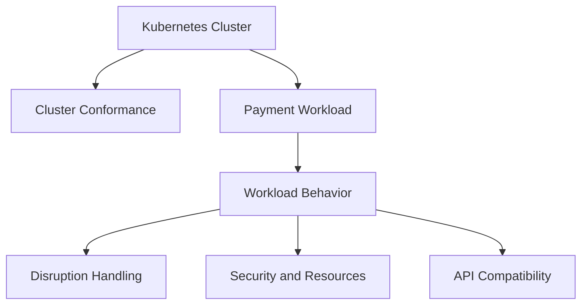
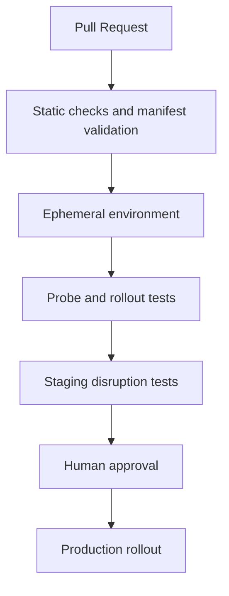

فرض کن یک سرویس پرداخت داریم که چند ماه بدون دردسر روی Kubernetes کار کرده. مانیتورینگ کلاستر سبزه، Podها هم Running هستن. آخر هفته نوبت ارتقای نودها می‌رسه و تیم زیرساخت شروع به جابه‌جا کردن Podها می‌کنه. درست وسط همین کار، بخشی از درخواست‌ها timeout می‌شن.

احتمالاً اولین واکنش اینه که بپرسیم: «مگه Kubernetes قرار نبود خودش این چیزها رو مدیریت کنه؟»

Kubernetes خیلی از کارهای زیرساخت رو انجام می‌ده، ولی از روی یک Deployment YAML نمی‌تونه حدس بزنه برنامهٔ ما با اتصال باز، درخواست نیمه‌تمام یا قطع‌شدن ناگهانی یک Pod چه رفتاری داره. **سالم‌بودن کلاستر لزوماً به معنی آماده‌بودن برنامه برای اتفاق‌های معمول محیط عملیاتی نیست.**

این مسئله حالا یک بحث رسمی هم پیدا کرده. جامعهٔ Kubernetes در **۲۷ اکتبر ۲۰۲۶** از تشکیل گروه کاری **Workload Conformance** خبر داد؛ گروهی که می‌خواد یک استاندارد مشترک و قابل‌آزمایش برای رفتار برنامه‌ها *روی* Kubernetes تعریف کنه.

من فکر می‌کنم نکتهٔ جالب خبر، خود اسم استاندارد نیست؛ سؤالیه که پشتشه: **آیا می‌شه به‌جای اعتماد به چند تنظیم YAML، رفتار واقعی سرویس رو قبل از انتشار امتحان کرد؟**

## Workload Conformance یعنی چی؟

تا امروز برنامهٔ Certified Kubernetes Conformance بیشتر روی سازگاری و رفتار **کلاستر** تمرکز داشته. اما دو برنامه که روی یک کلاستر تأییدشده اجرا می‌شن، ممکنه موقع جابه‌جایی نود کاملاً متفاوت رفتار کنن.

گروه کاری جدید می‌خواد برای رفتار runtime یک workload معیارهای قابل‌سنجش تعریف کنه. طبق اطلاعیه و charter رسمی، محدودهٔ پیشنهادی شامل امنیت، تاب‌آوری هنگام اختلال، مصرف منابع، شبکه، ذخیره‌سازی، استفاده از API و مشاهده‌پذیریه.

سه خروجی اصلی در نظر گرفته شده:

1. مشخصات رفتاری متناسب با هر نسخهٔ minor از Kubernetes؛
2. روش آزمودن هر الزام روی workload در حال اجرا؛
3. ابزار تست متن‌باز upstream برای اجرای این آزمون‌ها.

اما یک تفاوت مهم وجود داره: **تا تاریخ نگارش این مقاله، این‌ها هدف‌های گروه کاری هستن، نه یک گواهی آماده یا مجموعه‌تست نهایی که بشه همین امروز روی همهٔ سرویس‌ها اجرا کرد.** خود گروه گفته هنوز جزئیات الزام‌ها و روش آزمون‌شون نهایی نشده و برای رسیدن به نسخهٔ پایدار اولیه، حدود دو تا سه چرخهٔ انتشار Kubernetes رو هدف گرفته.

بنابراین اگر جایی دیدیم نوشته «Workload Conformance certified»، فعلاً باید دقیق بپرسیم منظورش چه آزمونی، با چه نسخه‌ای و با تأیید کدوم مرجع بوده.

## چرا تأیید کلاستر کافی نیست؟

بیایم دو لایه رو از هم جدا کنیم:



در لایهٔ کلاستر می‌پرسیم API و قابلیت‌های استاندارد Kubernetes درست کار می‌کنن یا نه. در لایهٔ workload می‌پرسیم برنامه‌ای که از این قابلیت‌ها استفاده می‌کنه، **در شرایط واقعی** چه رفتاری نشون می‌ده.

برای مثال، API مربوط به Eviction ممکنه درست کار کنه، ولی سرویس ما بعد از دریافت SIGTERM اتصال‌های باز رو ناگهانی ببنده. این مشکل الزاماً با تست سلامت خود کلاستر پیدا نمی‌شه.

از اون طرف، Workload Conformance قرار نیست منطق کسب‌وکار رو تست کنه. اینکه یک تراکنش مالی دوبار ثبت نشه، همچنان به طراحی و تست خودمون مربوطه. استاندارد پیشنهادی می‌خواد «چطور اجراشدن» برنامه رو بررسی کنه، نه «درست‌بودن نتیجهٔ تجاری» رو.

## یک سناریوی واقعی‌تر: سرویس پرداخت با سه Replica

فرض کنیم API پرداخت سه Replica داره و هرکدوم می‌تونن درخواست‌های مستقل رو پردازش کنن. در یک تعمیر برنامه‌ریزی‌شده، اپراتور یکی از نودها رو drain می‌کنه.

اگر برنامه درست برای این شرایط آماده نشده باشه، چند اتفاق محتمله: درخواست تازه هنوز به Pod در حال خاموش‌شدن برسه، درخواست قبلی نیمه‌کاره بمونه، یا Pod جایگزین قبل از آماده‌شدن کامل وارد مسیر ترافیک بشه.

به‌جای اینکه فقط بگیم «سه Replica داریم، پس مشکلی نیست»، باید رفتار برنامه رو در چند نقطه امتحان کنیم.

### ۱. Readiness با Liveness فرق داره

**Readiness probe** می‌گه این Pod *الان* می‌تونه ترافیک بگیره یا نه. اگر fail بشه، Pod از مسیر عادی سرویس برای ترافیک جدید کنار گذاشته می‌شه.

**Liveness probe** سؤال دیگه‌ای می‌پرسه: آیا کانتینر در وضعیتی گیر کرده که باید restart بشه؟ تنظیم بد liveness حتی می‌تونه موقع شلوغی، با restartهای پیاپی، وضعیت رو بدتر کنه.

**Startup probe** هم برای برنامه‌هایی مفیده که بالا آمدن‌شون زمان می‌بره؛ تا قبل از موفق‌شدن اون، readiness و liveness اجرا نمی‌شن.

این سه probe رو نباید کورکورانه روی یک endpoint کپی کنیم. مثلاً قطع موقت یک وابستگی بیرونی شاید دلیل خوبی برای برداشتن Pod از ترافیک باشه، اما لزوماً دلیل خوبی برای restart کردن خود برنامه نیست.

### ۲. خاموش‌شدن تمیز فقط یک عدد نیست

وقتی Pod وارد فرایند termination می‌شه، Kubernetes معمولاً یک مهلت برای خروج تمیز می‌ده؛ مقدار پیش‌فرض `terminationGracePeriodSeconds` برابر **۳۰ ثانیه** است.

در همین فرایند، وضعیت endpointهای در حال پایان به‌روزرسانی می‌شه تا برای ترافیک معمول Ready نباشن. بااین‌حال، زمان رسیدن تغییر به همهٔ اجزای مسیر ترافیک و رفتار اتصال‌های باز رو باید در محیط واقعی سنجید.

برنامهٔ ما هم باید به سیگنال پایان واکنش درست نشون بده: دریافت کار تازه رو متوقف کنه، کارهای در جریان رو طبق قرارداد خودش تمام یا به‌صورت امن قطع کنه و قبل از پایان مهلت خارج بشه.

اگر درخواست پرداخت ممکنه بیشتر از مهلت تعیین‌شده طول بکشه، افزایش سادهٔ timeout همیشه راه‌حل نیست. باید دربارهٔ idempotency، timeout سمت مشتری و بازیابی کار نیمه‌تمام هم تصمیم بگیریم.

### ۳. PDB معجزه نمی‌کنه

`PodDisruptionBudget` یا PDB به Kubernetes می‌گه در **اختلال‌های داوطلبانه‌ای که از Eviction API استفاده می‌کنن**، چند Pod می‌تونن هم‌زمان از دسترس خارج بشن.

برای سه Replica، می‌تونیم نمونه‌ای مثل این داشته باشیم:

```yaml
apiVersion: policy/v1
kind: PodDisruptionBudget
metadata:
  name: payment-api-pdb
spec:
  minAvailable: 2
  selector:
    matchLabels:
      app: payment-api
```

این تنظیم به‌خودی‌خود تضمین نمی‌کنه همیشه دو Pod سالم داریم. خرابی نود یا قطعی ناخواسته رو متوقف نمی‌کنه؛ فقط در تصمیم‌گیری Evictionهای داوطلبانه اثر داره.

یک نکتهٔ کمتر دیده‌شده: **PDB کنترل‌کنندهٔ مستقیم Rolling Update خود Deployment نیست.** برای Rolling Update باید تنظیمات `maxUnavailable` و `maxSurge` رو هم جداگانه بررسی کنیم. Podهای unavailable ناشی از rollout می‌تونن روی بودجهٔ اختلال اثر بذارن، ولی Deployment برای rollout به PDB محدود نمی‌شه.

این تفاوت رو اگر توی تست‌ها فراموش کنیم، ممکنه با یک حس امنیت اشتباه وارد محیط عملیاتی بشیم.

## یک Deployment نمونه؛ شروع بحث، نه نسخهٔ نهایی Production

نمونهٔ زیر برای یک سرویس HTTP فرضی طراحی شده. آدرس image و endpointهای سلامت نمونه‌اند؛ قبل از استفاده باید با برنامهٔ واقعی جایگزین و تست بشن.

```yaml
apiVersion: apps/v1
kind: Deployment
metadata:
  name: payment-api
spec:
  replicas: 3
  strategy:
    type: RollingUpdate
    rollingUpdate:
      maxSurge: 1
      maxUnavailable: 0
  selector:
    matchLabels:
      app: payment-api
  template:
    metadata:
      labels:
        app: payment-api
    spec:
      terminationGracePeriodSeconds: 45
      securityContext:
        runAsNonRoot: true
        seccompProfile:
          type: RuntimeDefault
      containers:
        - name: api
          image: registry.example.com/payment-api:1.0.0
          ports:
            - containerPort: 8080
          resources:
            requests:
              cpu: "250m"
              memory: "256Mi"
            limits:
              memory: "512Mi"
          securityContext:
            allowPrivilegeEscalation: false
            capabilities:
              drop: ["ALL"]
          startupProbe:
            httpGet:
              path: /health/startup
              port: 8080
            periodSeconds: 5
            failureThreshold: 24
          readinessProbe:
            httpGet:
              path: /health/ready
              port: 8080
            periodSeconds: 5
          livenessProbe:
            httpGet:
              path: /health/live
              port: 8080
            periodSeconds: 10
```

چرا `maxUnavailable: 0`؟ چون در این مثال می‌خوایم هنگام rollout تا حد امکان ظرفیت آمادهٔ قبلی حفظ بشه و Replica جدید با `maxSurge: 1` بالا بیاد. این انتخاب ظرفیت اضافی لازم داره و تضمین صفرشدن خطا نیست.

چرا برای CPU فقط request گذاشتیم؟ چون CPU limit در بعضی بارهای کاری می‌تونه باعث throttling بشه؛ این تصمیم باید با سیاست سازمان و اندازه‌گیری مصرف واقعی سنجیده بشه. Memory limit هم اگر نامناسب باشه می‌تونه به OOM ختم بشه.

تنظیم `runAsNonRoot` هم فقط وقتی کار می‌کنه که image واقعاً برای اجرا با کاربر غیر root آماده شده باشه. به‌علاوه، محدودسازی capabilityها و seccomp به‌تنهایی همهٔ الزامات امنیتی یک workload رو پوشش نمی‌ده.

**نکته:** عددهای منابع، تعداد Replica و زمان probe در این نمونه، مقادیر آموزشی‌اند؛ از هیچ استاندارد Workload Conformance نهایی استخراج نشده‌اند.

## از کجا بفهمیم واقعاً آماده‌ایم؟

من قبل از اینکه سراغ ابزارهای جدید برم، یک ماتریس آزمون ساده برای سرویس درست می‌کنم:

| آزمایش | سؤال اصلی | نشانه‌ای که بررسی می‌کنیم |
| --- | --- | --- |
| Rolling Update | آیا نسخهٔ تازه بدون افت غیرقابل‌قبول سرویس جایگزین می‌شه؟ | نرخ خطا، p95 و تعداد Podهای Ready |
| Node drain در محیط تست | آیا درخواست‌های در جریان درست مدیریت می‌شن؟ | timeout، قطع اتصال و نتیجهٔ درخواست |
| کندشدن وابستگی | آیا probeها تصمیم منطقی می‌گیرن؟ | Ready/NotReady، restart و صف درخواست |
| کمبود حافظه | آیا رفتار مصرف منابع قابل پیش‌بینیه؟ | OOMKilled، restart و زمان بازیابی |
| ارتقای نسخهٔ Kubernetes | آیا API منسوخ یا حذف‌شده‌ای استفاده می‌کنیم؟ | هشدارهای deprecation و خطاهای API |
| محدودیت دسترسی | آیا برنامه با حداقل دسترسی لازم اجرا می‌شه؟ | خطاهای permission و رفتار security context |

این جدول **پیشنهاد عملی من برای تست داخلیه**، نه فهرست رسمی الزام‌های گروه کاری جدید.

برای آزمون drain، سراغ کلاستر تست و یک نود مشخص می‌ریم؛ نه اینکه مستقیم روی Production دستور تخریبی اجرا کنیم. قبل از تست هم باید ظرفیت جایگزین، PDB و امکان برگشت رو بررسی کنیم.

## تست رو کجای فرایند انتشار بذاریم؟

به‌نظرم لازم نیست از روز اول همهٔ تست‌های اختلال رو روی هر Pull Request اجرا کنیم. یک تقسیم‌بندی ساده‌تر جواب می‌ده:



چک‌های سریع مثل اعتبارسنجی manifest، policy و بررسی APIهای منسوخ می‌تونن زود اجرا بشن. تست‌های سنگین‌تر مثل اختلال شبکه، drain یا سنجش رفتار زیر بار، بهتره در محیطی کنترل‌شده و با معیار قبولی مشخص انجام بشن.

برای یک سرویس پرداخت، معیار قبولی فقط «Pod دوباره بالا اومد» نیست. باید بدونیم درخواست ناموفق چه وضعیتی پیدا کرده، آیا retry امن بوده و آیا نتیجهٔ تراکنش قابل پیگیریه. این بخش به منطق کسب‌وکار مربوطه و **خارج از محدودهٔ Workload Conformance پیشنهادی** باقی می‌مونه.

## چه چیزهایی رو نباید با Workload Conformance قاطی کنیم؟

دو اصطلاح شبیه هم داریم که هدف‌های متفاوتی دارن:

- **Cluster Conformance:** بررسی سازگاری زیرساخت Kubernetes.
- **Workload Conformance:** استاندارد پیشنهادی برای رفتار runtime برنامه‌ای که روی Kubernetes اجرا می‌شه.

در کنار این‌ها، برنامهٔ **AI Conformance** دربارهٔ قابلیت‌های زیرساخت برای دسته‌ای از بارهای کاری AI/ML صحبت می‌کنه؛ جایگزین آزمون رفتار هر برنامه نیست.

گروه کاری جدید همچنین قصد نداره Helm، Operator یا یک policy engine خاص رو اجباری کنه. آزمون‌ها باید مستقل از ابزار بسته‌بندی و فروشنده باشن. همین بی‌طرفی مهمه، چون تیم‌ها در عمل از ترکیب‌های متفاوتی استفاده می‌کنن.

## آیا باید منتظر استاندارد رسمی بمونیم؟

نه. اگر امروز یک سرویس حساس روی Kubernetes داریم، می‌تونیم از همین حالا تست‌های رفتار عملیاتی رو به فرایند تحویل اضافه کنیم. فقط نباید به آزمون‌های داخلی خودمون برچسب «تأییدشده توسط استاندارد جدید» بزنیم.

در زمان نگارش، گروه کاری تازه شکل گرفته و هنوز دربارهٔ الزام‌های نهایی توافق نکرده. ممکنه بخشی از معیارهایی که الان منطقی به نظر می‌رسن، بعداً تغییر کنن یا اصلاً وارد مشخصات رسمی نشن.

به‌نظرم یک شروع خوب اینه که برای یک سرویس مهم، سه سؤال رو جواب بدیم: موقع قطع‌شدن یک Pod چه اتفاقی می‌افته؟ هنگام rollout چه مقدار اختلال قابل‌قبوله؟ و چطور می‌فهمیم رفتار واقعی با انتظارمون یکی بوده؟

اگر برای این سه سؤال تست تکرارپذیر داشته باشیم، حتی قبل از انتشار استاندارد هم یک قدم جلو افتادیم.

**جمع‌بندی:** Kubernetes می‌تونه کلاستر سالمی به ما بده، اما قابل‌اعتمادبودن سرویس چیزی نیست که صرفاً با سبزبودن وضعیت Pod ثابت بشه. خبر Workload Conformance یادآوری خوبیه که باید از «درست‌بودن فایل تنظیمات» برسیم به «درست‌بودن رفتار برنامه زیر فشار و اختلال».

---

## منابع و مطالعهٔ بیشتر

- [Kubernetes Blog — Announcing the Workload Conformance Working Group (27 Oct 2026)](https://kubernetes.io/blog/2026/10/27/announcing-workload-conformance-wg/)
- [Kubernetes Community — Workload Conformance Charter](https://github.com/kubernetes/community/blob/main/wg-workload-conformance/charter.md)
- [Kubernetes — Disruptions and PodDisruptionBudgets](https://kubernetes.io/docs/concepts/workloads/pods/disruptions/)
- [Kubernetes — Liveness, Readiness, and Startup Probes](https://kubernetes.io/docs/concepts/workloads/pods/probes/)
- [Kubernetes — Pod Lifecycle and Termination](https://kubernetes.io/docs/concepts/workloads/pods/pod-lifecycle/)
- [Kubernetes — Deployments and Rolling Updates](https://kubernetes.io/docs/concepts/workloads/controllers/deployment/)
- [Kubernetes — Pod Security Standards](https://kubernetes.io/docs/concepts/security/pod-security-standards/)
- [Kubernetes — Resource Management](https://kubernetes.io/docs/concepts/configuration/manage-resources-containers/)
- [Kubernetes — Deprecated API Migration Guide](https://kubernetes.io/docs/reference/using-api/deprecation-guide/)
