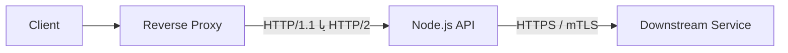

وقتی می‌گیم «سرویس Node.js ما پشت Reverse Proxy قرار داره»، معمولاً فرض می‌کنیم بخش زیادی از دردسرهای HTTP و TLS رو هم به پروکسی سپرده‌ایم. این فرض همیشه درست نیست. پروکسی می‌تونه اتصال کاربر رو خاتمه بده، اما ممکنه بین خودش و برنامه دوباره HTTP/2 یا HTTPS برقرار کنه؛ یا برنامه به‌عنوان کلاینت، با سرویس‌های دیگه ارتباط TLS داشته باشه.

در **۱۱ نوامبر ۲۰۲۶**، پروژهٔ Node.js برای شاخه‌های فعال ۲۲، ۲۴ و ۲۶ مجموعه‌ای از اصلاحات امنیتی منتشر کرد. نکتهٔ مهم فقط تعداد CVEها نیست: بعضی از ایرادها به **کرش‌کردن پردازش** منجر می‌شن، بعضی به **افشای دادهٔ حافظه** و بعضی هم می‌تونن مرز احراز هویت مبتنی بر گواهی رو مخدوش کنن. این‌ها سه مسئلهٔ متفاوت با روش بررسی متفاوت‌اند.

این مقاله رو بر اساس [اطلاعیهٔ رسمی Node.js در ۱۱ نوامبر](https://nodejs.org/en/blog/vulnerability/november-2026-security-releases/) می‌نویسم. قرار نیست روش سوءاستفاده رو بازسازی کنیم؛ می‌خوایم بفهمیم کدوم سرویس‌ها در معرض خطرند و چطور وصله رو با کمترین ریسک به محیط عملیاتی ببریم.

## دقیقاً چه نسخه‌هایی منتشر شدند؟

| شاخهٔ فعال | نسخهٔ امنیتی منتشرشده |
| --- | --- |
| Node.js 22.x | `22.23.5` |
| Node.js 24.x | `24.22.3` |
| Node.js 26.x | `26.13.1` |

این نسخه‌ها در اطلاعیهٔ رسمی ثبت شده‌اند؛ برای تصمیم نهایی، نسخهٔ نصب‌شده، وضعیت پشتیبانی و هر اطلاعیهٔ جدیدتر رو هم بررسی کن. نسخه‌های End-of-Life به‌صورت عادی وصلهٔ امنیتی دریافت نمی‌کنن.

## چرا یک HTTP/2 ساده می‌تونه کل پردازش رو از کار بندازه؟

در HTTP/2 چند Stream روی یک Connection زندگی می‌کنن. همین هم‌زمانی مزیت بزرگیه، اما مدیریت چرخهٔ عمر Stream و Session رو پیچیده‌تر می‌کنه. اگر یک Stream هنوز به بافر یا ساختار داخلی اشاره داشته باشه و Session زودتر آزاد بشه، نتیجه می‌تونه خطای حافظه یا توقف پردازش باشه.

برای نمونه، [CVE-2026-123863](https://nodejs.org/en/blog/vulnerability/november-2026-security-releases/) دربارهٔ خطای Assertion هنگام پاک‌سازی Session است. طبق اطلاعیه، در شرایط مشخص یک کلاینت بدون احراز هویت می‌تونه سرور HTTP/2 را متوقف کنه. این مورد برای شاخه‌های ۲۴ و ۲۶ گزارش شده.

[CVE-2026-123865](https://nodejs.org/en/blog/vulnerability/november-2026-security-releases/) سناریوی متفاوتی داره: هنگام خاموش‌شدن اتصال، خطای پروتکل می‌تونه باعث باقی‌ماندن Session و منابع مرتبط بشه. اثر عملی، مصرف تدریجی حافظه و File Descriptor است؛ یعنی شاید سرویس فوراً کرش نکنه، ولی زیر بار مداوم به محدودیت منابع برسه. طبق اطلاعیه، هر سه شاخهٔ فعال تحت تأثیرند.

یک نمونهٔ دیگه [CVE-2026-123868](https://nodejs.org/en/blog/vulnerability/november-2026-security-releases/) است. در این مورد، داده‌های ورودی صف‌شده برای Streamهایی که خوانده نمی‌شن، در بودجهٔ حافظهٔ Session حساب نمی‌شن. بنابراین صرفاً تنظیم `maxSessionMemory` برای جلوگیری از این مصرف حافظه کافی نبوده.

### چه چیزی رو مانیتور کنیم؟

برای یک سرویس HTTP/2، فقط تعداد درخواست موفق کافی نیست. این معیارها رو کنار هم ببین:

- حافظهٔ RSS و Heap، چون همهٔ حافظهٔ Native لزوماً در نمودار JavaScript Heap دیده نمی‌شه.
- تعداد اتصال‌های فعال و File Descriptorها.
- نرخ Reset شدن Streamها، Timeout و خطاهای پروتکل.
- Restartهای غیرمنتظره و علت خروج پردازش.
- نسبت خطاهای ۵xx و تأخیر پاسخ بعد از استقرار نسخهٔ جدید.

این‌ها به‌تنهایی اثبات وجود CVE نیستند؛ برای تشخیص اختلال و مقایسهٔ قبل و بعد از وصله مفیدند.

## نشت داده از HTTPS چه فرقی با Memory Leak داره؟

اسم‌ها شبیه‌اند ولی اثرشون یکی نیست. **Memory Leak** یعنی منابع آزاد نمی‌شن و مصرف حافظه رشد می‌کنه. **Memory Disclosure** یعنی داده‌ای از حافظهٔ پردازش به جایی می‌رسه که نباید برسه.

در [CVE-2026-123864](https://nodejs.org/en/blog/vulnerability/november-2026-security-releases/)، خطای Re-entrancy در مسیر HTTPS می‌تونه باعث خوانده‌شدن حافظهٔ نامربوط و انتقال اون در بدنهٔ درخواست بشه. اطلاعیهٔ رسمی شرایط خاصی رو برای فعال‌شدن مسیر آسیب‌پذیر ذکر می‌کنه؛ از جمله الگوی مشخصی از ارسال Header و پایان پاسخ هنگام دریافت Body. این به معنی آسیب‌پذیربودن همهٔ Routeهای HTTPS به یک اندازه نیست، ولی در هر سه شاخهٔ فعال باید وصله اعمال بشه.

از دید معماری، این اتفاق یادآوری می‌کنه که **جدا بودن درخواست‌ها در سطح کد، تضمین جدا بودن داده‌ها در سطح Runtime نیست**. اگر Runtime در مدیریت بافرها ایراد داشته باشه، تست واحدِ منطق Route ممکنه هیچ نشانه‌ای از مشکل نشون نده.

## mTLS؛ وقتی گواهی معتبر کافی نیست

در معماری سرویس‌به‌سرویس، mTLS معمولاً برای احراز هویت دوطرفه استفاده می‌شه. ولی داشتن یک گواهی معتبر برای یک Host، نباید خودبه‌خود مجوز دسترسی به Host دیگه‌ای رو بده.

دو مورد مهم اطلاعیه:

| CVE | مسئله | سناریوی مرتبط |
| --- | --- | --- |
| `CVE-2026-123872` | تغییر Server Name در TLS 1.2 Renegotiation می‌تونه سیاست Client Certificate را دور بزنه | سرورهایی با سیاست گواهی متفاوت برای Hostهای مختلف |
| `CVE-2026-123867` | تنظیم CA اختصاصی برای SNI بدون گواهی سرور در همان Context ممکنه به CA پیش‌فرض برگرده | استفاده از `server.addContext()` و CA متفاوت برای هر Host |

در هر دو مورد، مسئله این نیست که «mTLS همیشه ناامن است». خطر به **نحوهٔ پیکربندی و مسیر خاص اجرای TLS** وابسته است. بااین‌حال، به‌روزرسانی Runtime و بازبینی سیاست‌های گواهی لازمه.

### یک قاعدهٔ معماری برای سرویس‌های حساس

اگر احراز هویت سرویس‌ها بر اساس گواهی انجام می‌شه، بهتره هویت سرویس بعد از اعتبارسنجی TLS در لایهٔ Authorization هم به یک شناسهٔ مشخص و مجوزهای روشن نگاشت بشه. فقط «گواهی توسط یک CA قابل‌اعتماد صادر شده» نباید جای بررسی مجوز دسترسی به عملیات حساس رو بگیره.

برای مثال، یک سرویس گزارش‌گیری ممکنه حق خواندن گزارش داشته باشه ولی اجازهٔ ایجاد تراکنش نداشته باشه؛ حتی اگر هر دو با گواهی معتبر وارد شبکه شده باشند.

## آیا Reverse Proxy جلوی این خطرها رو می‌گیره؟

جواب کوتاه: **بستگی به مسیر واقعی ترافیک داره.**



اگر پروکسی HTTP/2 ورودی رو خاتمه بده و به Backend فقط HTTP/1.1 بفرسته، برخی مسیرهای حملهٔ HTTP/2 روی سرور Node.js قابل‌دسترسی نیستند. اما این موضوع آسیب‌پذیری‌های مربوط به **HTTPS خروجی، TLS داخلی، HTTP/2 داخلی یا کتابخانه‌های Runtime** رو خودبه‌خود رفع نمی‌کنه.

برای بررسی، به‌جای حدس‌زدن، پیکربندی Listenerها و اتصال‌های بین سرویس‌ها رو مستند کن:

1. کجا TLS Termination انجام می‌شه؟
2. Backend واقعاً با کدوم پروتکل درخواست می‌گیره؟
3. آیا خود Node.js از `node:http2` استفاده می‌کنه؟
4. آیا برنامه TLS Server، SNI یا mTLS اختصاصی داره؟
5. آیا اتصال خروجی با `https.Agent` و سیاست‌های CA متفاوت برقرار می‌کنه؟

مورد آخر هم مهمه: [CVE-2026-123877](https://nodejs.org/en/blog/vulnerability/november-2026-security-releases/) دربارهٔ استفادهٔ مجدد از Session TLS بین سیاست‌های متفاوت اعتبارسنجی گواهیه. پس سطح حمله فقط سمت سرور نیست.

## برنامهٔ به‌روزرسانی بدون غافلگیری

وصلهٔ امنیتی رو نباید با تغییر عمدهٔ معماری قاطی کرد. من برای چنین موردی این ترتیب رو ترجیح می‌دم:

### ۱. موجودی نسخه‌ها رو استخراج کن

روی محیط‌های اجرایی، نسخهٔ واقعی Node.js رو بررسی کن:

```bash
node --version
node -p "process.versions"
```

اگر از Docker استفاده می‌کنی، نسخهٔ داخل Image نهایی مهمه، نه نسخهٔ نصب‌شده روی لپ‌تاپ توسعه‌دهنده. برای Imageهای تولیدی، Digest نهایی و تاریخ Build رو هم ثبت کن.

### ۲. اول Runtime رو وصله کن، بعد تست کن

در شاخهٔ پشتیبانی‌شدهٔ فعلی به نسخهٔ اصلاح‌شده یا نسخهٔ امنیتی جدیدتر همون شاخه برو. تغییر نسخهٔ Major رو، مگر با دلیل مشخص، از این وصله جدا نگه دار.

```dockerfile
# نمونهٔ آموزشی؛ در محیط عملیاتی Digest تصویر تأییدشده را Pin کنید.
FROM node:26.13.1-bookworm-slim
WORKDIR /app
COPY package*.json ./
RUN npm ci --omit=dev
COPY . .
CMD ["node", "server.js"]
```

این Dockerfile صرفاً شکل تغییر نسخه رو نشون می‌ده؛ برای یک محصول واقعی باید Build چندمرحله‌ای، کاربر غیرریشه، مدیریت Secrets و بررسی Image هم در نظر گرفته بشه. قبل از استفاده، وجود Tag و Digest معتبر رو در Registry تأیید کن.

### ۳. تست‌های مرزی شبکه رو فراموش نکن

علاوه بر تست‌های معمول API، این سناریوها رو روی محیط آزمایشی اجرا کن:

| سناریو | انتظار |
| --- | --- |
| قطع ارتباط کلاینت وسط Upload | سرویس سالم بمونه و منابع آزاد بشن |
| لغو دانلود در HTTP/2 | سایر درخواست‌ها بدون اختلال ادامه پیدا کنن |
| Timeout هنگام پاسخ Streaming | خطا کنترل بشه و پردازش متوقف نشه |
| گواهی نامعتبر یا CA اشتباه | اتصال مطابق سیاست رد بشه |
| درخواست به Host با سیاست متفاوت mTLS | هویت و مجوز همان Host اعمال بشه |
| Restart یک Replica | سرویس با ظرفیت باقی‌مانده پاسخ‌گو بمونه |

این تست‌ها جای آزمون امنیتی تخصصی یا خود وصله رو نمی‌گیرن؛ برای کاهش ریسک Regression هستند.

### ۴. استقرار تدریجی و امکان بازگشت

اگر چند Replica داری، نسخهٔ جدید رو ابتدا روی بخشی از ترافیک امتحان کن. نرخ خطا، مصرف منابع، Restart و رفتار TLS رو با نسخهٔ قبلی مقایسه کن. Rollback باید آماده باشه، اما برگشتن به نسخهٔ آسیب‌پذیر فقط یک اقدام اضطراری کوتاه‌مدت است؛ راه‌حل پایدار نیست.

## سه اشتباه رایج در واکنش به این اطلاعیه

**اشتباه اول: «ما HTTP/2 نداریم، پس لازم نیست آپدیت کنیم.»** شاید آسیب‌پذیری‌های HTTP/2 سمت سرور به برنامه‌ات نرسن، ولی HTTPS و TLS خروجی یا Permission Model هنوز نیازمند بررسی‌اند.

**اشتباه دوم: «با محدودکردن حافظهٔ Container مسئله حل می‌شه.»** Memory Limit می‌تونه جلوی مصرف بی‌نهایت منابع میزبان رو بگیره، ولی ممکنه به OOM Kill منجر بشه؛ جلوی افشای حافظه یا دورزدن سیاست گواهی رو نمی‌گیره.

**اشتباه سوم: «نسخهٔ Node در package.json درست است.»** فیلد `engines` الزاماً Runtime اجراشده در Production رو تعیین نمی‌کنه. نسخهٔ واقعی Container یا ماشین رو باید جداگانه تأیید کرد.

## جمع‌بندی

درس این وصله‌ها صرفاً «Node.js رو آپدیت کن» نیست. **مرزهای اعتماد در یک سرویس فقط داخل کد Application تعریف نمی‌شن**؛ HTTP Parser، بافرهای Native، چرخهٔ عمر Connection و سیاست‌های TLS هم بخشی از همون مرزند.

اگر یک API حساس رو نگهداری می‌کنی، امروز سه کار عملی انجام بده: نسخهٔ واقعی Runtime رو مشخص کن، مسیرهای HTTP/2 و TLS رو روی دیاگرام معماری علامت بزن، و وصله رو با تست و استقرار تدریجی اعمال کن. این کار از فهرست‌کردن ده‌ها CVE بدون شناخت سطح حمله ارزش بیشتری داره.

---

## منابع و مطالعهٔ بیشتر

- [Node.js — Security Releases, 11 November 2026](https://nodejs.org/en/blog/vulnerability/november-2026-security-releases/) — منبع اصلی جزئیات CVEها و نسخه‌های اصلاح‌شده
- [Node.js — Security Policy](https://nodejs.org/en/security/) — سیاست گزارش و رسیدگی به آسیب‌پذیری‌ها
- [Node.js — Release Schedule](https://github.com/nodejs/Release) — وضعیت پشتیبانی شاخه‌ها
- [Node.js — HTTP/2 API](https://nodejs.org/api/http2.html) — رفتار Session و Stream
- [Node.js — TLS API](https://nodejs.org/api/tls.html) — گواهی‌ها، SNI و TLS
- [Node.js — HTTPS API](https://nodejs.org/api/https.html) — Agent و ارتباطات HTTPS

**مطالعهٔ مرتبط در همین سایت:** [مهاجرت به Node.js 26 LTS](../node26-lts-migration-fa/) — برای برنامه‌ریزی ارتقای Runtime.
