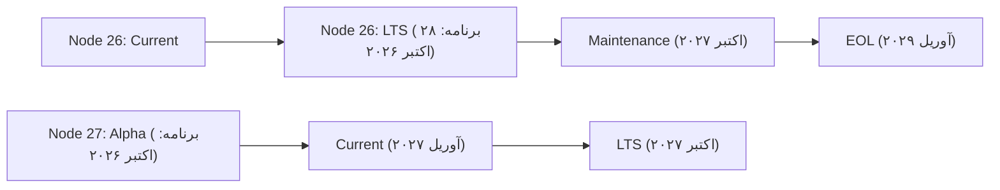
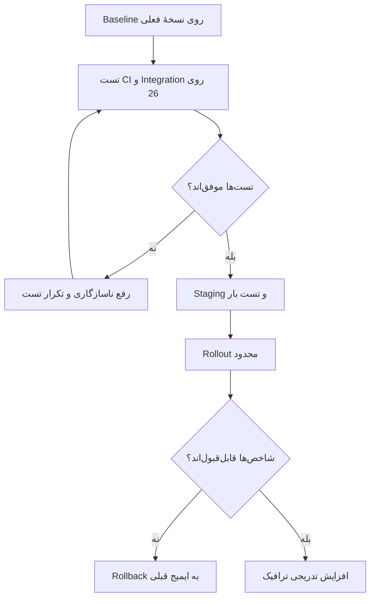

فرض کن سرویس‌مون چند ساله روی Node.js 20 کار می‌کنه. تست‌ها سبزن، کاربرها هم شکایتی ندارن و کسی دلش نمی‌خواد فقط برای عوض کردن نسخهٔ Node یک هفته درگیر CI و Docker و پکیج‌ها بشه. اما یک مشکل داریم: نسخهٔ ۲۰ از آوریل ۲۰۲۶ به پایان پشتیبانی رسمی رسیده. یعنی اگر مشکل امنیتی جدیدی در خود runtime پیدا بشه، دیگه نمی‌تونیم روی وصلهٔ رسمی اون شاخه حساب کنیم.

حالا Node.js 26 هم در آستانهٔ ورود به دورهٔ LTS قرار گرفته. سؤال من این نیست که «جدیدترین نسخه کدومه؟»؛ سؤال اینه که **برای یک سرویس واقعی، چه زمانی و با چه آزمایش‌هایی ارتقا بدیم که ریسک‌مون کمتر بشه؟**

این مطلب وضعیت پروژه را در **۲۷ اکتبر ۲۰۲۶** بررسی می‌کنه. طبق [برنامهٔ رسمی انتشار Node.js](https://github.com/nodejs/Release)، نسخهٔ ۲۶ قرار است **۲۸ اکتبر ۲۰۲۶** وارد LTS بشه. تا لحظهٔ نگارش، در [صفحهٔ رسمی نسخه‌ها](https://nodejs.org/en/about/previous-releases) هنوز با وضعیت `Current` ثبت شده؛ پس نباید از الان بنویسیم «۲۶ LTS شده». تاریخ‌های برنامه هم ممکنه تغییر کنن.

## اول تکلیف نسخه‌ها را روشن کنیم

بر اساس برنامهٔ رسمی Release Working Group، وضعیت شاخه‌های مهم این شکلیه:

| نسخه | وضعیت در ۲۷ اکتبر ۲۰۲۶ | پایان پشتیبانی برنامه‌ریزی‌شده |
| --- | --- | --- |
| Node.js 20 | EOL؛ خارج از پشتیبانی | ۳۰ آوریل ۲۰۲۶ |
| Node.js 22 | Maintenance LTS | ۳۰ آوریل ۲۰۲۷ |
| Node.js 24 | LTS؛ از ۲۰ اکتبر در دورهٔ Maintenance | ۳۰ آوریل ۲۰۲۸ |
| Node.js 26 | Current؛ ورود به LTS برای ۲۸ اکتبر برنامه‌ریزی شده | ۳۰ آوریل ۲۰۲۹ |

**EOL** یعنی پایان عمر پشتیبانی رسمی؛ **Current** شاخهٔ جدیدیه که هنوز در مرحلهٔ تثبیت قرار داره؛ و **LTS** برای استفادهٔ طولانی‌مدت طراحی شده. خود پروژهٔ Node.js هم توصیه می‌کنه برای محیط production از شاخه‌های LTS پشتیبانی‌شده استفاده کنیم.

از این جدول یک نتیجهٔ ساده می‌گیرم: اگر روی نسخهٔ ۲۴ به‌روز هستیم، لزوماً لازم نیست روز ورود ۲۶ به LTS مهاجرت کنیم. اما اگر هنوز روی ۲۰ هستیم، مسئله فقط امکانات جدید نیست؛ داریم با runtime بدون پشتیبانی رسمی کار می‌کنیم.

## چه چیزی در Node.js 26 تغییر کرده؟

[اطلاعیهٔ انتشار Node.js 26.0.0 در ۵ مه ۲۰۲۶](https://nodejs.org/en/blog/release/v26.0.0/) چند تغییر مهم رو معرفی می‌کنه:

- موتور **V8 به نسخهٔ 14.6** ارتقا پیدا کرده؛ این یعنی تغییر در قابلیت‌ها و رفتار موتور جاوااسکریپت، نه تضمین سریع‌تر شدن تمام برنامه‌ها.
- **Undici 8** وارد runtime شده؛ اگر از `fetch` داخلی Node یا کتابخانه‌هایی که به رفتار HTTP حساس‌اند استفاده می‌کنیم، تست اتصال‌ها و timeoutها مهمه.
- **Temporal** به‌صورت پیش‌فرض فعال شده؛ ولی وجود یک API جدید دلیل کافی برای بازنویسی فوری کدهای تاریخ و ساعت نیست.
- بعضی APIهای قدیمی حذف یا منسوخ شده‌اند. برای نمونه، `http.Server.prototype.writeHeader()` حذف شده و جایگزین مستندش `writeHead()` است. ماژول‌های قدیمی `_stream_*` هم حذف شده‌اند.

اگر از یک فریم‌ورک رایج استفاده می‌کنیم، ممکنه هیچ‌وقت مستقیماً این APIهای حذف‌شده رو صدا نزده باشیم. اما یکی از وابستگی‌های قدیمی‌مون شاید هنوز به اون‌ها متکی باشه. به همین دلیل، **سبز بودن تست‌های کد خودمون کافی نیست؛ زنجیرهٔ وابستگی‌ها هم باید بررسی بشه.**

برای مطالعهٔ جداگانهٔ مدیریت تاریخ و Time Zone، بهتره اول مستندات [Temporal در MDN](https://developer.mozilla.org/en-US/docs/Web/JavaScript/Reference/Global_Objects/Temporal) رو بخونیم؛ این مقاله قرار نیست دوباره آموزش Temporal باشه.

## یک تغییر بزرگ‌تر: از Node.js 27 به بعد تقویم انتشار عوض می‌شود

تا نسخهٔ ۲۶، Node.js معمولاً هر شش ماه یک نسخهٔ major منتشر می‌کرد و شاخه‌های زوج به LTS می‌رسیدند. در [اعلامیهٔ رسمی تغییر برنامه](https://nodejs.org/en/blog/announcements/evolving-the-nodejs-release-schedule)، تیم Node.js توضیح داده که **از نسخهٔ ۲۷ به بعد** قرار است هر سال یک نسخهٔ major منتشر بشه و همهٔ نسخه‌های major وارد LTS بشن.

برای نسخهٔ ۲۷، یک دورهٔ Alpha از اکتبر ۲۰۲۶ برنامه‌ریزی شده، نسخهٔ Current در آوریل ۲۰۲۷ میاد و ورودش به LTS برای اکتبر ۲۰۲۷ پیش‌بینی شده. Alpha محل امتحان تغییرات ناسازگار و دریافت بازخورد از نویسنده‌های کتابخانه‌هاست؛ نه انتخاب پیش‌فرض برای سرور production.



این دیاگرام **برنامهٔ انتشار** رو نشون می‌ده، نه اینکه همهٔ مرحله‌ها تا امروز اتفاق افتاده باشن.

## قبل از مهاجرت، سه نوع ریسک را جدا کنیم

من ریسک ارتقای Node رو به سه بخش تقسیم می‌کنم:

**۱. ناسازگاری خود runtime:** API حذف‌شده، تغییر در رفتار شبکه یا TLS، تغییر در V8 و هشدارهای deprecation.

**۲. ناسازگاری وابستگی‌ها:** فریم‌ورک، درایور دیتابیس، کتابخانهٔ رمزنگاری، پکیج‌های native و ابزارهای build. یک پکیج ممکنه در `package.json` نسخهٔ ۲۶ رو مجاز اعلام کرده باشه، اما مسیر حساس برنامهٔ ما رو روی اون نسخه امتحان نکرده باشه.

**۳. ناسازگاری محیط اجرا:** ایمیج Docker، معماری CPU، OpenSSL، توزیع لینوکس، تنظیمات CI، نسخهٔ package manager و محدودیت‌های پلتفرم میزبانی.

اگر همهٔ این‌ها رو زیر عنوان کلی «ارتقا به Node 26» قاطی کنیم، وقتی چیزی خراب شد تشخیص علت سخت می‌شه. بهتره هر لایه رو جدا تست کنیم.

## یک مسیر مهاجرت که می‌شود واقعاً اجرا کرد

بیایم یک API فرضی رو در نظر بگیریم که به دیتابیس وصل می‌شه و با یک سرویس بیرونی هم ارتباط داره. می‌خوایم نسخهٔ Node رو عوض کنیم، بدون اینکه هم‌زمان فریم‌ورک، دیتابیس و منطق کسب‌وکار رو هم بازنویسی کنیم.

### قدم ۱: نسخهٔ واقعی را در همهٔ محیط‌ها پیدا کنیم

اول از همه ببینیم الان چه چیزی **واقعاً اجرا می‌شه**؛ نه اینکه فقط چه چیزی داخل فایل README نوشته شده:

```bash
node --version
npm --version
npm ls --depth=0
```

نسخهٔ Node در لپ‌تاپ، CI، ایمیج build و کانتینر production ممکنه متفاوت باشه. برای کانتینر اجراشده هم باید نسخه رو داخل همون محیط بررسی کنیم. اگر از چند سرویس استفاده می‌کنیم، بهتره این اطلاعات رو برای تک‌تک سرویس‌ها ثبت کنیم.

همین‌جا یک baseline نگه می‌داریم: نرخ خطا، p95 زمان پاسخ، مصرف حافظه، تعداد restart و نتیجهٔ چند سناریوی کلیدی. بدون baseline، بعداً نمی‌فهمیم ارتقا چه تغییری ایجاد کرده.

### قدم ۲: با یک ماتریس CI سازگاری را بسنجیم

قبل از تغییر production، تست‌ها رو روی نسخه‌های پشتیبانی‌شده اجرا می‌کنیم. برای نمونه، اگر پروژه از GitHub Actions استفاده می‌کنه، می‌شه چنین job ساده‌ای داشت:

```yaml
name: node-compatibility
on:
  pull_request:
  workflow_dispatch:

jobs:
  test:
    runs-on: ubuntu-latest
    strategy:
      fail-fast: false
      matrix:
        node: [22, 24, 26]
    steps:
      - uses: actions/checkout@v4
      - uses: actions/setup-node@v4
        with:
          node-version: ${{ matrix.node }}
          cache: npm
      - run: npm ci
      - run: npm test
      - run: npm run build --if-present
```

این فقط یک **نمونهٔ پیشنهادی**ه؛ فرض می‌کنه پروژه `package-lock.json` و اسکریپت `test` داره. اگر تست نداریم، job با `npm test` موفق نمی‌شه و باید اول تست‌های معنی‌دار اضافه کنیم. برای پروژه‌ای که به دیتابیس یا صف وابسته‌ست، تست integration رو هم در محیط مناسب اجرا می‌کنیم.

ماتریس CI نشان می‌ده برنامه در شرایط آزمایشگاهی کار می‌کنه؛ جای تست بار و آزمایش عملیاتی رو نمی‌گیره.

### قدم ۳: وابستگی‌های حساس را هدفمند بررسی کنیم

من اول سراغ پکیج‌هایی می‌رم که با سیستم‌عامل، شبکه یا دادهٔ حساس کار می‌کنن: native addonها، درایور دیتابیس، TLS، HTTP client و ابزارهای ساخت.

دو نکتهٔ کوچک اما مهم:

- `engines.node` در `package.json` به‌تنهایی تضمین نمی‌کنه همهٔ محیط‌ها نسخهٔ درست رو اجرا کنن؛ رفتار نصب هم به تنظیمات package manager وابسته‌ست.
- عبور از `npm ci` ثابت نمی‌کنه مسیرهای runtime سالم‌اند. باید درخواست واقعی بفرستیم، اتصال دیتابیس رو آزمایش کنیم و سناریوهای خطا و timeout رو هم پوشش بدیم.

اگر مجبوریم چند شاخهٔ Node رو پشتیبانی کنیم، می‌تونیم دامنهٔ نسخه‌های مجاز رو روشن کنیم:

```json
{
  "engines": {
    "node": "^22.0.0 || ^24.0.0 || ^26.0.0"
  }
}
```

این مثال برای **کتابخانه یا پروژه‌ای با پشتیبانی چندنسخه‌ای** مناسبه. برای یک سرویس production که فقط روی یک شاخه اجرا می‌شه، معمولاً بهتره نسخهٔ مورد استفاده در CI و محیط اجرا دقیق‌تر کنترل بشه.

### قدم ۴: ایمیج و زیرساخت را جداگانه تست کنیم

فرض کنیم سرویس رو با Docker منتشر می‌کنیم. یک تغییر آزمایشی می‌تونه از این‌جا شروع بشه:

```dockerfile
# Example for staging, not a complete production Dockerfile
FROM node:26-bookworm-slim
WORKDIR /app
COPY package*.json ./
RUN npm ci --omit=dev
COPY . .
CMD ["node", "server.js"]
```

این Dockerfile **صرفاً برای توضیح تغییر runtime** است و برای هر پروژه‌ای آمادهٔ استفاده در production نیست. اگر پروژه TypeScript داره یا build لازم داره، باید مرحلهٔ build و خروجی نهایی رو جدا تنظیم کنیم. همین‌طور tag شناور `node:26-bookworm-slim` ممکنه در buildهای بعدی به نسخهٔ patch جدید اشاره کنه؛ برای استقرار قابل‌بازتولید، pin کردن digest ایمیج و داشتن فرایند به‌روزرسانی منظم بهتره.

به‌خصوص اگر native dependency داریم، تفاوت سیستم‌عامل و معماری build با production می‌تونه مسئله‌ساز بشه. اینکه تست روی لپ‌تاپ موفق بوده، الزاماً چیزی دربارهٔ ایمیج نهایی ثابت نمی‌کنه.

### قدم ۵: rollout تدریجی و rollback واقعی

بعد از تست‌ها، لازم نیست یک‌باره همهٔ ترافیک رو روی نسخهٔ جدید ببریم. اگر زیرساخت اجازه می‌ده، ابتدا یک محیط staging شبیه production و بعد یک rollout محدود داشته باشیم.

من در این مرحله به این‌ها نگاه می‌کنم: خطاهای 5xx، p95/p99 زمان پاسخ، timeout سرویس‌های بیرونی، مصرف حافظه، restart کانتینرها و لاگ‌های deprecation. یک سناریوی پرداخت یا ثبت سفارش که در ظاهر پاسخ ۲۰۰ می‌ده ولی کند شده هم باید دیده بشه.



Rollback فقط عوض کردن tag نیست. اگر هم‌زمان schema دیتابیس یا فرمت داده رو تغییر داده باشیم، ممکنه نسخهٔ قبلی دیگه با دادهٔ جدید سازگار نباشه. به همین دلیل ترجیح می‌دم ارتقای runtime رو از تغییرات بزرگ دیتابیس جدا نگه دارم.

## چرا امنیت را نباید تا روز مهاجرت عقب بیندازیم؟

در **۲۱ اکتبر ۲۰۲۶**، پروژهٔ Node.js برای شاخه‌های ۲۲، ۲۴ و ۲۶ به‌روزرسانی امنیتی منتشر کرد: به‌ترتیب `22.23.4`، `24.22.1` و `26.12.1`. در [اطلاعیهٔ امنیتی همان روز](https://nodejs.org/en/blog/vulnerability/october-2026-security-releases) مشکلاتی در بخش‌هایی مثل TLS، DNS، HTTP و Brotli توضیح داده شده.

این اتفاق یک یادآوری خوبه: **مهاجرت به major جدید و نصب patch امنیتی دو تصمیم متفاوت‌اند.** اگر روی ۲۴ هستیم و فعلاً نمی‌خوایم به ۲۶ بریم، باز هم باید patch امنیتی شاخهٔ فعلی رو بررسی و نصب کنیم. منتظر موندن برای پروژهٔ بزرگ مهاجرت، دلیل خوبی برای عقب انداختن وصلهٔ امنیتی نیست.

به‌عکس، ارتقا به ۲۶ هم به‌تنهایی امنیت کل برنامه رو تضمین نمی‌کنه. وابستگی‌ها، تنظیمات شبکه، secretها و روش استقرار همچنان مهم‌اند.

## برای تیم خودمان کدام تصمیم منطقی‌تر است؟

| وضعیت فعلی | تصمیم پیشنهادی |
| --- | --- |
| روی Node 20 یا نسخهٔ EOL هستیم | مهاجرت به یک شاخهٔ پشتیبانی‌شده را در اولویت قرار بدیم؛ در بسیاری از تیم‌ها ۲۴ مسیر کم‌ریسک‌تری برای شروعه. |
| روی Node 22 هستیم | patchها رو نگه داریم و قبل از پایان پشتیبانی در آوریل ۲۰۲۷ برای مهاجرت برنامه داشته باشیم. |
| روی Node 24 هستیم | بدون عجله، سازگاری با ۲۶ رو در CI آزمایش کنیم؛ ارتقای فوری اجباری نیست. |
| کتابخانهٔ عمومی منتشر می‌کنیم | ماتریس نسخه‌های پشتیبانی‌شده رو حفظ کنیم و کانال Alpha نسخهٔ ۲۷ رو هم برای کشف زودهنگام مشکل در نظر بگیریم. |
| پروژهٔ تازه راه می‌اندازیم | تا قبل از ورود رسمی ۲۶ به LTS، شاخهٔ LTS پشتیبانی‌شده انتخاب کنیم؛ بعد از اعلام رسمی و تأیید سازگاری می‌تونیم ۲۶ رو ارزیابی کنیم. |

این جدول نسخهٔ قطعی برای همهٔ تیم‌ها نیست. اگر یک پلتفرم میزبانی هنوز Node 26 رو پشتیبانی نمی‌کنه یا یک وابستگی حیاتی آماده نیست، تاریخ رسمی LTS به‌تنهایی دلیل کافی برای مهاجرت همون روز نیست.

## چند سؤال که احتمالاً موقع تصمیم‌گیری پیش می‌آد

### آیا از ۲۸ اکتبر باید همهٔ سرویس‌ها را روی Node 26 ببریم؟

نه. ورود به LTS یعنی شاخه برای پشتیبانی بلندمدت وارد مرحلهٔ جدیدی می‌شه؛ نه اینکه بقیهٔ شاخه‌های پشتیبانی‌شده ناگهان نامعتبر بشن. وضعیت سرویس و وابستگی‌ها تعیین‌کننده‌اند.

### آیا Node 25 برای production انتخاب خوبیه؟

در تاریخ نگارش، نسخهٔ ۲۵ خارج از پشتیبانی رسمی است. برای سرویس جدید production انتخاب مناسبی نیست.

### آیا با تغییر Node، عملکرد برنامه حتماً بهتر می‌شود؟

نه. تغییر موتور V8 یا HTTP client ممکنه روی workload ما اثر مثبت، منفی یا ناچیز داشته باشه. نتیجه رو باید با سناریو و دادهٔ واقعی خودمون اندازه بگیریم، نه فقط با عددهای benchmark دیگران.

### آیا سبز شدن تست‌های واحد برای مهاجرت کافیه؟

معمولاً نه. برای سرویس واقعی، تست integration، رفتار زیر بار، سازگاری با وابستگی‌های بیرونی، پایش بعد از استقرار و مسیر rollback هم لازم‌اند.

## جمع‌بندی

اگر بخوام این تصمیم رو برای یک تیم مهندسی خلاصه کنم، سه کار انجام می‌دم: اول نسخه‌های EOL رو از production حذف می‌کنم؛ بعد patchهای امنیتی شاخه‌های پشتیبانی‌شده رو به‌موقع می‌گیرم؛ و در نهایت ارتقای major رو با تست و rollout مرحله‌ای جلو می‌برم.

Node.js 26 یک نقطهٔ مناسب برای بازبینی وضعیت runtime پروژه‌ست. ولی هدف ما «داشتن جدیدترین عدد نسخه» نیست؛ هدف اینه که سرویس‌مون **قابل‌پشتیبانی، قابل‌تست و قابل‌بازگشت** بمونه.

---

## منابع و تاریخ بررسی

منابع زیر در **۲۷ اکتبر ۲۰۲۶** بررسی شده‌اند. تاریخ‌های آینده، طبق برنامهٔ رسمی‌اند و ممکن است تغییر کنند.

- [Node.js Release Working Group — برنامهٔ نسخه‌ها و پایان پشتیبانی](https://github.com/nodejs/Release)
- [Node.js Releases — تعریف Current، LTS و توصیهٔ production](https://nodejs.org/en/about/previous-releases)
- [Node.js 26.0.0 — تغییرات اصلی نسخهٔ ۲۶، ۵ مه ۲۰۲۶](https://nodejs.org/en/blog/release/v26.0.0/)
- [Evolving the Node.js Release Schedule — تغییر چرخهٔ انتشار از نسخهٔ ۲۷](https://nodejs.org/en/blog/announcements/evolving-the-nodejs-release-schedule)
- [October 2026 Security Releases — اطلاعیهٔ ۲۱ اکتبر](https://nodejs.org/en/blog/vulnerability/october-2026-security-releases)
- [nodejs/node — فهرست Releaseها در GitHub](https://github.com/nodejs/node/releases)
