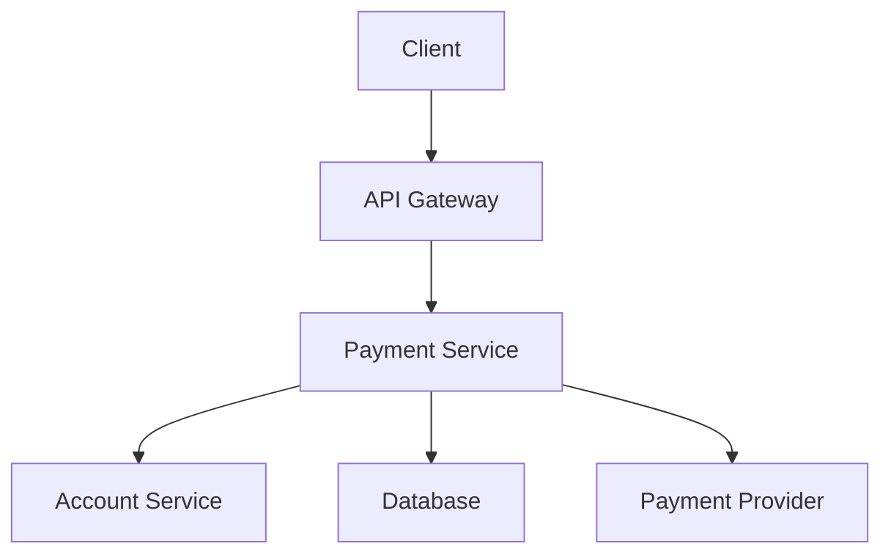
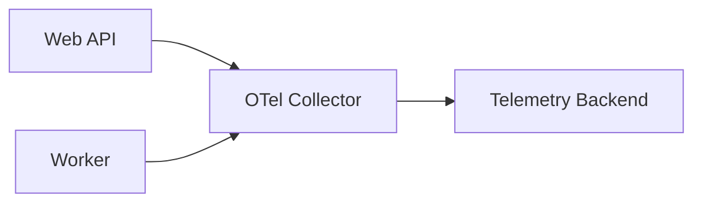

فرض کن یک کاربر می‌گه «پرداختم خیلی طول کشید». داشبورد رو باز می‌کنی: CPU عادیه، حافظه هم مشکلی نداره، حتی نرخ خطا هم بالا نرفته. پس مشکل کجاست؟

ممکنه درخواست بین چند سرویس جابه‌جا شده باشه، یکی از سرویس‌ها منتظر دیتابیس مونده باشه و در نهایت هم پاسخ موفق برگشته باشه؛ فقط با تأخیر زیاد. این‌جاست که مانیتورینگ زیرساخت به‌تنهایی جواب سؤال ما رو نمی‌ده.

من برای فهمیدن چنین مشکلی، سه جور داده رو کنار هم می‌خوام: **متریک، لاگ و تریس**. OpenTelemetry کمک می‌کنه این داده‌ها رو با قراردادها و ابزارهای نسبتاً یکپارچه تولید و منتقل کنیم؛ اما خودش قرار نیست به‌جای همهٔ ابزارهای ذخیره‌سازی و تحلیل کار کنه.

## اول ببینیم هر سیگنال چه چیزی می‌گه

**Metrics** برای دیدن روندها مناسب‌اند: در هر دقیقه چند درخواست داریم؟ چند درصد خطا می‌خورن؟ توزیع زمان پاسخ چطوره؟ به‌جای یک میانگین ساده، معمولاً صدک‌های تأخیر مثل p95 هم به درد می‌خورن؛ چون میانگین می‌تونه تجربهٔ کاربران کندتر رو پنهان کنه.

**Logs** رویدادهای مشخص رو ثبت می‌کنن؛ مثلاً اینکه یک درخواست به‌دلیل اعتبارسنجی رد شده یا یک وابستگی timeout داده. لاگ خوب باید ساختارمند و قابل جست‌وجو باشه، نه فقط یک جملهٔ مبهم مثل «Something went wrong».

**Traces** مسیر یک عملیات رو بین اجزای سیستم نشون می‌دن. هر trace معمولاً از چند span تشکیل می‌شه؛ هر span یک عملیات با زمان شروع و پایان و اطلاعات زمینه‌ای خودشه. وقتی trace context درست بین سرویس‌ها منتقل بشه، می‌تونیم ببینیم کدوم قسمت مسیر بیشتر زمان برده.

هیچ‌کدوم جای اون یکی رو نمی‌گیره. متریک می‌گه مشکلی داریم، تریس کمک می‌کنه مسیرش رو پیدا کنیم و لاگ ممکنه جزئیات علت رو روشن کنه.

## مثال: یک درخواست پرداخت

تصور کن مسیر ساده‌شدهٔ پرداخت این شکلیه:

این دیاگرام فقط یک مثال فرضیه، نه معماری پیشنهادی برای همهٔ سیستم‌های بانکی.

اگر درخواست ۱٫۸ ثانیه طول کشیده، دانستن همین عدد کافی نیست. شاید ۱٫۴ ثانیه‌اش در تماس با یک سرویس بیرونی گذشته و بقیهٔ مراحل سریع بوده‌اند. تریس می‌تونه این تفاوت رو نشون بده؛ البته به شرط اینکه عملیات‌های مهم instrument شده باشن و دادهٔ مربوط به همون درخواست واقعاً ثبت شده باشه.

نکتهٔ مهم اینه که spanها ممکنه هم‌زمان اجرا بشن. پس جمع سادهٔ مدت همهٔ spanها لزوماً با زمان کل درخواست برابر نیست.

## OpenTelemetry دقیقاً چه کاری می‌کنه؟

OpenTelemetry یک پروژهٔ متن‌بازه برای **تولید، جمع‌آوری و انتقال telemetry**. API و SDK، ابزارهای instrumentation و Collector از بخش‌های مهم اکوسیستمش هستند. می‌تونی داده رو به یک backend مناسب بفرستی؛ اما OpenTelemetry به‌خودی‌خود جای یک سیستم کامل تحلیل و نگهداری داده نیست.

در یک معماری معمول، اپلیکیشن با SDK یا auto-instrumentation داده تولید می‌کنه، Collector اون رو دریافت و پردازش می‌کنه و بعد به مقصد انتخابی می‌فرسته:

Collector الزام همهٔ استقرارها نیست، ولی برای متمرکز کردن تنظیمات، مدیریت مسیر خروجی و بعضی پردازش‌ها مفیده. اگر Collector از دسترس خارج بشه یا صف‌ها پر بشن، بسته به تنظیمات ممکنه داده از دست بره؛ بنابراین خود مسیر telemetry هم نیاز به پایش داره.

## از کجا شروع کنیم که پروژه بی‌دلیل پیچیده نشه؟

من از یک سرویس و یک سؤال مشخص شروع می‌کنم: «چرا endpoint پرداخت بعضی وقت‌ها کند می‌شه؟» نه اینکه از روز اول بخوایم کل سازمان رو instrument کنیم.

### قدم اول: چند متریک قابل‌اعتماد

برای HTTP، قراردادهای رسمی OpenTelemetry متریکی به نام `http.server.request.duration` تعریف می‌کنن که مدت درخواست‌های سرور رو برحسب ثانیه اندازه می‌گیره. در کنار اون، نرخ درخواست و نرخ خطا رو هم از داده‌های مناسب محاسبه می‌کنیم. برای داشبورد، بهتره route و method رو به‌صورت کنترل‌شده نگه داریم.

**یک اشتباه خطرناک:** استفاده از URL خامی مثل `/users/123456` به‌عنوان label متریک. هر شناسهٔ جدید می‌تونه یک سری زمانی جدید بسازه و cardinality رو بالا ببره. قرارداد HTTP برای `http.route` از الگوی کم‌تنوعی مثل `/users/{id}` استفاده می‌کنه.

### قدم دوم: یک مسیر حیاتی رو trace کنیم

از ورودی API تا تماس با دیتابیس و سرویس‌های بیرونی رو بررسی می‌کنیم. اگر بخشی از مسیر trace context رو منتقل نکنه، تصویر کامل نداریم. در صف‌ها و پردازش‌های asynchronous هم propagation باید آگاهانه پیاده‌سازی و آزمایش بشه.

### قدم سوم: لاگ‌ها رو به درخواست وصل کنیم

اگر لاگ‌ها trace ID و در صورت نیاز span ID داشته باشن، از یک خطا می‌تونیم به مسیر مربوط برسیم. البته این ارتباط بسته به زبان، SDK و تنظیمات logging ممکنه به پیکربندی اضافه نیاز داشته باشه.

### قدم چهارم: هزینه و امنیت رو جدی بگیریم

همهٔ درخواست‌ها رو با جزئیات کامل و برای همیشه نگه نداریم. sampling، retention و محدود کردن attributeها می‌تونه حجم داده رو کنترل کنه. اما sampling هم بی‌هزینه نیست: ممکنه trace مربوط به یک مشکل نادر ثبت نشه. سیاست نمونه‌برداری باید با هدف عیب‌یابی و نیازهای عملیاتی هماهنگ باشه.

برای سیستم‌های مالی، قبل از ارسال telemetry حتماً بررسی کنیم که رمز، توکن دسترسی، شمارهٔ کارت، اطلاعات شخصی یا payload حساس وارد span و log نشده باشه. صرف استفاده از OpenTelemetry داده رو خودکار امن یا ناشناس نمی‌کنه.

## اشتباه‌هایی که بهتره تکرار نکنیم

- **فقط داشبورد ساختن:** داشبورد قشنگ بدون سؤال عملیاتی مشخص، الزاماً عیب‌یابی رو بهتر نمی‌کنه.
- **ثبت همه‌چیز:** telemetry زیاد هم هزینه داره، هم نویز تولید می‌کنه و هم ممکنه اطلاعات حساس رو لو بده.
- **یکی دانستن خطا و کندی:** پاسخ ۲۰۰ هم می‌تونه تجربهٔ خیلی بدی برای کاربر باشه.
- **اعتماد کامل به یک trace:** یک نمونه لزوماً نمایندهٔ همهٔ درخواست‌ها نیست؛ باید کنار متریک‌ها بررسی بشه.
- **فراموش کردن مالکیت سرویس‌ها:** اگر معلوم نباشه چه کسی هشدار رو بررسی می‌کنه، داشتن داده به‌تنهایی مسئله رو حل نمی‌کنه.

## چطور بفهمیم کارمون نتیجه داده؟

به‌جای اینکه تعداد داشبوردها یا spanها رو بشماریم، یک سناریوی واقعی رو آزمایش کنیم: عمداً در محیط تست یک وابستگی رو کند کنیم و ببینیم آیا می‌تونیم بدون حدس‌زدن‌های طولانی محل تأخیر رو پیدا کنیم؟

اگر قبل از این کار فقط می‌دونستیم «پرداخت کنده» و حالا می‌تونیم بگیم «بیشتر تأخیر در تماس با سرویس مشخصی اتفاق افتاده»، یک قدم واقعی جلو رفتیم.

برای من Observability یعنی بتونم دربارهٔ رفتار سیستم سؤال تازه‌ای بپرسم و با داده جواب بگیرم؛ نه اینکه صرفاً تعداد نمودارهای بیشتری داشته باشم. از یک مسیر مهم شروع کنیم، نتیجه رو بسنجیم و بعد دامنه رو گسترش بدیم.

---

**منابع و مطالعهٔ بیشتر:**

- [OpenTelemetry Documentation](https://opentelemetry.io/docs/)
- [OpenTelemetry HTTP Semantic Conventions](https://opentelemetry.io/docs/specs/semconv/http/)
- [HTTP Metrics Semantic Conventions](https://opentelemetry.io/docs/specs/semconv/http/http-metrics/)
- [OpenTelemetry Collector](https://opentelemetry.io/docs/collector/)
