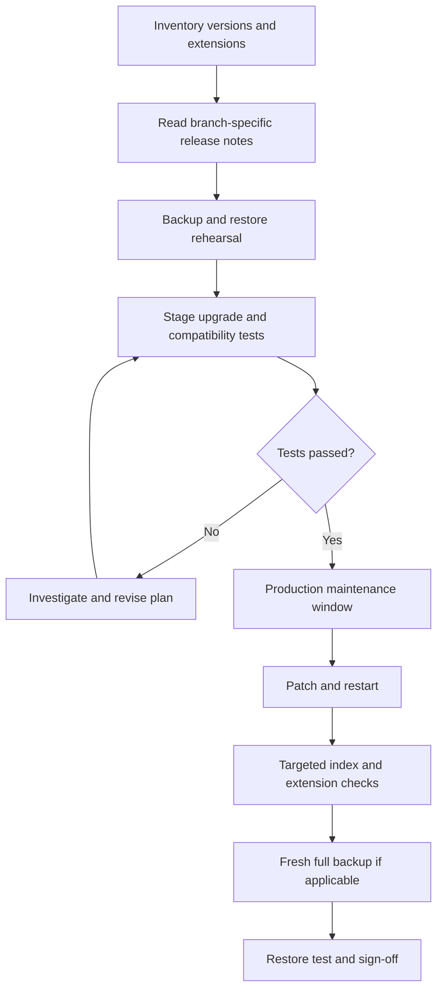

فرض کن ساعت دو بامداد یک وصلهٔ امنیتی برای دیتابیس Production منتشر شده. تیم زیرساخت نسخهٔ جدید رو نصب می‌کنه، سرویس بالا می‌آد و Health Check هم سبزه. می‌شه تیک «رفع مشکل» رو زد؟

برای آپدیت **۱۲ نوامبر ۲۰۲۶ PostgreSQL**، جواب همیشه نه است. این انتشار فقط دربارهٔ بستن راه حمله نیست؛ بعضی اصلاحاتش به ایندکس‌هایی مربوط می‌شن که ممکنه از قبل دادهٔ نادرست داشته باشن، بعضی به بکاپ‌های Incremental، و یکی هم به Extensionهایی که با زبان C کامپایل شدن. یعنی ممکنه باینری سرور سالم باشه ولی کار عملیاتی هنوز تموم نشده باشه.

در این مقاله سعی می‌کنم فرق «نصب نسخهٔ اصلاح‌شده» و «برگشتن به وضعیت قابل‌اعتماد» رو با یک برنامهٔ عملی روشن کنم. مبنا [اطلاعیهٔ رسمی PostgreSQL در ۱۲ نوامبر](https://www.postgresql.org/about/news/postgresql-187-1712-1616-1520-1425-and-19-rc-2-released-3442/) و [Release Notes نسخهٔ 18.7](https://www.postgresql.org/docs/18/release-18-7.html) است؛ برای شاخه‌های دیگه باید یادداشت انتشار همون شاخه رو هم بخونیم.

## دقیقاً چه اتفاقی افتاد؟

پروژهٔ PostgreSQL در ۱۲ نوامبر نسخه‌های اصلاحی **18.7، 17.12، 16.16، 15.20 و 14.25** رو منتشر کرد؛ هم‌زمان PostgreSQL 19 RC 2 هم عرضه شد. طبق اعلام پروژه، این بسته‌ها **۵۲ آسیب‌پذیری امنیتی و بیش از ۱۴۰ باگ** رو رفع می‌کنن.

| شاخه | نسخهٔ اصلاحی اعلام‌شده |
| --- | --- |
| 18 | 18.7 |
| 17 | 17.12 |
| 16 | 16.16 |
| 15 | 15.20 |
| 14 | 14.25؛ آخرین انتشار این شاخه |

این جدول به معنی یکسان بودن همهٔ CVEها در تمام شاخه‌ها نیست. برای نمونه، [CVE-2026-120142](https://www.postgresql.org/support/security/CVE-2026-120142/) فقط شاخه‌های ۱۷ و ۱۸ رو تحت تأثیر قرار می‌ده. جزئیات دقیق هر آسیب‌پذیری در [فهرست امنیتی رسمی](https://www.postgresql.org/support/security/) مشخص شده.

نکتهٔ مهم دیگه: **PostgreSQL 14 به پایان پشتیبانی رسیده**. نصب 14.25 راه‌حل موقت برای وصلهٔ همین انتشار است، نه جایگزین برنامهٔ مهاجرت به یک شاخهٔ پشتیبانی‌شده.

## CVE-2026-6460 چه درسی دربارهٔ مرز اعتماد می‌ده؟

یکی از موارد مهم این انتشار، [CVE-2026-6460](https://www.postgresql.org/docs/18/release-18-7.html) است. مشکل به تفسیر مقدارهای Composite و تغییر ساختار نوع داده برمی‌گرده. به زبان ساده، وقتی شکل یک Row Type عوض می‌شه، ممکنه داده‌ای با چیدمان قدیمی هنوز جایی در حافظه وجود داشته باشه. اگر سرور اون رو با توصیف ساختار جدید تفسیر کنه، به Type Confusion می‌رسیم.

در این خانواده از آسیب‌پذیری‌ها، داشتن دسترسی محدود SQL لزوماً به معنی محدود بودن اثر حمله نیست. بعضی CVEها به کاربر احرازهویت‌شده‌ای که اجازهٔ ساخت Object داره امکان اجرای کد در سطح فرایند دیتابیس می‌دن؛ این با دسترسی مستقیم و بدون احراز هویت از اینترنت فرق داره. برای همین نباید از روی عدد CVSS نتیجه بگیریم «هرکسی از بیرون می‌تونه سرور رو بگیره»، ولی نباید حساب‌های داخلی، حساب‌های اپلیکیشن یا Tenantها رو هم ذاتاً قابل‌اعتماد فرض کنیم.

سه سؤال معماری مطرح می‌شه:

1. آیا حساب اپلیکیشن واقعاً به `CREATE`، `ALTER` یا نصب Extension نیاز داره؟
2. آیا نقش اجرای Migration از نقش Runtime جدا شده؟
3. اگر یک حساب دیتابیس محدود لو بره، چه مسیرهایی برای گسترش دسترسی وجود داره؟

برای یک سرویس مالی، پیشنهاد عملی اینه که کاربر Runtime فقط مجوزهای لازم برای Queryهای خودش رو داشته باشه. DDL و Migration رو با یک نقش جدا و در یک فرایند کنترل‌شده انجام بدیم. این کار جای Patch رو نمی‌گیره، اما سطح حمله رو کوچک‌تر می‌کنه.

## چرا ممکنه بعد از Patch هنوز کار داشته باشیم؟

### ۱. ایندکس خراب با تعویض باینری تعمیر نمی‌شه

در اطلاعیهٔ رسمی چند مشکل مرتبط با ایندکس‌ها ذکر شده: بعضی ایندکس‌های **GIN** ممکنه Rowهایی رو جا بندازن یا نتیجهٔ نامربوط برگردونن؛ برای **GiST با pg_trgm** هم احتمال از دست رفتن Match وجود داشته. مواردی دربارهٔ B-tree روی ستون‌های `bpchar` بدون طول مشخص و برخی ایندکس‌های TOAST هم مطرح شده.

وصله معمولاً از تکرار خطا جلوگیری می‌کنه، ولی الزاماً ساختار خراب قبلی رو بازسازی نمی‌کنه. به همین خاطر Release Notes برای شرایط مشخص، `REINDEX` رو توصیه می‌کنه.

اول باید ایندکس‌های مرتبط رو پیدا کنیم. مثلاً این Query صرفاً یک **فهرست اولیه** از ایندکس‌های GIN و GiST می‌ده، نه تشخیص قطعی خرابی:

```sql
SELECT
  n.nspname AS schema_name,
  t.relname AS table_name,
  i.relname AS index_name,
  am.amname AS index_method,
  pg_get_indexdef(i.oid) AS definition
FROM pg_class i
JOIN pg_index ix ON ix.indexrelid = i.oid
JOIN pg_class t ON t.oid = ix.indrelid
JOIN pg_namespace n ON n.oid = t.relnamespace
JOIN pg_am am ON am.oid = i.relam
WHERE i.relkind IN ('i', 'I')
  AND am.amname IN ('gin', 'gist')
  AND n.nspname NOT IN ('pg_catalog', 'information_schema')
ORDER BY n.nspname, t.relname, i.relname;
```

بعد از تطبیق نوع ایندکس و شرایط با Release Notes، می‌شه برای یک ایندکس مشخص، با برنامه‌ریزی ظرفیت و قفل‌ها، از دستور زیر استفاده کرد:

```sql
REINDEX INDEX CONCURRENTLY public.example_index;
```

`CONCURRENTLY` معمولاً اجازه می‌ده نوشتن روی جدول ادامه پیدا کنه، اما بدون هزینه نیست: زمان و فضای دیسک بیشتر می‌خواد، محدودیت‌های اجرایی داره و در همهٔ موقعیت‌ها قابل استفاده نیست. اجرای کورکورانهٔ `REINDEX DATABASE` روی دیتابیس بزرگ، بدون بررسی زمان و ظرفیت، خودش می‌تونه Incident بسازه. [مستندات REINDEX](https://www.postgresql.org/docs/18/sql-reindex.html) رو برای قفل‌ها و محدودیت‌ها بخون.

### ۲. زنجیرهٔ Incremental Backup ممکنه قابل‌اعتماد نباشه

طبق Release Notes، چند ایراد کشف‌شده می‌تونستن باعث خرابی بکاپ‌های Incremental موجود بشن. توصیهٔ پروژه اینه که بعد از آپدیت، **یک Full Backup تازه** بگیریم و Incrementalهای بعدی رو بر پایهٔ اون بسازیم.

این توصیه رو با «هر بکاپی که قبل از Patch گرفته شده قطعاً خراب است» اشتباه نگیریم. موضوع، قابل‌اعتماد نبودن زنجیرهٔ قبلی برای بازیابی مطمئن است. اگر از روش Incremental داخلی PostgreSQL استفاده نمی‌کنی، باید اثر این توصیه رو با ابزار بکاپ خودت و مستندات همون ابزار تطبیق بدی.

برای تیم عملیات، موفق بودن Job بکاپ کافی نیست. حداقل یک Restore آزمایشی در محیط جدا انجام بده و زمان واقعی بازیابی رو ثبت کن. بدون Restore Test، عدد RTO بیشتر شبیه حدس است تا تعهد.

### ۳. Extensionهای C ممکنه نیاز به بازسازی داشته باشن

اصلاح بررسی سازگاری Composite Type در CVE-2026-6460 برای حفاظت کامل به **Rebuild کردن Extensionهای C** نیاز داره؛ بعضی Extensionها حتی ممکنه به تغییر Source Code احتیاج داشته باشن. این موضوع رو خود Release Notes صریح گفته.

برای شروع می‌تونیم Extensionهای نصب‌شده رو فهرست کنیم:

```sql
SELECT extname, extversion
FROM pg_extension
ORDER BY extname;
```

اما این Query به‌تنهایی نمی‌گه کدوم Extension از C استفاده می‌کنه یا با ABI جدید سازگاره. باید فهرست رو با Packageها، مستندات Vendor و روش Build واقعی تطبیق بدیم. صرفاً `ALTER EXTENSION UPDATE` زدن هم تضمین نمی‌کنه باینری کامپایل‌شده با نسخهٔ جدید بازسازی شده باشه.

غیرفعال کردن `composite_type_mismatch` برای دور زدن ناسازگاری، در Release Notes به‌عنوان گزینه‌ای همراه با ریسک امنیتی معرفی شده؛ نباید تبدیل به تنظیم پیش‌فرض دائمی بشه.

## یک Runbook قابل اجرا برای تیم کوچک

به‌جای اینکه Patch رو یک دستور `apt upgrade` ببینیم، بهتره یک تغییر کنترل‌شده با معیار پذیرش داشته باشیم:



### قبل از تغییر

- نسخهٔ سرور رو با `SHOW server_version;` و نسخهٔ Client Toolها رو جداگانه ثبت کن.
- نقش‌های دارای DDL، Extensionهای نصب‌شده، Replication، Pooler و مسیر بکاپ رو مستند کن.
- Release Notes شاخهٔ خودت رو بخون؛ فرض نکن همهٔ موارد 18.7 در 16.16 هم دقیقاً یکسان‌اند.
- از داده بکاپ بگیر و روی محیطی جدا Restore کن. برنامهٔ برگشت رو هم بنویس؛ برگشت به باینری آسیب‌پذیر بدون تحلیل سازگاری، Rollback ایمن نیست.

### هنگام تغییر

- ابتدا محیط Stage رو با دادهٔ غیرحساس و Workload شبیه Production ارتقا بده.
- Queryهای حیاتی، Migrationها، Extensionها، اتصال Pooler و رفتار Replica رو تست کن.
- در Production، وضعیت Replica Lag، خطاهای Query، Connectionها، Latency و مصرف Disk رو زیر نظر بگیر.
- برای `REINDEX` فقط ایندکس‌هایی رو انتخاب کن که با شرایط گزارش‌شده تطبیق دارن؛ زمان اجرا و فضای لازم رو از قبل بسنج.

### بعد از تغییر

- صرفاً به `SELECT 1` اکتفا نکن. چند Query حساس رو با نتایج موردانتظار مقایسه کن.
- وضعیت Extensionهای C و وابستگی به باینری‌های قدیمی رو بررسی کن.
- اگر از Incremental Backup داخلی استفاده می‌کنی، Full Backup جدید و زنجیرهٔ تازه بساز.
- یک Restore Test مستقل اجرا کن و زمان، خطاها و نتیجه رو ثبت کن.
- اگر هنوز PostgreSQL 14 داری، یک برنامهٔ Major Upgrade با تاریخ مشخص داشته باش.

## سه اشتباه رایج در مدیریت این حادثه

**اشتباه اول: «دیتابیس پشت فایرواله، پس مشکلی نداریم.»** بعضی از آسیب‌پذیری‌ها به کاربر لاگین‌کرده با مجوزهای مشخص مربوط می‌شن. فایروال برای کنترل دسترسی شبکه لازمه، ولی از خطای حساب داخلی یا دسترسی بیش‌ازحد جلوگیری نمی‌کنه.

**اشتباه دوم: «Health Check سبزه، پس داده هم درسته.»** یک ایندکس مشکل‌دار ممکنه تنها در Query خاص نتیجهٔ اشتباه بده. سنجش صحت داده و آزمون مسیرهای واقعی محصول باید بخشی از معیار پذیرش باشه.

**اشتباه سوم: «بکاپ موفق شده، پس قابل بازیابیه.»** بین ساختن فایل بکاپ و بازیابی موفق دیتابیس فاصله هست. در این انتشار، توصیهٔ Full Backup جدید برای کاربران Incremental Backup دقیقاً همین تفاوت رو یادآوری می‌کنه.

## جمع‌بندی: تعریف Done رو عوض کنیم

این انتشار PostgreSQL یک مثال خوب از تفاوت **Patch Management** و **Reliability Engineering** است. Patch یعنی نسخهٔ اصلاح‌شده رو نصب کنیم؛ بازیابی اعتماد یعنی مطمئن بشیم ایندکس‌ها، Extensionها، داده‌ها و مسیر Restore هم قابل اتکا هستن.

برای یک سیستم حساس، من این چهار شرط رو برای بستن Change Ticket می‌ذارم: نسخهٔ اصلاح‌شده نصب شده، وابستگی‌های باینری و ایندکس‌های مرتبط بررسی شده، بکاپ جدید در صورت نیاز گرفته شده و Restore آزمایشی موفق بوده. اگر یکی از این‌ها باقی مونده، بهتره Ticket رو «در حال پیگیری» نگه داریم، حتی اگر سرویس فعلاً بدون خطا جواب می‌ده.

---

## منابع و مطالعهٔ بیشتر

- [PostgreSQL Global Development Group — اطلاعیهٔ رسمی ۱۲ نوامبر ۲۰۲۶](https://www.postgresql.org/about/news/postgresql-187-1712-1616-1520-1425-and-19-rc-2-released-3442/)
- [PostgreSQL 18.7 Release Notes — جزئیات مهاجرت، REINDEX، بکاپ و Extension](https://www.postgresql.org/docs/18/release-18-7.html)
- [PostgreSQL Security Information — فهرست CVEها و نسخه‌های آسیب‌پذیر](https://www.postgresql.org/support/security/)
- [CVE-2026-120142 — نمونهٔ آسیب‌پذیری مخصوص شاخه‌های ۱۷ و ۱۸](https://www.postgresql.org/support/security/CVE-2026-120142/)
- [PostgreSQL REINDEX Documentation](https://www.postgresql.org/docs/18/sql-reindex.html)

**یادداشت:** این متن بر اساس اطلاعیه‌های منتشرشده تا ۱۸ نوامبر ۲۰۲۶ نوشته شده. این مقاله راهنمای تصمیم‌گیری و بررسی عملیاتی است؛ دستورات نمونه باید قبل از اجرا روی Production با نسخه، Extensionها و معماری واقعی سیستم تطبیق داده بشن.
