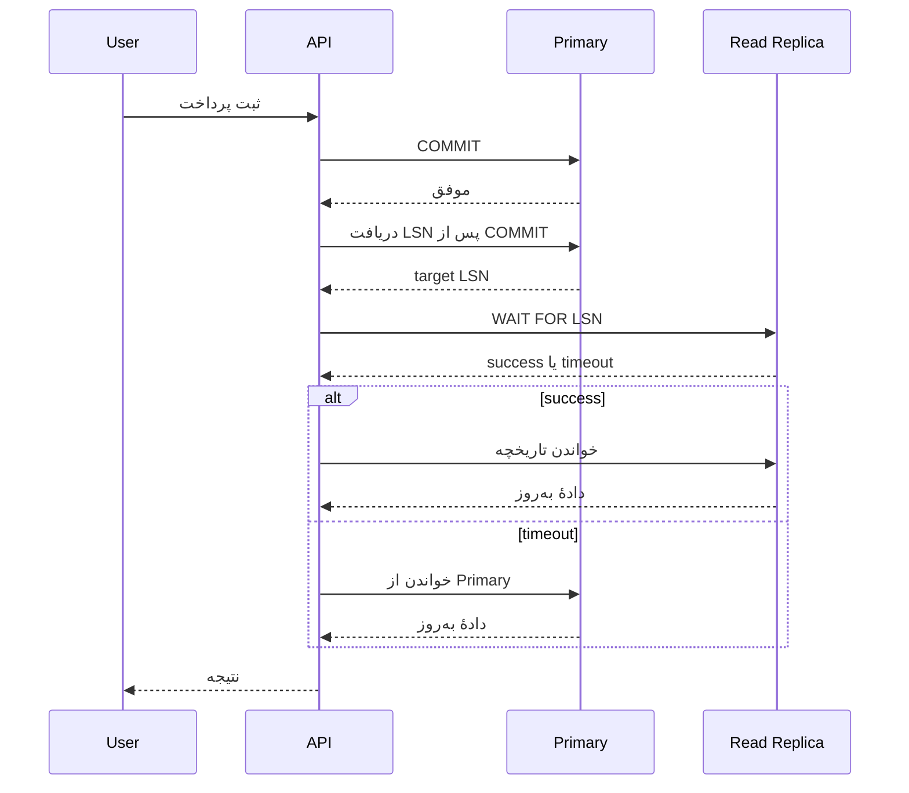
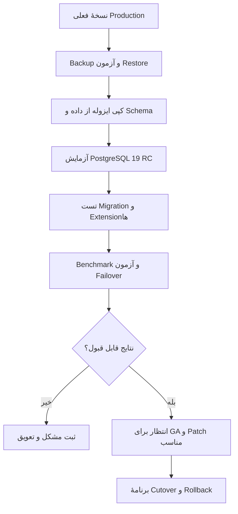

فرض کن توی یک سرویس پرداخت، جدول تراکنش‌ها هر روز بزرگ‌تر می‌شه. بعضی گزارش‌ها کند شده‌اند و گاهی هم کاربر بلافاصله بعد از ثبت پرداخت، وارد صفحهٔ تاریخچه می‌شه و تراکنش جدیدش رو نمی‌بینه. دیتابیس خراب نشده؛ دو مسئلهٔ جدا داریم: نگهداری جدول‌های پرتغییر و تأخیر بین دیتابیس اصلی و Replica.

حالا PostgreSQL 19 داره به انتشار نهایی نزدیک می‌شه و برای هر دو مسئله ابزارهای تازه‌ای معرفی کرده. وسوسه‌انگیزه که بگیم «پس سریع ارتقا بدیم». ولی من اول یک سؤال می‌پرسم: **آیا این قابلیت‌ها واقعاً مشکل ما رو حل می‌کنن و ریسک مهاجرت چقدره؟**

این مطلب دربارهٔ تصمیم‌هاییه که بهتره *قبل از* ارتقا بگیریم، نه تبلیغ یک نسخهٔ جدید.

## اول وضعیت انتشار را درست بفهمیم

در **۱۵ اکتبر ۲۰۲۶**، پروژهٔ PostgreSQL نسخهٔ **19 RC 1** رو منتشر کرد. طبق [اعلامیهٔ رسمی](https://www.postgresql.org/about/news/postgresql-19-rc-1-released-3409/)، برنامه اینه که RC 2 در **۱۲ نوامبر** و نسخهٔ نهایی در **۱۹ نوامبر ۲۰۲۶** منتشر بشه؛ البته اگر مشکل جدیدی پیدا نشه. پس در تاریخ نگارش این مقاله، **PostgreSQL 19 هنوز GA نشده**.

Release Candidate یعنی قابلیت‌های نسخه تقریباً نهایی‌اند، نه اینکه برای سرویس مالی Production مناسب شده باشه. خود [راهنمای نسخه‌های آزمایشی PostgreSQL](https://www.postgresql.org/developer/beta/) هم استفاده از RC رو برای محیط عملیاتی توصیه نمی‌کنه.

برای بررسی فعالیت توسعه، [مخزن آینه‌ای PostgreSQL در GitHub](https://github.com/postgres/postgres) و برچسب `REL_19_RC1` هم قابل مشاهده‌اند؛ مشارکت اصلی پروژه از مسیرهای رسمی PostgreSQL انجام می‌شه، نه Pull Requestهای این آینه. انتشار رسمی و تغییرات مخزن، دلیل خوبی برای بررسی موضوع‌اند؛ **دادهٔ قابل‌اتکایی برای ادعای رتبهٔ این موضوع در Google Trends ندارم**.

## ۱. REPACK؛ وقتی VACUUM معمولی کافی نیست

وقتی ردیف‌های جدول زیاد UPDATE یا DELETE می‌شن، نسخه‌های قدیمی ردیف‌ها می‌تونن فضای اشغال‌شده‌ای باقی بذارن. `VACUUM` معمولی این فضا رو برای استفادهٔ دوباره در همان جدول آزاد می‌کنه، ولی معمولاً فایل جدول رو کوچک نمی‌کنه تا فضا به سیستم‌عامل برگرده.

در PostgreSQL 19 دستور جدید `REPACK` برای بازنویسی جدول و بازیابی فضا اضافه شده. شکل ساده‌اش اینه:

```sql
-- فقط روی محیط آزمایشی PostgreSQL 19 اجرا شود
REPACK public.payment_events;
```

اما شکل معمول `REPACK` به قفل `ACCESS EXCLUSIVE` نیاز داره. برای جدول پرترافیک، این موضوع می‌تونه دردسرساز بشه.

گزینهٔ جدید `CONCURRENTLY` اجازه می‌ده بخش عمدهٔ کار هم‌زمان با خواندن و نوشتن‌های معمول انجام بشه:

```sql
-- نمونهٔ آزمایشی؛ قبل از اجرا پیش‌نیازها و ظرفیت دیسک را بررسی کنید
REPACK (CONCURRENTLY) public.payment_events;
```

### آیا CONCURRENTLY یعنی بدون قفل و بدون ریسک؟

نه. طبق [مستندات رسمی REPACK](https://www.postgresql.org/docs/19/sql-repack.html)، در مرحلهٔ نهایی برای جابه‌جایی فایل‌ها هنوز یک قفل `ACCESS EXCLUSIVE` گرفته می‌شه. مدت اون معمولاً کوتاهه، ولی تضمین نمی‌شه همیشه بی‌اثر باشه.

چند محدودیت مهم هم وجود داره:

- این حالت برای جدول Partitioned یا `UNLOGGED` قابل استفاده نیست.
- جدول باید شرایط لازم برای شناسایی ردیف‌ها، از جمله Primary Key و Replica Identity مناسب، رو داشته باشه.
- عملیات به فضای موقت، منابع I/O و ظرفیت لازم برای ثبت تغییرات هم‌زمان نیاز داره.
- `REPACK (CONCURRENTLY)` داخل Transaction Block مجاز نیست و به امکان ایجاد Replication Slot اضافی وابسته است.
- مستندات هشدار می‌دن که این عملیات از نظر **MVCC-safe بودن** محدودیت داره: تراکنش‌هایی با Snapshot قدیمی ممکنه بعد از Commit عملیات، جدول رو خالی ببینن.

این هشدار آخر برای سیستم‌های دارای تراکنش‌های طولانی خیلی مهمه. قبل از استفاده، باید رفتار Readerهای طولانی‌عمر رو در تست بازسازی کنیم.

### چه زمانی ارزش امتحان‌کردن داره؟

وقتی واقعاً Table Bloat داریم و می‌خوایم فضا رو پس بگیریم. نه صرفاً چون جدول بزرگه. اول حجم جدول و ایندکس‌ها، نسبت ردیف‌های مرده، سرعت رشد، قفل‌ها و هزینهٔ I/O رو اندازه می‌گیریم. بعد روی نسخه‌ای از داده با الگوی ترافیک نزدیک به واقعیت آزمایش می‌کنیم.

```sql
-- برای بررسی اولیهٔ وضعیت جدول؛ این اعداد برآوردی‌اند
SELECT
  schemaname,
  relname,
  n_live_tup,
  n_dead_tup,
  last_autovacuum
FROM pg_stat_user_tables
WHERE relname = 'payment_events';
```

`n_dead_tup` تخمینه، نه اندازه‌گیری دقیق حجم قابل‌بازیابی. تصمیم برای REPACK رو فقط با همین ستون نگیریم.

## ۲. دستور WAIT؛ مشکل «پرداخت ثبت شد ولی تاریخچه خالیه»

در معماری‌های دارای Read Replica، معمولاً نوشتن روی Primary انجام می‌شه و بخشی از خواندن‌ها به Replica می‌رن. اگر Replication غیرهم‌زمان باشه، ممکنه پاسخ موفق نوشتن به کاربر برگرده ولی Replica هنوز تغییر رو اعمال نکرده باشه.

PostgreSQL 19 دستور `WAIT FOR LSN` رو معرفی کرده تا برنامه بتونه منتظر رسیدن WAL به یک نقطهٔ مشخص بشه. این کار برای الگوی **Read Your Writes** مفیده.



مثلاً بعد از Commit روی Primary، می‌تونیم LSNای بگیریم که **در یا بعد از رکورد Commit همان تراکنش** قرار داشته باشه:

```sql
-- روی Primary، بعد از COMMIT
SELECT pg_current_wal_insert_lsn();
```

و روی Replica، پیش از اجرای Query خواندن، منتظر Replay همون LSN بشیم:

```sql
-- LSN فقط نمونه است؛ مقدار واقعی باید از Primary برسد
WAIT FOR LSN '0/0306EE20'
  WITH (MODE 'standby_replay', TIMEOUT '500ms', NO_THROW);
```

با `NO_THROW` نتیجه می‌تونه `success` یا `timeout` باشه؛ در وضعیت‌های مرتبط با Recovery ممکنه `not in recovery` هم برگرده. **فقط در حالت `success`** مسیر خواندن از همون Replica رو ادامه می‌دیم؛ در Timeout می‌تونیم طبق سیاست محصول از Primary بخونیم یا خطای قابل‌کنترل برگردونیم.

### چند نکته که در طراحی API نباید فراموش کنیم

اول اینکه `WAIT` یک دستور SQL جدیده و درایور یا ORM مورد استفاده‌مون باید بتونه اجراش کنه. دوم اینکه این انتظار باید **قبل از Queryهایی که Lock می‌گیرن** انجام بشه؛ اجرای اون در تراکنشی که قبلاً Lock گرفته ممکنه رد بشه. سوم اینکه LSN عددی به‌تنهایی Timeline رو مشخص نمی‌کنه؛ بعد از Failover و Promotion باید سیاست صحت و مسیریابی دوباره بررسی بشه.

این دستور هم قرار نیست Replica رو فوراً به‌روز کنه؛ فقط تا رسیدن به وضعیت مطلوب منتظر می‌مونه. اگر Replica عقب افتاده یا ارتباط قطع شده باشه، انتظار طولانی خودش می‌تونه Latency سرویس رو خراب کنه.

جزئیات دقیق و محدودیت‌ها در [مستندات WAIT](https://www.postgresql.org/docs/19/sql-wait.html) اومده. قبل از استفاده در Production، سناریوی Failover، Timeout، Pooling و تراکنش‌های طولانی رو جداگانه آزمایش کنیم.

## ۳. Parallel Autovacuum؛ بهتر شدن نگهداری، نه حذف نیاز به تنظیمات

PostgreSQL 19 امکان استفاده از Workerهای موازی برای بعضی کارهای Autovacuum، به‌خصوص کار روی Indexها، رو اضافه کرده. در کنار اون، اولویت‌بندی جدول‌ها برای Autovacuum هم بهبود پیدا کرده.

برای یک دیتابیس پرتراکنش، این قابلیت می‌تونه کمک‌کننده باشه؛ ولی نباید نتیجه بگیریم هر Autovacuum از این به بعد سریع‌تره. اثر واقعی به تعداد و اندازهٔ ایندکس‌ها، I/O، حجم تغییرات و محدودیت منابع بستگی داره.

در نسخهٔ ۱۹ می‌شه تنظیمات مرتبط رو بررسی کرد:

```sql
SHOW autovacuum_max_parallel_workers;
SELECT * FROM pg_stat_autovacuum_scores LIMIT 10;
```

این View و تنظیمات رو در محیط PostgreSQL 19 آزمایش کن؛ روی نسخه‌های قدیمی‌تر ممکنه وجود نداشته باشن. اگر قبلاً مشکل Autovacuum داشتیم، باید پیش و پس از ارتقا زمان عملیات، مصرف I/O و میزان رشد Dead Tupleها رو با یک Workload یکسان مقایسه کنیم.

## ۴. Logical Replication و Sequenceها؛ جزئیاتی که در مهاجرت جا می‌مونن

یکی از قابلیت‌های PostgreSQL 19، پشتیبانی از همگام‌سازی مقدار Sequenceها در Logical Replication است. این موضوع مخصوصاً وقتی مهم می‌شه که برای مهاجرت یا تغییر معماری، داده‌ها رو از یک سرور به سرور دیگه منتقل می‌کنیم.

اما دو نکته وجود داره: طبق [مستندات Replicating Sequences](https://www.postgresql.org/docs/19/logical-replication-sequences.html)، همگام‌سازی Sequence نیاز داره **Publisher نسخهٔ ۱۹ یا جدیدتر** باشه، و مقدار Sequence روی Subscriber ممکنه با ادامهٔ فعالیت Publisher دوباره عقب بیفته. پس نباید فرض کنیم صرفاً فعال‌کردن Publication همهٔ مسائل Cutover رو حل می‌کنه.

برای مهاجرتی که Sequence و شناسه‌های ترتیبی داره، برنامهٔ نهایی‌کردن Writeها، بررسی مقدار Sequence و جلوگیری از تداخل شناسه‌ها رو باید صریح بنویسیم.

## ۵. تغییرهای پیش‌فرض؛ خطرهایی که در خبرهای انتشار کمتر دیده می‌شن

گاهی مهم‌ترین تغییر نسخهٔ جدید، قابلیتی نیست که خودمون فعال می‌کنیم؛ **تغییر یک Default** است.

در [Release Notes نسخهٔ ۱۹](https://www.postgresql.org/docs/19/release-19.html) چند مورد قابل‌توجه دیده می‌شه:

| تغییر | سؤال عملیاتی |
| --- | --- |
| JIT به‌صورت پیش‌فرض غیرفعال می‌شه | آیا Queryهای تحلیلی سنگین ما به JIT وابسته‌اند؟ |
| فشرده‌سازی پیش‌فرض TOAST به `lz4` تغییر می‌کنه | مصرف CPU و فضای داده‌های جدید چه تغییری می‌کنه؟ |
| هشدار برای احراز هویت موفق با رمز MD5 اضافه می‌شه | آیا هنوز کلاینت یا Role قدیمی داریم؟ |
| پشتیبانی RADIUS حذف می‌شه | آیا جایی از این روش استفاده می‌کنیم؟ |
| `standard_conforming_strings` در سرور همیشه روشنه | آیا اسکریپت یا Dump قدیمی رفتار قبلی رو فرض کرده؟ |

برای دیدن تنظیمات مؤثر در سرور فعلی:

```sql
SHOW server_version;
SHOW jit;
SHOW default_toast_compression;
SHOW password_encryption;
SHOW standard_conforming_strings;
```

نکته: `password_encryption` به‌تنهایی روش ذخیره‌سازی رمز همهٔ Roleهای موجود رو ثابت نمی‌کنه. برای ممیزی احراز هویت باید تنظیمات و داده‌های مرتبط رو با دسترسی مناسب بررسی کنیم، بدون اینکه رمزها یا Hashها رو وارد گزارش‌های عمومی کنیم.

## ۶. برنامهٔ مهاجرت؛ به‌جای «آپگرید کنیم و ببینیم چی می‌شه»

برای Major Upgrade معمولاً سه مسیر اصلی داریم:

| مسیر | مزیت | ریسک یا هزینه |
| --- | --- | --- |
| `pg_upgrade` | استفادهٔ مجدد از فایل‌های داده و معمولاً زمان کمتر از Dump/Restore | نیاز به توقف یا هماهنگی سرویس و بررسی Extensionها |
| `pg_dump` / `pg_restore` | بازسازی منطقی و فرصت بازبینی ساختار | برای دیتابیس بزرگ ممکنه زمان و فضای زیادی بخواد |
| Logical Replication | امکان آماده‌سازی مقصد هم‌زمان با ادامهٔ فعالیت مبدا | Cutover، DDL، Sequence و سازگاری نسخه‌ها پیچیده‌تر می‌شن |

هیچ‌کدوم ذاتاً «بدون Downtime» نیستن. انتخاب به حجم داده، RTO/RPO، وابستگی‌ها و سطح ریسک‌پذیری بستگی داره.



### قدم اول: از Backup مطمئن شو، نه فقط از موفق بودن Job

اینکه Backup هر شب سبز می‌شه، تضمین نمی‌کنه Restore کار می‌کنه. یک Restore واقعی روی محیط جدا انجام بده، صحت داده و سازگاری Extensionها رو بررسی کن و زمان بازیابی رو اندازه بگیر.

### قدم دوم: `pg_upgrade --check` رو با نسخهٔ مقصد اجرا کن

در محیط تست و با مسیرهای واقعی نصب و Data Directory، از Binary نسخهٔ جدید استفاده می‌کنیم:

```bash
# نمونهٔ الگو؛ مسیرها را با نصب آزمایشی خودتان جایگزین کنید
/path/to/pg19/bin/pg_upgrade \
  --old-bindir=/path/to/old/bin \
  --new-bindir=/path/to/pg19/bin \
  --old-datadir=/path/to/old/data \
  --new-datadir=/path/to/new/data \
  --check
```

این دستور فقط سازگاری اولیه رو بررسی می‌کنه و جای تست کامل مهاجرت رو نمی‌گیره. [مستندات pg_upgrade](https://www.postgresql.org/docs/19/pgupgrade.html) رو برای پیش‌نیازها، Extensionها و حالت‌های `--link`، `--clone` و سایر گزینه‌ها بخون.

**هشدار مهم:** بعضی حالت‌های سریع ارتقا می‌تونن بازگشت به Cluster قبلی رو دشوار یا ناممکن کنن. Rollback رو نباید صرفاً «اجرای نسخهٔ قبلی» تصور کنیم؛ ممکنه لازم باشه از Backup بازیابی کنیم.

### قدم سوم: تست رو با داده و Query واقعی انجام بده

برای هر مسیر مهم برنامه، این موارد رو قبل و بعد از ارتقا مقایسه کن:

- زمان پاسخ p50 و p95 برای Queryهای اصلی؛
- Query Plan با `EXPLAIN (ANALYZE, BUFFERS)` روی دادهٔ آزمایشی؛
- نرخ خطا و Timeout در اتصال‌های برنامه؛
- رفتار Lock، Autovacuum، Replication Lag و Failover؛
- سازگاری Migrationها، Driver، ORM و Extensionها؛
- صحت داده بعد از Restore و Cutover، نه فقط تعداد ردیف‌ها.

`EXPLAIN ANALYZE` واقعاً Query رو اجرا می‌کنه؛ برای Queryهای تغییردهندهٔ داده، بدون طرح ایمن آزمایشی ازش استفاده نکن.

## ۷. آیا pg_plan_advice راه‌حل کندی Queryهاست؟

PostgreSQL 19 افزونهٔ `pg_plan_advice` رو هم معرفی کرده که می‌تونه بعضی تصمیم‌های Planner رو ثبت یا هدایت کنه. برای بررسی Regression یک Query خاص مفیده؛ مثلاً وقتی Planner جدید ترتیب Join متفاوتی انتخاب کرده.

ولی طبق [مستندات رسمی](https://www.postgresql.org/docs/19/pgplanadvice.html)، مجبور کردن Planner به یک مسیر ثابت می‌تونه بعداً نتیجهٔ بدتری بده؛ چون توزیع داده تغییر می‌کنه. من از این ابزار به‌عنوان **آخرین ابزار تشخیص و کنترل هدفمند** استفاده می‌کنم، نه جایگزین Statistics درست، Index مناسب و Benchmark.

## در نهایت چه تصمیمی بگیریم؟

اگر الان PostgreSQL 17 یا 18 روی یک سرویس حساس خوب کار می‌کنه، انتشار RC 1 دلیل کافی برای ارتقای فوری نیست. تا زمان انتشار پایدار، می‌تونیم با یک کپی ایزوله از دیتابیس سه سؤال رو جواب بدیم:

1. آیا `REPACK (CONCURRENTLY)` واقعاً مسئلهٔ Bloat ما رو با ریسک قابل‌قبول حل می‌کنه؟
2. آیا `WAIT FOR LSN` می‌تونه مسیر Read-After-Write ما رو ساده‌تر کنه، بدون اینکه Latency غیرقابل‌قبول بسازه؟
3. آیا تغییر Defaultها، Planner، Extensionها و Replication با Workload واقعی ما سازگارند؟

اگر پاسخ‌ها مثبت بود، برای GA و نسخهٔ اصلاحی مناسب برنامه‌ریزی می‌کنیم. اگر نه، ارتقا رو عقب می‌اندازیم. **در سیستم‌های حساس، تصمیم درست همیشه جدیدترین نسخه نیست؛ نسخه‌ایه که رفتار و مسیر بازگشتش رو واقعاً آزمایش کرده باشیم.**

---

## منابع و مطالعهٔ بیشتر

- [اعلامیهٔ رسمی PostgreSQL 19 RC 1 — ۱۵ اکتبر ۲۰۲۶](https://www.postgresql.org/about/news/postgresql-19-rc-1-released-3409/)
- [Release Notes نسخهٔ ۱۹؛ تغییرات و ناسازگاری‌ها](https://www.postgresql.org/docs/19/release-19.html)
- [مستندات REPACK و هشدارهای CONCURRENTLY](https://www.postgresql.org/docs/19/sql-repack.html)
- [مستندات WAIT FOR LSN](https://www.postgresql.org/docs/19/sql-wait.html)
- [مستندات Logical Replication برای Sequenceها](https://www.postgresql.org/docs/19/logical-replication-sequences.html)
- [راهنمای pg_upgrade](https://www.postgresql.org/docs/19/pgupgrade.html)
- [مخزن آینه‌ای PostgreSQL در GitHub](https://github.com/postgres/postgres)

**مطالعهٔ مرتبط در سایت:** [مانیتورینگ کافی نیست؛ چطور با OpenTelemetry بفهمیم سرویس‌مان کجا کند شده؟](../opentelemetry-observability-fa/)
