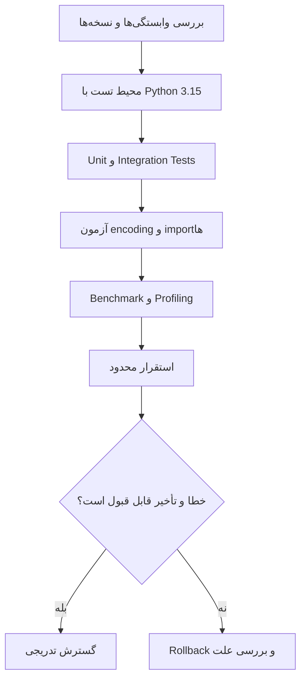

فرض کن یک سرویس Python داری که چند ماهه بدون دردسر کار می‌کنه. نسخهٔ جدید زبان منتشر شده، چند نفر توی تیم از قابلیت‌های تازه‌اش تعریف می‌کنن و یکی پیشنهاد می‌ده همین هفته همهٔ سرویس‌ها رو ارتقا بدیم. سؤال من اینه: **دقیقاً دنبال حل چه مشکلی هستیم؟**

اگر سرویس موقع بالا اومدن کنده، اگر نمی‌دونیم کدوم تابع CPU رو می‌خوره، یا اگر فایل‌های متنی روی دو سرور رفتار متفاوتی دارن، Python 3.15 واقعاً چیزهای جالبی برای بررسی داره. ولی اگر فقط دنبال یک عدد بزرگ‌تر توی خروجی `python --version` باشیم، احتمالاً ارزش ریسک مهاجرت رو درست حساب نکردیم.

Python 3.15.0 در **۹ اکتبر ۲۰۲۶** منتشر شد. تا زمان نوشتن این مطلب، نسخهٔ اصلاحی **3.15.2** هم در **۲۶ اکتبر** منتشر شده. می‌خوام ببینیم تغییرهای این نسخه چه معنایی برای یک سرویس واقعی دارن؛ نه اینکه فقط فهرست قابلیت‌های جدید رو مرور کنیم.

## چرا الان دربارهٔ Python 3.15 حرف می‌زنیم؟

[اعلامیهٔ رسمی انتشار Python 3.15](https://blog.python.org/2026/10/python-3150-final-is-here/) و [راهنمای تغییرات نسخه](https://docs.python.org/3/whatsnew/3.15.html) چند موضوع مهم رو برجسته کرده‌ان: وارد شدن Lazy Imports به خود زبان، پیش‌فرض شدن UTF-8، اضافه شدن ابزار پروفایلینگ Tachyon و چند تغییر در APIهای استاندارد.

در [مخزن CPython در GitHub](https://github.com/python/cpython) هم توسعهٔ نسخه ادامه داره. انتشار رسمی، فعالیت مخزن و گفت‌وگوهای جامعه نشون می‌دن موضوع ارزش بررسی داره؛ اما من برای این مقاله **رتبه یا عددی از Google Trends ادعا نمی‌کنم**، چون دادهٔ قابل‌اتکایی برای تأییدش به دست نیاوردم.

برای تصمیم مهندسی، مهم‌تر از ترند بودن اینه که بفهمیم کدوم تغییر به درد پروژهٔ خودمون می‌خوره.

## ۱. Lazy Imports؛ شروع سریع‌تر، اما با یک بده‌بستان

وقتی در Python می‌نویسیم `import`، معمولاً کد سطح بالای ماژول در همان مرحلهٔ بارگذاری اجرا می‌شه. اگر ماژول‌های زیادی پشت سر هم بارگذاری بشن، شروع یک برنامه می‌تونه کند بشه؛ حتی اگر برنامه در این اجرا به بیشتر اون ماژول‌ها نیازی نداشته باشه.

تا قبل از 3.15 یک راه رایج این بود که import رو داخل تابع ببریم:

```python
# نسخهٔ سازگار با Pythonهای قدیمی‌تر
def export_report(rows):
    import json
    return json.dumps(rows, ensure_ascii=False)
```

در Python 3.15 می‌تونیم به‌جای این کار، از `lazy` در سطح ماژول استفاده کنیم:

```python
# Python 3.15+
lazy import json


def export_report(rows):
    return json.dumps(rows, ensure_ascii=False)
```

در این مثال، ماژول `json` وقتی واقعاً از نامش استفاده کنیم بارگذاری می‌شه. `json` خودش مثال سنگینی نیست؛ هدف فقط روشن شدن رفتار جدیده. در پروژهٔ واقعی باید importهای پرهزینه رو با اندازه‌گیری پیدا کنیم، نه با حدس.

برای `from` هم همین امکان وجود داره:

```python
# Python 3.15+؛ ماژول reports فرضی است
lazy from myapp.reports import build_monthly_report


def handle_report_request(account_id):
    return build_monthly_report(account_id)
```

این مثال یک خطر هم داره: اگر اولین استفاده از `build_monthly_report` در درخواست یک کاربر اتفاق بیفته، هزینهٔ import به همون درخواست منتقل می‌شه. بنابراین **سریع‌تر شدن startup الزاماً به معنی سریع‌تر شدن پاسخ کاربر نیست**.

### کجاها مفیده؟

برای ابزارهای CLI، پردازش‌های کوتاه‌عمر، بعضی Workerها و برنامه‌هایی که فقط گاهی از وابستگی‌های سنگین استفاده می‌کنن، ارزش امتحان کردن داره. برای APIای که یک بار بالا میاد و روزها کار می‌کنه، ممکنه اثرش روی کارکرد معمول سرویس ناچیز باشه؛ حتی شاید اولین درخواستِ مسیر کم‌استفاده کندتر بشه.

### کجاها دردسر درست می‌کنه؟

فرض کن import یک ماژول، افزونه‌ای رو ثبت می‌کنه یا تنظیمات مهمی رو اعتبارسنجی می‌کنه. با lazy شدنش ممکنه اون کار به‌موقع انجام نشه. از طرف دیگه، `ImportError` ممکنه به‌جای زمان بالا آمدن سرویس، وسط اولین درخواست ظاهر بشه.

در مستندات [PEP 810](https://peps.python.org/pep-0810/) هم این محدودیت‌ها روشن شده‌اند: `lazy` فقط در سطح ماژول مجازه، داخل تابع یا بدنهٔ کلاس و بلوک `try` قابل استفاده نیست، و برای `import *` یا `__future__` هم کاربرد نداره.

یک گزینهٔ سراسری مثل `-X lazy_imports=all` وجود داره؛ ولی من فعال‌کردن یک‌بارهٔ اون روی کل سرویس رو پیشنهاد نمی‌کنم. اول یک import مشخص و قابل اندازه‌گیری رو آزمایش می‌کنیم.

## ۲. UTF-8 پیش‌فرض شد؛ خبر خوب با یک ریسک پنهان

قبلاً اگر بدون تعیین encoding فایل متنی رو باز می‌کردیم، نتیجه می‌تونست به تنظیمات محیط و سیستم‌عامل وابسته باشه. طبق [PEP 686](https://peps.python.org/pep-0686/)، در Python 3.15 حالت UTF-8 به‌صورت پیش‌فرض فعاله.

این تغییر برای فایل‌های فارسی، JSON، CSV و سرویس‌هایی که بین Windows و Linux جابه‌جا می‌شن می‌تونه مفید باشه. اما یک نکته رو فراموش نکنیم: **اگر فایل قدیمی با یک encoding محلی ذخیره شده باشه، عوض شدن پیش‌فرض ممکنه باعث خطا یا تفسیر اشتباه داده بشه.**

من همچنان ترجیح می‌دم قرارداد فایل رو صریح بنویسم:

```python
from pathlib import Path

text = Path("customers.txt").read_text(encoding="utf-8")
Path("export.txt").write_text(text, encoding="utf-8")
```

اگر فایل واقعاً با encoding دیگری ساخته شده، باید همون رو مشخص کنیم یا با یک فرایند کنترل‌شده تبدیلش کنیم؛ نه اینکه امیدوار باشیم Python خودش حدس بزنه.

برای تشخیص تفاوت رفتار، `PYTHONUTF8=0` هم وجود داره. این گزینه می‌تونه در تست مهاجرت کمک کنه، ولی جایگزین تعیین صریح encoding در قرارداد داده نیست.

## ۳. Tachyon؛ وقتی حدس‌زدن دربارهٔ کندی کافی نیست

فرض کن زمان پاسخ API بالا رفته و نمی‌دونیم مشکل از کجاست. قبل از تغییر کد باید بفهمیم برنامه وقتش رو کجا صرف می‌کنه. Python 3.15 ابزار sampling profiler جدیدی به نام **Tachyon** رو در `profiling.sampling` اضافه کرده.

برخلاف profilerهای tracing که فراخوانی توابع رو دنبال می‌کنن، sampling در بازه‌های زمانی از stack نمونه می‌گیره. خروجی یک **تخمین آماری** از نقاط پرهزینه است، نه زمان‌سنجی دقیق تک‌تک فراخوانی‌ها. این تفاوت مهمه؛ مخصوصاً وقتی می‌خوایم نتیجهٔ دو اجرای نزدیک به هم رو مقایسه کنیم.

مثلاً برای بررسی یک اسکریپت:

```bash
python -m profiling.sampling run worker.py
```

یا برای ساخت flame graph:

```bash
python -m profiling.sampling run --flamegraph -o profile.html worker.py
```

ابزار امکان اتصال به یک فرایند در حال اجرا رو هم داره:

```bash
python -m profiling.sampling attach 12345
```

در دستور آخر، `12345` صرفاً یک PID نمونه است. دسترسی به فرایند، محدودیت‌های سیستم‌عامل و سیاست‌های امنیتی محیط اجرا رو باید جداگانه بررسی کنیم. همچنین در محیط عملیاتی بهتره profiling رو با زمان محدود و روی نمونهٔ کنترل‌شده انجام بدیم.

Tachyon حالت‌های مختلفی برای بررسی زمان واقعی (`wall`) و زمان CPU (`cpu`) داره. اگر سرویس منتظر شبکه یا دیتابیس باشه، انتخاب حالت اندازه‌گیری می‌تونه تفسیر ما از نتیجه رو عوض کنه. [مستندات رسمی profiling.sampling](https://docs.python.org/3/library/profiling.sampling.html) جزئیات این تفاوت‌ها رو توضیح می‌ده.

### Tachyon جای متریک و تریس رو می‌گیره؟

نه. پروفایلینگ برای پیدا کردن نقاط پرهزینهٔ اجرای کد خوبه؛ ولی به‌تنهایی مسیر یک درخواست بین چند سرویس، نرخ خطا یا تجربهٔ همهٔ کاربران رو نشون نمی‌ده. من از متریک و distributed tracing برای تشخیص **کِی و کجا** مشکل اتفاق افتاده استفاده می‌کنم، بعد اگر مسئله داخل فرایند Python بود سراغ profiler می‌رم.

## ۴. چند تغییر کوچک که ممکنه به کد واقعی بخورن

همهٔ قابلیت‌های جدید قرار نیست فوراً وارد پروژه بشن، ولی بعضی‌ها ارزش شناختن دارن.

### `frozendict` برای داده‌ای که نباید تغییر کنه

در Python 3.15 یک نوع built-in به نام `frozendict` داریم:

```python
settings = frozendict(currency="IRR", precision=2)
print(settings["currency"])

# TypeError: تغییر مستقیم مجاز نیست
# settings["precision"] = 4
```

این نوع مثل `dict` قابل تغییر نیست و اگر کلیدها و مقدارها hashable باشن، خودش هم hashable می‌شه. ولی **زیرکلاس `dict` نیست**؛ اگر کد ما فقط `isinstance(value, dict)` رو قبول می‌کنه، باید سازگاریش رو بررسی کنیم. برای APIهایی که فقط قرارداد mapping لازم دارن، `collections.abc.Mapping` اغلب انتخاب بهتریه.

### `sentinel` برای تشخیص «ارسال نشده» از `None`

گاهی `None` یک مقدار معتبره و نمی‌تونیم ازش به‌عنوان علامت «پارامتر داده نشده» استفاده کنیم. Python 3.15 نوع built-in جدیدی به نام `sentinel` معرفی کرده تا چنین وضعیت‌هایی رو واضح‌تر مدل کنیم. این قابلیت مخصوصاً در APIهایی با پارامتر اختیاری به درد می‌خوره؛ البته باید قواعد identity و serialization اون رو طبق [PEP 661](https://peps.python.org/pep-0661/) بررسی کنیم.

### JIT بهتر شده، اما هنوز آزمایشی است

طبق اعلام رسمی، JIT آزمایشی Python 3.15 در بنچمارک‌های مشخصی نسبت به baselineهای تعریف‌شده بهبود داشته. این عددها **تضمین سرعت بیشتر برای FastAPI یا هر سرویس دیگری نیستند**. اگر می‌خوایم اثر JIT رو بسنجیم، باید با بار واقعی، سخت‌افزار یکسان و تنظیمات کنترل‌شده آزمایش کنیم.

همچنین وجود پشتیبانی از free-threading در بعضی بسته‌های نصب، به معنی حذف خودکار GIL از همهٔ اجراهای Python نیست. این دو موضوع رو نباید با هم قاطی کنیم.

## ۵. مهاجرت امن یک سرویس؛ از آزمایش تا Rollback

برای من ارتقای نسخهٔ زبان بیشتر شبیه تغییر یک dependency زیرساختیه تا اضافه‌کردن یک قابلیت کوچک. پیشنهاد می‌کنم مسیر رو این‌طوری پیش ببریم:



### اول: سازگاری وابستگی‌ها رو بررسی کنیم

نسخهٔ Python رو در یک محیط جدا نصب کنیم و وابستگی‌ها رو با همون نسخه resolve و نصب کنیم. وجود یک نسخهٔ stable از Python لزوماً به معنی آماده بودن تمام کتابخانه‌های پروژه، مخصوصاً پکیج‌های دارای extension باینری، نیست.

برای سرویس‌های FastAPI، علاوه بر خود framework، وضعیت Pydantic، driver دیتابیس، کتابخانه‌های رمزنگاری، worker و image استقرار رو هم باید بررسی کنیم. من بدون اجرای تست‌ها ادعا نمی‌کنم ترکیب فعلی پروژه با 3.15 سازگاره.

### دوم: تست‌ها فقط «بالا آمدن سرویس» نباشن

یک نمونهٔ ساده برای ساخت محیط جدا:

```bash
python3.15 -m venv .venv315
. .venv315/bin/activate
python -m pip install -r requirements.txt
python -m pytest
```

این دستورات فرض می‌کنن Python 3.15 و وابستگی‌های پروژه نصب‌پذیرن و فایل `requirements.txt` و `pytest` در پروژه وجود دارن. اگر از ابزار مدیریت وابستگی دیگری استفاده می‌کنیم، دستورها باید مطابق همون پروژه تغییر کنن.

در کنار unit test، چند سناریوی واقعی لازم داریم: فایل فارسی، ارتباط با دیتابیس، درخواست‌های هم‌زمان، مسیر خطا، و اولین درخواست بعد از بالا آمدن worker.

### سوم: تغییرات ناسازگار استاندارد رو دست‌کم نگیریم

در بخش [Porting to Python 3.15](https://docs.python.org/3/whatsnew/3.15.html#porting-to-python-3-15) چند تغییر سازگاری فهرست شده. مثلاً در `sqlite3.connect()` پارامترهای بعد از نام دیتابیس keyword-only شده‌اند. پس این سبک رو ترجیح بدیم:

```python
import sqlite3

connection = sqlite3.connect("app.db", timeout=10)
connection.close()
```

اگر کد قدیمی آرگومان‌های اضافه رو به‌صورت positional می‌فرستاده، باید اصلاح بشه. همین یک مثال نشون می‌ده چرا عبور از تست‌های یک API واقعی مهم‌تر از اجرای موفق `python --version` است.

### چهارم: قبل و بعد رو با یک معیار مقایسه کنیم

برای بررسی هزینهٔ import می‌شه از گزینهٔ استاندارد `-X importtime` کمک گرفت:

```bash
python -X importtime -c "import myapp" 2> import-times.txt
```

`myapp` نام فرضی پکیج پروژه‌ست. این خروجی فقط زمان importها رو نشون می‌ده، نه latency واقعی API. برای تصمیم نهایی بهتره cold start، زمان اولین درخواست، p95 پاسخ، مصرف حافظه و نرخ خطا رو در محیط مشابه اندازه بگیریم.

اگر فقط startup بهتر شده ولی اولین درخواست بدتر شده، باید بفهمیم هزینه رو واقعاً کم کردیم یا صرفاً به جای دیگری منتقلش کردیم.

### پنجم: انتشار محدود و راه برگشت

در استقرار container یا VM، نسخهٔ قبلی runtime و dependency lockfile رو نگه داریم. اول روی درصد کوچکی از ترافیک یا یک worker آزمایش کنیم. اگر خطا، مصرف حافظه یا latency از حد توافق‌شده گذشت، بدون تغییر دادهٔ ناسازگار به نسخهٔ قبلی برگردیم.

اگر هم‌زمان schema دیتابیس یا فرمت داده رو تغییر می‌دیم، Rollback پیچیده‌تر می‌شه؛ بهتره ارتقای runtime رو تا حد ممکن از migration داده جدا نگه داریم.

## اشتباه‌هایی که در این مهاجرت راحت اتفاق می‌افتن

| اشتباه | نتیجهٔ احتمالی | راه بهتر |
| --- | --- | --- |
| فعال کردن Lazy Imports برای کل برنامه | خطاهای import یا side effectهای دیرهنگام | انتخاب importهای مشخص و تست اولین استفاده |
| تکیه بر سرعت JIT در یک بنچمارک عمومی | انتظار غیرواقعی از عملکرد سرویس | آزمون روی workload واقعی |
| حذف `encoding=` از فایل‌ها | رفتار مبهم روی داده‌های قدیمی | مشخص کردن قرارداد encoding |
| فقط تست کردن health endpoint | ندیدن خرابی مسیرهای کم‌استفاده | تست مسیرهای اصلی و edge caseها |
| تغییر runtime و schema در یک انتشار | سخت شدن Rollback | جدا کردن تغییرهای مستقل |

## پس الان باید مهاجرت کنیم؟

اگر یک سرویس حساس و پایدار داریم، من مهاجرت رو صرفاً به خاطر تازه بودن نسخه انجام نمی‌دم. اول یک شاخهٔ آزمایشی می‌سازم، تست‌ها رو اجرا می‌کنم و مشخص می‌کنم کدوم مشکل فعلی قراره با ارتقا حل بشه.

اگر ابزار CLI با startup کند داریم، Lazy Imports ارزش یک آزمایش کوچک رو داره. اگر در سرویس CPU-bound دنبال bottleneck می‌گردیم، Tachyon می‌تونه به تشخیص کمک کنه. اگر با فایل‌های قدیمی و چند سیستم‌عامل سروکار داریم، تغییر UTF-8 حتی بدون استفاده از قابلیت‌های جدید هم نیاز به تست داره.

جمع‌بندی من ساده‌ست: **نسخهٔ جدید زبان یک فرصت برای بهتر کردن سیستم است، نه دلیل کافی برای تغییر دادن سیستم.** اول مسئله رو اندازه بگیریم، بعد تغییر رو محدود انجام بدیم و آخر سر با داده تصمیم بگیریم.

---

## منابع و مطالعهٔ بیشتر

- [Python Insider — Python 3.15.0 final، ۹ اکتبر ۲۰۲۶](https://blog.python.org/2026/10/python-3150-final-is-here/)
- [What's New in Python 3.15 — مستندات رسمی](https://docs.python.org/3/whatsnew/3.15.html)
- [PEP 810 — Explicit Lazy Imports](https://peps.python.org/pep-0810/)
- [PEP 686 — UTF-8 Mode by Default](https://peps.python.org/pep-0686/)
- [Tachyon / profiling.sampling — مستندات رسمی](https://docs.python.org/3/library/profiling.sampling.html)
- [PEP 790 — برنامهٔ انتشار و نسخه‌های اصلاحی](https://peps.python.org/pep-0790/)
- [CPython — مخزن رسمی GitHub](https://github.com/python/cpython)
