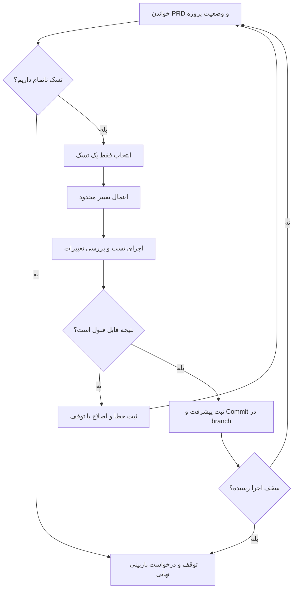

فرض کن یک تسک نسبتاً مشخص داری: می‌خوای به پنل پشتیبانی محصولت امکان فیلتر کردن تیکت‌ها بر اساس وضعیت رو اضافه کنی. از یک ایجنت کدنویسی کمک می‌گیری، ولی وسط کار می‌بینی هم کامپوننت رو تغییر داده، هم API رو، هم چندتا فایل نامرتبط رو دست زده. آخرش هم معلوم نیست کدوم قسمت واقعاً تست شده.

اینجا مسئله فقط «پرامپت بهتر» نیست. باید برای کار ایجنت یک روند قابل‌پیگیری داشته باشیم؛ روندی که بدونه از کجا شروع کنه، در هر مرحله چه کاری انجام بده و چه موقع متوقف بشه.

یکی از روش‌های ساده برای این کار **Ralph** یا **Ralph Wiggum** نام داره: یک حلقه که ایجنت کدنویسی رو چند بار، هر بار با یک کار محدود و وضعیت ثبت‌شدهٔ پروژه، اجرا می‌کنه.

## رالف دقیقاً چه کاری انجام می‌ده؟

در روش رالف قرار نیست یک مدل رو برای چند ساعت به حال خودش رها کنیم و امیدوار باشیم آخرش محصول آماده تحویل بده. ایده اینه که **کار بزرگ رو به قدم‌های کوچک تقسیم کنیم** و بعد از هر قدم، نتیجه رو روی فایل‌ها، تست‌ها و تاریخچهٔ Git ثبت کنیم.

در ساده‌ترین شکل، سه چیز داریم:

- **فایل نیازمندی‌ها (PRD):** قراره چی ساخته بشه و معیار قبول شدنش چیه؟
- **فایل پیشرفت:** چه کارهایی انجام شده، چه چیزی هنوز مونده و چه مشکلی پیدا کردیم؟
- **حلقهٔ اجرا:** ایجنت یک تسک رو انجام می‌ده، نتیجه بررسی می‌شه و در اجرای بعدی از وضعیت ثبت‌شده ادامه می‌ده.

نکتهٔ مهم اینه که حافظهٔ قابل‌اتکای این روند، فایل‌ها و کدهای داخل ریپوزیتوری هستن؛ نه اینکه فرض کنیم مدل تمام گفت‌وگوهای قبلی رو بدون نقص به خاطر می‌سپاره.

## یک مثال واقعی‌تر: فیلتر وضعیت تیکت‌ها

بیایم همون قابلیت فیلتر تیکت رو در نظر بگیریم. اگر فقط بنویسیم «فیلتر وضعیت رو پیاده کن»، چند سؤال بی‌جواب می‌مونه: وضعیت‌ها چی هستن؟ فیلتر روی سرور انجام می‌شه یا مرورگر؟ وقتی هیچ تیکتی پیدا نشد چه چیزی نشون بدیم؟

من ترجیح می‌دم قبل از شروع، یک فایل `PRD.md` شبیه این داشته باشم:

```md
# فیلتر تیکت‌ها بر اساس وضعیت

هدف: کاربر پشتیبانی بتواند تیکت‌ها را بر اساس وضعیت ببیند.

وضعیت‌ها: open، pending، closed

کارها:
- [ ] بررسی API فعلی و مشخص کردن محل اعمال فیلتر
- [ ] اضافه کردن پارامتر status با اعتبارسنجی مقدار
- [ ] افزودن انتخاب وضعیت در رابط کاربری
- [ ] نمایش حالت بدون نتیجه و امکان پاک کردن فیلتر
- [ ] نوشتن یا به‌روزرسانی تست‌های مرتبط

شرط پذیرش:
- مقدار نامعتبر status پذیرفته نشود.
- فیلتر با صفحه‌بندی فعلی سازگار باشد.
- بدون فیلتر، رفتار قبلی حفظ شود.
- تست‌های مرتبط و بررسی TypeScript موفق باشند.
```

این PRD نمونه‌ست؛ برای یک پروژهٔ واقعی باید با قرارداد API و ساختار موجود هماهنگش کنیم. نکته‌اش اینه که ایجنت لازم نیست هر بار از اول حدس بزنه منظور ما چی بوده.

## حلقه چطور جلو می‌ره؟

این فلوچارت، یک نسخهٔ کنترل‌شده از روند رو نشون می‌ده:



من عمداً «سقف اجرا» رو گذاشتم. اگر ایجنت توی یک مشکل گیر کرد، تکرار بی‌پایان فقط هزینه و تغییرات بیشتری تولید می‌کنه. برای همین باید از قبل مشخص کنیم چند بار اجازهٔ تلاش داره و چه اتفاقی باعث توقف می‌شه.

## چرا فایل پیشرفت به درد می‌خوره؟

فرض کن اجرای اول، اعتبارسنجی `status` رو اضافه کرده ولی هنوز تست‌ها رو کامل نکرده. اگر این وضعیت ثبت نشه، اجرای بعدی ممکنه دوباره همون بخش رو تغییر بده یا اصلاً متوجه کار نیمه‌تمام نشه.

یک `progress.md` ساده می‌تونه این‌طوری باشه:

```md
## اجرای ۱
- انجام شد: اضافه شدن اعتبارسنجی status در API
- بررسی شد: تست مقادیر مجاز موفق بود
- باقی مانده: تست مقدار نامعتبر و هماهنگی صفحه‌بندی
- نکته: نام پارامتر با API فعلی status است
```

اینجا به جای نگه داشتن یک گفت‌وگوی طولانی، اطلاعات مهم رو به شکل خلاصه و قابل‌بررسی ذخیره کردیم. این روش بی‌نقص نیست؛ اگر گزارش پیشرفت اشتباه باشه، اجرای بعدی هم ممکنه مسیر اشتباه بره. برای همین وضعیت فایل‌ها و تست‌ها باید حرف آخر رو بزنن.

اگر دربارهٔ محدودیت متن ورودی مدل کنجکاوی، قبلاً در مقالهٔ [پنجرهٔ زمینه چیست؟](../context-window-fa/) توضیح دادیم که چرا طولانی شدن زمینه می‌تونه مسئله‌ساز بشه.

## چطور یک نسخهٔ ساده و قابل‌کنترل اجرا کنیم؟

برای شروع لازم نیست از روز اول یک سیستم تمام‌خودکار بسازیم. اگر از Claude Code استفاده می‌کنی، می‌تونی بعد از نصب و تنظیم دسترسی‌ها، یک اجرای محدود داشته باشی. این نمونه عمداً **فقط یک نوبت** رو اجرا می‌کنه:

```bash
claude --permission-mode acceptEdits -p \
  "فایل‌های PRD.md و progress.md را بخوان.
   فقط اولین تسک ناتمام را انتخاب کن.
   قبل از تغییر، فایل‌های مرتبط را بررسی کن.
   فقط همان تسک را پیاده‌سازی کن.
   نتیجه و کارهای باقی‌مانده را در progress.md بنویس.
   اگر اطلاعات کافی نیست، تغییر حدسی انجام نده."
```

حالت `acceptEdits` برای تأیید ویرایش فایل‌هاست؛ به معنی مجوز نامحدود برای اجرای هر فرمانی نیست. دسترسی ابزارها، مجوز اجرای تست‌ها و محدودیت‌های محیط رو باید جداگانه تنظیم کنیم. این دستور هم به‌تنهایی تضمین نمی‌کنه که ایجنت دقیقاً یک تسک انجام بده؛ خروجی باید بررسی بشه.

بعد از اجرا، من این کارها رو انجام می‌دم:

1. با `git diff` می‌بینم دقیقاً کدوم فایل‌ها تغییر کردن.
2. تست‌های مرتبط رو اجرا می‌کنم؛ در پروژهٔ Astro مثلاً `npm run check` برای بررسی TypeScript و Astro مفیده.
3. اگر تغییرات درست بود، روی یک branch جدا Commit می‌کنم.
4. بعد سراغ تسک بعدی می‌رم؛ نه اینکه بدون بررسی، ده‌ها بار ایجنت رو اجرا کنم.

وقتی این روند دستی جواب داد، می‌شه یک اسکریپت حلقه‌ای براش نوشت که تعداد اجراها رو محدود کنه، خطاها رو ثبت کنه و در هر نوبت یک نشست تازه بسازه. **تازه بودن نشست** به این معنی نیست که کیفیت مدل همیشه ثابت می‌مونه؛ فقط کمک می‌کنه تاریخچهٔ طولانی گفت‌وگو بی‌دلیل همراه هر اجرا کشیده نشه.

## از کجا بفهمیم واقعاً کار تموم شده؟

یکی از خطرهای اتوماسیون اینه که ایجنت خودش اعلام کنه «انجام شد» و ما هم همون رو معیار پایان قرار بدیم.

برای من سه چیز مهم‌تره: کد با نیازمندی‌ها تطبیق داشته باشه، تست‌ها نتیجهٔ قابل‌قبول بدن و تغییرات قابل‌مرور باشن. اگر ایجنت فقط در خروجی متنی بگه «همه‌چیز درست است»، هنوز مدرکی نداریم.

بهتره معیار پایان رو به چیزهایی وصل کنیم که مستقل از حرف مدل قابل‌بررسی هستن:

| معیار | چطور بررسیش کنیم؟ |
| --- | --- |
| همهٔ تسک‌ها انجام شدن | تطبیق PRD با تغییرات واقعی |
| رفتار قبلی خراب نشده | اجرای تست‌های مرتبط و رگرسیون |
| کیفیت کد قابل‌قبوله | مرور Diff، Type Check و بازبینی انسانی |
| تغییر آمادهٔ ادغامه | ساخت Pull Request و بررسی CI |

برای مثال فیلتر تیکت، اگر API مقدار نامعتبر رو قبول کنه یا صفحه‌بندی رو خراب کرده باشیم، تیک خوردن همهٔ چک‌باکس‌های PRD کافی نیست.

## چه کارهایی رو نباید بدون نظارت به حلقه بسپریم؟

اگر پروژه به اطلاعات حساس، دادهٔ مشتری، سرویس پرداخت یا زیرساخت اصلی وصل باشه، ریسک خیلی جدی‌تره. یک دستور اشتباه می‌تونه داده رو تغییر بده یا اطلاعات محرمانه رو در لاگ‌ها و خروجی ابزارها قرار بده.

برای همین بهتره:

- ایجنت رو در محیط ایزوله و با دسترسی حداقلی اجرا کنیم؛ نه با مجوز نامحدود.
- کلیدها، توکن‌ها و دادهٔ واقعی مشتری رو وارد زمینهٔ مدل نکنیم.
- اجرای Migration، تغییر زیرساخت و عملیات Production رو پشت تأیید انسانی نگه داریم.
- تغییرات رو در branch جدا انجام بدیم و قبل از Merge، تست و بازبینی داشته باشیم.

حتی اگر ده بار پشت سر هم خروجی خوب گرفتیم، این به معنی امن بودن اجرای بی‌نظارت روی Production نیست.

## رالف برای چه کارهایی مناسبه؟

من این روش رو برای کارهایی مناسب‌تر می‌دونم که **قابل خرد کردن و قابل سنجش** باشن؛ مثل اضافه کردن تست برای یک ماژول، رفع خطاهای مشخص TypeScript یا پیاده‌سازی چند قابلیت کوچک با معیار پذیرش روشن.

در مقابل، اگر هنوز نمی‌دونیم محصول دقیقاً چه رفتاری باید داشته باشه یا تصمیم معماری مهمی در پیشه، اول باید مسئله رو با آدم‌های تیم روشن کنیم. حلقهٔ خودکار جای تصمیم‌گیری محصول و طراحی سیستم رو نمی‌گیره.

در نهایت جذابیت Ralph برای من خود حلقه نیست؛ **قابل‌ردیابی کردن کار ایجنت**ه. به جای اینکه یک درخواست بزرگ بدیم و فقط خروجی آخر رو ببینیم، هر مرحله یک تغییر مشخص، یک وضعیت ثبت‌شده و یک فرصت برای بررسی داریم.

اگر بخوای باهاش شروع کنی، از یک تسک کوچک و سه اجرای کنترل‌شده شروع کن. وقتی مطمئن شدی معیارهای پذیرش و توقف درست کار می‌کنن، تازه سراغ خودکارتر کردنش برو.

---

**منبع اصلی:** [Getting Started With Ralph — AI Hero](https://www.aihero.dev/getting-started-with-ralph)

**مطالعهٔ تکمیلی:**
- [Claude Code Best Practices — Anthropic](https://www.anthropic.com/research/claude-code-best-practices)
- [Claude Code Power User Tips — Anthropic](https://support.claude.com/en/articles/14554000-claude-code-power-user-tips)
- [About Protected Branches — GitHub Docs](https://docs.github.com/en/repositories/configuring-branches-and-merges-in-your-repository/managing-protected-branches/about-protected-branches)
