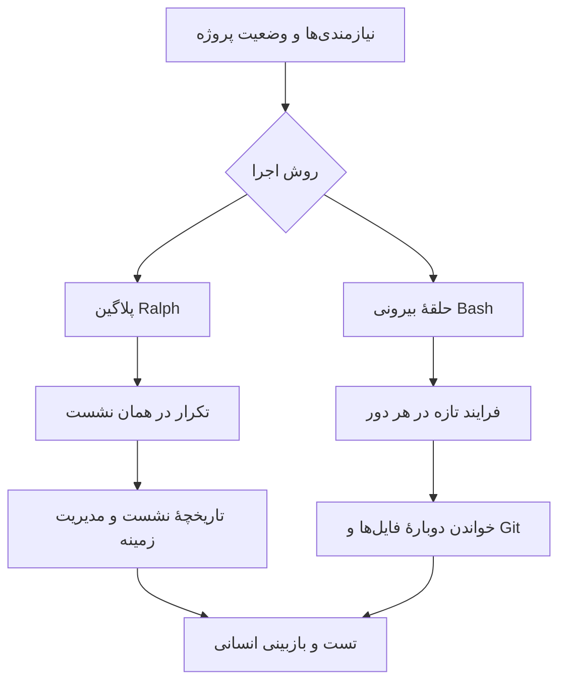

فرض کن یک ایجنت کدنویسی رو گذاشتی روی پروژه تا چند تا تست اضافه کنه. بار اول فایل‌ها رو می‌خونه، یک تغییر می‌ده و تست می‌گیره. بار دوم می‌خواد خطا رو درست کنه. بار سوم هم می‌ره سراغ یک گوشهٔ دیگه از کد. تا اینجا همه‌چیز خوبه، اما یک سؤال مهم داریم: **هر بار با یک گفت‌وگوی تازه کار می‌کنه یا تمام حرف‌ها و خروجی‌های قبلی هنوز همراهشن؟**

این تفاوت، پشت یکی از بحث‌های جالب دربارهٔ Ralph Wiggum و پلاگینش در Claude Code قرار داره. من می‌خوام به‌جای اینکه صرفاً بگم «پلاگین خوبه یا بده»، ببینیم هر روش چه چیزی رو نگه می‌داره، چه چیزی رو دور می‌ریزه و کجا باید مراقب باشیم.

اگر هنوز با خود Ralph آشنا نیستی، اول [معرفی Ralph و حلقهٔ کدنویسی](../ralph-ai-coding-loop-fa/) رو بخون.

## مسئله از کجا شروع می‌شه؟

در روش Ralph، یک کار نسبتاً مشخص رو به چند مرحلهٔ کوچک تقسیم می‌کنیم. ایجنت یک مرحله رو انجام می‌ده، نتیجه رو در فایل‌ها و Git می‌ذاره و اجرای بعدی از روی وضعیت واقعی پروژه ادامه می‌ده.

دو راه برای تکرار این کار داریم:

- **پلاگین Ralph:** داخل یک نشست Claude Code کار می‌کنه و با یک Stop hook اجازه می‌ده دستور دوباره اجرا بشه.
- **حلقهٔ بیرونی Bash:** هر بار یک فرایند مستقل Claude Code رو اجرا می‌کنه و بعد از پایانش، فرایند بعدی رو از نو شروع می‌کنه.

تفاوت اصلی این نیست که کد کدوم روش کوتاه‌تره. بحث بر سر **عمر نشست و مدیریت زمینه (Context)** است.

## چرا تاریخچهٔ طولانی می‌تونه دردسر درست کنه؟

مدل زبانی فقط بخشی از اطلاعات رو در پنجرهٔ زمینهٔ خودش می‌بینه. وقتی خروجی ابزارها، فایل‌های طولانی، خطاهای تکراری و گفت‌وگوهای قبلی جمع می‌شن، پیدا کردن اطلاعات مهم سخت‌تر می‌شه. گاهی هم محدودیت ظرفیت وارد بازی می‌شه.

ولی اینجا باید یک ادعای رایج رو دقیق‌تر بگیم: **هیچ مرز ثابت و اثبات‌شده‌ای مثل «بعد از ۴۰ درصد زمینه، مدل دیگه خوب فکر نمی‌کنه» برای همهٔ مدل‌ها وجود نداره.** افت کیفیت به مدل، نوع کار، جای اطلاعات مهم و نحوهٔ مدیریت زمینه بستگی داره. همین‌طور بزرگ شدن زمینه به این معنی نیست که هزینهٔ محاسباتی در همهٔ معماری‌ها دقیقاً یک شکل رشد می‌کنه.

Claude Code هم ابزارهای مدیریت زمینه داره؛ مثلاً `/compact` تاریخچه رو خلاصه می‌کنه و در بعضی شرایط فشرده‌سازی خودکار انجام می‌شه. پس اینکه بگیم یک نشست طولانی *حتماً* خراب می‌شه، درست نیست. مسئله اینه که خلاصه‌سازی ممکنه جزئیاتی رو حذف کنه و باید نتیجه رو آزمایش کنیم.

برای آشنایی بیشتر با خود مفهوم، [مقالهٔ پنجرهٔ زمینه](../context-window-fa/) رو هم داریم.

## پلاگین Ralph چه‌کار می‌کنه؟

در پیاده‌سازی مستندشدهٔ پلاگین، دستور `/ralph-loop` یک حلقه داخل نشست فعلی می‌سازه. وقتی Claude می‌خواد کار رو تموم کنه، Stop hook وضعیت رو بررسی می‌کنه و در صورت نرسیدن به شرط پایان، دوباره همان درخواست رو جلوش می‌ذاره.

مثلاً یک درخواست محدود می‌تونه این شکلی باشه:

```text
/ralph-loop "برای تابع اعتبارسنجی ورودی تست اضافه کن؛
فقط فایل‌های تست را تغییر بده.
وقتی تست‌ها واقعاً پاس شدند، <promise>DONE</promise> را بنویس."
--completion-promise "DONE" --max-iterations 3
```

این فقط نمونهٔ شکل دستور است؛ باید آن را متناسب با نسخهٔ نصب‌شدهٔ پلاگین و محدودیت‌های پروژه تنظیم کنی. عبارت پایان هم **گواهی پاس شدن تست‌ها نیست**؛ صرفاً علامتیه که ایجنت تولید می‌کنه و پلاگین می‌خونه.

مزیتش اینه که لازم نیست اسکریپت جدا بنویسی و می‌تونی همان نشست رو ادامه بدی. نقطهٔ ضعف احتمالی هم اینه که تاریخچهٔ همان نشست بین تکرارها باقی می‌مونه؛ مگر اینکه سازوکار مدیریت زمینه وارد عمل بشه.

## حلقهٔ Bash چه فرقی داره؟

در حلقهٔ بیرونی، به‌جای ادامه دادن یک نشست، هر بار یک دستور تازهٔ `claude -p` اجرا می‌شه. اگر از گزینه‌هایی مثل `--continue` یا `--resume` استفاده نکنی، تاریخچهٔ گفت‌وگوی اجرای قبلی رو عمداً به نشست جدید منتقل نمی‌کنی.

در عوض، اطلاعاتی که باید باقی بمونن رو در فایل‌های پروژه نگه می‌داری: نیازمندی‌ها، وضعیت تسک‌ها، تغییرات کد و نتیجهٔ تست‌ها.



این یعنی حلقهٔ Bash حافظهٔ جادویی نداره. اگر ایجنت وضعیتش رو درست ثبت نکنه، اجرای بعدی ممکنه همان کار رو تکرار کنه یا تصمیم قبلی رو ندونه. زمینهٔ تازه یک مزیت بالقوه‌ست، نه تضمین کیفیت.

## یک نمونهٔ کوچک و کنترل‌شده

فرض کنیم در یک پروژهٔ Node.js می‌خوایم تست‌های اعتبارسنجی شماره شبا رو کامل کنیم. اول در `PROMPT.md` می‌نویسیم:

```text
هدف: فقط تست‌های اعتبارسنجی شماره شبا را تکمیل کن.
قبل از تغییر، فایل‌های مرتبط و وضعیت Git را بررسی کن.
از روی tests و progress.md بفهم چه چیزهایی انجام شده.
کد تولیدی را تغییر نده؛ فقط تست اضافه یا اصلاح کن.
نتیجهٔ هر دور و کار باقی‌مانده را در progress.md ثبت کن.
هیچ commit، push یا merge خودکاری انجام نده.
```

بعد یک حلقهٔ *آزمایشی* با سقف سه اجرا می‌ذاریم:

```bash
#!/usr/bin/env bash
set -euo pipefail

for iteration in 1 2 3; do
  echo "Starting iteration $iteration"

  # هر بار یک فرایند مستقل؛ بدون --continue و --resume
  claude -p --max-turns 8 "$(cat PROMPT.md)"

  # در این مثال فرض کردیم npm test در پروژه تعریف شده.
  if npm test; then
    echo "Tests passed. Review the diff before accepting."
    break
  fi

  echo "Tests failed; next iteration may try a fix."
done

git status --short
git diff --stat
```

چند نکتهٔ مهم دربارهٔ این نمونه:

- `--max-turns` تعداد نوبت‌های ایجنت در *هر اجرا* رو محدود می‌کنه، نه هزینهٔ کل سه اجرا رو.
- `npm test` باید واقعاً در پروژه تعریف شده باشه. پاس شدنش هم به معنی کامل بودن همهٔ معیارهای پذیرش نیست.
- اگر `claude` با خطا خارج بشه، به‌خاطر `set -e` حلقه متوقف می‌شه؛ این رفتار برای مثال محافظه‌کارانهٔ ما عمدیه.
- فایل `progress.md` فقط وقتی قابل‌اعتماده که با Diff و تست واقعی تطبیقش بدیم.
- این اسکریپت برای یک مخزن آزمایشی و محیط محدود در نظر گرفته شده، نه اجرای بدون نظارت روی سیستم عملیاتی.

اگر ایجنت اجازهٔ نوشتن یا اجرای فرمان نداشته باشه، باید مجوزهای لازم رو در محیط امن و با محدودهٔ مشخص تنظیم کنی. برای راحتی، سراغ دور زدن همهٔ تأییدهای امنیتی نرو.

## کِی کدوم روش رو انتخاب کنیم؟

| وضعیت | انتخابی که اول امتحان می‌کنم |
| --- | --- |
| یک تغییر کوچک با چند بار اصلاح در همان گفتگو | پلاگین Ralph با سقف تکرار |
| کار طولانی با چند تسک مستقل و وضعیت ثبت‌شده | حلقهٔ بیرونی با نشست تازه |
| پروژه‌ای که خروجی ابزارها خیلی حجیمه | نشست تازه یا مدیریت صریح زمینه |
| تصمیم معماری، دادهٔ حساس یا تغییر Production | توقف برای تصمیم و تأیید انسانی |

این جدول یک قانون قطعی نیست. برای تصمیم درست، باید هر دو روش رو با یک تسک مشابه امتحان کنیم: تعداد خطاها، کیفیت Diff، زمان اجرا، مصرف توکن و تعداد دفعات مداخلهٔ انسانی رو کنار هم بذاریم.

اگر کار چند مرحله‌ای جدی‌تره، [نکته‌های اجرای قابل‌اعتماد Ralph](../reliable-ralph-workflow-fa/) دربارهٔ معیار پذیرش، کنترل هزینه و توقف ایمن مفصل‌تر توضیح می‌ده.

## سه اشتباه که نباید از قلم بیفته

**اول: قاطی کردن «نشست تازه» با «شروع از صفر».** در حلقهٔ Bash، فایل‌ها و تاریخچهٔ Git باقی می‌مونن. فقط قرار نیست همهٔ متن گفت‌وگوی قبلی دوباره وارد زمینه بشه.

**دوم: اعتماد کامل به جملهٔ «تمام شد».** ایجنت ممکنه ادعا کنه تست‌ها پاس شدن، اما تنها راه مطمئن، اجرای واقعی تست و بررسی نتیجه‌ست. حتی سبز شدن تست‌ها هم جای Code Review رو نمی‌گیره.

**سوم: اجرای نامحدود روی محیط واقعی.** هر حلقه باید سقف اجرا، محدودهٔ دسترسی و مسیر توقف داشته باشه. اگر ابزار به کلیدهای عملیاتی، دادهٔ مشتری یا سرویس‌های حساس دسترسی داره، اول محیط رو ایزوله کن و مجوزها رو محدود نگه دار.

## جمع‌بندی

برای من جذابیت حلقهٔ Bash اینه که **وضعیت مهم پروژه رو از تاریخچهٔ چت جدا می‌کنه**. این کار می‌تونه اجرای طولانی رو قابل‌ردیابی‌تر کنه، اما به شرطی که نیازمندی‌ها، تست‌ها و فایل پیشرفت واقعاً درست نگهداری بشن.

از اون طرف، پلاگین Ralph برای کارهای کوچک و تعاملی می‌تونه انتخاب ساده‌تری باشه. بهتره به‌جای حکم کلی دربارهٔ خوب یا بد بودن ابزار، با یک مسئلهٔ مشخص آزمایشش کنیم و خروجی رو بسنجیم.

---

**منبع الهام:** [Why the Anthropic Ralph plugin sucks (use a bash loop instead) — AI Hero](https://www.aihero.dev/why-the-anthropic-ralph-plugin-sucks)

**برای بررسی فنی بیشتر:**
- [راهنمای پلاگین Ralph Wiggum در مخزن Anthropic](https://github.com/anthropics/claude-code/blob/main/plugins/ralph-wiggum/commands/help.md)
- [مستندات رسمی CLI در Claude Code](https://code.claude.com/docs/en/cli-reference)
- [مدیریت پنجرهٔ زمینه در Claude Code](https://support.claude.com/en/articles/14552983-models-usage-and-limits-in-claude-code)
- [بحث فنی دربارهٔ تفاوت نشست تازه و Stop hook](https://github.com/anthropics/claude-plugins-official/issues/125)
