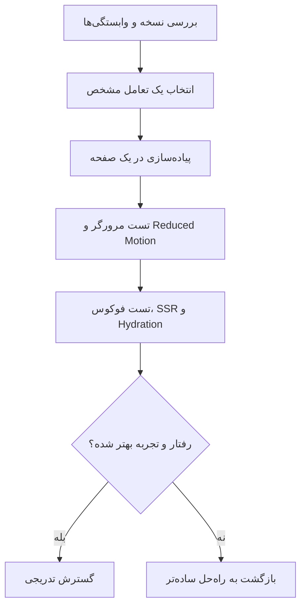

فرض کن یک پنل مدیریتی داریم. کاربر بین فهرست تراکنش‌ها و جزئیات یک تراکنش جابه‌جا می‌شه. اطلاعات درست نمایش داده می‌شن، اما هر بار صفحه ناگهان عوض می‌شه و چشم کاربر باید دوباره دنبال عنوان، دکمهٔ برگشت و اطلاعات اصلی بگرده.

می‌تونیم با چند خط CSS یک Fade اضافه کنیم. ولی وقتی تغییر صفحه به رندر React، بارگذاری داده و جابه‌جایی چند کامپوننت وابسته باشه، هماهنگ‌کردن انیمیشن با زمان واقعی تغییر DOM همیشه ساده نیست.

**React 19.3** که در **۹ سپتامبر ۲۰۲۶** منتشر شد، دو API رو از وضعیت آزمایشی به پایدار رسوند: `View Transitions` و `Fragment Refs`. در کنارش، `browser()` و سازگاری با `Trusted Types` هم اضافه شده. نسخهٔ اصلاحی **19.3.1** هم در **۱۴ اکتبر ۲۰۲۶** در GitHub ثبت شده؛ پس وقتی از 19.3 حرف می‌زنیم، منظورمون فقط نسخهٔ اولیه نیست.

من این تغییرها رو از زاویهٔ یک سؤال بررسی می‌کنم: **کدوم مسئلهٔ واقعی رو حل می‌کنن و کجا استفاده ازشون فقط پیچیدگی اضافه می‌کنه؟**

## چرا این نسخه ارزش بررسی داره؟

[اعلامیهٔ رسمی React 19.3](https://react.dev/blog/2026/09/09/react-19-3) توضیح می‌ده که View Transitions و Fragment Refs بعد از دورهٔ آزمایشی به APIهای پایدار تبدیل شدن. [انتشار 19.3.1 در GitHub](https://github.com/react/react/releases/tag/v19.3.1) هم نشون می‌ده توسعهٔ این شاخه در اکتبر ادامه داشته. این دو منبع برای فهم وضعیت نسخه معتبرتر از فهرست‌های تبلیغاتی «بهترین قابلیت‌های React» هستن.

این موضوع در جامعهٔ فرانت‌اند هم بحث داشته؛ اما **برای Google Trends عدد یا رتبه‌ای رو مستقل تأیید نکرده‌ام**. بنابراین ادعای «ترند شمارهٔ یک گوگل» ندارم. دلیل انتخاب، تغییر رسمی APIها و کاربرد عملی اون‌هاست.

یک نکتهٔ نسخه‌ای: `React 19.3` به معنی انتشار React 20 نیست. همچنین «Stable شدن API» به معنی این نیست که هر مرورگر قدیمی همهٔ افکت‌های بصری رو یکسان نمایش می‌ده.

## ۱. View Transition: تغییر UI را با انیمیشن هماهنگ کنیم

در CSS می‌تونیم برای تغییر `opacity` یا `transform` یک `transition` تعریف کنیم. این روش هنوز هم عالیه؛ مخصوصاً برای Hover، باز و بسته شدن یک منوی ساده یا افکت‌های کوچک.

اما فرض کن یک کامپوننت از درخت React حذف می‌شه و کامپوننت دیگری جاش میاد. برای اینکه خروج قبلی و ورود بعدی نرم باشه، معمولاً باید زمان حذف عنصر رو مدیریت کنیم. `<ViewTransition>` بخشی از این هماهنگی رو با استفاده از [View Transition API مرورگر](https://developer.mozilla.org/en-US/docs/Web/API/Document/startViewTransition) انجام می‌ده.

در React چهار نوع تغییر اصلی داریم:

| نوع | چه اتفاقی افتاده؟ | مثال |
| --- | --- | --- |
| `enter` | یک مرز View Transition وارد درخت می‌شه | باز شدن پنل جزئیات |
| `exit` | یک مرز از درخت حذف می‌شه | بستن پنل |
| `update` | محتوا یا چیدمان داخل مرز تغییر می‌کنه | عوض شدن دادهٔ کارت |
| `share` | عنصر نام‌گذاری‌شده از جایی حذف و در جای دیگری اضافه می‌شه | انتقال کارت به صفحهٔ جزئیات |

React این تغییرها رو با ساختار رندر هماهنگ می‌کنه؛ ولی **هر `setState` معمولی انیمیشن رو فعال نمی‌کنه**. این تفاوت، مهم‌ترین نکته‌ایه که موقع اولین آزمایش باید بدونیم.

### یک مثال کوچک و قابل اجرا

این مثال برای یک پروژهٔ React 19.3 با JSX نوشته شده. فرض کن کاربر با زدن دکمه می‌خواد توضیح بیشتری دربارهٔ یک تراکنش ببینه:

```jsx
import { useState, startTransition, ViewTransition } from "react";

export default function TransactionDetails() {
  const [expanded, setExpanded] = useState(false);

  function toggleDetails() {
    startTransition(() => {
      setExpanded((value) => !value);
    });
  }

  return (
    <section>
      <h2>تراکنش ۴۲۱</h2>
      <button
        type="button"
        aria-expanded={expanded}
        aria-controls="transaction-extra"
        onClick={toggleDetails}
      >
        {expanded ? "بستن جزئیات" : "نمایش جزئیات"}
      </button>

      <div id="transaction-extra">
        {expanded && (
          <ViewTransition>
            <div>
              <p>وضعیت: موفق</p>
              <p>روش پرداخت: انتقال بانکی</p>
            </div>
          </ViewTransition>
        )}
      </div>
    </section>
  );
}
```

اینجا `startTransition` به React می‌گه تغییر وضعیت، یک به‌روزرسانی غیرضروری از نظر فوریت پاسخ به ورودی کاربره. اضافه یا حذف شدن `ViewTransition` می‌تونه با افکت ورود و خروج همراه بشه. افکت پیش‌فرض معمولاً یک Cross-fade است؛ نتیجهٔ دقیق رو باید در مرورگر هدف تست کنیم.

این کد برای نمایش جزئیات یک نمونهٔ ساده‌ست، نه الگوی مناسب برای هر فرم. مثلاً **مقدار فیلد متنی کنترل‌شده رو داخل `startTransition` به‌روزرسانی نکنیم**؛ تایپ‌کردن باید فوری باقی بمونه. همین‌طور Transition جایگزین کنترل وضعیت Loading یا مدیریت خطای درخواست شبکه نیست.

### چرا خودمان `document.startViewTransition` را صدا نزنیم؟

وقتی از `<ViewTransition>` در React استفاده می‌کنیم، React خودش فراخوانی API مرورگر رو هماهنگ می‌کنه. طبق [مستندات رسمی این کامپوننت](https://react.dev/reference/react/ViewTransition)، نباید برای همان تغییر UI هم‌زمان به‌صورت دستی `document.startViewTransition()` رو اجرا کنیم؛ دو هماهنگ‌کننده می‌تونن در کار هم دخالت کنن.

به‌نظرم مرزبندی خوب اینه: برای انیمیشن‌های وابسته به رندر React از ابزار خود React استفاده کنیم؛ برای تعامل‌های مستقل از درخت React، اول ببینیم CSS ساده‌تر جواب می‌ده یا نه.

## ۲. وقتی جهت حرکت مهمه: addTransitionType

فرض کن در یک راهنمای چندمرحله‌ای، کاربر «بعدی» یا «قبلی» رو می‌زنه. اگر هر دو حرکت یک Fade یکسان داشته باشن، ممکنه حس جهت حرکت از بین بره.

`addTransitionType` علت یک Transition رو مشخص می‌کنه. مثلاً `forward` و `backward`. بعد می‌تونیم بر اساس اون، کلاس انیمیشن متفاوتی انتخاب کنیم.

```jsx
import {
  useState,
  startTransition,
  addTransitionType,
  ViewTransition,
} from "react";

const steps = ["اطلاعات", "تأیید", "نتیجه"];

export default function Wizard() {
  const [step, setStep] = useState(0);

  function move(direction) {
    startTransition(() => {
      addTransitionType(direction);
      setStep((current) =>
        Math.max(0, Math.min(steps.length - 1, current + (
          direction === "forward" ? 1 : -1
        )))
      );
    });
  }

  return (
    <section>
      <ViewTransition
        update={{
          forward: "step-forward",
          backward: "step-backward",
        }}
      >
        <h2>{steps[step]}</h2>
      </ViewTransition>

      <button disabled={step === 0} onClick={() => move("backward")}>
        قبلی
      </button>
      <button
        disabled={step === steps.length - 1}
        onClick={() => move("forward")}
      >
        بعدی
      </button>
    </section>
  );
}
```

در این مثال، `update` رو انتخاب کردیم، چون مرز View Transition در درخت باقی می‌مونه و محتوای داخلش تغییر می‌کنه. اگر `enter` می‌گذاشتیم، صرف عوض شدن متن لزوماً افکت موردنظر رو فعال نمی‌کرد.

برای کلاس‌های `step-forward` و `step-backward` باید انیمیشن دلخواه رو با CSS تعریف کنیم؛ نام کلاس به‌تنهایی انیمیشن سفارشی نمی‌سازه. [مستندات addTransitionType](https://react.dev/reference/react/addTransitionType) روش اتصال نوع تغییر به کلاس و pseudo-elementهای View Transition رو توضیح می‌ده.

### انیمیشن باید قابل خاموش شدن باشه

بعضی کاربرها حرکت زیاد روی صفحه رو آزاردهنده می‌دونن. React فعلاً `prefers-reduced-motion` رو خودکار برای ما مدیریت نمی‌کنه. پس اگر انیمیشن اضافه می‌کنیم، این ترجیح رو هم در نظر بگیریم:

```css
@media (prefers-reduced-motion: reduce) {
  ::view-transition-old(*),
  ::view-transition-new(*) {
    animation-duration: 0.01ms !important;
    animation-iteration-count: 1 !important;
  }
}
```

در محصول واقعی بهتره انیمیشن‌ها کوتاه و هدفمند باشن و بعد از اعمال CSS، حالت Reduce Motion رو هم با تنظیمات سیستم‌عامل آزمایش کنیم. هدف این نیست که هر تغییر کوچکی حرکت کنه؛ هدف اینه که کاربر راحت‌تر بفهمه **چه چیزی تغییر کرده**.

## ۳. Fragment Refs: دسترسی به چند عنصر، بدون div اضافه

حالا از انیمیشن فاصله بگیریم. مسئلهٔ دیگه‌ای رو تصور کن: یک کامپوننت سه فیلد فرم برمی‌گردونه و ما می‌خوایم با یک دکمه، فوکوس رو به اولین فیلد قابل‌استفاده منتقل کنیم.

قبلاً شاید یک `div` دور همهٔ فیلدها می‌ذاشتیم تا بهش `ref` بدیم؛ یا مجبور بودیم برای هر فیلد جداگانه ref مدیریت کنیم. اما اضافه کردن wrapper ممکنه Grid، Flex یا ساختار معنایی صفحه رو عوض کنه.

در React 19.3 می‌تونیم به شکل کامل `<Fragment>` یک `ref` بدیم. مقدار ref از نوع `FragmentInstance` خواهد بود؛ **خود Fragment هنوز هیچ DOM node جدیدی تولید نمی‌کنه**.

```jsx
import { Fragment, useRef } from "react";

export default function AccountForm() {
  const fieldsRef = useRef(null);

  return (
    <form>
      <button type="button" onClick={() => fieldsRef.current?.focus()}>
        رفتن به اولین فیلد
      </button>

      <Fragment ref={fieldsRef}>
        <label>
          شماره حساب
          <input name="account" />
        </label>
        <label>
          توضیحات
          <input name="note" />
        </label>
      </Fragment>

      <button type="submit">ثبت</button>
    </form>
  );
}
```

در این نمونه `focus()` بین فرزندان قابل‌فوکوس جست‌وجو می‌کنه. از اون طرف، متدهایی مثل `addEventListener`، `observeUsing` و `getClientRects` روی **اولین سطح عناصر DOM داخل Fragment** کار می‌کنن. این تفاوت مهمه: متدهای مختلف لزوماً همهٔ فرزندان تو‌در‌تو رو یکسان نمی‌بینن.

یک محدودیت ساده هم داریم: سینتکس کوتاه `<></>` نمی‌تونه `ref` بگیره؛ باید `Fragment` رو import کنیم.

### چه زمانی Fragment Ref انتخاب بدیه؟

اگر به یک عنصر واقعی با `classList`، `style`، `dataset` یا اندازهٔ یک Box مشخص نیاز داریم، `FragmentInstance` جایگزین `HTMLElement` نیست. فقط مجموعه‌ای از عملیات مشخص رو در اختیارمون می‌ذاره.

برای مدیریت فوکوس هم باید دلیل روشنی داشته باشیم. اینکه بعد از هر رندر، فوکوس کاربر رو به اولین فیلد ببریم، ممکنه تجربهٔ کار با صفحه‌خوان یا صفحه‌کلید رو خراب کنه. **وجود API به معنی درست بودن استفادهٔ خودکار از اون نیست.**

اگر با TypeScript کار می‌کنیم، نسخهٔ `@types/react` و `@types/react-dom` باید با قابلیت‌های 19.3 سازگار باشن. تایپ `FragmentInstance` و متدهای وابسته به renderer رو در محیط پروژه بررسی کنیم؛ فقط موفق شدن Build جاوااسکریپت کافی نیست.

## ۴. browser(): وقتی کامپوننت واقعاً به مرورگر نیاز داره

یک باگ آشنا در برنامه‌های SSR اینه که سرور HTML رو با یک مقدار تولید می‌کنه، ولی اولین رندر مرورگر مقدار دیگه‌ای می‌سازه. مثلاً سرور Time Zone خودش رو می‌شناسه و مرورگر Time Zone کاربر رو.

راه‌حل همیشه خاموش کردن SSR برای کل صفحه نیست. React 19.3 یک API به نام `browser()` در `react-dom` اضافه کرده که با `use` ترکیب می‌شه. این کار می‌تونه رندر **همون کامپوننت** رو روی سرور متوقف کنه و به نزدیک‌ترین `Suspense` اجازه بده fallback نمایش بده.

```jsx
import { Suspense, use } from "react";
import { browser } from "react-dom";

function LocalTimeZone() {
  use(browser("Timezone is only known in the browser"));

  const timeZone =
    new Intl.DateTimeFormat().resolvedOptions().timeZone;

  return <span>{timeZone}</span>;
}

export default function Profile() {
  return (
    <p>
      منطقهٔ زمانی شما:
      <Suspense fallback={<span>در حال بارگذاری…</span>}>
        <LocalTimeZone />
      </Suspense>
    </p>
  );
}
```

روی سرور، `LocalTimeZone` به fallback نزدیک‌ترین Suspense واگذار می‌شه. در مرورگر، `use(browser())` تعلیق ایجاد نمی‌کنه و مقدار محلی نمایش داده می‌شه.

این قابلیت برای بخش‌های واقعاً وابسته به `window`، `localStorage` یا محیط مرورگر مفیده. ولی اگر داده‌ای رو می‌تونیم روی سرور به‌درستی تولید کنیم، بهتره بی‌دلیل اون رو از SSR حذف نکنیم. این تصمیم می‌تونه روی HTML اولیه، SEO و تجربهٔ بارگذاری اثر بذاره. [راهنمای browser()](https://react.dev/reference/react-dom/browser) مثال‌ها و محدودیت‌های بیشتری داره.

## ۵. Trusted Types: پشتیبانی بهتر، نه امنیت خودکار

در یک پنل مدیریتی ممکنه متن HTML از منبعی بیرونی دریافت کنیم. اگر اون متن بدون کنترل به sinkهای خطرناک DOM مثل `innerHTML` برسه، خطر XSS مطرح می‌شه.

[Trusted Types](https://developer.mozilla.org/en-US/docs/Web/API/Trusted_Types_API) سازوکاری در مرورگره که می‌تونه با سیاست Content Security Policy، استفاده از مقادیر خام در sinkهای حساس رو محدود کنه. React 19.3 حالا آبجکت‌های Trusted Types رو در مسیرهای مربوط بدون تبدیل ناخواسته به رشته عبور می‌ده تا سیاست‌های مرورگر بتونن درست عمل کنن.

اما دو سوءتفاهم رو کنار بذاریم:

- **React خودش HTML نامطمئن رو پاک‌سازی نمی‌کنه.** هنوز باید ورودی رو اعتبارسنجی و در صورت نیاز با ابزار مناسب sanitize کنیم.
- **نصب React 19.3 به‌تنهایی CSP یا Trusted Types رو فعال نمی‌کنه.** باید سیاست امنیتی رو جداگانه طراحی، فعال و آزمایش کنیم.

در محصولی که دادهٔ مالی یا شخصی نمایش می‌ده، این قابلیت بیشتر یک قطعه از معماری دفاعی است تا یک دکمهٔ «امن‌سازی».

## ۶. یک تغییر کوچک در Server Components

در نسخهٔ جدید، Server Component می‌تونه Context تعریف‌شده در یک ماژول `'use client'` رو مستقیماً render کنه؛ بدون اینکه صرفاً برای عبور دادن مقدار Context یک کامپوننت Provider واسط بنویسیم.

این تغییر کد رو ساده‌تر می‌کنه، اما مرزهای Server و Client رو حذف نمی‌کنه. همچنان باید حواسمون به داده‌های قابل‌ارسال به کلاینت، مجوزها و نحوهٔ دسترسی به اطلاعات حساس باشه. برای یک پروژهٔ صرفاً Client-side، احتمالاً این قابلیت اولویت بالایی نداره.

## کدام قابلیت برای کدام مسئله؟

| مسئلهٔ واقعی | ابزار مناسب | چه زمانی سراغش نریم؟ |
| --- | --- | --- |
| تغییر صفحه یا کارت با حفظ حس تداوم | `ViewTransition` | برای Hover ساده یا وقتی CSS کافی است |
| انیمیشن متفاوت برای عقب و جلو | `addTransitionType` | وقتی حرکت جهت‌دار معنی خاصی ندارد |
| فوکوس یا مشاهدهٔ گروهی بدون wrapper | `Fragment ref` | وقتی به یک DOM node واقعی نیاز داریم |
| بخشی از UI که فقط در مرورگر معنی دارد | `use(browser())` | وقتی SSR درست و مفید است |
| اجرای سیاست Trusted Types در DOM | پشتیبانی جدید React DOM | وقتی هنوز CSP و sanitization نداریم |

این جدول نسخهٔ کوتاه تصمیم‌گیریه؛ قرار نیست همهٔ این APIها رو صرفاً چون تازه‌اند وارد یک پروژه کنیم.

## قبل از مهاجرت، این آزمایش‌ها رو انجام بدیم

من ترجیح می‌دم به‌جای ارتقای هم‌زمان همهٔ کامپوننت‌ها، یک مسیر کوچک و قابل‌مشاهده انتخاب کنم. مثلاً باز و بسته شدن جزئیات یک رکورد در پنل مدیریت.



چند مورد رو عمداً در تست نگه می‌دارم:

1. **نسخه‌ها:** `react` و `react-dom` هم‌نسخه باشن؛ آخرین Patch سازگار رو بررسی کنیم. برای TypeScript، تایپ‌ها رو هم چک کنیم.
2. **مرورگرها:** Chrome، Firefox و Safari هدف محصول رو با نسخه‌های واقعی تست کنیم. اگر API مرورگر پشتیبانی نشه، نباید نمایش محتوای اصلی به انیمیشن وابسته باشه.
3. **دسترس‌پذیری:** با صفحه‌کلید و تنظیم `prefers-reduced-motion` تست کنیم. فوکوس نباید بعد از جابه‌جایی محتوا گم بشه.
4. **SSR و Hydration:** در برنامهٔ SSR، HTML اولیه، fallbackها و اولین رندر مرورگر رو جداگانه بررسی کنیم.
5. **عملکرد:** قبل و بعد از تغییر، تجربهٔ واقعی کاربر رو بسنجیم. نرم‌تر به‌نظر رسیدن UI الزاماً به معنی سریع‌تر شدن پاسخ شبکه نیست.
6. **Rollback:** تغییر UI رو در یک PR مستقل نگه داریم تا اگر روی مرورگر یا دستگاهی مشکل داشت، برگشتنش ساده باشه.

برای آزمایش، یک سناریوی Playwright می‌تونه بررسی کنه که پس از کلیک، محتوای درست نمایش داده شده و دکمه همچنان قابل‌دسترسیه. ولی **تست گذشتن از یک انیمیشن با تست درست بودن منطق تراکنش یکی نیست**. این دو رو از هم جدا نگه داریم.

## سه اشتباه رایج در استفاده از APIهای جدید

**اول: هر تغییر State رو Transition کنیم.** بعضی تغییرها مثل تایپ‌کردن و بازخورد فوری دکمه باید سریع بمونن. `startTransition` ابزار زمان‌بندی به‌روزرسانیه، نه راهی برای «بهتر کردن» همهٔ `setState`ها.

**دوم: انیمیشن رو جایگزین طراحی تعامل کنیم.** اگر کاربر نمی‌فهمه کدوم رکورد انتخاب شده، یک Cross-fade مشکل اطلاعات ناقص یا عنوان مبهم رو حل نمی‌کنه.

**سوم: API جدید رو با قابلیت خودکار اشتباه بگیریم.** `Fragment ref` جای همهٔ DOM refها رو نمی‌گیره؛ `browser()` همهٔ خطاهای Hydration رو درمان نمی‌کنه؛ Trusted Types هم به‌تنهایی جلوی XSS رو نمی‌گیره.

## جمع‌بندی

به نظرم جذاب‌ترین بخش React 19.3 این نیست که می‌تونیم انیمیشن بیشتری داشته باشیم. مهم‌تر اینه که **هماهنگ‌کردن تغییرات React با رفتار مرورگر** در چند سناریوی مشخص ساده‌تر شده.

اگر یک داشبورد یا اپلیکیشن با جابه‌جایی‌های زیاد داریم، View Transitions ارزش یک آزمایش محدود رو داره. اگر یک کتابخانهٔ کامپوننت می‌سازیم و نمی‌خوایم برای مدیریت فوکوس، DOM اضافه تولید کنیم، Fragment Refs می‌تونه مفید باشه. اگر SSR داریم، `browser()` رو فقط برای بخش‌هایی استفاده کنیم که واقعاً به مرورگر وابسته‌اند.

قرار نیست بعد از هر انتشار React، کل پروژه رو بازنویسی کنیم. یک مسئلهٔ مشخص، یک نمونهٔ کوچک و یک تست قابل‌تکرار معمولاً تصمیم بهتری به ما می‌ده.

---

## منابع و مطالعهٔ بیشتر

- [React 19.3 — اعلامیهٔ رسمی، ۹ سپتامبر ۲۰۲۶](https://react.dev/blog/2026/09/09/react-19-3)
- [React 19.3.1 — انتشار GitHub، ۱۴ اکتبر ۲۰۲۶](https://github.com/react/react/releases/tag/v19.3.1)
- [ViewTransition — مستندات رسمی React](https://react.dev/reference/react/ViewTransition)
- [Fragment و FragmentInstance — مستندات رسمی React](https://react.dev/reference/react/Fragment)
- [addTransitionType — مستندات رسمی React](https://react.dev/reference/react/addTransitionType)
- [browser() — مستندات رسمی React DOM](https://react.dev/reference/react-dom/browser)
- [View Transition API — MDN](https://developer.mozilla.org/en-US/docs/Web/API/Document/startViewTransition)
- [Trusted Types API — MDN](https://developer.mozilla.org/en-US/docs/Web/API/Trusted_Types_API)
