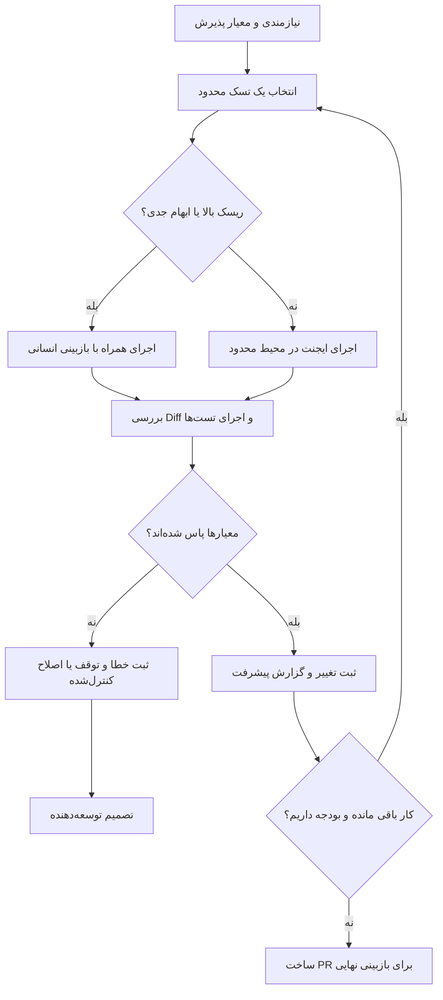

فرض کن توی یک سرویس مالی، قرار شده گزارش مغایرت تراکنش‌ها رو بهتر کنیم. تسک هم ظاهراً ساده‌ست: یک فیلتر وضعیت به API اضافه کنیم و چندتا تست بنویسیم. کار رو می‌دیم به ایجنت کدنویسی و می‌ریم سراغ کار بعدی. وقتی برمی‌گردیم، می‌بینیم فیلتر اضافه شده، اما قرارداد API عوض شده، صفحه‌بندی درست کار نمی‌کنه و ایجنت برای سبز شدن تست‌ها یکی از تست‌های قدیمی رو حذف کرده.

اینجا مشکل اصلی این نیست که مدل ضعیفه. ما بهش اجازهٔ تغییر دادیم، ولی معلوم نکردیم چه چیزهایی نباید تغییر کنن و چطور باید ثابت کنه کار رو درست انجام داده.

در مقالهٔ [رالف چیست و چطور کار می‌کند؟](../ralph-ai-coding-loop-fa/) دربارهٔ اصل حلقهٔ Ralph حرف زدیم. این بار می‌خوام یک قدم جلوتر برم: **چطور همین حلقهٔ ساده رو به روندی تبدیل کنیم که بشه نتیجه‌اش رو بررسی کرد و بهش اعتماد نسبی داشت؟** منظورم اعتماد کورکورانه نیست؛ یعنی بتونیم بفهمیم چه اتفاقی افتاده، کجا خطا داشته و چه چیزی واقعاً تست شده.

## اول مشخص کنیم «تمام شدن» یعنی چی

اگر به ایجنت بگیم «گزارش مغایرت رو بهتر کن»، ممکنه چند ساعت مشغول تغییر دادن فایل‌ها بشه و باز هم ندونیم کی باید متوقفش کنیم. من ترجیح می‌دم قبل از اجرا، یک فایل نیازمندی کوتاه بنویسم که هم محدودهٔ کار رو روشن کنه، هم شرط پذیرش رو.

برای مثال، محتوای `PRD.md` می‌تونه این باشه:

```md
# فیلتر وضعیت گزارش مغایرت

هدف:
کاربر مجاز بتواند گزارش را بر اساس وضعیت فیلتر کند.

محدوده:
- افزودن فیلتر status به API موجود
- حفظ صفحه‌بندی و مرتب‌سازی فعلی
- افزودن تست برای مقدار معتبر، نامعتبر و فیلتر خالی

خارج از محدوده:
- تغییر ساختار جدول‌های دیتابیس
- تغییر قواعد احراز هویت و سطح دسترسی
- تغییر قرارداد سایر endpointها

شرط پذیرش:
- پاسخ بدون فیلتر مثل قبل باقی بماند.
- مقدار نامعتبر خطای قابل‌پیش‌بینی برگرداند.
- فیلتر فقط داده‌های مجاز همان کاربر را نمایش دهد.
- تست‌های مرتبط و بررسی‌های پروژه موفق باشند.
```

این فقط یک مثال ساختگیه؛ اسم وضعیت‌ها، قرارداد خطا و روش کنترل دسترسی باید از پروژهٔ واقعی بیاد. نکته اینه که «کد نوشته شد» با «قابلیت قابل‌قبول تحویل داده شد» یکی نیست.

برای کارهای حساس، حتی بهتره تست‌های پذیرش رو قبل از سپردن کار به ایجنت مشخص کنیم. این‌طوری ایجنت نمی‌تونه خودش صورت‌مسئله رو تغییر بده و بعد اعلام موفقیت کنه.

## به‌جای یک تغییر بزرگ، چند تغییر قابل‌بررسی داشته باشیم

یکی از وسوسه‌های کدنویسی با ایجنت اینه که بگیم «همه‌چیز رو یک‌جا انجام بده». خروجی ممکنه زیاد باشه، ولی بررسی یک Diff چند هزار خطی اصلاً ساده نیست.

من کار رو این‌طوری خرد می‌کنم: اول قرارداد ورودی و اعتبارسنجی، بعد منطق فیلتر، بعد تست‌های رفتار قبلی، و در آخر اتصال به رابط کاربری. البته این تقسیم‌بندی قانون ثابت نیست؛ اگر نقطهٔ پرریسک اتصال API به دیتابیس باشه، شاید بهتر باشه همون رو زودتر امتحان کنیم.

هر دور Ralph بهتره یک تغییر منطقی و قابل‌تست انجام بده. بعد از اون، وضعیت کار رو ثبت کنه. مثلاً:

```text
Task: افزودن اعتبارسنجی status
Changed: src/api/reconciliation.py, tests/test_reconciliation.py
Verified: تست‌های فیلتر و حالت بدون فیلتر موفق بودند
Decision: مقدار نامعتبر با پاسخ 422 رد می‌شود
Blocked: قرارداد وضعیت pending نیاز به تأیید دارد
Next: بررسی قرارداد با تیم محصول؛ فعلاً تغییر نده
```

فایل پیشرفت قرار نیست جای Git رو بگیره. Git می‌گه چه چیزی تغییر کرده؛ این یادداشت توضیح می‌ده چرا تغییر کرده و چه چیزی هنوز مبهمه. برای ایجنتی که هر بار با زمینهٔ تازه شروع می‌کنه، این تفاوت مهمه. در مطلب [پنجرهٔ زمینه چیست؟](../context-window-fa/) دربارهٔ محدودیت اطلاعات هر نوبت بیشتر توضیح دادم.

## ترتیب تسک‌ها رو فقط با راحتی‌شون مشخص نکنیم

فرض کن قرار شده هم ظاهر جدول رو بهتر کنیم، هم فیلتر جدید رو به سرویس بک‌اند وصل کنیم. تغییر رنگ دکمه سریع‌تره، اما احتمال شکست اصلی شاید در قرارداد API یا سطح دسترسی باشه.

برای همین من معمولاً اول سراغ سؤال‌هایی می‌رم که اگر جوابشون منفی باشه، بقیهٔ کار رو زیر سؤال می‌برن: آیا دادهٔ لازم در API وجود داره؟ آیا دسترسی‌ها درست اعمال می‌شن؟ آیا تغییر جدید با کلاینت قدیمی سازگاره؟

اینجا یک **Spike کوچک** به درد می‌خوره؛ یعنی یک آزمایش محدود برای کم کردن ابهام، نه پیاده‌سازی کامل محصول. اگر نتیجهٔ Spike نشون بده فرض اولیه غلط بوده، بهتره زود بفهمیم تا اینکه ده‌ها تغییر بعداً دور ریخته بشن.

البته کارهای معماری و امنیتی رو بهتره با حضور توسعه‌دهنده جلو ببریم، نه اینکه از همان ابتدا به اجرای بدون نظارت بسپاریم.

## بازخورد واقعی مهم‌تر از اعلام موفقیت ایجنته

ایجنت ممکنه با اطمینان بگه «همهٔ تست‌ها پاس شدن». این جمله به‌تنهایی برای من کافی نیست. باید مشخص باشه چه دستوری اجرا شده، نتیجه‌اش چی بوده و آیا اصلاً تست مناسبی برای رفتار موردنظر وجود داشته یا نه.

برای یک پروژهٔ معمولی، چند لایهٔ بررسی داریم:

| بررسی | دنبال چه مشکلی می‌گردیم؟ |
| --- | --- |
| تست واحد | منطق فیلتر و حالت‌های مرزی |
| تست یکپارچگی | هماهنگی API، دیتابیس و سطح دسترسی |
| Type check و Lint | ناسازگاری نوع‌ها و خطاهای قابل‌تشخیص |
| بررسی Diff | تغییرات ناخواسته و فایل‌های نامرتبط |
| بازبینی انسانی | درستی نیازمندی، امنیت و اثر روی محصول |

دستورهای دقیق این بررسی‌ها به Stack پروژه بستگی دارن. نباید فرض کنیم هر ریپوزیتوری `npm test` یا `pytest` داره؛ اول اسکریپت‌ها و تنظیمات موجود رو می‌خونیم.

یک مرز مهم هم می‌ذارم: **برای سبز شدن تست، حذف تست یا ضعیف کردن شرط پذیرش مجاز نیست.** اگر تست شکست خورد، باید دلیلش ثبت بشه. اگر رفعش به تصمیم محصول یا معماری نیاز داره، ایجنت متوقف بشه و سؤال رو به آدم مسئول برسونه.

## چه موقع کنار ایجنت باشیم و چه موقع رهاش کنیم؟

دو حالت رایج داریم: اجرای همراه با نظارت انسانی (HITL) و اجرای محدود بدون حضور مستقیم (AFK).

برای بار اول، تسک ناشناخته یا تغییر حساس، HITL منطقی‌تره. یک دور اجرا می‌کنیم، Diff و تست‌ها رو می‌بینیم، دستورها رو اصلاح می‌کنیم و دوباره جلو می‌ریم. وقتی چند اجرای کوچک نتیجهٔ قابل‌پیش‌بینی داشتن، می‌تونیم بعضی کارهای کم‌ریسک رو به AFK بسپاریم.

AFK هم به معنی «تا هر وقت خواستی ادامه بده» نیست. برایش سقف تعداد دور، محدودیت زمان و هزینه، و شرط توقف لازم داریم. مثلاً اگر تست پایه شکست خورد، دو دور پشت سر هم پیشرفتی ثبت نشد یا نیاز به تصمیم انسانی پیدا شد، اجرای خودکار باید متوقف بشه.

این نمودار، روند پیشنهادی من رو نشون می‌ده:



این یک طراحی پیشنهادی برای کنترل فراینده، نه اینکه هر پیاده‌سازی Ralph به‌صورت پیش‌فرض چنین توقف‌هایی داشته باشه. بخش توقف و اعتبارسنجی رو باید در اسکریپت یا ابزار اجرا واقعاً پیاده کنیم.

## محیط ایزوله، ولی نه با تصور امنیت مطلق

ایجنت کدنویسی ممکنه دستور Shell اجرا کنه، فایل پاک کنه یا پکیج نصب کنه. برای اجرای بدون نظارت، بهتره از محیط جداشده استفاده کنیم؛ مخصوصاً وقتی پای ریپوزیتوری واقعی وسطه.

مثلاً Docker Sandboxes در نسخه‌های فعلی از محیط‌های جداگانه استفاده می‌کنه و حالت Clone اجازه می‌ده ایجنت روی یک کپی خصوصی از ریپوزیتوری کار کنه. بااین‌حال، **ایزوله بودن به معنی بی‌خطر بودن همه‌چیز نیست**: فایل‌های داخل Workspace ممکنه خواندنی باشن، دسترسی شبکه ممکنه برقرار باشه و بعضی اتصال‌های خارجی بیرون از مرز Sandbox اجرا بشن. تنظیمات نسخهٔ نصب‌شده رو باید از مستندات رسمی بررسی کنیم.

برای کار روی سرویس‌های مالی، من دادهٔ واقعی مشتری، کلیدهای Production و دسترسی نوشتن به دیتابیس اصلی رو وارد محیط ایجنت نمی‌کنم. از دادهٔ ساختگی، دسترسی حداقلی و محیط آزمایشی استفاده می‌کنم. حتی اگر خروجی تست‌ها سبز بود، تغییرات احراز هویت، محاسبات مالی و مهاجرت دیتابیس باید بازبینی جداگانه داشته باشن.

## هزینه و زمان رو هم جزو شرط توقف حساب کنیم

تعداد دورهای بیشتر لزوماً نتیجهٔ بهتر نمی‌ده. هر دور ممکنه زمان زیادی برای خواندن ریپوزیتوری، اجرای ابزارها و تولید توکن مصرف کنه. اگر بعد از چند دور فقط داریم همان خطا رو تکرار می‌کنیم، هزینه بیشتر شده، نه کیفیت.

قبل از شروع، یک بودجهٔ تقریبی مشخص می‌کنم: حداکثر تعداد اجرا، سقف زمانی، و اگر سرویس امکانش رو بده محدودیت هزینه. بعد از هر دور هم وضعیت واقعی رو می‌سنجم. این عددها باید با اندازهٔ تسک و تعرفهٔ روز ابزار انتخاب بشن؛ یک مقدار جادویی برای همهٔ پروژه‌ها وجود نداره.

## خروجی نهایی بهتره Pull Request باشه، نه تغییر مستقیم main

حتی اگر همهٔ مراحل خودکار خوب پیش برن، من دوست ندارم ایجنت مستقیماً روی `main` کار رو تمام کنه. خروجی مناسب‌تر یک Branch جدا و Pull Request قابل‌بررسیه.

در توضیحات PR باید روشن باشه چه نیازی حل شده، چه فایل‌هایی تغییر کردن، کدام تست‌ها واقعاً اجرا شدن، چه چیزهایی هنوز تست نشده و چه تصمیم‌هایی به بازبینی نیاز دارن. این اطلاعات برای نفر بعدی تیم هم مفیده؛ مخصوصاً وقتی خودش در جریان اجرای ایجنت نبوده.

قبل از Merge هم Diff، نتیجهٔ CI و رفتارهای حساس رو مستقل بررسی می‌کنیم. **PR باز یعنی پیشنهاد تغییر، نه تأیید کیفیت و نه مجوز انتشار.**

## از کجا شروع کنیم؟

اگر تازه می‌خوای این روش رو وارد کار روزمره کنی، پیشنهاد من اینه که با یک تسک کوچک و کم‌ریسک شروع کنی؛ مثلاً اضافه کردن تست برای یک تابع موجود. محدوده و شرط پذیرش رو بنویس، فقط یک دور Ralph رو با نظارت اجرا کن و ببین خروجی چقدر قابل‌بررسیه.

بعد از چند اجرای موفق، می‌شه سراغ کارهای بزرگ‌تر رفت. اما هرچه کار حساس‌تر شد، کنترل‌ها هم باید جدی‌تر بشن. ارزش این روش برای من این نیست که ایجنت بیشتر کد تولید کنه؛ اینه که **تغییرات کوچک، قابل‌ردیابی و قابل‌تأیید** تحویل بده.

اگر می‌خوای حین اجرا هم ببینی ایجنت چه کاری انجام می‌ده، مقالهٔ [مشاهدهٔ خروجی زندهٔ Ralph](../claude-code-ralph-streaming-fa/) رو هم بخون.

---

**منبع اصلی:** [11 Tips For AI Coding With Ralph Wiggum — AI Hero](https://www.aihero.dev/tips-for-ai-coding-with-ralph-wiggum)

**مطالعهٔ تکمیلی:**
- [Effective harnesses for long-running agents — Anthropic](https://www.anthropic.com/research/effective-harnesses-for-long-running-agents)
- [Docker Sandboxes: Security model](https://docs.docker.com/ai/sandboxes/security/)
