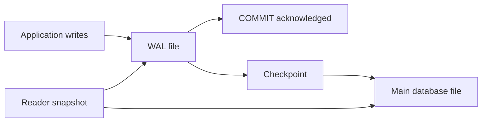
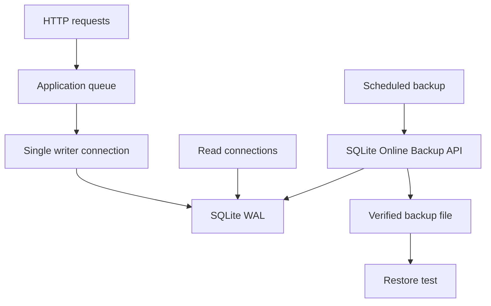

فرض کن یک سرویس کوچک داری که دیتابیسش SQLite است. درخواست‌ها جواب موفق می‌گیرن، تراکنش‌ها Commit می‌شن و هیچ خطای واضحی توی لاگ نیست. چند ساعت بعد می‌بینی بخشی از داده‌هایی که مطمئن بودی ذخیره شدن، توی دیتابیس نیستن.

این سناریو همیشه به معنی اشتباه برنامه‌نویس نیست. تیم SQLite در **۳ مارس ۲۰۲۶** یک Race Condition قدیمی در حالت Write-Ahead Logging یا WAL پیدا کرد که در شرایط بسیار خاص می‌تونه باعث خرابی دیتابیس بشه. اصلاحش در **SQLite 3.51.3، منتشرشده در ۱۳ مارس ۲۰۲۶** ارائه شد. بعدتر، در **۲۴ اوت ۲۰۲۶** مستندات رسمی با اشاره به یک روش بازتولید مستقل به‌روز شدن.

موضوع این مقاله فقط یک باگ نیست؛ می‌خوایم بفهمیم Checkpoint چطور کار می‌کنه، چه زمانی خطر داریم و برای یک SQLite واقعی در Production چه کاری باید انجام بدیم.

## اول WAL را درست بشناسیم

SQLite در حالت معمول تغییرات رو با یک Rollback Journal مدیریت می‌کنه. در حالت WAL، تغییرات ابتدا در فایل جداگانه‌ای کنار دیتابیس نوشته می‌شن:

```text
app.sqlite
app.sqlite-wal
app.sqlite-shm
```

فایل اصلی دیتابیس لزوماً بلافاصله بعد از Commit به‌روز نمی‌شه. تراکنش‌های Commitشده می‌تونن هنوز داخل `-wal` باشن. فایل `-shm` برای هماهنگی و ایندکس WAL به کار می‌ره و مثل فایل WAL، نسخهٔ مستقل و قابل‌حملِ بکاپ نیست.

مزیت مهم WAL اینه که Readerها معمولاً می‌تونن هم‌زمان با یک Writer کار کنن؛ اما این به معنی چند Writer هم‌زمانِ بدون محدودیت نیست. SQLite همچنان نوشتن رو هماهنگ و سریال می‌کنه.



**Checkpoint** فرایند انتقال صفحه‌های مناسب از WAL به فایل اصلی دیتابیسه. به‌طور پیش‌فرض، SQLite وقتی Commit باعث بشه WAL به آستانهٔ حدود ۱۰۰۰ صفحه برسه، یک Checkpoint خودکار از نوع PASSIVE اجرا می‌کنه. این آستانه تعداد صفحه است، نه تعداد تراکنش یا یک حجم ثابت برای همهٔ دیتابیس‌ها.

برای دیدن وضعیت فعلی:

```sql
PRAGMA journal_mode;
PRAGMA wal_autocheckpoint;
PRAGMA wal_checkpoint(PASSIVE);
```

خروجی `wal_checkpoint` شامل وضعیت Busy و تعداد فریم‌های WAL و فریم‌های Checkpointشده است. اجرای دستی این دستور روی سرویس زنده خودش یک عملیات Checkpoint محسوب می‌شه؛ پس نباید بدون دلیل در یک حلقهٔ مانیتورینگ تهاجمی قرارش بدیم.

## باگ WAL-Reset دقیقاً چه اتفاقی می‌اندازد؟

طبق [توضیح فنی رسمی SQLite](https://sqlite.org/wal.html)، مشکل وقتی رخ می‌ده که چند اتصال مستقل در Thread یا Processهای متفاوت، در یک بازهٔ زمانی بسیار دقیق با عملیات نوشتن و Checkpoint تداخل پیدا کنن.

مسیر رخداد، ساده‌شده، این شکلیه:

1. یک Checkpoint کامل انجام می‌شه و WAL آمادهٔ استفادهٔ مجدد می‌شه.
2. اتصال دوم یک Checkpoint تازه شروع می‌کنه.
3. هم‌زمان، اتصال دیگری تراکنشی Commit می‌کنه که WAL رو Reset کرده و نوشتن رو از ابتدای اون ادامه می‌ده.
4. به دلیل Race Condition، Checkpoint دوم Reset شدن WAL رو درست تشخیص نمی‌ده و اطلاعات WAL-Index رو اشتباه ثبت می‌کنه.
5. با بزرگ‌تر شدن WAL و اجرای Checkpoint بعدی، بعضی صفحه‌های تراکنش قبلی ممکنه به فایل اصلی منتقل نشن.

این یک **خرابی بالقوهٔ داده** است، نه صرفاً کند شدن Query یا بزرگ شدن فایل WAL. نکتهٔ مهم اینه که احتمال رخداد بسیار پایینه. خود تیم SQLite می‌گه برای بازتولید اولیه مجبور شده بود شرایط زمانی خاصی رو با ابزار تست ایجاد کنه. بنابراین نباید از وجود این باگ نتیجه بگیریم که تمام دیتابیس‌های WAL در معرض خرابی روزمره هستن.

### چه نسخه‌هایی تحت تأثیر قرار گرفتن؟

| نسخه | وضعیت نسبت به WAL-Reset |
| --- | --- |
| 3.7.0 تا 3.51.2 | طبق گزارش رسمی، احتمال وجود باگ |
| 3.51.3 و نسخه‌های بعدی | اصلاح‌شده |
| 3.44.6 و 3.50.7 | نسخه‌های Backportشدهٔ اصلاح |
| 3.53.x | شامل اصلاح WAL-Reset؛ سایر اصلاحات نسخه را جدا بررسی کنید |

شمارهٔ نسخهٔ ابزار `sqlite3` در Terminal لزوماً نسخهٔ SQLite استفاده‌شده توسط برنامهٔ Node.js، Python یا کتابخانهٔ Embedشده نیست. باید نسخهٔ **Runtime واقعی برنامه** رو هم بررسی کنی.

```sql
SELECT sqlite_version();
```

این Query رو از همان Connection یا Driverی اجرا کن که سرویس Production ازش استفاده می‌کنه. در پروژه‌هایی که SQLite به‌صورت Static Link یا همراه یک پکیج نصب می‌شه، آپدیت کردن CLI سیستم کافی نیست.

## یک اشتباه رایج: WAL بزرگ یعنی دیتابیس خراب شده؟

نه. بزرگ شدن `app.sqlite-wal` به‌تنهایی نشونهٔ خرابی نیست.

فرض کن یک Reader تراکنش طولانی باز کرده و همچنان Snapshot قدیمی رو نگه داشته. Checkpoint نمی‌تونه صفحه‌هایی رو که آن Reader هنوز بهشون نیاز داره آزاد یا بازنویسی کنه. اگر Readerهای طولانی یا هم‌پوشان همیشه فعال باشن، Checkpoint ممکنه کامل نشه. به این وضعیت **Checkpoint Starvation** می‌گن.

تفاوت دو مسئله مهمه:

| مسئله | نشانهٔ معمول | اقدام |
| --- | --- | --- |
| Checkpoint Starvation | WAL رو به رشد، Checkpoint ناقص | بررسی تراکنش‌های Read طولانی و زمان‌بندی Checkpoint |
| WAL-Reset Race | احتمال خرابی داده در تداخل بسیار خاص | ارتقای SQLite به نسخهٔ اصلاح‌شده |
| بکاپ ناقص | فایل بکاپ داده‌های Commitشدهٔ اخیر را ندارد | استفاده از Online Backup API و تست Restore |
| Write Contention | خطاهای `SQLITE_BUSY` یا افزایش زمان انتظار | کوتاه‌کردن تراکنش‌ها و تنظیم Busy Timeout |

برای تشخیص، اول به الگوی تراکنش‌ها نگاه کن. آیا یک Cursor باز مونده؟ آیا گزارش‌گیری بزرگ داخل یک Transaction اجرا می‌شه؟ آیا چند Process بدون هماهنگی دستی Checkpoint می‌زنن؟

## آیا باید Auto-checkpoint را خاموش کنیم؟

برای اغلب سرویس‌ها، نه. پیش‌فرض‌های SQLite سال‌هاست تحت آزمون قرار گرفتن. خاموش کردن Auto-checkpoint و اجرای مکرر Checkpoint دستی بدون اندازه‌گیری، معمولاً پیچیدگی عملیاتی بیشتری ایجاد می‌کنه.

اگر واقعاً نیاز به مدیریت دستی داری، باید دلیلش قابل‌اندازه‌گیری باشه: مثلاً Latency غیرقابل‌قبول در لحظهٔ Commit یا نیاز به کنترل رشد WAL.

```sql
-- فقط پس از بررسی رفتار واقعی workload
PRAGMA wal_autocheckpoint = 1000;
```

این مقدار پیش‌فرض رایجه و نوشتنش اینجا صرفاً برای نمایش تنظیمه. از تغییر عدد بدون Benchmark نتیجهٔ قطعی نگیر.

همچنین `TRUNCATE` یا `RESTART` رو به‌عنوان راه‌حل همیشگی اجرا نکن. این حالت‌ها ممکنه منتظر Readerها بمونن و روی زمان پاسخ سرویس اثر بذارن.

## بکاپ امن از دیتابیس WAL؛ کپی فایل کافی نیست

یکی از خطاهای رایج اینه که وقتی سرویس فعاله فقط فایل `app.sqlite` رو با `cp` برداریم. چون دادهٔ Commitشده ممکنه هنوز داخل `app.sqlite-wal` باشه، خروجی می‌تونه ناقص یا ناسازگار باشه.

حتی کپی جداگانهٔ هر سه فایل در حالی که دیتابیس در حال تغییره، یک Snapshot اتمیک تضمین نمی‌کنه. راه استاندارد برای بکاپ زنده، **SQLite Online Backup API** است؛ CLI رسمی SQLite هم دستور `.backup` رو در اختیار می‌ذاره.

```bash
# مسیرها را برای محیط خودت تغییر بده
sqlite3 /srv/app/app.sqlite ".backup '/srv/backups/app-2026-11-19.sqlite'"
```

این دستور رو روی همان Host یا محیطی اجرا کن که به فایل دیتابیس دسترسی درست داره. بکاپ رو در فایل موقت بساز و فقط بعد از موفقیت، به نام نهایی منتقل کن. اگر خروجی به Storage دیگری ارسال می‌شه، برای انتقال هم Checksum و خطاهای شبکه رو در نظر بگیر.

گزینهٔ دیگر، `VACUUM INTO` است که یک کپی فشرده و سازگار از دیتابیس زنده می‌سازه، اما رفتار و هزینهٔ I/O آن با Online Backup API یکسان نیست.

### یک اسکریپت ساده با کنترل خطا

```bash
#!/usr/bin/env bash
set -euo pipefail
umask 077

DB="/srv/app/app.sqlite"
DEST="/srv/backups"
mkdir -p "$DEST"

STAMP="$(date -u +%Y%m%dT%H%M%SZ)"
TMP="$DEST/.app-$STAMP.sqlite.tmp"
FINAL="$DEST/app-$STAMP.sqlite"

trap 'rm -f "$TMP"' EXIT

sqlite3 "$DB" ".backup '$TMP'"
CHECK="$(sqlite3 "$TMP" 'PRAGMA integrity_check;')"
test "$CHECK" = "ok"

mv "$TMP" "$FINAL"
sha256sum "$FINAL" > "$FINAL.sha256"
echo "Backup ready: $FINAL"
```

این نمونه برای مسیرهای ثابت و قابل‌اعتماد نوشته شده. برای Production باید فضای دیسک، Retention، مانیتورینگ شکست بکاپ، رمزنگاری در مقصد و کپی خارج از سرور هم اضافه بشه. `integrity_check` سلامت ساختاری رو بررسی می‌کنه، نه کامل بودن همهٔ داده‌های موردانتظار کسب‌وکار.

## Restore را واقعاً آزمایش کن

بکاپی که هیچ‌وقت Restore نشده، هنوز یک فرضیه است.

یک آزمون ساده و غیرمخرب روی کپی جداگانه:

```bash
mkdir -p /tmp/sqlite-restore-test
cp /srv/backups/app-2026-11-19.sqlite /tmp/sqlite-restore-test/restored.sqlite
sqlite3 /tmp/sqlite-restore-test/restored.sqlite 'PRAGMA integrity_check;'
sqlite3 /tmp/sqlite-restore-test/restored.sqlite 'PRAGMA foreign_key_check;'
```

در کنار این‌ها چند Query دامنه‌ای هم لازم داری: تعداد سفارش‌ها، آخرین تراکنش ثبت‌شده، یا سازگاری جمع مبالغ با Ledger. `foreign_key_check` فقط نقض Foreign Key تعریف‌شده رو گزارش می‌کنه؛ برای بررسی منطق کسب‌وکار کافی نیست.

برای Restore واقعی، سرویس رو متوقف کن، از وضعیت فعلی نسخهٔ ایمن نگه دار، فایل‌های مرتبط با دیتابیس قبلی رو فقط طبق Runbook و پس از اطمینان از بسته بودن تمام Connectionها مدیریت کن و سپس نسخهٔ بکاپ رو جایگزین کن. **فایل `-wal` یک دیتابیس زنده رو دستی حذف نکن.**

## برای سرویس‌های چند Process چه معماری‌ای بهتره؟

SQLite از چند Connection و چند Process روی یک فایل محلی پشتیبانی می‌کنه، اما محدودیت‌های Locking و هماهنگی رو باید جدی گرفت. WAL برای فایل‌سیستم شبکه‌ای معمولی طراحی نشده، چون به Shared Memory بین Processهای همان Host وابسته است.

اگر سرویس کوچک داری، یک Writer Queue در سطح برنامه می‌تونه مدیریت ترتیب عملیات رو ساده‌تر کنه؛ اما این یک الزام عمومی SQLite نیست و به‌تنهایی جایگزین Locking داخلی یا آپدیت امنیتی نمی‌شه.



اگر چند Replica روی Hostهای متفاوت باید هم‌زمان بنویسن، قبل از Share کردن یک فایل SQLite بین ماشین‌ها، معماری Storage و Replication رو دوباره بررسی کن. یک Queue در حافظهٔ هر Replica، Writerهای Replicaهای دیگر رو هماهنگ نمی‌کنه.

## Runbook پیشنهادی برای Production

به‌جای تغییر هم‌زمان چند تنظیم، این ترتیب رو پیشنهاد می‌کنم:

1. **Inventory:** نسخهٔ SQLite داخل Runtime برنامه، Journal Mode، تعداد Connectionها و مکان فایل رو ثبت کن.
2. **Upgrade:** اگر نسخه در بازهٔ آسیب‌پذیر قرار می‌گیره، Driver یا SQLite Embedشده رو به نسخهٔ دارای Fix ارتقا بده؛ سازگاری رو در Staging تست کن.
3. **Backup:** قبل از Deploy یک بکاپ سازگار بگیر و Restore رو روی دیتابیس جدا آزمایش کن.
4. **Observe:** اندازهٔ WAL، زمان تراکنش‌های Read/Write، خطاهای Busy و نتیجهٔ Checkpointهای برنامه‌ریزی‌شده رو پایش کن.
5. **Deploy:** سرویس رو با Rollback Plan و بدون دست‌کاری دستی فایل‌های WAL منتشر کن.
6. **Verify:** `integrity_check`، `foreign_key_check` و چند کنترل کسب‌وکاری رو اجرا کن؛ سپس لاگ‌ها و Latency رو زیر نظر بگیر.

این Runbook تضمین نمی‌کنه هیچ خرابی‌ای رخ نده، ولی ریسک خطاهای رایج عملیاتی رو پایین می‌آره و مهم‌تر از اون، مسیر تشخیص و بازیابی رو مشخص می‌کنه.

## جمع‌بندی

SQLite هنوز برای تعداد زیادی از سرویس‌ها انتخاب کاملاً معقولیه. WAL-Reset یادآوری می‌کنه که حتی نرم‌افزارهای بسیار آزموده‌شده هم ممکنه Race Conditionهای نادر داشته باشن. واکنش درست، کنار گذاشتن SQLite یا اجرای Checkpointهای بیشتر نیست؛ **نسخهٔ اصلاح‌شده، بکاپ سازگار، تراکنش‌های قابل‌کنترل و Restore آزمایش‌شده** است.

اگر فقط یک کار از این مقاله انجام می‌دی، نسخهٔ SQLite مورد استفادهٔ **خود برنامه** رو بررسی کن، نه فقط نسخهٔ CLI نصب‌شده روی سرور.

## منابع و مطالعهٔ بیشتر

- [SQLite — Write-Ahead Logging و شرح رسمی WAL-Reset](https://sqlite.org/wal.html)؛ شامل جزئیات باگ، شرایط رخداد و به‌روزرسانی ۲۴ اوت ۲۰۲۶.
- [SQLite 3.51.3 Release](https://sqlite.org/releaselog/3_51_3.html)؛ انتشار اصلاح در ۱۳ مارس ۲۰۲۶.
- [SQLite — Online Backup API](https://sqlite.org/backup.html)؛ روش رسمی بکاپ از دیتابیس زنده.
- [SQLite — Online Backup C Interface](https://sqlite.org/c3ref/backup_finish.html)؛ جزئیات Lock و Snapshot.
- [SQLite — PRAGMA wal_checkpoint](https://sqlite.org/pragma.html#pragma_wal_checkpoint)؛ حالت‌ها و خروجی Checkpoint.
- [SQLite — How To Corrupt An SQLite Database File](https://sqlite.org/howtocorrupt.html)؛ خطاهای فایل‌سیستم و کپی ناامن.

*یادداشت پژوهشی: این مقاله بر اساس مستندات رسمی SQLite و بحث‌های فنی سال ۲۰۲۶ تهیه شده است. ادعایی دربارهٔ رتبهٔ دقیق Google Trends ندارد.*
