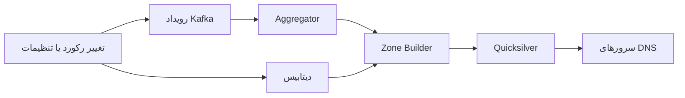
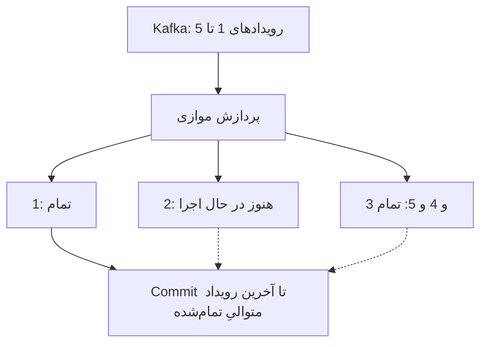
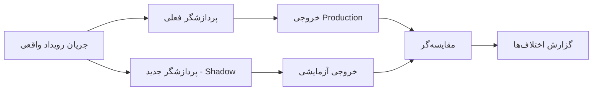

فرض کن یک سرویس داریم که برای هر تغییر کوچک در اطلاعات مشتری، کل گزارش آن مشتری را از اول می‌سازد. اوایل کار همه‌چیز خوب پیش می‌رود؛ داده‌ها کم‌اند و بازسازی چند میلی‌ثانیه بیشتر طول نمی‌کشد. چند ماه بعد یک مشتری بزرگ وارد سیستم می‌شود، تعداد رکوردها چند میلیون می‌شود و همان تغییر کوچک ناگهان چند گیگابایت حافظه مصرف می‌کند.

راه‌حل اولیه شاید اضافه‌کردن Worker باشد. اما اگر مسئله این باشد که **برای تغییر یک فیلد، کل داده را دوباره پردازش می‌کنیم**، Worker بیشتر فقط صورت‌حساب را بزرگ‌تر می‌کند.

در ۲ نوامبر ۲۰۲۶، تیم مهندسی Cloudflare [توضیح داد](https://blog.cloudflare.com/dns-targeted-zone-builds/) که چطور با بازطراحی پردازش تغییرات DNS، اوج مصرف حافظهٔ سامانهٔ Zone Builder را ۸۵ درصد کاهش داده و زمان میانهٔ تکمیل ساخت را از حدود ۷٫۷ به ۳٫۳ ثانیه رسانده است. نکتهٔ جذاب این گزارش، عددها نیست؛ روشی است که تیم برای حفظ **درستی خروجی** هنگام کم‌کردن کار به کار برد.

در این مطلب معماری را قدم‌به‌قدم باز می‌کنیم و بعد می‌بینیم چطور همین ایده را در سرویس‌های خودمان پیاده کنیم.

## مشکل اصلی: تغییر کوچک، بازسازی کامل

Cloudflare برای سرویس‌دهی DNS، رکوردها و تنظیمات هر دامنه را به ساختاری تبدیل می‌کند که سرورهای DNS بتوانند سریع بخوانند. این کار را Zone Builder انجام می‌دهد. تغییرها از دیتابیس و سرویس‌های داخلی به جریان رویداد می‌رسند و در نهایت خروجی در Quicksilver، ذخیره‌ساز توزیع‌شدهٔ Cloudflare، نوشته می‌شود.



در مدل قدیمی، تغییر بعضی تنظیمات باعث می‌شد Builder همهٔ رکوردهای دامنه را دوباره بخواند، تبدیل کند و با وضعیت موجود مقایسه کند. حتی اگر در نهایت فقط چند کلید تغییر کرده بودند، هزینهٔ خواندن و مقایسهٔ کل مجموعه پرداخت می‌شد.

این تفاوت مهمی است: **نوشتن فقط داده‌های تغییرکرده، الزاماً به معنی پردازش فقط داده‌های تغییرکرده نیست.**

در یک سیستم بانکی هم ممکن است همین اتفاق بیفتد: برای تغییر وضعیت یک تراکنش، کل گزارش روزانهٔ حساب را دوباره محاسبه کنیم. خروجی نهایی شاید فقط یک ردیف باشد، ولی پردازش اولیه همچنان سنگین است.

## ایدهٔ اصلی: کوچک‌ترین کاری که درستی‌اش را می‌توان ثابت کرد

Cloudflare یک *Targeted Build Planner* طراحی کرد. Planner بر اساس نوع تغییر تصمیم می‌گیرد چه بخشی از خروجی واقعاً باید بازسازی شود. طبق گزارش رسمی، پنج مسیر اصلی وجود دارد:

| نوع کار | چه چیزی بازسازی می‌شود؟ | مثال |
| --- | --- | --- |
| Resources only | رکوردهای نام‌های مشخص | تغییر A یا TXT |
| Resources and metadata | نام‌های مشخص و فرادادهٔ مشترک | تغییر Nameserver یا Wildcard |
| Apex and metadata | ریشهٔ دامنه و فراداده | بعضی تنظیمات SSL |
| Purge | حذف خروجی دامنهٔ غیرفعال | لغو انتشار |
| Full zone | کل دامنه | تغییر ناشناخته یا انتشار اولیه |

قانون طلایی این است: **خروجی بازسازی جزئی باید برای کلیدهای تحت تأثیر، دقیقاً همان خروجی بازسازی کامل باشد.** اگر نمی‌توانیم این را ثابت کنیم، باید مسیر محافظه‌کارانه را انتخاب کنیم.

این یک بهینه‌سازی معمولی نیست؛ تغییر در مدل تصمیم‌گیری سیستم است. برای استفاده از آن باید بدانیم هر رویداد دقیقاً کدام خروجی‌ها را تحت تأثیر قرار می‌دهد.

### رویداد باید دلیل تغییر را بگوید

رویدادی با محتوای زیر چندان کمک نمی‌کند:

```json
{ "accountId": "A-42", "updated": true }
```

اگر فقط بدانیم چیزی تغییر کرده، شاید مجبور شویم کل حساب را دوباره پردازش کنیم. اما رویداد دقیق‌تر امکان تصمیم‌گیری می‌دهد:

```json
{
  "eventId": "evt-103",
  "accountId": "A-42",
  "type": "transaction.status.changed",
  "transactionId": "T-901",
  "previousStatus": "pending",
  "newStatus": "settled",
  "version": 19
}
```

این صرفاً یک **مثال پیشنهادی** است، نه قالب رویدادهای Cloudflare. در سیستم واقعی باید دربارهٔ نسخه‌بندی Schema، اطلاعات حساس و اندازهٔ Payload هم تصمیم بگیریم.

اگر رویداد کامل نیست، راه امن این نیست که حدس بزنیم فقط یک ردیف تغییر کرده. می‌توانیم رویداد را به مسیر بازسازی کامل بفرستیم، یا با یک درخواست معتبر اطلاعات لازم را دوباره بخوانیم.

## چرا فقط داشتن Kafka کافی نیست؟

Kafka انتقال رویداد را انجام می‌دهد؛ خودش تضمین نمی‌کند که پردازش ما ارزان، درست یا مستقل از بقیهٔ مشتری‌ها باشد.

فرض کن در یک Partition، رویداد شمارهٔ ۲ مربوط به مشتری بزرگی است و پردازشش چند دقیقه طول می‌کشد. رویدادهای ۳ تا ۱۰۰ ممکن است سریع تمام شوند، اما Commit کردن Offset جلوتر از رویداد ۲ خطرناک است: اگر برنامه Restart شود، آن رویداد ناتمام ممکن است دیگر دوباره خوانده نشود.

Cloudflare از رویکردی استفاده می‌کند که در آن تکمیل کارهای بعدی ثبت می‌شود، اما Offset متعهدشده فقط وقتی جلو می‌رود که تمام کارهای قبلی هم تمام شده باشند. به این رفتار در گزارش *soft committing* گفته شده است.



در این مثال، تا وقتی شمارهٔ ۲ تمام نشده، نمی‌توان Offset را از آن عبور داد؛ حتی اگر بقیهٔ کارها تمام شده باشند.

این طراحی معمولاً به معنی پذیرش **پردازش دوباره** در برابر خطر **گم‌کردن تغییر** است. بنابراین مصرف‌کننده باید Idempotent باشد. مثلاً ثبت یک رویداد با شناسهٔ تکراری نباید دوبار مبلغی را به حساب اضافه کند.

### یک الگوی ساده برای Idempotency

```sql
CREATE TABLE processed_events (
  consumer_name TEXT NOT NULL,
  event_id TEXT NOT NULL,
  processed_at TIMESTAMPTZ NOT NULL DEFAULT now(),
  PRIMARY KEY (consumer_name, event_id)
);
```

در یک تراکنش دیتابیس، اول ثبت شناسهٔ رویداد را امتحان می‌کنیم. اگر قبلاً ثبت شده، تغییر تجاری را تکرار نمی‌کنیم. اگر تازه است، همان تراکنش تغییر تجاری را هم اعمال می‌کند. Commit کردن Offset Kafka باید **بعد از Commit موفق دیتابیس** انجام شود.

این الگو برای عملیات داخل یک دیتابیس مفید است؛ برای چند سیستم خارجی یا ارسال پیام و پرداخت واقعی، به طراحی جداگانهٔ Outbox، Inbox یا سازوکار Idempotency در مقصد نیاز داریم. یک جدول به‌تنهایی Exactly-once سراسری نمی‌سازد.

## ترکیب رویدادها، بدون حذف کار لازم

یکی دیگر از تغییرهای Cloudflare، یک Scheduler مشترک بود. اگر برای یک دامنه چند رویداد پشت سر هم برسد، لازم نیست هر کدام یک Build مستقل ایجاد کنند. می‌توانیم **مجموعهٔ کارهای لازم** را با هم ترکیب کنیم.

برای مثال:

- رویداد اول: بازسازی رکورد `www.example.com`
- رویداد دوم: بازسازی Wildcard و Metadata
- برنامهٔ نهایی: بازسازی هر دو نام و Metadata، در یک اجرا

اما اینجا یک دام وجود دارد: ترکیب کار با حذف دلخواه رویداد فرق می‌کند. باید شناسه‌ها و Offsetهای تمام پیام‌های منتظر را نگه داریم تا فقط بعد از موفقیت کل کار تأیید شوند.

یک قاعدهٔ کاربردی برای Planner خودمان:

```ts
type Plan =
  | { kind: "partial"; keys: Set<string>; metadata: boolean }
  | { kind: "full" }
  | { kind: "purge" };

function mergePlans(a: Plan, b: Plan): Plan {
  if (a.kind === "purge" || b.kind === "purge") return { kind: "purge" };
  if (a.kind === "full" || b.kind === "full") return { kind: "full" };
  return {
    kind: "partial",
    keys: new Set([...a.keys, ...b.keys]),
    metadata: a.metadata || b.metadata,
  };
}
```

این فقط **شبه‌پیاده‌سازی برای توضیح ایده** است. تقدم `purge` بر `full` باید با مدل دامنه و ترتیب واقعی رویدادها سازگار باشد. در سامانه‌ای که بعد از حذف، ایجاد دوباره مجاز است، بدون بررسی نسخه و وضعیت فعلی نمی‌شود همین تقدم را استفاده کرد.

## داده‌ای که از روی آن تصمیم گرفتیم ممکن است قدیمی باشد

رویداد می‌گوید «در گذشته چه اتفاقی افتاد». اما ممکن است بین دریافت رویداد و شروع پردازش، وضعیت دیتابیس دوباره تغییر کرده باشد.

Cloudflare ابتدا از رویداد یک برنامهٔ محافظه‌کارانه می‌سازد و درست پیش از اجرا، وضعیت انتشار دامنه را دوباره از دیتابیس می‌خواند. این بازخوانی می‌تواند برنامه را از Partial به Full یا Purge تغییر دهد.

مسئلهٔ دیگر Replication Lag است. اگر Kafka رویداد را زودتر از رسیدن تغییر دیتابیس به Replica تحویل دهد، خواندن از Replica وضعیت قدیمی را نشان می‌دهد. تیم Cloudflare هم تأخیر کوتاهی در Aggregator داشت و هم کنترل نهایی برای تشخیص Replica عقب‌مانده اضافه کرد.

برای سیستم خودمان می‌توانیم یکی از این راه‌ها را بررسی کنیم:

1. خواندن از Primary برای عملیات حساس.
2. انتظار تا Replica به نسخه یا LSN موردنیاز برسد، اگر زیرساخت چنین تضمینی می‌دهد.
3. Retry با Backoff و محدودیت مشخص، نه یک حلقهٔ بی‌پایان.
4. ثبت نسخهٔ داده و رد کردن خروجی محاسبه‌شده از وضعیت قدیمی.

هیچ‌کدام جایگزین طراحی قرارداد سازگاری داده نیستند. مثلاً در گزارش مالی، «چند ثانیه دادهٔ قدیمی» شاید قابل‌قبول باشد، ولی در کنترل موجودی قابل‌برداشت حساب نه.

## چطور مطمئن شویم بهینه‌سازی خروجی را خراب نکرده؟

اینجا به نظرم مهم‌ترین بخش تجربهٔ Cloudflare است. تیم فقط Benchmark نگرفت؛ مسیر جدید را در کنار مسیر قدیمی اجرا کرد و خروجی‌ها را مقایسه کرد.

در آزمایش‌ها، بازسازی کامل و جزئی از وضعیت یکسان دیتابیس انجام می‌شدند و کلیدهای خروجی با هم مقایسه می‌شدند. برای انتشار هم یک Zone Builder آینه‌ای، رویدادهای واقعی را مصرف می‌کرد، اما خروجی را به محیطی می‌نوشت که به کاربران سرویس نمی‌داد.

نمونه‌ای از همین الگو برای سرویس‌های خودمان:



برای مقایسهٔ منصفانه باید نسخهٔ ورودی‌ها، زمان‌های وابسته به ساعت و ترتیب عملیات را کنترل کنیم. اختلاف لحظه‌ای لزوماً باگ نیست؛ ممکن است دو مسیر هنوز به یک نسخه از داده نرسیده باشند. بهتر است اختلاف‌های **ماندگار بعد از همگام‌شدن** را جداگانه بررسی کنیم.

Cloudflare در گزارشش می‌گوید مقایسه‌گر، نمونه‌ای ۲۰ درصدی از Zoneها را بررسی می‌کرد. این عدد انتخاب آن تیم بوده و قرار نیست برای همهٔ پروژه‌ها بهترین نرخ نمونه‌برداری باشد.

## نتایج را درست بخوانیم

اعداد زیر از [گزارش مهندسی Cloudflare در ۲ نوامبر ۲۰۲۶](https://blog.cloudflare.com/dns-targeted-zone-builds/) هستند، نه بنچمارک مستقل یا تضمین عملکرد برای پروژهٔ ما.

| معیار | قبل | بعد |
| --- | --- | --- |
| میانگین حافظهٔ فعال Zone Builder | حدود ۴۹ GiB | حدود ۷ GiB |
| اوج حافظه | حدود ۷۹ GiB | حدود ۱۲ GiB |
| میانهٔ زمان تکمیل Build | حدود ۷٫۷ ثانیه | حدود ۳٫۳ ثانیه |
| بیشترین جهش p99 در مقایسهٔ ۲۴ساعته | ۱۴٫۶ دقیقه | ۱٫۲۱ دقیقه |

طبق گزارش، حدود ۹۳ درصد Buildها دیگر به بازسازی کامل نیاز نداشتند. کاهش حافظه و بهبود تأخیر از چند تغییر با هم به دست آمد: Planner، Scheduler، کاهش Buildهای سنگین و بعداً کوتاه‌تر شدن فاصلهٔ بازسازی و زمان نگه‌داشتن رویدادها.

پس درست نیست بگوییم «فقط با اضافه‌کردن Kafka» یا «فقط با تغییر یک الگوریتم» به چنین نتیجه‌ای می‌رسیم.

## چه زمانی این معماری به درد ما می‌خورد؟

قبل از پیاده‌سازی Targeted Rebuild، سه سؤال می‌پرسم:

**اول: هزینهٔ بازسازی کامل واقعاً مسئله است؟** اگر هر بار فقط ۵۰۰ رکورد می‌خوانیم و Build چند میلی‌ثانیه طول می‌کشد، Planner پیچیده شاید ارزش نگهداری نداشته باشد.

**دوم: وابستگی خروجی‌ها را می‌شناسیم؟** اگر تغییر یک فیلد ممکن است به ده‌ها بخش نامشخص اثر بگذارد، اول باید مدل وابستگی و قرارداد رویداد را روشن کنیم.

**سوم: مسیر برگشت امن داریم؟** باید بتوانیم خروجی مسیر جدید را با مسیر مرجع مقایسه کنیم و در صورت اختلاف، پردازش را به روش قبلی برگردانیم.

برای یک سرویس گزارش‌گیری تراکنش، مسیر اجرای تدریجی می‌تواند این باشد:

1. زمان، حافظه، Queue Lag و تعداد Full Rebuildها را اندازه بگیریم.
2. رویدادهای دقیق با شناسه و نسخهٔ مشخص طراحی کنیم.
3. برای یک نوع تغییر محدود، Planner جزئی بسازیم.
4. خروجی جدید را در Shadow Mode کنار خروجی فعلی مقایسه کنیم.
5. خطاهای بازپخش، رویداد تکراری، ترتیب نامناسب و Replica Lag را تست کنیم.
6. درصد کمی از مشتری‌ها را منتقل کنیم و معیارهای صحت و تأخیر را پایش کنیم.
7. برای تغییر ناشناخته یا ناسازگار، مسیر محافظه‌کارانه داشته باشیم.

## چند اشتباه رایج

- **بهینه‌سازی قبل از اندازه‌گیری:** شاید گلوگاه اصلی دیتابیس یا شبکه باشد، نه Full Rebuild.
- **اعتماد کامل به Payload رویداد:** وضعیت لحظهٔ اجرا ممکن است تغییر کرده باشد.
- **Commit زودهنگام Offset:** با Restart می‌تواند به از دست رفتن کار منجر شود.
- **تست فقط با دادهٔ کوچک:** مشکل معمولاً با مشتری‌های بزرگ و داده‌های نامتوازن خودش را نشان می‌دهد.
- **نادیده‌گرفتن حذف داده:** خروجی قدیمی که دیگر نباید وجود داشته باشد هم بخشی از درستی سیستم است.
- **پیچیده‌کردن بیش از حد:** اگر مسیر Full ساده و سریع است، نگه‌داشتن آن انتخاب بدی نیست.

## جمع‌بندی

درس این تجربه برای من این نیست که همه باید DNS یا Kafka شبیه Cloudflare داشته باشند. مسئله این است که در سیستم‌های رویدادمحور، **مقدار کاری که از هر تغییر نتیجه می‌گیریم** به‌اندازهٔ سرعت اجرای همان کار مهم است.

وقتی رویدادها دقیق باشند، وابستگی خروجی‌ها مشخص باشد و بتوانیم درستی بازسازی جزئی را با مسیر کامل بسنجیم، می‌شود بدون قربانی‌کردن صحت داده، کار اضافه را حذف کرد.

اما وقتی مطمئن نیستیم، یک بازسازی کاملِ درست بهتر از یک بهینه‌سازی سریع با خروجی اشتباه است.

## منابع و مطالعهٔ بیشتر

- [Cloudflare Engineering — How we halved DNS build delay and cut memory use by 85% (۲ نوامبر ۲۰۲۶)](https://blog.cloudflare.com/dns-targeted-zone-builds/) — منبع اصلی اعداد و طراحی.
- [Cloudflare — How we improved DNS record build speed by more than 4,000x (۲۵ مه ۲۰۲۲)](https://blog.cloudflare.com/dns-build-improvement/) — پیشینهٔ بازسازی رکوردمحور.
- [Apache Kafka — Documentation](https://kafka.apache.org/documentation/) — مفهوم Partition و Offset.
- [Microservices.io — Idempotent Consumer](https://microservices.io/patterns/communication-style/idempotent-consumer.html) — مدیریت پیام‌های تکراری.
- [Microservices.io — Transactional Outbox](https://microservices.io/patterns/data/transactional-outbox.html) — هماهنگی تغییر دیتابیس و انتشار رویداد.
