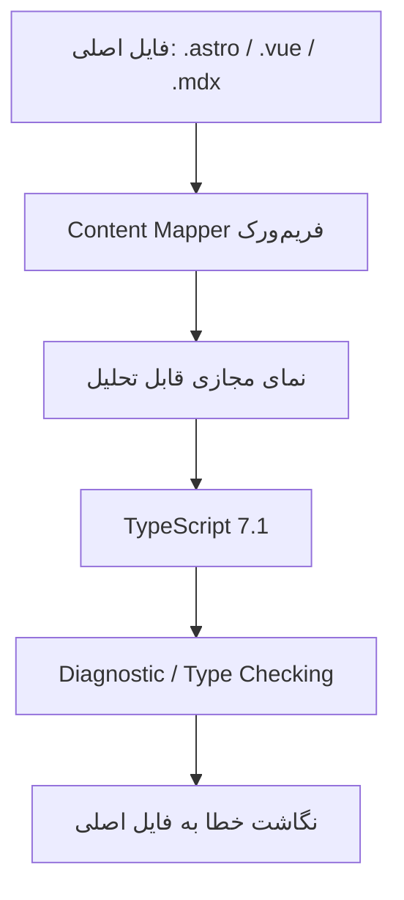
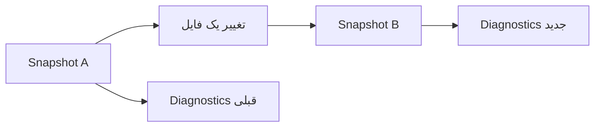

فرض کن توی یک پروژهٔ Astro کار می‌کنی. بخشی از منطق داخل فایل‌های `.ts` قرار داره، بخشی داخل کامپوننت‌های `.astro` و چند تکه کد هم در فایل‌های `.mdx`. از بیرون همه‌شون یک پروژه‌اند، ولی ابزارهای بررسی نوع همیشه این تصویر یکپارچه رو نمی‌بینن. برای همین گاهی باید یک ابزار جدا برای TypeScript داشته باشیم و یک ابزار دیگه برای بررسی کدهای داخل فایل‌های مخصوص فریم‌ورک.

حالا [TypeScript 7.1 Beta](https://devblogs.microsoft.com/typescript/announcing-typescript-7-1-beta/) در **۲۰ اکتبر ۲۰۲۶** منتشر شده و یکی از تغییرهای مهمش دقیقاً به همین مسئله مربوطه: **Content Mappers**. البته این فقط یکی از تغییرهاست؛ TypeScript 7.1 برای ابزارهایی که با کامپایلر کار می‌کنن هم API تازه‌ای آورده.

من بیشتر از اینکه دنبال یک فهرست طولانی از قابلیت‌ها باشم، سه سؤال دارم: این نسخه چه مشکلی رو حل می‌کنه؟ کجای کار هنوز آزمایشی‌ه؟ و اگر یک پروژهٔ واقعی داریم، چطور بدون به‌هم‌زدن CI امتحانش کنیم؟

> **وضعیت در ۲۸ اکتبر ۲۰۲۶:** نسخهٔ ۷.۰ در ۸ ژوئیه منتشر شده، اما **۷.۱ هنوز Beta است**. این مقاله معرفی قابلیت‌ها و راهنمای ارزیابیه، نه توصیه به ارتقای بی‌قیدوشرط پروژه‌های production.

## چرا TypeScript 7.1 مهمه؟

برای فهمیدن ۷.۱ باید یک قدم عقب‌تر بریم. در نسخهٔ ۷.۰، تیم TypeScript کامپایلر و ابزارهای اصلی رو با پیاده‌سازی native در **Go** ارائه کرد. هدف فقط تولید JavaScript سریع‌تر نبود؛ **type-checking**، پاسخ‌گویی ابزارهای ادیتور و پردازش پروژه‌های بزرگ هم اهمیت داشت.

طبق [گزارش رسمی TypeScript 7.0](https://devblogs.microsoft.com/typescript/announcing-typescript-7-0/)، در بنچمارک‌های انتخاب‌شدهٔ تیم، زمان full build نسبت به TypeScript 6 حدود ۸ تا ۱۲ برابر بهتر بود. این عدد نتیجهٔ همان آزمایش‌هاست؛ برای پروژهٔ ما تضمین نمی‌کنه که هر دستوری ده برابر سریع‌تر بشه.

یک جای خالی هم وجود داشت: نسخهٔ ۷.۰ **API عمومی کامپایلر برای ابزارهای دیگر** نداشت. ابزارهایی مثل لینترها، پلاگین‌ها و فریم‌ورک‌هایی که تحلیل TypeScript رو در کار خودشون استفاده می‌کنن، به چیزی بیشتر از دستور `tsc` نیاز دارن. نسخهٔ ۷.۱ تلاش می‌کنه این فاصله رو کم کنه.

## ۱. Content Mappers؛ وقتی کد داخل فایل معمولی TypeScript نیست

بعضی فریم‌ورک‌ها کد رو داخل قالب فایل خودشون نگه می‌دارن. یک کامپوننت Vue ممکنه template و script داشته باشه؛ یک فایل Astro هم ترکیبی از بخش‌های مختلفه. TypeScript برای بررسی درست این کدها باید بدونه کد قابل تحلیل کجاست و خطا رو چطور به **موقعیت اصلی داخل فایل** برگردونه.

ایدهٔ Content Mapper اینه که یک ابزار مخصوص فریم‌ورک، نمایی مجازی از فایل بسازه و ارتباط بخش‌های اون نما با فایل اصلی رو به TypeScript بده.



این تصویر یک مدل مفهومی ساده‌شده‌ست، نه توصیف دقیق تمام جزئیات پیاده‌سازی.

تا قبل از این هم ابزارهایی مثل Volar برای کار با فایل‌های ترکیبی وجود داشتن. نکتهٔ جدید اینه که TypeScript 7.1 یک **نقطهٔ اتصال رسمی** برای چنین کاری معرفی کرده. در اطلاعیهٔ رسمی گفته شده برای Astro، CSS Modules، Ember، MDX، Svelte و Vue نمونه‌ها یا پیاده‌سازی‌های اولیه وجود دارن.

**اما این جمله رو نباید اشتباه بخونیم:** وجود نمونهٔ Content Mapper به معنی این نیست که از امروز هر پروژهٔ Astro یا Vue با نصب TypeScript 7.1 خودکار و بدون تنظیمات اضافه کار می‌کنه. بلوغ هر integration، نسخهٔ فریم‌ورک و پشتیبانی ابزارهای مرتبط باید جدا بررسی بشه.

### فعال‌کردن Mapper چه محدودیتی داره؟

طبق مستندات Beta، mapper باید برای پسوندهای مشخص در تنظیمات پروژه ثبت بشه. نمونهٔ معرفی‌شده در اطلاعیه از یک پکیج فرضی `@vue/content-mapper` استفاده می‌کنه که **در زمان انتشار آن اطلاعیه روی npm موجود نبوده**. پس نباید اون نمونه رو یک دستور نصب واقعی حساب کنیم.

نکتهٔ امنیتی مهم‌تر: اجرای Content Mapper می‌تونه به اجرای کد خارجی منجر بشه. برای استفاده از این قابلیت در خط فرمان، TypeScript فلگ `--runExternalCode` رو لازم می‌دونه. در VS Code هم workspace trust و اجازهٔ اجرای mapper مطرحه؛ تنظیم `js/ts.contentMappers.enabled` می‌تونه برای غیرفعال‌کردن قابلیت استفاده بشه.

این یک مرز اعتماد واقعیه. اگر پروژه‌ای از یک dependency ناشناخته برای mapper استفاده می‌کنه، قبل از فعال‌سازی باید همون دقتی رو به خرج بدیم که برای اجرای یک اسکریپت build یا پلاگین ناشناخته داریم.

## ۲. API جدید؛ کامپایلر فقط یک دستور ترمینال نیست

وقتی می‌نویسیم:

```bash
npx tsc --noEmit
```

از TypeScript می‌خوایم پروژه رو بررسی کنه و فایل خروجی تولید نکنه. اما بعضی ابزارها می‌خوان **داخل برنامهٔ خودشون** یک مجموعه فایل رو تحلیل کنن، خطاها رو بخونن یا خروجی کامپایل بگیرن.

TypeScript 7.1 به‌جای یک API بزرگ و یکپارچه، چند entry point معرفی کرده:

| مسیر | کاربرد |
| --- | --- |
| `typescript/sync` | دسترسی هم‌زمان به APIهای برنامه و type-checker |
| `typescript/async` | نسخهٔ مبتنی بر Promise |
| `typescript/fs` | کار با فایل‌سیستم‌های مجازی و لایه‌ای |
| `typescript/ast` | نوع‌ها و enumهای مربوط به AST |
| `typescript/ast/is` | تشخیص نوع گره‌های AST |
| `typescript/ast/factory` | ساخت و به‌روزرسانی گره‌های AST |

مثلاً یک ابزار می‌تونه از `API` در `typescript/sync` برای ساخت یک program و گرفتن diagnostics استفاده کنه. در مثال رسمی، فایل‌ها و تنظیمات صریحاً به API داده می‌شن؛ برعکس اجرای معمول `tsc`، آن نمونه خودش `tsconfig.json` رو پیدا نمی‌کنه.

### یک تفاوت مهم: مدیریت منابع

در API جدید، نمونه‌های `API`، `Program` و `Snapshot` می‌تونن منابعی سمت runtime کامپایلر Go نگه دارن. پس نمی‌شه فقط به garbage collector جاوااسکریپت تکیه کرد.

نمونهٔ کوتاه‌شدهٔ الگوی مستندات رسمی:

```ts
import { API } from "typescript/sync";

using api = new API();
using program = api.createProgram(["src/index.ts"], {
  strict: true,
  noEmit: true,
});

const diagnostics = program.getSemanticDiagnostics();
console.log(diagnostics.length);
```

این مثال برای توضیح الگوی استفاده‌ست؛ برای اجرای واقعی باید نسخهٔ Beta، مسیر فایل و محیط اجرا رو بررسی کنیم. `using` هنگام خروج از scope منابع رو آزاد می‌کنه. اگر از این الگو استفاده نکنیم، باید با متدهای مناسب مثل `dispose()` یا `close()` منابع رو دستی آزاد کنیم.

این جزئیات برای نویسندهٔ یک اپلیکیشن ساده شاید خیلی مهم نباشه، ولی برای سازندهٔ language server، پلاگین یا ابزار تحلیل کد، می‌تونه تفاوت بین یک ابزار پایدار و مصرف حافظهٔ بی‌دلیل باشه.

## ۳. Snapshots؛ به‌جای تحلیل دوبارهٔ همه‌چیز

فرض کن یک ابزار داریم که موقع تایپ‌کردن کاربر، خطاهای TypeScript رو نشون می‌ده. هر بار که یک کاراکتر تغییر می‌کنه، بازسازی کامل همهٔ پروژه احتمالاً انتخاب خوبی نیست.

در API جدید، **Snapshot** نمایی از وضعیت فایل‌ها و برنامه‌ها در یک لحظه‌ست. می‌تونیم از یک snapshot، نسخهٔ جدیدی با تغییرهای مشخص بسازیم و در شرایط مناسب از بخشی از کار قبلی استفاده کنیم.



مثال رسمی TypeScript نشان می‌ده که حتی بعد از ساخت snapshot جدید، می‌شه diagnostics وضعیت قبلی رو هم نگه داشت. البته نباید اشیای مربوط به snapshotهای مختلف رو بی‌دقت با هم ترکیب کنیم و هر snapshot هم باید در پایان آزاد بشه.

برای من جذابیت این طراحی بیشتر در ابزارهای توسعه‌ست: اگر قرار باشه IDE یا ابزار بررسی فایل‌های ترکیبی بسازیم، کنترل روی تغییرات کوچک اهمیت زیادی پیدا می‌کنه.

## ۴. Import Attributes؛ نوع فایل رو فقط از پسوند حدس نزنیم

فرض کن runtime یا bundler از این شکل import پشتیبانی می‌کنه:

```ts
import readme from "./README.md" with { type: "text" };
```

اینجا `type: "text"` بخشی از قرارداد import است. TypeScript 7.1 اجازه می‌ده برای **ambient module declarations** هم import attribute تعریف کنیم:

```ts
declare module "*" with { type: "text" } {
  const content: string;
  export default content;
}
```

این تعریف کمک می‌کنه نوع import با attribute مورد انتظار هماهنگ باشه. اما دو محدودیت رو باید یادمون بمونه:

- TypeScript با چنین declarationای **وجود فایل روی دیسک رو تضمین نمی‌کنه**؛ خطای فایل ناموجود ممکنه هنگام build یا runtime مشخص بشه.
- اضافه‌شدن پشتیبانی type-checking به این معنی نیست که همهٔ مرورگرها، Node.jsها یا bundlerها از `type: "text"` پشتیبانی می‌کنن. پشتیبانی runtime رو باید جداگانه بررسی کرد.

در همین نسخه، syntax مربوط به **Source Phase Imports** هم پشتیبانی می‌شه؛ قابلیتی که به‌خصوص برای سناریوهای WebAssembly مطرحه. این بخش هنوز به وضعیت پیشنهاد ECMAScript و پشتیبانی runtime وابسته‌ست، پس نباید صرفاً با دیدن syntax جدید اون رو یک قابلیت عمومی همهٔ محیط‌ها فرض کنیم.

## ۵. ES2026؛ TypeScript با JavaScript جدید همگام می‌شه

در نسخهٔ ۷.۱، گزینه‌های `target` و `lib` برای `es2026` به‌صورت پایدار شناخته می‌شن. تغییر اصلی در این بخش، اضافه‌شدن یا جابه‌جایی declarationهای کتابخانه‌ای برای امکانات استانداردشده‌ست؛ از جمله بعضی متدهای `Uint8Array` و `Map`.

```json
{
  "compilerOptions": {
    "target": "es2026",
    "lib": ["es2026", "dom"]
  }
}
```

این فقط یک **نمونهٔ تنظیمات برای بررسی**ه، نه پیشنهادی که بدون توجه به runtime در همهٔ پروژه‌ها کپی کنیم. اگر target جدید انتخاب کنیم ولی محیط اجرای واقعی از یک API پشتیبانی نکنه، type-checking موفق به‌تنهایی جلوی خطای runtime رو نمی‌گیره. TypeScript به‌جای ما polyfill اضافه نمی‌کنه.

## ۶. آیا ۷.۱ واقعاً سریع‌تر از ۷.۰ است؟

تیم TypeScript در اطلاعیهٔ ۲۰ اکتبر چند نتیجه منتشر کرده. این جدول بخشی از همون آزمایش‌هاست؛ مقایسه با **TypeScript 7.0**، با چهار thread پیش‌فرض type-checker و گزینهٔ `--noEmit`:

| پروژه | TypeScript 7.0 | TypeScript 7.1 Beta | کاهش زمان گزارش‌شده |
| --- | ---: | ---: | ---: |
| mui-docs | 22.2 ثانیه | 11.9 ثانیه | 46.6٪ |
| sentry | 19.6 ثانیه | 15.1 ثانیه | 22.8٪ |
| vscode | 21.6 ثانیه | 17.7 ثانیه | 17.7٪ |

در همان گزارش، مصرف حافظهٔ `mui-docs` از ۸۰۹۳ به ۴۰۷۹ مگابایت (MiB) رسیده؛ یعنی حدود ۴۹٫۶ درصد کمتر. این‌ها **اعداد منتشرشده توسط تیم پروژه** هستند، نه نتیجهٔ بنچمارکی که من روی پروژهٔ خودمون اجرا کرده باشم.

چرا این تفکیک مهمه؟ چون اگر پروژهٔ ما کوچک باشه، زمان build بیشتر صرف bundler یا تست‌ها بشه، یا CI منابع محدودی داشته باشه، احتمالاً نسبت به این اعداد نتیجهٔ متفاوتی می‌گیریم.

من ترجیح می‌دم به‌جای نوشتن «۷.۱ دو برابر سریع‌تره»، بگم: **در بعضی پروژه‌های آزمایش‌شده پیشرفت قابل‌توجهی دیده شده؛ برای تصمیم‌گیری باید روی کد خودمون اندازه بگیریم.**

## ۷. آیا همین امروز باید ارتقا بدیم؟

جواب کوتاه من: برای یک پروژهٔ production، **اول ارزیابی، بعد تصمیم**.

این جدول کمک می‌کنه بفهمیم کجا ارزش آزمایش بیشتره:

| وضعیت پروژه | پیشنهاد |
| --- | --- |
| پروژهٔ کوچک با TypeScript 7.0 و CI سریع | عجله‌ای برای Beta نیست |
| monorepo بزرگ با type-checking کند | بنچمارک ۷.۱ در برنچ آزمایشی ارزش داره |
| ابزار سفارشی مبتنی بر Compiler API | API جدید رو جداگانه ارزیابی کن |
| پروژهٔ Astro/Vue/Svelte با tooling حساس | سازگاری mapper و ابزارهای فریم‌ورک رو بررسی کن |
| سیستم حساس با فرایند انتشار سخت‌گیرانه | تا آماده‌شدن نسخهٔ پایدار و تست وابستگی‌ها صبر کن |

یک نکتهٔ فنی هم هست: در ۷.۱ بعضی بررسی‌های نوع سخت‌گیرانه‌تر شدن؛ مثلاً در conditional typeهای توزیع‌شونده روی unionها. ممکنه کدی که در نسخهٔ قبلی بدون خطا بود، حالا خطای جدید بگیره. این لزوماً regression نیست؛ گاهی یک فرض نادرست در تعریف type رو آشکار می‌کنه.

## یک آزمایش مهاجرت کم‌ریسک

اگر قرار باشه ۷.۱ رو در یک پروژهٔ واقعی امتحان کنم، این ترتیب رو انتخاب می‌کنم:

### قدم اول: وضعیت فعلی رو ثبت کنیم

روی یک برنچ آزمایشی، نسخهٔ TypeScript و زمان اجرای type-checking، build و تست‌ها رو ثبت می‌کنیم. برای مقایسهٔ منصفانه، ماشین، نسخهٔ Node، lockfile و تنظیمات تا حد ممکن ثابت بمونن.

```bash
npx tsc --version
time npx tsc --noEmit
npm run build
npm test
```

`npm test` و `npm run build` فقط وقتی کار می‌کنن که پروژه این scriptها رو داشته باشه. برای پروژه‌های دارای project references هم ممکنه به‌جای `tsc --noEmit` لازم باشه فرمان واقعی CI، مثل `tsc -b`، رو مقایسه کنیم.

### قدم دوم: Beta رو فقط روی همان برنچ نصب کنیم

```bash
npm install -D typescript@beta
npx tsc --version
time npx tsc --noEmit
npm run build
npm test
```

اگر lint، تولید declaration، پلاگین‌های ادیتور یا ابزارهای سفارشی داریم، اون‌ها رو هم اجرا می‌کنیم. **سبز بودن `tsc` به معنی سازگاری تمام ابزارهای اکوسیستم نیست.**

### قدم سوم: خطاها رو دسته‌بندی کنیم

خطاهای جدید رو با نسخهٔ قبلی مقایسه کنیم: آیا از تغییر رفتار type-checker میان؟ از declarationهای DOM؟ از dependencyای که هنوز با API جدید سازگار نیست؟ یا واقعاً یک اشکال در کد خودمونه؟

برای ابزارهایی که هنوز به API قدیمی وابسته‌اند، [راهنمای TypeScript 7.0](https://devblogs.microsoft.com/typescript/announcing-typescript-7-0/) روش اجرای کنارهمی با پکیج `@typescript/typescript6` رو توضیح داده. این راه‌حل باید آگاهانه و با بررسی peer dependencyها استفاده بشه؛ نه اینکه دو نسخه رو تصادفی در پروژه قاطی کنیم.

### قدم چهارم: نتیجه رو قابل مقایسه ثبت کنیم

برای هر نسخه چند بار اجرا بگیریم، به جای یک عدد اتفاقی از میانهٔ زمان‌ها استفاده کنیم و peak memory رو هم بسنجیم. اگر تست‌ها fail شدن، اول علت رو پیدا کنیم؛ صرفاً برای بهتر شدن نمودار سرعت، خطاها رو نادیده نگیریم.

در نهایت، تغییر نسخه و lockfile رو فقط وقتی نگه داریم که مزیت قابل اندازه‌گیری و سازگاری کافی داشته باشیم. اگر نه، برنچ آزمایشی رو کنار می‌ذاریم و پروژهٔ اصلی دست‌نخورده می‌مونه.

## چند سوءبرداشت که ممکنه دردسر درست کنن

**«۷.۱ منتشر شده، پس stable است.»** نه؛ در تاریخ نگارش، نسخهٔ منتشرشده **Beta** است. طبق برنامهٔ اعلام‌شده، Release Candidate و نسخهٔ نهایی بعداً میان؛ زمان‌بندی ممکنه تغییر کنه.

**«Content Mapper یعنی همهٔ فایل‌های Astro از الان خودکار type-check می‌شن.»** نه؛ قابلیت زیرساختی معرفی شده، ولی هر integration باید جداگانه آماده، نصب و آزمایش بشه.

**«اگر TypeScript یک API رو بشناسه، مرورگر هم اجراش می‌کنه.»** نه؛ declaration و پشتیبانی runtime دو موضوع متفاوت‌اند.

**«بنچمارک رسمی یعنی CI ما هم همان‌قدر سریع می‌شه.»** نه؛ اعداد رسمی نقطهٔ شروع تحقیق‌اند، نه پیش‌بینی قطعی.

**«یک پلاگین Content Mapper مثل یک فایل پیکربندی بی‌خطره.»** نه؛ می‌تونه کد اجرا کنه و باید از نظر اعتماد به dependency و مجوز اجرا بررسی بشه.

## جمع‌بندی؛ تغییر مهم فقط سرعت نیست

اگر TypeScript 7.0 رو با کامپایلر native و سرعت بیشتر به یاد بیاریم، ۷.۱ برای من بیشتر دربارهٔ **بازشدن درهای این کامپایلر به روی ابزارهای دیگر**ه. API جدید، Snapshotها و Content Mappers می‌تونن تجربهٔ ساخت ابزارهای توسعه و کار با فایل‌های ترکیبی رو بهتر کنن.

اما چون هنوز با Beta طرفیم، بهتره بین «قابلیت امیدوارکننده» و «قابلیت آمادهٔ استفادهٔ عمومی در پروژهٔ خودمون» فرق بذاریم.

اگر امروز بخوام یک کار عملی انجام بدم، نه همهٔ پروژه رو ارتقا می‌دم و نه صرفاً خبر انتشار رو بازنشر می‌کنم؛ یک برنچ می‌سازم، زمان type-checking رو اندازه می‌گیرم، سازگاری ابزارها رو می‌سنجم و بعد تصمیم می‌گیرم. همین آزمایش کوچک احتمالاً بیشتر از هر نمودار تبلیغاتی به دردمون می‌خوره.

---

## منابع و مطالعهٔ بیشتر

- [Announcing TypeScript 7.1 Beta — Microsoft TypeScript Team، ۲۰ اکتبر ۲۰۲۶](https://devblogs.microsoft.com/typescript/announcing-typescript-7-1-beta/)
- [TypeScript 7.1 Beta — GitHub Release، ۲۰ اکتبر ۲۰۲۶](https://github.com/microsoft/TypeScript/releases/tag/v7.1-beta)
- [Announcing TypeScript 7.0 — Microsoft TypeScript Team، ۸ ژوئیهٔ ۲۰۲۶](https://devblogs.microsoft.com/typescript/announcing-typescript-7-0/)
- [TypeScript Repository — کد و Issueهای پروژه](https://github.com/microsoft/TypeScript)
