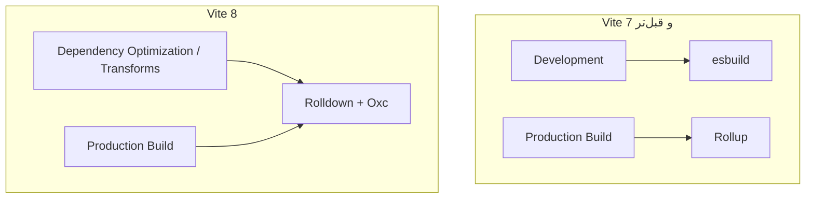

یه پروژهٔ فرانت‌اند رو تصور کن که چند سال از عمرش می‌گذره. اولش `pnpm build` توی چند ثانیه تموم می‌شد؛ حالا هر بار که یک تغییر کوچیک می‌دی، باید منتظر بمونی تا خروجی Production آماده بشه. اولین واکنش معمولاً اینه که سرور CI رو قوی‌تر کنیم یا کش بیشتری اضافه کنیم. ولی گاهی خود ابزار Build هم ارزش دوباره بررسی کردن داره.

**Vite 8** که ۱۲ مارس ۲۰۲۶ منتشر شد، یک تغییر مهم زیرِ کاپوت داره: به‌جای ترکیب قدیمی esbuild و Rollup، از **Rolldown** استفاده می‌کنه؛ یک Bundler نوشته‌شده با Rust. موضوع فقط سریع‌تر شدن نیست. تیم Vite می‌خواد تفاوت رفتار ابزار در Development و Production رو هم کمتر کنه.

می‌خوام ببینیم دقیقاً چی عوض شده، ادعای سرعت رو چطور باید بخونیم و اگر الان پروژه‌مون روی Vite 7 باشه، چطور بدون قمار کردن روی محیط Production مهاجرت کنیم.

## چرا Vite قبلاً دو تا ابزار داشت؟

در نسخه‌های قبل، Vite برای کارهای مختلف به دو ابزار تکیه می‌کرد:

- **esbuild** برای کارهایی مثل Dependency Pre-bundling و تبدیل سریع TypeScript/JSX در محیط توسعه.
- **Rollup** برای Bundle نهایی Production، تقسیم کد به Chunk و بهینه‌سازی خروجی.

این انتخاب در زمان خودش منطقی بود. لازم نبود Vite از صفر همه‌چیز رو بسازه؛ می‌تونست از سرعت esbuild و اکوسیستم پلاگین‌های Rollup استفاده کنه.

اما یک هزینهٔ پنهان داشت: دو مسیر پردازش متفاوت. اگر یک پکیج یا پلاگین در Dev درست کار می‌کرد، لزوماً معنی‌اش این نبود که خروجی Production هم دقیقاً همون رفتار رو داره. بخشی از پیچیدگی Vite صرف هماهنگ کردن این دو مسیر می‌شد.

این دیاگرام، تصویر ساده‌شدهٔ معماری قدیم و جدیده؛ قرار نیست تمام جزئیات داخلی Vite رو نشون بده:



نکتهٔ مهم: **Vite 8 به این معنی نیست که همهٔ ماژول‌های پروژه در حالت عادیِ Dev یک‌جا Bundle می‌شن.** شیوهٔ معمول توسعه هنوز از مزیت Native ESM استفاده می‌کنه. Bundled Dev Mode یک قابلیت جداگانه و آزمایشیه که پایین‌تر بهش می‌رسیم.

## Rolldown و Oxc هرکدوم چه نقشی دارن؟

اسم این دو ابزار کنار هم زیاد میاد و راحت می‌شه قاطی‌شون کرد.

**Rolldown** یک Bundler با API نزدیک به Rollup هست. کارهایی مثل دنبال کردن وابستگی ماژول‌ها، Tree-shaking، ساخت Chunk و تولید خروجی نهایی در محدودهٔ وظایفشه.

**Oxc** مجموعه‌ای از ابزارهای پردازش JavaScript/TypeScript هست؛ از Parser و Transformer تا بخش‌هایی که Rolldown برای پردازش کد ازشون استفاده می‌کنه.

پس Vite هنوز ابزار اصلی تجربهٔ توسعه و تنظیمات پروژه‌ست؛ Rolldown بخش Bundling رو انجام می‌ده و Oxc در لایهٔ پردازش کد کمک می‌کنه. یکی شدن این زنجیره می‌تونه هم هماهنگی رو بیشتر کنه و هم فرصت بهینه‌سازی بده.

اما «نوشته‌شده با Rust» به‌تنهایی تضمین نمی‌کنه هر پروژه‌ای سریع‌تر بشه. اندازهٔ کد، نوع پلاگین‌ها، مرحلهٔ Minify، Source Map و حتی وضعیت کش CI روی زمان نهایی اثر دارن.

## ادعای ۱۰ تا ۳۰ برابر سریع‌تر یعنی چی؟

در معرفی رسمی Vite 8، تیم پروژه می‌گه Rolldown در Benchmarkهای خودش **۱۰ تا ۳۰ برابر سریع‌تر از Rollup** عمل کرده. این عدد رو نباید با «کل Build پروژهٔ من حتماً ۳۰ برابر سریع می‌شه» یکی بدونیم.

در همون معرفی، چند نمونهٔ واقعی هم گزارش شده:

| پروژه | نتیجهٔ گزارش‌شده در معرفی رسمی |
| --- | --- |
| Linear | کاهش زمان Build از ۴۶ به ۶ ثانیه |
| Ramp | کاهش ۵۷ درصدی زمان Build |
| Mercedes-Benz.io | تا ۳۸ درصد کاهش |
| Beehiiv | کاهش ۶۴ درصدی |

این‌ها گزارش‌های منتشرشده توسط تیم Vite از پروژه‌های مشخص هستن، نه آزمایش مستقلی که من روی همهٔ پروژه‌ها انجام داده باشم. برای همین بهتره ازشون به‌عنوان نشانهٔ ظرفیت ابزار استفاده کنیم، نه قولِ سرعت برای پروژهٔ خودمون.

از اون طرف، تغییر Bundler می‌تونه خروجی Chunkها، رفتار بعضی پلاگین‌ها و حتی اندازهٔ Assetها رو تغییر بده. فقط زمان Build رو نگاه نکنیم؛ نتیجه‌ای که به کاربر تحویل می‌دیم هم مهمه.

## مهاجرت از Vite 7 به Vite 8، قدم‌به‌قدم

اگر پروژه‌ات ساده‌ست، احتمالاً ارتقا سخت نیست. ولی برای پروژه‌ای که چندین پلاگین، تنظیمات سفارشی و Build چندمرحله‌ای داره، من این مسیر رو ترجیح می‌دم.

### ۱. اول وضعیت فعلی رو ثبت کن

قبل از تغییر نسخه، روی برنچ جداگانه این‌ها رو یادداشت کن:

- نسخهٔ Node و Vite در Local و CI.
- مدت Build در چند اجرای مشابه، نه فقط یک بار.
- حجم JavaScript و CSS خروجی، تعداد Chunkها و هشدارهای Build.
- نتیجهٔ تست‌های خودکار و چند مسیر حیاتی اپلیکیشن.

برای اندازه‌گیری اولیه، می‌تونی چند بار فرمان زیر رو روی ماشین و شرایط یکسان اجرا کنی:

```bash
time pnpm build
```

اگر پروژه Cache یا کارهای اضافه مثل Type-check و تست رو در اسکریپت Build اجرا می‌کنه، مشخص کن دقیقاً داری چی رو اندازه می‌گیری. مقایسهٔ دو دستور متفاوت، نتیجهٔ قابل‌اعتمادی نمی‌ده.

### ۲. نسخهٔ Node رو بررسی کن

طبق راهنمای رسمی، Vite 8 به **Node.js 20.19+ یا 22.12+** نیاز داره. این رو هم در محیط توسعه و هم در Runnerهای CI چک کن؛ بالا آمدن پروژه روی لپ‌تاپ به‌معنی آماده بودن Pipeline نیست.

```bash
node --version
pnpm exec vite --version
```

اگر نسخهٔ Node پایین‌تر از حد پشتیبانی‌شده‌ست، قبل از ارتقای Vite اون رو اصلاح کن.

### ۳. روی برنچ آزمایشی ارتقا بده

برای پروژه‌ای که از pnpm استفاده می‌کنه:

```bash
pnpm up vite@8
pnpm install
pnpm build
```

این فقط مثالِ ارتقای وابستگی Vite هست. اگر از Astro، Nuxt، React Router یا ابزارهای دیگه‌ای استفاده می‌کنی که به Vite وابسته‌اند، قبلش سازگاری نسخه‌های Framework و پلاگین‌ها رو بررسی کن. الزاماً نباید Vite رو مستقل از Framework به‌روزرسانی کرد.

### ۴. تنظیمات قدیمی رو پیدا کن

Vite 8 برای سازگاری، بخشی از تنظیمات قبلی رو خودکار تبدیل می‌کنه؛ ولی بهتره بعد از ارتقا سراغ نام‌های جدید بری.

| تنظیم قدیمی | مسیر جدید |
| --- | --- |
| `build.rollupOptions` | `build.rolldownOptions` |
| `optimizeDeps.esbuildOptions` | `optimizeDeps.rolldownOptions` |
| `esbuild` برای Transform | `oxc` |

همهٔ گزینه‌ها تبدیل یک‌به‌یک ندارن. مثلاً بعضی تنظیمات پلاگین‌های esbuild فقط تا حدی پشتیبانی می‌شن. پس نباید کورکورانه اسم یک کلید رو عوض کنیم و فرض کنیم معنی‌اش همون مونده.

یک نمونهٔ ساده از تنظیم جدید Build:

```ts
import { defineConfig } from 'vite'

export default defineConfig({
  build: {
    rolldownOptions: {
      // تنظیمات سفارشی Rolldown در صورت نیاز
    },
  },
})
```

این مثال عمداً تنظیم خاصی اعمال نمی‌کنه؛ هدفش نشون دادن مسیر API جدیده. اگر الان تنظیم سفارشی نداری، لازم نیست برای «استفاده از Rolldown» این بخش رو اضافه کنی؛ Vite 8 خودش از Rolldown استفاده می‌کنه.

### ۵. پلاگین‌ها و خروجی واقعی رو تست کن

تیم Vite می‌گه بیشتر پلاگین‌های موجود بدون تغییر کار می‌کنن، ولی «بیشتر» با «همه» فرق داره. پلاگین‌هایی که به جزئیات Rollup، Babel یا esbuild وابسته‌ان، ارزش بررسی بیشتری دارن.

من بعد از ارتقا این سناریوها رو تست می‌کنم:

- اجرای Dev Server و Hot Module Replacement.
- Build تولیدی و باز کردن خروجی Preview.
- مسیرهای Lazy-loaded و Dynamic Import.
- Source Map و گزارش خطا در محیط تست.
- Assetها، CSS و Chunkهایی که Browser دانلود می‌کنه.
- مسیرهای SSR، اگر پروژه SSR داره.

تغییر پیش‌فرض Browser Target رو هم فراموش نکن. در Vite 8 حداقل نسخه‌های پیش‌فرض مرورگر نسبت به Vite 7 جلوتر رفته‌اند؛ مثلاً Chrome از 107 به 111 و Safari از 16.0 به 16.4. اگر هنوز باید مرورگر قدیمی‌تری رو پشتیبانی کنی، `build.target` رو آگاهانه تنظیم و تست کن.

### ۶. اگر پروژه پیچیده‌ست، دو مرحله‌ای برو

راهنمای رسمی یک مسیر میانی پیشنهاد می‌کنه: ابتدا روی Vite 7، پکیج آزمایشی `rolldown-vite` رو جایگزین کن تا تغییر Bundler رو جداگانه تست کنی؛ بعد سراغ Vite 8 برو. این روش برای پروژه‌هایی که پلاگین سفارشی زیادی دارن می‌تونه پیدا کردن علت Regression رو راحت‌تر کنه.

اما برای یک پروژهٔ ساده، همین مرحلهٔ میانی ممکنه فقط کار اضافه درست کنه. انتخابش بستگی به ریسک پروژه داره.

## قابلیت جالب Vite 8.1: Bundled Dev Mode

نسخهٔ 8.1 که ۲۳ ژوئن ۲۰۲۶ منتشر شد، **Bundled Dev Mode** رو به‌صورت آزمایشی معرفی کرد.

در روش معمول Vite، مرورگر می‌تونه تعداد زیادی ماژول ESM رو جداگانه درخواست کنه. این روش برای پروژه‌های کوچک و متوسط معمولاً خوب جواب می‌ده، اما وقتی تعداد ماژول‌ها خیلی زیاد می‌شه، هزینهٔ درخواست‌های متعدد و پردازش اون‌ها ممکنه محسوس بشه.

Bundled Dev Mode می‌خواد بخشی از این هزینه رو کم کنه. برای امتحان کردنش:

```ts
import { defineConfig } from 'vite'

export default defineConfig({
  experimental: {
    bundledDev: true,
  },
})
```

در تست اولیهٔ اعلام‌شده توسط تیم Vite روی اپلیکیشنی با ۱۰ هزار کامپوننت React، شروع کار حدود ۱۵ برابر و Full Reload حدود ۱۰ برابر سریع‌تر گزارش شده. این عددها مربوط به همون سناریوی آزمایش هستن، نه همهٔ پروژه‌ها.

**فعلاً برای Production Workflow روی این قابلیت حساب قطعی باز نکن.** مستندات رسمی هشدار می‌دن که بعضی پلاگین‌های شخص ثالث و قابلیت‌های کمتر رایج هنوز ممکنه با این حالت سازگار نباشن. اگر مشکل سرعت Dev Server نداری، روشن کردن یک قابلیت آزمایشی فقط به‌خاطر جدید بودنش ضرورتی نداره.

## سرعت Build تنها معیار موفقیت نیست

فرض کن Build از ۱۲۰ ثانیه به ۳۰ ثانیه رسیده. خبر خوبیه؛ ولی اگر خروجی JavaScript سنگین‌تر شده یا یک مسیر Lazy-load از کار افتاده، مهاجرت موفقی نداشتیم.

برای ارزیابی، من این چهار بُعد رو کنار هم می‌ذارم:

| معیار | سؤال عملی |
| --- | --- |
| Build time | میانگین و پراکندگی زمان Build در شرایط مشابه چقدره؟ |
| Output size | حجم JS/CSS فشرده و تعداد Chunkها چه تغییری کرده؟ |
| Runtime behavior | مسیرهای اصلی، Dynamic Import و HMR درست کار می‌کنن؟ |
| Maintainability | تنظیمات و پلاگین‌ها ساده‌تر شدن یا Workaround بیشتری لازم داریم؟ |

یک نکتهٔ دیگه هم هست: خود Vite 8 طبق اعلام رسمی حدود ۱۵ مگابایت حجم نصب بیشتری نسبت به Vite 7 داره؛ بخشی به‌خاطر Rolldown و بخشی به‌خاطر Lightning CSS. این عدد **حجم پکیج‌های ابزار Build** هست، نه لزوماً ۱۵ مگابایت اضافه در خروجی‌ای که کاربر دانلود می‌کنه.

برای تیمی که Build زیاد اجرا می‌کنه، حتی صرفه‌جویی متوسط در هر Pipeline می‌تونه ارزشمند باشه. ولی باید با دادهٔ خود پروژه تصمیم بگیریم، نه فقط Benchmark صفحهٔ معرفی.

## یک برنامهٔ کم‌ریسک برای تیم

اگر قرار باشه این تغییر رو روی پروژهٔ واقعی انجام بدم، کار رو این‌طوری تقسیم می‌کنم:

1. یک PR فقط برای ارتقای ابزار Build می‌سازم؛ تغییر فیچر رو قاطی‌اش نمی‌کنم.
2. Benchmark قبل و بعد رو در یک محیط ثابت می‌گیرم.
3. خروجی Build و تست‌های اصلی رو مقایسه می‌کنم.
4. روی محیط Staging، مسیرهای مهم و خطاهای Browser رو بررسی می‌کنم.
5. بعد از تأیید، Merge می‌کنم و یک راه Rollback مشخص نگه می‌دارم.

Rollback هم معمولاً باید با برگردوندن Lockfile و نسخه‌های وابستگی همراه باشه؛ فقط تغییر عدد نسخه در `package.json` کافی نیست.

برای پروژه‌ای که روی Framework خاصی بنا شده، مستندات مهاجرت همون Framework اولویت داره. تغییر Vite در لایهٔ زیرساخت Build اتفاق می‌افته و ممکنه Framework خودش زمان‌بندی و محدودیت سازگاری داشته باشه.

## بالاخره الان مهاجرت کنیم یا نه؟

اگر Build طولانی شده، پروژه پلاگین‌های نسبتاً استاندارد داره و CI قابل‌اعتمادی هم داری، **امتحان کردن Vite 8 روی یک برنچ جداگانه منطقیه**.

اگر محصول در آستانهٔ انتشار حساسه، پلاگین سفارشی پیچیده داری یا Framework هنوز نسخهٔ موردنیاز رو پشتیبانی نمی‌کنه، بهتره اول سازگاری رو روشن کنی. سریع‌تر بودن ابزار، دلیل کافی برای پذیرفتن ریسک بی‌حساب نیست.

چیزی که از Vite 8 برام جالبه فقط تغییر یک Bundler نیست؛ اینه که یک تصمیم معماری قدیمی—استفاده از دو مسیر پردازش برای دو نیاز متفاوت—بعد از چند سال دوباره بررسی شده. گاهی بهینه‌سازی واقعی از اضافه کردن کش و سرور قوی‌تر نمیاد؛ از کم کردن پیچیدگی خود مسیر میاد.

---

## منابع و مطالعهٔ بیشتر

- [معرفی رسمی Vite 8 — ۱۲ مارس ۲۰۲۶](https://vite.dev/blog/announcing-vite8)
- [معرفی رسمی Vite 8.1 — ۲۳ ژوئن ۲۰۲۶](https://vite.dev/blog/announcing-vite8-1)
- [راهنمای رسمی مهاجرت از Vite 7](https://vite.dev/guide/migration.html)
- [راهنمای Build در Vite](https://vite.dev/guide/build)
- [مخزن Vite در GitHub](https://github.com/vitejs/vite)
- [مخزن Rolldown در GitHub](https://github.com/rolldown/rolldown)
- [مخزن Oxc در GitHub](https://github.com/oxc-project/oxc)
