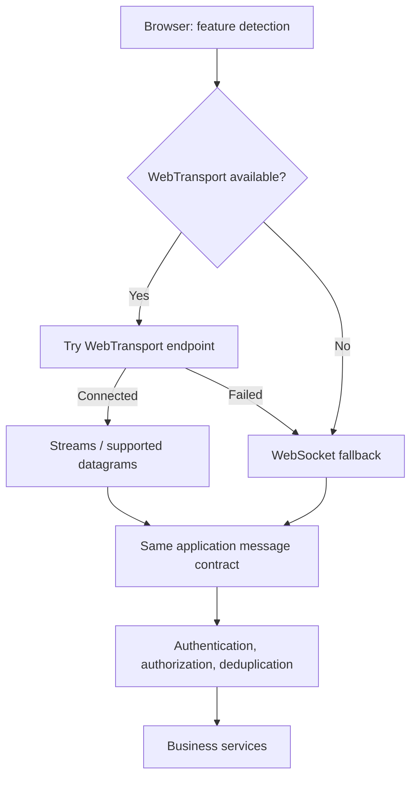

فرض کن یک داشبورد زنده داری که قیمت‌ها رو هر چند لحظه به‌روزرسانی می‌کنه. هم‌زمان کاربر باید بتونه یک دستور مهم بفرسته و تأیید قطعی دریافت کنه. برای همهٔ این پیام‌ها یک WebSocket باز کرده‌ای. کار می‌کنه؛ پس چرا باید به WebTransport فکر کنیم؟

جواب کوتاه اینه: **برای خیلی از محصولات اصلاً نباید مهاجرت کنیم.** اما اگر یک اتصال بلادرنگ داریم که چند نوع داده با حساسیت و رفتار متفاوت حمل می‌کنه، WebTransport گزینه‌ایه که ارزش آزمایش داره.

دلیل انتخاب این موضوع، قرار گرفتن WebTransport در مجموعهٔ **Baseline 2026** در مستندات MDN است. طبق MDN از مارس ۲۰۲۶ روی نسخه‌های جدید مرورگرهای اصلی در دسترس قرار گرفته، ولی این به معنی پشتیبانی همهٔ دستگاه‌های قدیمی یا همهٔ حالت‌های پروتکل نیست. [مستندات MDN](https://developer.mozilla.org/en-US/docs/Web/API/WebTransport_API)

## مشکل WebSocket دقیقاً چیه؟

WebSocket ارتباط دوطرفه و طولانی‌مدت بین مرورگر و سرور ایجاد می‌کنه. برای چت، اعلان، داشبورد و خیلی از برنامه‌های بلادرنگ انتخاب جاافتاده‌ایه. مشکلش این نیست که «کند» یا «قدیمی» شده؛ مشکل وقتی خودش رو نشون می‌ده که چند جریان منطقی متفاوت رو روی یک کانال مرتب و قابل‌اعتماد سوار می‌کنیم.

مثلاً در یک بازی چندنفره، وضعیت لحظه‌ای موقعیت بازیکن ممکنه بعد از رسیدن وضعیت جدید ارزش قبلیش رو از دست بده. اما پیام «خرید آیتم تأیید شد» باید قابل‌اعتماد و به‌ترتیب پردازش بشه. اگر همهٔ این‌ها رو داخل یک جریان بفرستیم، مدیریت اولویت، صف و بازیابی خطا پیچیده‌تر می‌شه.

WebTransport این انتخاب رو در سطح انتقال به ما می‌ده: **Streamهای قابل‌اعتماد** و در حالت HTTP/3، **Datagramهای غیرقابل‌اعتماد**.

## Stream و Datagram یعنی چی؟

| ویژگی | Stream | Datagram |
| --- | --- | --- |
| تحویل | قابل‌اعتماد و مرتب درون همان Stream | تضمین تحویل یا ترتیب ندارد |
| مناسب برای | فرمان، پاسخ، داده‌ای که نباید گم شود | موقعیت لحظه‌ای، نمونه‌های موقتی telemetry |
| رفتار هنگام ازدست‌رفتن بسته | بازیابی داده در انتقال | برنامه ممکن است داده را از دست بدهد |
| نکتهٔ مهم | چند Stream می‌توانند مستقل باشند | فقط وقتی انتقال زیرین پشتیبانی کند |

تفاوت کلیدی اینه که **Datagram برای پیام مهم مالی یا تغییر وضعیت پایدار مناسب نیست**. اگر از دست رفتن یک پیام می‌تونه نتیجهٔ کسب‌وکار رو عوض کنه، باید قرارداد سطح اپلیکیشن برای تأیید، شناسهٔ یکتا و تکرار امن داشته باشیم؛ حتی اگر از Stream قابل‌اعتماد استفاده کنیم.

## HTTP/3 و QUIC چه نقشی دارند؟

WebTransport معمولاً روی HTTP/3 کار می‌کنه و HTTP/3 از QUIC استفاده می‌کنه. QUIC چند Stream مستقل در اختیار اتصال می‌ذاره؛ از دست رفتن دادهٔ یک Stream لزوماً سایر Streamها رو مثل یک جریان واحد TCP معطل نمی‌کنه.

این به معنی حذف تمام تأخیرها نیست: ازدحام شبکه، محدودیت پهنای باند، منطق برنامه و صف‌های سمت سرور همچنان مهم‌اند. همچنین بعضی محیط‌ها UDP رو محدود می‌کنند. MDN قابلیت `WebTransport.supportsReliableOnly` رو توضیح داده که به پشتیبانی انتقال صرفاً قابل‌اعتماد، از جمله HTTP/2، مربوط می‌شه؛ در این حالت Datagram غیرقابل‌اعتماد در دسترس نیست.

[مستندات supportsReliableOnly](https://developer.mozilla.org/en-US/docs/Web/API/WebTransport/supportsReliableOnly_static)

## مقایسه با WebSocket و SSE

| نیاز | SSE | WebSocket | WebTransport |
| --- | --- | --- | --- |
| اعلان یک‌طرفه از سرور | بسیار مناسب | قابل انجام | قابل انجام، ولی معمولاً پیچیده‌تر |
| پیام دوطرفه | نیازمند مسیر جداگانه برای ارسال | مناسب | مناسب |
| Streamهای مستقل | خیر | نه به‌شکل بومی در API | بله |
| Datagram غیرقابل‌اعتماد | خیر | خیر | در انتقال سازگار |
| پیچیدگی زیرساخت | کم | متوسط | بیشتر؛ نیازمند پشتیبانی سرور و مسیر شبکه |

اگر صرفاً می‌خوایم وضعیت سفارش رو به صفحه برسونیم، SSE شاید کافی باشه. اگر چت یا اعلان دوطرفه داریم، WebSocket همچنان انتخاب منطقیه. WebTransport زمانی جذاب‌تر می‌شه که نیاز واقعی به چند Stream مستقل یا Datagram داشته باشیم.

## یک اتصال ساده در مرورگر

نمونهٔ زیر صرفاً ایجاد اتصال و بستن کنترل‌شدهٔ اون رو نشون می‌ده؛ برای کار کردن به سروری نیاز داریم که WebTransport رو پشتیبانی کنه.

```js
async function connectRealtime(url) {
  if (!("WebTransport" in globalThis)) {
    throw new Error("WebTransport is unavailable");
  }

  const transport = new WebTransport(url);

  try {
    await transport.ready;
    console.log("Connected");
    return transport;
  } catch (error) {
    transport.closed.catch(() => {});
    throw error;
  }
}

const transport = await connectRealtime(
  "https://realtime.example.com:443/session"
);

// در زمان خروج یا پایان نشست:
// transport.close({ closeCode: 0, reason: "Session ended" });
```

آدرس باید HTTPS باشه و در شکل اتصال HTTP/3 طبق مستندات MDN، پورت صریحاً در URL ذکر بشه. نمونهٔ بالا سرور واقعی ایجاد نمی‌کنه و فقط قرارداد سمت مرورگر رو نمایش می‌ده.

## ارسال یک فرمان قابل‌اعتماد

برای فرستادن یک پیام کوتاه می‌تونیم Stream یک‌طرفه بسازیم. در این مثال فرمت پیام آموزشی و قراردادیه؛ سرور باید همین فرمت رو بفهمه.

```js
async function sendCommand(transport, command) {
  const stream = await transport.createUnidirectionalStream();
  const writer = stream.getWriter();

  try {
    const payload = new TextEncoder().encode(
      JSON.stringify(command) + "\n"
    );
    await writer.write(payload);
  } finally {
    await writer.close();
    writer.releaseLock();
  }
}

await sendCommand(transport, {
  type: "subscribe",
  channel: "market-overview"
});
```

**نکته:** موفق شدن `writer.write()` یا `writer.close()` تأیید اجرای فرمان توسط کسب‌وکار نیست. برای عملیات حساس باید پاسخ سطح اپلیکیشن با شناسهٔ درخواست دریافت کنیم. بهتره هر پیام یک `requestId` داشته باشه و سرور اجرای تکراری رو مدیریت کنه.

## Datagram برای داده‌های زودگذر

اگر انتقال از Datagram پشتیبانی کنه، می‌شه آخرین وضعیت یک نشانگر یا نمونهٔ موقتی سنسور رو بدون الزام به تحویل تک‌تک پیام‌های قبلی ارسال کرد.

```js
async function sendEphemeralUpdate(transport, update) {
  if (transport.reliability === "reliable-only") {
    return false;
  }

  const writer = transport.datagrams.writable.getWriter();
  try {
    await writer.write(
      new TextEncoder().encode(JSON.stringify(update))
    );
    return true;
  } finally {
    writer.releaseLock();
  }
}
```

در عمل باید اندازهٔ Datagram، محدودیت‌های صف، زمان انقضا و نرخ ارسال رو هم کنترل کنیم. این نمونه صرفاً تفاوت API رو نشان می‌ده و برای Production به‌تنهایی کافی نیست.

## معماری پیشنهادی برای مهاجرت تدریجی



نکتهٔ مهم این نمودار، جدا کردن **قرارداد پیام اپلیکیشن** از **پروتکل انتقال**ه. اگر امروز WebSocket داریم، بهتره قبل از مهاجرت یک لایهٔ کوچک برای `connect`، `send`، `receive` و `close` تعریف کنیم. اون وقت می‌تونیم WebTransport رو فقط برای بخشی از کاربران فعال کنیم و در صورت شکست اتصال، بدون تغییر منطق کسب‌وکار به WebSocket برگردیم.

Fallback نباید باعث اجرای دوبارهٔ فرمان‌های حساس بشه. اگر وسط ارسال یک فرمان اتصال قطع شد، وضعیت اون فرمان ممکنه نامعلوم باشه. شناسهٔ یکتا و پاسخ قابل‌استعلام این مشکل رو بهتر از تکرار کورکورانه حل می‌کنه.

## امنیت: اتصال برقرار شد، ولی آیا مجازه؟

WebTransport به سرور سازگار نیاز داره. مستندات MDN توضیح می‌ده که هنگام برقراری نشست، درخواست `CONNECT` با پروتکل مشخص ارسال می‌شه و مرورگر `Origin` رو هم می‌فرسته؛ **سرور باید Origin رو بررسی کنه**.

ولی بررسی Origin جای احراز هویت و مجوز دسترسی رو نمی‌گیره. پیشنهاد من برای یک سرویس واقعی:

- هویت کاربر رو در زمان ساخت نشست بررسی کن؛ صرف وجود اتصال رو مجوز دسترسی به کانال‌ها فرض نکن.
- مجوز هر `subscribe` یا `command` رو سمت سرور بررسی کن، به‌خصوص در سیستم‌های چندسازمانی.
- تعداد اتصال‌ها، Streamها، نرخ پیام و اندازهٔ payload رو محدود کن.
- نشست‌های قطع‌شده و Streamهای نیمه‌باز رو پاک‌سازی کن.
- برای فرمان‌های حساس، idempotency و audit log مستقل از انتقال داشته باش.

در سناریوهای مالی، ارسال قیمت‌های لحظه‌ای می‌تونه ماهیت موقتی داشته باشه؛ اما ثبت سفارش، انتقال وجه یا تغییر مجوز کاربر هرگز نباید صرفاً با Datagram و بدون تأیید سطح کسب‌وکار انجام بشه.

## چطور بفهمیم مهاجرت ارزش داشته؟

قبل از تغییر، برای WebSocket فعلی baseline بگیر. بعد روی گروه آزمایشی WebTransport همین معیارها رو اندازه بگیر:

1. زمان برقراری اتصال و نرخ شکست آن، به تفکیک مرورگر و شبکه
2. تأخیر انتهابه‌انتهای پیام، به‌خصوص صدک ۹۵ و ۹۹
3. تعداد reconnect و مدت بازیابی نشست
4. مصرف CPU، حافظه و پهنای باند در مرورگر و سرور
5. نرخ پیام‌های حذف‌شده برای Datagram و رفتار اپلیکیشن هنگام حذف
6. هزینهٔ نگهداری و سازگاری Load Balancer، CDN و Firewall

این‌ها معیارهای پیشنهادی برای آزمایش‌اند، نه نتیجهٔ یک بنچمارک منتشرشده. اگر WebTransport روی شبکه‌های واقعی کاربران شکست بیشتری داشته باشه یا به زیرساخت پیچیده‌تری نیاز پیدا کنه، بهبود احتمالی تأخیر ممکنه توجیه اقتصادی نداشته باشه.

## چند اشتباه رایج

**«Baseline 2026 یعنی همه‌جا کار می‌کنه.»** نه؛ Baseline پوشش نسخه‌های جدید مرورگرهای اصلی رو توصیف می‌کنه. دستگاه‌های قدیمی و محدودیت‌های شبکه هنوز مهم‌اند.

**«Datagram سریع‌تره، پس همهٔ پیام‌ها رو با اون بفرستیم.»** از دست رفتن یا جابه‌جایی ترتیب پیام‌ها برای بعضی کاربردها قابل‌قبوله، برای بعضی نه.

**«QUIC مشکل کندی اپلیکیشن رو حل می‌کنه.»** اگر گلوگاه ما Query دیتابیس یا صف پردازش سروره، عوض کردن پروتکل انتقال درمانش نیست.

**«WebTransport جایگزین فوری WebSocket شده.»** هنوز برای خیلی از تیم‌ها هزینهٔ پیاده‌سازی، پشتیبانی و عیب‌یابی WebSocket کمتره.

## جمع‌بندی

WebTransport رو بهتره به چشم یک ابزار تازه برای **انتخاب رفتار انتقال هر نوع داده** ببینیم، نه یک دستور عمومی برای بازنویسی ارتباطات بلادرنگ. اگر یک کانال دوطرفهٔ قابل‌اعتماد تمام نیاز محصول رو پوشش می‌ده، WebSocket انتخاب خوبی باقی می‌مونه. اما اگر Streamهای مستقل و پیام‌های زودگذر داریم، یک آزمایش محدود WebTransport می‌تونه ارزشمند باشه.

من برای شروع، اول قرارداد پیام‌ها و معیارهای اندازه‌گیری رو مشخص می‌کنم، بعد یک مسیر آزمایشی با fallback می‌سازم و تازه با دادهٔ واقعی دربارهٔ مهاجرت تصمیم می‌گیرم.

---

## منابع و مطالعهٔ بیشتر

- [MDN — WebTransport API (Baseline 2026)](https://developer.mozilla.org/en-US/docs/Web/API/WebTransport_API)
- [MDN — WebTransport interface](https://developer.mozilla.org/en-US/docs/Web/API/WebTransport)
- [MDN — WebTransport constructor](https://developer.mozilla.org/en-US/docs/Web/API/WebTransport/WebTransport)
- [MDN — supportsReliableOnly](https://developer.mozilla.org/en-US/docs/Web/API/WebTransport/supportsReliableOnly_static)
- [W3C — WebTransport specification](https://w3c.github.io/webtransport/)
- [IETF RFC 9114 — HTTP/3](https://www.rfc-editor.org/rfc/rfc9114)
