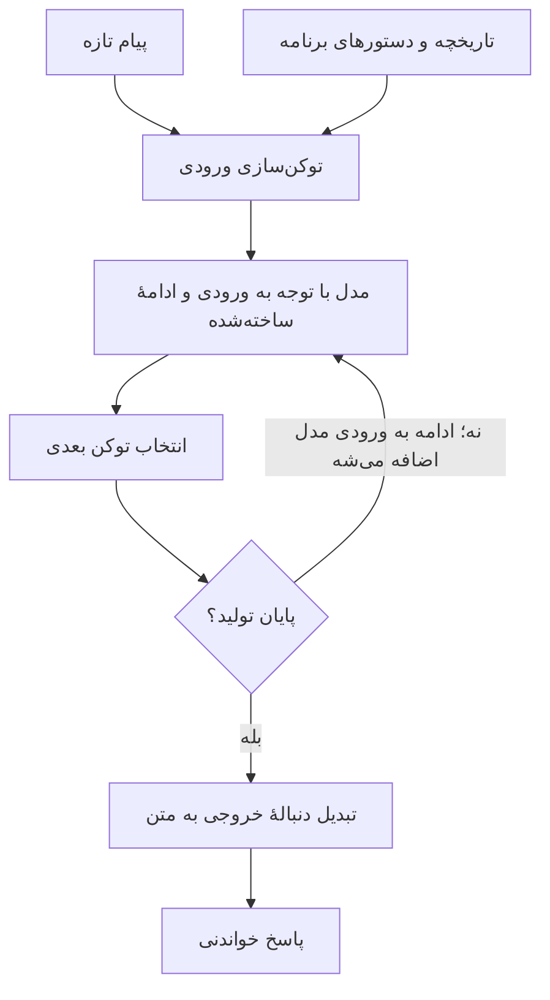
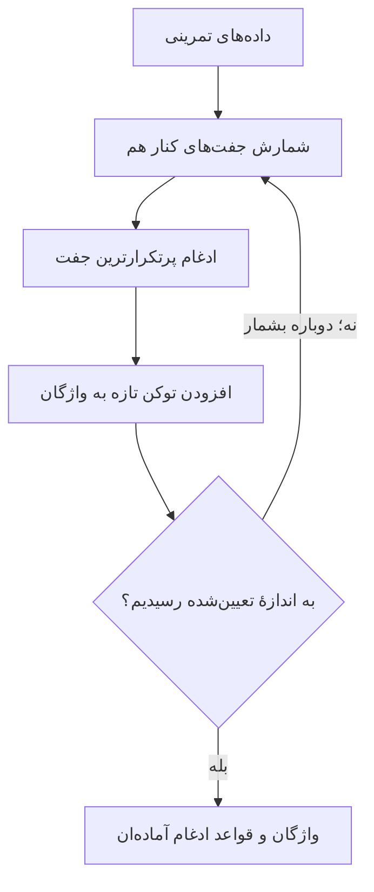

وقتی می‌خوایم با یک مدل زبانی کار کنیم، خیلی زود به کلمهٔ «توکن» می‌رسیم؛ مخصوصاً وقتی پای هزینه یا محدودیت طول متن وسط باشه. سؤال طبیعی هم اینه: چرا به‌جای تعداد کلمه‌ها، توکن می‌شمرن؟

جواب کوتاه اینه که مدل، متن رو دقیقاً با همون مرزبندی‌ای که ما می‌خونیم پردازش نمی‌کنه. بیایم این تفاوت رو باز کنیم.

## توکن یعنی یک تکه از متن، نه لزوماً یک کلمه

**توکن** می‌تونه یک کلمه، بخشی از کلمه یا یک نشانه باشه. فاصله هم ممکنه همراه تکهٔ بعدی یا به شکل دیگری در تقسیم‌بندی بیاد. «توکن‌ساز» یا Tokenizer این تقسیم‌بندی رو انجام می‌ده و برای هر تکه، یک شناسهٔ عددی می‌ذاره.

این جدول یک نمونهٔ کاملاً ساختگیه، فقط برای فهم مسیر؛ خروجی هیچ توکن‌ساز مشخصی نیست:

| ترتیب | تکهٔ متن | شناسهٔ فرضی |
| --- | --- | --- |
| ۱ | `سلام` | `101` |
| ۲ | ` دنیا`؛ با فاصلهٔ اولش | `202` |
| ۳ | `!` | `303` |

با همین جدول فرضی، «سلام دنیا!» می‌شه دنبالهٔ `101, 202, 303`. مسیر برعکس هم اینه: شناسه‌ها رو به تکه‌های متن برگردونیم و به ترتیب به هم بچسبونیم. به این دو کار Encoding و Decoding می‌گن؛ اینجا منظور رمزگذاری امنیتی نیست.

عدد بزرگ‌تر هم معنی مهم‌تر نمی‌ده؛ این عدد فقط شناسه‌ست.

## از پیام ما تا جواب مدل چه اتفاقی می‌افته؟

ورودی می‌تونه علاوه بر پیام تازه، تاریخچه و دستورهای برنامه رو هم شامل بشه. مدل با توجه به ورودی و ادامه‌ای که تا اون لحظه ساخته، توکن بعدی رو تولید می‌کنه:

این نمودار مسیر کلی رو نشون می‌ده؛ نمایش تکه‌تکهٔ پاسخ روی صفحه هم لازم نیست تا پایان تولید صبر کنه.

## توکن‌ساز چطور یاد می‌گیره متن رو تقسیم کنه؟

یکی از روش‌های رایج **BPE**ه. موقع آموزش توکن‌ساز، جفت‌های کنار هم شمرده می‌شن؛ پرتکرارترین جفت ادغام می‌شه و یک توکن تازه می‌سازه. این کار تکرار می‌شه تا واژگان به اندازهٔ تعیین‌شده برسه.

مثلاً در دادهٔ فرضی `ab ab ac`، جفت `a` و `b` دو بار تکرار شده و `a` و `c` یک بار. پس اولین ادغام می‌تونه ساختن `ab` باشه. تکه‌ها باید کنار هم باشن؛ نمی‌شه دو بخش هم‌پوشان رو روی هم گذاشت.

این آموزش، جدا از آموزش خود مدل زبانیه. وقتی بعداً پیام می‌فرستیم، توکن‌ساز معمولاً همون قواعد آماده رو اعمال می‌کنه، نه اینکه برای هر پیام از نو واژگان بسازه. در نوع بایت‌محور BPE، نقطهٔ شروع بایت‌ها هستن، نه الزاماً حرف‌های کامل. جزئیات این روش در منبع تکمیلی اول اومده.

## واژگان بزرگ‌تر چه فرقی داره؟

واژگان اینجا یعنی مجموعهٔ توکن‌های قابل‌شناسایی، نه فهرست کلمه‌هایی که مدل معنی‌شون رو می‌فهمه. اگر تکه‌های بلندتر و مناسب‌تری در اون باشن، یک متن ممکنه با توکن‌های کمتری نمایش داده بشه.

اما صرفاً با دیدن اندازهٔ واژگان نمی‌شه تعداد توکن یا کیفیت مدل رو پیش‌بینی کرد. برای مقایسه، من همون متن رو با توکن‌ساز هر مدل امتحان می‌کنم.

## اسم عجیب یا کلمهٔ تازه چی می‌شه؟

توکن‌ساز بایت‌محور می‌تونه متنی رو که قبلاً ندیده هم به بخش‌های کوچک‌تر بشکنه. لازم نیست هر اسم تازه، یک توکن مستقل داشته باشه. در ابزارهایی مثل tiktoken، تبدیل متن عادی به توکن و برگردوندنش به متن، برگشت‌پذیره.

بااین‌حال، قابل‌تبدیل‌بودن یک اسم به توکن به معنی فهمیدن اون نیست. مثلاً اگر اسم ساختگی «زومبافلو» رو توی پیام بذارم، صرف اینکه مدل بتونه دریافتش کنه ثابت نمی‌کنه اطلاعاتی درباره‌ش داره.

## برای متن فارسی، چی رو باید اندازه بگیریم؟

من برای یک پیام مثل «پرداخت انجام شد، ولی سفارش ثبت نشده» از روی تعداد کلمه‌ها هزینه حدس نمی‌زنم. متن واقعی رو با توکن‌ساز مربوط به مدل می‌سنجم؛ مستندات tiktoken هم انتخاب Encoding متناسب با مدل رو توضیح می‌ده.

برای امتحان، این سه شکل نوشتن رو کنار هم بذاریم:

| نمونه | چیزی که بررسی می‌کنیم |
| --- | --- |
| `می‌روم` | شکل دارای نیم‌فاصله |
| `می روم` | شکل دارای فاصله |
| `میروم` | شکل چسبیده |

این جدول ادعا نمی‌کنه کدوم کم‌توکن‌تره. یک تمرین برای دیدن تفاوت‌هاست؛ نتیجه رو باید اندازه گرفت. من هم املای درست و خوانایی رو فدای چند توکن کمتر نمی‌کنم.

در سرویس‌هایی که مصرف رو توکنی حساب می‌کنن، ورودی و خروجی ممکنه نرخ متفاوت داشته باشن. برای برآورد، هر دو رو جدا ببینیم و نرخ همون سرویس رو بررسی کنیم. کوتاه‌کردن جواب هم وقتی مفیده که اطلاعات لازم رو حذف نکنه.

خلاصهٔ حرفم: **توکن واحد پردازش متنه، نه مترادف کلمه یا معنی.** برای کار فارسی، اندازه‌گیری متن واقعی از هر نسبت سرانگشتی قابل‌اتکاتره.

---

**منابع تکمیلی برای جزئیات فنی:**

1. [آموزش BPE در Hugging Face](https://huggingface.co/learn/llm-course/en/chapter6/5)
2. [مستندات رسمی tiktoken](https://github.com/openai/tiktoken)
3. [راهنمای شمارش و مقایسهٔ توکن‌ها در OpenAI Cookbook](https://developers.openai.com/cookbook/examples/how_to_count_tokens_with_tiktoken)

**منبع اصلی:** [What Are Tokens? — AI Hero](https://www.aihero.dev/what-are-tokens)

## مسیر مطالعهٔ مبانی مدل‌های زبانی

این پنج مقاله رو می‌تونی به ترتیب زیر بخونی؛ جای مقالهٔ فعلی در جدول مشخص شده.

| مرحله | مقاله | چی یاد می‌گیریم؟ |
| --- | --- | --- |
| ۱ | [LLM چیست؟ مدل زبانی بزرگ چطور جواب می‌دهد؟](../what-is-an-llm-fa/) | آشنایی با آموزش مدل و نحوهٔ ساخت پاسخ |
| ۲ — **اینجایی** | [توکن چیست؟ مدل زبانی متن فارسی را چطور می‌خواند؟](../what-are-tokens-fa/) | شناخت واحدهای پردازش متن و شمارش مصرف |
| ۳ | [پنجرهٔ زمینه چیست؟ چرا مدل زبانی حرف‌های قبلی را جا می‌اندازد؟](../context-window-fa/) | فهم محدودیت طول ورودی و مدیریت زمینه |
| ۴ | [مهندسی پرامپت به زبان ساده؛ چطور دستور بهتری بنویسیم؟](../prompt-engineering-fa/) | نوشتن دستور روشن و ارزیابی پاسخ |
| ۵ | [برای انتخاب مدل زبانی چه چیزهایی را بسنجیم؟](../choosing-an-llm-fa/) | سنجیدن کیفیت، سرعت و هزینه برای انتخاب مدل |

**قدم بعدی:** [پنجرهٔ زمینه چیست؟ چرا مدل زبانی حرف‌های قبلی را جا می‌اندازد؟](../context-window-fa/)
